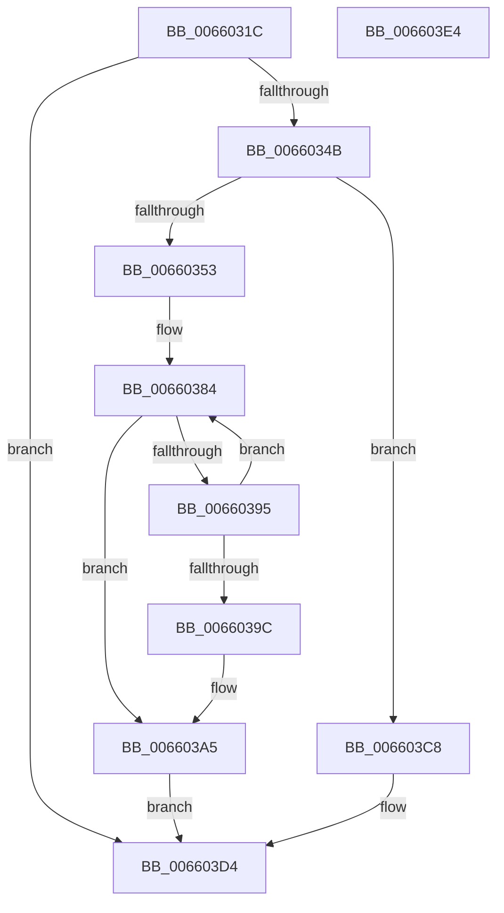

# WheaFlushETWEventsAddWorkRtn

- RVA: `0x0066031C`–`0x006603E5` (길이 `201` bytes)
- VA: `0x000000014066031C`
- 실행 섹션: `.text`
- PDB 이름 있음: `예`; PDB Function 태그: `아니요`
- unwind 정보 RVA: `0x000C8020`
- 디코드: `52`개 명령, `201/201` bytes 표시
- 미해석 바이트: `0` (있으면 어셈블리에 `.byte`로 보존)

> 이 문서는 커널 이미지의 기계어와 PDB 기호를 분석해 생성했습니다. 4번과 5번은 함수 원형과 자료형을 바이너리 사용 방식에서 추정한 C 해석이며 원본 소스 복구 결과는 아닙니다.

## 1. Dependencies

- 직접 호출 지점: **6**; 고유 호출 대상: **6**
- 직접 호출자로 확인된 함수: **1**
- RIP 상대 이미지 참조: **6**

### Outgoing calls
- `0x00660361` → [KeGetCurrentProcessorNumberEx](../40/KeGetCurrentProcessorNumberEx_function_00401690.md) (function, `0x00401690`)
- `0x0066038C` → [KeEnumerateNextProcessor](../41/KeEnumerateNextProcessor_function_00415480.md) (function, `0x00415480`)
- `0x006603A0` → [KeGetProcessorNumberFromIndex](../2D/KeGetProcessorNumberFromIndex_function_002DD320.md) (function, `0x002DD320`)
- `0x006603B0` → [KeSetTargetProcessorDpcEx](../2D/KeSetTargetProcessorDpcEx_function_002DD280.md) (function, `0x002DD280`)
- `0x006603C1` → [KeInsertQueueDpc](../20/KeInsertQueueDpc_function_00207C50.md) (function, `0x00207C50`)
- `0x006603CF` → [ExQueueWorkItem](../2F/ExQueueWorkItem_function_002F9520.md) (function, `0x002F9520`)

### Direct callers
- [WheaProcessWaitingETWEvents](WheaProcessWaitingETWEvents_function_006607A0.md) at `0x006607BC`

### Static image references
- `0x00660336` → RVA `0x00EF8EC0` (`.data`; read/write)
- `0x0066033D` → RVA `0x00EF8EC0` (`.data`; read)
- `0x00660366` → RVA `0x00FC7128` (`ALMOSTRO`; read)
- `0x00660375` → RVA `0x00FC7120` (`ALMOSTRO`; read)
- `0x006603A9` → RVA `0x00EF8E60` (`.data`; read)
- `0x006603C8` → RVA `0x00EF8EA0` (`.data`; read)

## 2. Other-region calls and transfers

- 다른 실행 섹션으로 향하는 call: **0**
- 별도 외부 분기/꼬리 이동을 확인하지 못했습니다.

## 3. Assembly (complete function range)

```asm
0066031C  48 89 5C 24 18                  mov qword ptr [rsp + 0x18], rbx
00660321  48 89 7C 24 20                  mov qword ptr [rsp + 0x20], rdi
00660326  55                              push rbp
00660327  48 8B EC                        mov rbp, rsp
0066032A  48 83 EC 40                     sub rsp, 0x40
0066032E  33 FF                           xor edi, edi
00660330  89 7D 10                        mov dword ptr [rbp + 0x10], edi
00660333  8D 57 01                        lea edx, [rdi + 1]
00660336  F0 01 15 83 8B 89 00            lock add dword ptr [rip + 0x898b83], edx
0066033D  8B 05 7D 8B 89 00               mov eax, dword ptr [rip + 0x898b7d]
00660343  3B C2                           cmp eax, edx
00660345  0F 8F 89 00 00 00               jg 0x1406603d4
0066034B  44 0F 20 C0                     mov rax, cr8
0066034F  3C 02                           cmp al, 2
00660351  76 75                           jbe 0x1406603c8
00660353  48 8D 4D 10                     lea rcx, [rbp + 0x10]
00660357  89 7D F2                        mov dword ptr [rbp - 0xe], edi
0066035A  66 89 7D F6                     mov word ptr [rbp - 0xa], di
0066035E  89 7D 18                        mov dword ptr [rbp + 0x18], edi
00660361  E8 2A 13 DA FF                  call 0x140401690
00660366  48 8B 05 BB 6D 96 00            mov rax, qword ptr [rip + 0x966dbb]
0066036D  0F B6 5D 12                     movzx ebx, byte ptr [rbp + 0x12]
00660371  48 89 45 E8                     mov qword ptr [rbp - 0x18], rax
00660375  48 8D 05 A4 6D 96 00            lea rax, [rip + 0x966da4]
0066037C  48 89 45 E0                     mov qword ptr [rbp - 0x20], rax
00660380  66 89 7D F0                     mov word ptr [rbp - 0x10], di
00660384  48 8D 55 E0                     lea rdx, [rbp - 0x20]
00660388  48 8D 4D 18                     lea rcx, [rbp + 0x18]
0066038C  E8 EF 50 DB FF                  call 0x140415480
00660391  85 C0                           test eax, eax
00660393  75 10                           jne 0x1406603a5
00660395  8B 4D 18                        mov ecx, dword ptr [rbp + 0x18]
00660398  3B CB                           cmp ecx, ebx
0066039A  74 E8                           je 0x140660384
0066039C  48 8D 55 10                     lea rdx, [rbp + 0x10]
006603A0  E8 7B CF C7 FF                  call 0x1402dd320
006603A5  48 8D 55 10                     lea rdx, [rbp + 0x10]
006603A9  48 8D 0D B0 8A 89 00            lea rcx, [rip + 0x898ab0]
006603B0  E8 CB CE C7 FF                  call 0x1402dd280
006603B5  45 33 C0                        xor r8d, r8d
006603B8  48 8D 0D A1 8A 89 00            lea rcx, [rip + 0x898aa1]
006603BF  33 D2                           xor edx, edx
006603C1  E8 8A 78 BA FF                  call 0x140207c50
006603C6  EB 0C                           jmp 0x1406603d4
006603C8  48 8D 0D D1 8A 89 00            lea rcx, [rip + 0x898ad1]
006603CF  E8 4C 91 C9 FF                  call 0x1402f9520
006603D4  48 8B 5C 24 60                  mov rbx, qword ptr [rsp + 0x60]
006603D9  48 8B 7C 24 68                  mov rdi, qword ptr [rsp + 0x68]
006603DE  48 83 C4 40                     add rsp, 0x40
006603E2  5D                              pop rbp
006603E3  C3                              ret
006603E4  CC                              int3
```

## 4. C-style interpretation (structured pseudocode)

```c
__int64 __fastcall WheaFlushETWEventsAddWorkRtn(__int64 a1, __int64 a2, int a3)
{
    __int64 result;
    __int64 v_rdi;
    __int64 v_rsp;
    unsigned __int16 v_stack_m12;
    unsigned int v_stack_m16;
    unsigned __int16 v_stack_m18;
    unsigned __int64 v_stack_m20;
    unsigned __int64 v_stack_m28;
    unsigned int v_stack_p10;
    unsigned __int64 v_stack_p18;
    unsigned __int64 v_stack_p20;
    unsigned int v_stack_p8;
    unsigned __int8 v_stack_pA;

    v_stack_p18 = v_rbx;
    v_stack_p20 = v_rdi;
    v_rsp = (v_rsp) - (64);
    v_rdi = 0;
    v_stack_p8 = 0;
    if (((unsigned int)((unsigned int)(*(unsigned int *)(v_rip + 9014141)))) > ((unsigned int)(v_rdi + 1))) goto loc_006603D4;
    if (((unsigned __int8)(v_cr8)) <= 2) goto loc_006603C8;
    v_stack_m16 = 0;
    v_stack_m12 = 0;
    v_stack_p10 = 0;
    result = KeGetCurrentProcessorNumberEx(v_stack_p8, v_rdi + 1, a3, a4);
    v_stack_m20 = *(unsigned __int64 *)(v_rip + 9858491);
    v_stack_m28 = v_rip + 9858468;
    v_stack_m18 = 0;
loc_00660384:
    result = KeEnumerateNextProcessor(v_stack_p10, v_stack_m28, a3, a4);
    if ((unsigned int)(result) != 0) goto loc_006603A5;
    if (((unsigned int)((unsigned int)(v_stack_p10))) == ((unsigned int)(v_stack_pA))) goto loc_00660384;
    result = KeGetProcessorNumberFromIndex((unsigned int)(v_stack_p10), v_stack_p8, a3, a4);
loc_006603A5:
    result = KeSetTargetProcessorDpcEx(v_rip + 9013936, v_stack_p8, a3, a4);
    a3 = 0;
    a2 = 0;
    result = KeInsertQueueDpc(v_rip + 9013921, a2, a3, a4);
    goto loc_006603D4;
loc_006603C8:
    result = ExQueueWorkItem(v_rip + 9013969, a2, a3, a4);
loc_006603D4:
    v_rsp = (v_rsp) + (64);
    return result;
}
```

## 5. (Beta) C Style

```c
int64_t WheaFlushETWEventsAddWorkRtn(int64_t Arg1, int64_t Arg2, int32_t Arg3)
{
    int64_t result;
    int64_t local_rdi;
    int64_t local_rsp;
    uint16_t v_stack_m12;
    uint32_t v_stack_m16;
    uint16_t v_stack_m18;
    uint64_t v_stack_m20;
    uint64_t v_stack_m28;
    uint32_t v_stack_p10;
    uint64_t v_stack_p18;
    uint64_t v_stack_p20;
    uint32_t v_stack_p8;
    uint8_t v_stack_pA;

    v_stack_p18 = local_rbx;
    v_stack_p20 = local_rdi;
    local_rsp = (local_rsp) - (64);
    local_rdi = 0;
    v_stack_p8 = 0;
    if (((uint32_t)((uint32_t)(*(uint32_t *)(v_rip + 0x898B7D)))) > ((uint32_t)(local_rdi + 1))) goto loc_006603D4;
    if (((uint8_t)(v_cr8)) <= 2) goto loc_006603C8;
    v_stack_m16 = 0;
    v_stack_m12 = 0;
    v_stack_p10 = 0;
    result = KeGetCurrentProcessorNumberEx(v_stack_p8, local_rdi + 1, Arg3, a4);
    v_stack_m20 = *(uint64_t *)(v_rip + 0x966DBB);
    v_stack_m28 = v_rip + 9858468;
    v_stack_m18 = 0;
loc_00660384:
    result = KeEnumerateNextProcessor(v_stack_p10, v_stack_m28, Arg3, a4);
    if ((uint32_t)(result) != 0) goto loc_006603A5;
    if (((uint32_t)((uint32_t)(v_stack_p10))) == ((uint32_t)(v_stack_pA))) goto loc_00660384;
    result = KeGetProcessorNumberFromIndex((uint32_t)(v_stack_p10), v_stack_p8, Arg3, a4);
loc_006603A5:
    result = KeSetTargetProcessorDpcEx(v_rip + 9013936, v_stack_p8, Arg3, a4);
    Arg3 = 0;
    Arg2 = 0;
    result = KeInsertQueueDpc(v_rip + 9013921, Arg2, Arg3, a4);
    goto loc_006603D4;
loc_006603C8:
    result = ExQueueWorkItem(v_rip + 9013969, Arg2, Arg3, a4);
loc_006603D4:
    local_rsp = (local_rsp) + (64);
    return result;
}
```

## 6. Execution-region graph

[열기: 2D/3D 그래프와 함수 탐색 컨트롤 패널](../../../control-panel.html?section=text&rva=0x0066031C&view=graph)

- 2D 그래프는 위에서 아래로 흐르고, 3D 그래프는 빈 공간을 드래그해 회전합니다. Shift+드래그는 이동, 휠은 확대·축소, 함수 노드 선택은 대상 보고서 이동입니다.

### Static fallback


