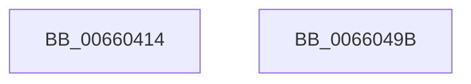

# WheaFlushETWEventsDpcWorkerInit

- RVA: `0x00660414`–`0x0066049C` (길이 `136` bytes)
- VA: `0x0000000140660414`
- 실행 섹션: `.text`
- PDB 이름 있음: `예`; PDB Function 태그: `아니요`
- unwind 정보 RVA: `0x0005CF00`
- 디코드: `26`개 명령, `136/136` bytes 표시
- 미해석 바이트: `0` (있으면 어셈블리에 `.byte`로 보존)

> 이 문서는 커널 이미지의 기계어와 PDB 기호를 분석해 생성했습니다. 4번과 5번은 함수 원형과 자료형을 바이너리 사용 방식에서 추정한 C 해석이며 원본 소스 복구 결과는 아닙니다.

## 1. Dependencies

- 직접 호출 지점: **1**; 고유 호출 대상: **1**
- 직접 호출자로 확인된 함수: **1**
- RIP 상대 이미지 참조: **15**

### Outgoing calls
- `0x0066042A` → [memset](../6C/memset_function_006C6C40.md) (function, `0x006C6C40`)

### Direct callers
- [WheapEtwEnableCallback](../../page/7D/WheapEtwEnableCallback_function_007D83D0.md) at `0x007D83DF`

### Static image references
- `0x0066041C` → RVA `0x00EF8E60` (`.data`; read)
- `0x00660431` → RVA `0x00EF8E60` (`.data`; write)
- `0x0066043B` → RVA `0x006603F0` (`WheaFlushETWEventsDpcRoutine`; read)
- `0x00660442` → RVA `0x00EF8E80` (`.data`; write)
- `0x00660449` → RVA `0x00EF8E78` (`.data`; write)
- `0x00660450` → RVA `0x006604B0` (`WheaFlushETWEventsWorkerRoutine`; read)
- `0x00660457` → RVA `0x00EF8EB0` (`.data`; write)
- `0x0066045E` → RVA `0x007D8680` (`WheapProcessWaitingETWEvents`; read)
- `0x00660465` → RVA `0x00EF8EC8` (`.data`; write)
- `0x0066046C` → RVA `0x00EF8E98` (`.data`; write)
- `0x00660473` → RVA `0x00EF8E70` (`.data`; write)
- `0x0066047A` → RVA `0x00EF8EB8` (`.data`; write)
- `0x00660481` → RVA `0x00EF8EA0` (`.data`; write)
- `0x00660488` → RVA `0x00EF8EC0` (`.data`; write)
- `0x0066048E` → RVA `0x00EEF578` (`.data`; write)

## 2. Other-region calls and transfers

- 다른 실행 섹션으로 향하는 call: **0**
- 별도 외부 분기/꼬리 이동을 확인하지 못했습니다.

## 3. Assembly (complete function range)

```asm
00660414  40 53                           push rbx
00660416  48 83 EC 20                     sub rsp, 0x20
0066041A  33 D2                           xor edx, edx
0066041C  48 8D 1D 3D 8A 89 00            lea rbx, [rip + 0x898a3d]
00660423  48 8B CB                        mov rcx, rbx
00660426  44 8D 42 70                     lea r8d, [rdx + 0x70]
0066042A  E8 11 68 06 00                  call 0x1406c6c40
0066042F  33 C9                           xor ecx, ecx
00660431  C7 05 25 8A 89 00 13 01 00 00   mov dword ptr [rip + 0x898a25], 0x113
0066043B  48 8D 05 AE FF FF FF            lea rax, [rip - 0x52]
00660442  48 89 1D 37 8A 89 00            mov qword ptr [rip + 0x898a37], rbx
00660449  48 89 05 28 8A 89 00            mov qword ptr [rip + 0x898a28], rax
00660450  48 8D 05 59 00 00 00            lea rax, [rip + 0x59]
00660457  48 89 05 52 8A 89 00            mov qword ptr [rip + 0x898a52], rax
0066045E  48 8D 05 1B 82 17 00            lea rax, [rip + 0x17821b]
00660465  48 89 05 5C 8A 89 00            mov qword ptr [rip + 0x898a5c], rax
0066046C  48 89 0D 25 8A 89 00            mov qword ptr [rip + 0x898a25], rcx
00660473  48 89 0D F6 89 89 00            mov qword ptr [rip + 0x8989f6], rcx
0066047A  48 89 1D 37 8A 89 00            mov qword ptr [rip + 0x898a37], rbx
00660481  48 89 0D 18 8A 89 00            mov qword ptr [rip + 0x898a18], rcx
00660488  89 0D 32 8A 89 00               mov dword ptr [rip + 0x898a32], ecx
0066048E  C6 05 E3 F0 88 00 01            mov byte ptr [rip + 0x88f0e3], 1
00660495  48 83 C4 20                     add rsp, 0x20
00660499  5B                              pop rbx
0066049A  C3                              ret
0066049B  CC                              int3
```

## 4. C-style interpretation (structured pseudocode)

```c
__int64 __fastcall WheaFlushETWEventsDpcWorkerInit(__int64 a1, int a2)
{
    __int64 result;
    __int64 v_rsp;

    v_rsp = (v_rsp) - (32);
    a2 = 0;
    result = memset(v_rip + 9013821, a2, a2 + 112, a4);
    a1 = 0;
    *(unsigned int *)(v_rip + 9013797) = 275;
    *(unsigned __int64 *)(v_rip + 9013815) = v_rip + 9013821;
    *(unsigned __int64 *)(v_rip + 9013800) = v_rip - 82;
    *(unsigned __int64 *)(v_rip + 9013842) = v_rip + 89;
    *(unsigned __int64 *)(v_rip + 9013852) = v_rip + 1540635;
    *(unsigned __int64 *)(v_rip + 9013797) = 0;
    *(unsigned __int64 *)(v_rip + 9013750) = 0;
    *(unsigned __int64 *)(v_rip + 9013815) = v_rip + 9013821;
    *(unsigned __int64 *)(v_rip + 9013784) = 0;
    *(unsigned int *)(v_rip + 9013810) = 0;
    *(unsigned __int8 *)(v_rip + 8974563) = 1;
    v_rsp = (v_rsp) + (32);
    return v_rip + 1540635;
}
```

## 5. (Beta) C Style

```c
int64_t WheaFlushETWEventsDpcWorkerInit(int64_t Arg1, int32_t Arg2)
{
    int64_t result;
    int64_t local_rsp;

    local_rsp = (local_rsp) - (32);
    Arg2 = 0;
    result = memset(v_rip + 9013821, Arg2, Arg2 + 112, a4);
    Arg1 = 0;
    *(uint32_t *)(v_rip + 0x898A25) = 275;
    *(uint64_t *)(v_rip + 0x898A37) = v_rip + 9013821;
    *(uint64_t *)(v_rip + 0x898A28) = v_rip - 82;
    *(uint64_t *)(v_rip + 0x898A52) = v_rip + 89;
    *(uint64_t *)(v_rip + 0x898A5C) = v_rip + 1540635;
    *(uint64_t *)(v_rip + 0x898A25) = 0;
    *(uint64_t *)(v_rip + 0x8989F6) = 0;
    *(uint64_t *)(v_rip + 0x898A37) = v_rip + 9013821;
    *(uint64_t *)(v_rip + 0x898A18) = 0;
    *(uint32_t *)(v_rip + 0x898A32) = 0;
    *(uint8_t *)(v_rip + 0x88F0E3) = 1;
    local_rsp = (local_rsp) + (32);
    return v_rip + 1540635;
}
```

## 6. Execution-region graph

[열기: 2D/3D 그래프와 함수 탐색 컨트롤 패널](../../../control-panel.html?section=text&rva=0x00660414&view=graph)

- 2D 그래프는 위에서 아래로 흐르고, 3D 그래프는 빈 공간을 드래그해 회전합니다. Shift+드래그는 이동, 휠은 확대·축소, 함수 노드 선택은 대상 보고서 이동입니다.

### Static fallback


