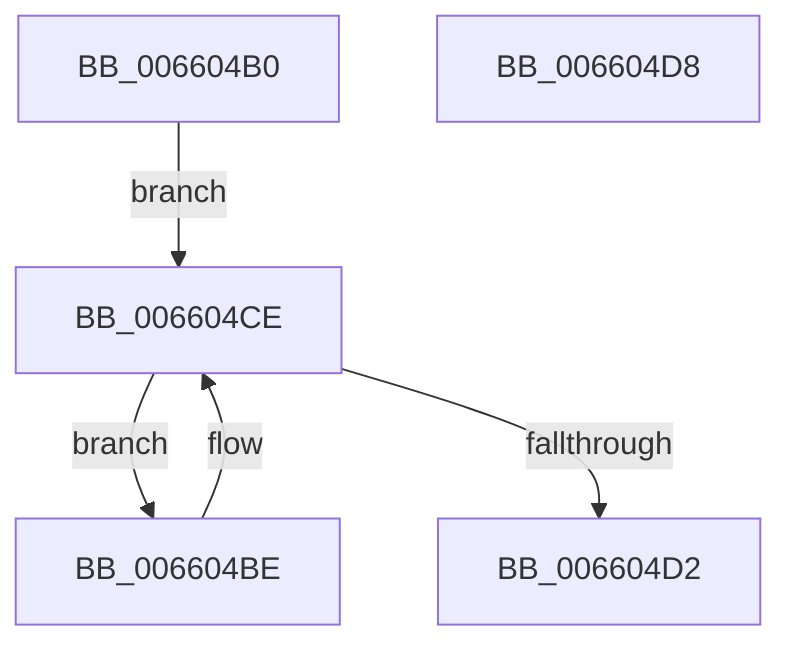

# WheaFlushETWEventsWorkerRoutine

- RVA: `0x006604B0`–`0x006604D9` (길이 `41` bytes)
- VA: `0x00000001406604B0`
- 실행 섹션: `.text`
- PDB 이름 있음: `예`; PDB Function 태그: `아니요`
- unwind 정보 RVA: `0x0005CF00`
- 디코드: `15`개 명령, `41/41` bytes 표시
- 미해석 바이트: `0` (있으면 어셈블리에 `.byte`로 보존)

> 이 문서는 커널 이미지의 기계어와 PDB 기호를 분석해 생성했습니다. 4번과 5번은 함수 원형과 자료형을 바이너리 사용 방식에서 추정한 C 해석이며 원본 소스 복구 결과는 아닙니다.

## 1. Dependencies

- 직접 호출 지점: **1**; 고유 호출 대상: **1**
- 직접 호출자로 확인된 함수: **0**
- RIP 상대 이미지 참조: **0**

### Outgoing calls
- `0x006604C2` → [guard_dispatch_icall](../6B/guard_dispatch_icall_function_006BAAD0.md) (function, `0x006BAAD0`)

### Direct callers
- 이 함수 시작 RVA로 연결되는 직접 call은 확인되지 않았습니다. 간접 호출은 완전히 역산할 수 없습니다.

### Static image references
- 디코드된 RIP-relative 메모리 참조가 없습니다.

## 2. Other-region calls and transfers

- 다른 실행 섹션으로 향하는 call: **0**
- 별도 외부 분기/꼬리 이동을 확인하지 못했습니다.

## 3. Assembly (complete function range)

```asm
006604B0  40 53                           push rbx
006604B2  48 83 EC 20                     sub rsp, 0x20
006604B6  8B 41 60                        mov eax, dword ptr [rcx + 0x60]
006604B9  48 8B D9                        mov rbx, rcx
006604BC  EB 10                           jmp 0x1406604ce
006604BE  48 8B 43 68                     mov rax, qword ptr [rbx + 0x68]
006604C2  E8 09 A6 05 00                  call 0x1406baad0
006604C7  F0 FF 4B 60                     lock dec dword ptr [rbx + 0x60]
006604CB  8B 43 60                        mov eax, dword ptr [rbx + 0x60]
006604CE  85 C0                           test eax, eax
006604D0  7F EC                           jg 0x1406604be
006604D2  48 83 C4 20                     add rsp, 0x20
006604D6  5B                              pop rbx
006604D7  C3                              ret
006604D8  CC                              int3
```

## 4. C-style interpretation (structured pseudocode)

```c
__int64 __fastcall WheaFlushETWEventsWorkerRoutine(__int64 a1)
{
    __int64 result;
    __int64 v_rsp;

    v_rsp = (v_rsp) - (32);
    goto loc_006604CE;
loc_006604BE:
    result = guard_dispatch_icall(a1, a2, a3, a4);
loc_006604CE:
    if (condition_is_greater) goto loc_006604BE;
    v_rsp = (v_rsp) + (32);
    return (unsigned int)(*(unsigned int *)(a1 + 96));
}
```

## 5. (Beta) C Style

```c
int64_t WheaFlushETWEventsWorkerRoutine(void *Arg1)
{
    uint8_t *arg1 = (uint8_t *)Arg1;

    int64_t result;
    int64_t local_rsp;

    local_rsp = (local_rsp) - (32);
    goto loc_006604CE;
loc_006604BE:
    result = guard_dispatch_icall(Arg1, a2, a3, a4);
loc_006604CE:
    if (condition_is_greater) goto loc_006604BE;
    local_rsp = (local_rsp) + (32);
    return (uint32_t)(*(uint32_t *)(arg1 + 0x60));
}
```

### 관측된 메모리 오프셋

구조체 형식이 확인되지 않은 접근은 인자 기준의 오프셋으로만 기록했습니다.

| 기준 인자 | 오프셋 표현 | 폭 (bit) | 접근 |
|---|---:|---:|---|
| `Arg1` | `+ 0x60` | `32` | `R` |
| `Arg1` | `+ 0x60` | `32` | `R/W` |
| `Arg1` | `+ 0x68` | `64` | `R` |

## 6. Execution-region graph

[열기: 2D/3D 그래프와 함수 탐색 컨트롤 패널](../../../control-panel.html?section=text&rva=0x006604B0&view=graph)

- 2D 그래프는 위에서 아래로 흐르고, 3D 그래프는 빈 공간을 드래그해 회전합니다. Shift+드래그는 이동, 휠은 확대·축소, 함수 노드 선택은 대상 보고서 이동입니다.

### Static fallback


