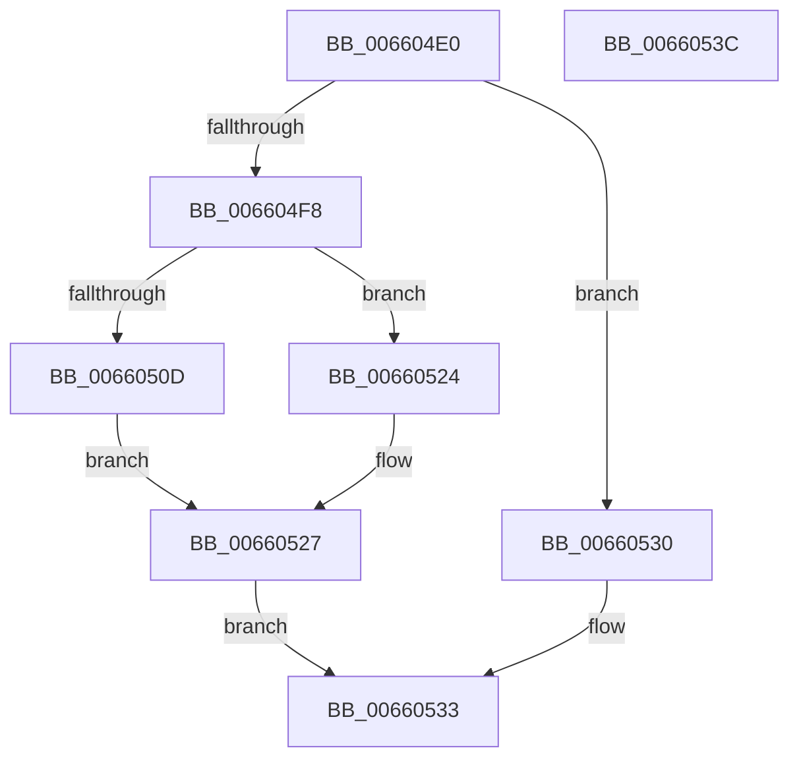

# WheaHighIrqlLogSelEventHandlerRegister

- RVA: `0x006604E0`–`0x0066053D` (길이 `93` bytes)
- VA: `0x00000001406604E0`
- 실행 섹션: `.text`
- PDB 이름 있음: `예`; PDB Function 태그: `아니요`
- unwind 정보 RVA: `0x0005CF00`
- 디코드: `25`개 명령, `93/93` bytes 표시
- 미해석 바이트: `0` (있으면 어셈블리에 `.byte`로 보존)

> 이 문서는 커널 이미지의 기계어와 PDB 기호를 분석해 생성했습니다. 4번과 5번은 함수 원형과 자료형을 바이너리 사용 방식에서 추정한 C 해석이며 원본 소스 복구 결과는 아닙니다.

## 1. Dependencies

- 직접 호출 지점: **1**; 고유 호출 대상: **1**
- 직접 호출자로 확인된 함수: **0**
- RIP 상대 이미지 참조: **5**

### Outgoing calls
- `0x006604FF` → [WheapHighIrqlLogSelEventHandlerAcquireLock](WheapHighIrqlLogSelEventHandlerAcquireLock_function_006608E8.md) (function, `0x006608E8`)

### Direct callers
- 이 함수 시작 RVA로 연결되는 직접 call은 확인되지 않았습니다. 간접 호출은 완전히 역산할 수 없습니다.

### Static image references
- `0x006604EC` → RVA `0x00EF9F00` (`.data`; read)
- `0x0066050D` → RVA `0x00EF9F08` (`.data`; write)
- `0x00660514` → RVA `0x00EF9F10` (`.data`; write)
- `0x0066051B` → RVA `0x00EF9F00` (`.data`; write)
- `0x00660527` → RVA `0x00EF9F04` (`.data`; read/write)

## 2. Other-region calls and transfers

- 다른 실행 섹션으로 향하는 call: **0**
- 별도 외부 분기/꼬리 이동을 확인하지 못했습니다.

## 3. Assembly (complete function range)

```asm
006604E0  40 53                           push rbx
006604E2  48 83 EC 20                     sub rsp, 0x20
006604E6  45 33 C9                        xor r9d, r9d
006604E9  4C 8B DA                        mov r11, rdx
006604EC  44 39 0D 0D 9A 89 00            cmp dword ptr [rip + 0x899a0d], r9d
006604F3  48 8B D9                        mov rbx, rcx
006604F6  75 38                           jne 0x140660530
006604F8  45 8D 51 01                     lea r10d, [r9 + 1]
006604FC  41 8A CA                        mov cl, r10b
006604FF  E8 E4 03 00 00                  call 0x1406608e8
00660504  44 39 0D F5 99 89 00            cmp dword ptr [rip + 0x8999f5], r9d
0066050B  75 17                           jne 0x140660524
0066050D  48 89 1D F4 99 89 00            mov qword ptr [rip + 0x8999f4], rbx
00660514  4C 89 1D F5 99 89 00            mov qword ptr [rip + 0x8999f5], r11
0066051B  44 89 15 DE 99 89 00            mov dword ptr [rip + 0x8999de], r10d
00660522  EB 03                           jmp 0x140660527
00660524  45 8A D1                        mov r10b, r9b
00660527  44 87 0D D6 99 89 00            xchg dword ptr [rip + 0x8999d6], r9d
0066052E  EB 03                           jmp 0x140660533
00660530  45 8A D1                        mov r10b, r9b
00660533  41 8A C2                        mov al, r10b
00660536  48 83 C4 20                     add rsp, 0x20
0066053A  5B                              pop rbx
0066053B  C3                              ret
0066053C  CC                              int3
```

## 4. C-style interpretation (structured pseudocode)

```c
__int64 __fastcall WheaHighIrqlLogSelEventHandlerRegister(__int64 a1, __int64 a2, __int64 a3, int a4)
{
    __int64 result;
    __int64 v_rsp;

    v_rsp = (v_rsp) - (32);
    a4 = 0;
    if ((*(unsigned int *)(v_rip + 9017869)) != 0) goto loc_00660530;
    result = WheapHighIrqlLogSelEventHandlerAcquireLock((unsigned __int8)(a4 + 1), a2, a3, a4);
    if ((*(unsigned int *)(v_rip + 9017845)) != 0) goto loc_00660524;
    *(unsigned __int64 *)(v_rip + 9017844) = a1;
    *(unsigned __int64 *)(v_rip + 9017845) = a2;
    *(unsigned int *)(v_rip + 9017822) = (unsigned int)(a4 + 1);
    goto loc_00660527;
loc_00660524:
loc_00660527:
    goto loc_00660533;
loc_00660530:
loc_00660533:
    v_rsp = (v_rsp) + (32);
    return 0;
}
```

## 5. (Beta) C Style

```c
int64_t WheaHighIrqlLogSelEventHandlerRegister(int64_t Arg1, int64_t Arg2, int64_t Arg3, int32_t Arg4)
{
    int64_t result;
    int64_t local_rsp;

    local_rsp = (local_rsp) - (32);
    Arg4 = 0;
    if ((*(uint32_t *)(v_rip + 0x899A0D)) != 0) goto loc_00660530;
    result = WheapHighIrqlLogSelEventHandlerAcquireLock((uint8_t)(Arg4 + 1), Arg2, Arg3, Arg4);
    if ((*(uint32_t *)(v_rip + 0x8999F5)) != 0) goto loc_00660524;
    *(uint64_t *)(v_rip + 0x8999F4) = Arg1;
    *(uint64_t *)(v_rip + 0x8999F5) = Arg2;
    *(uint32_t *)(v_rip + 0x8999DE) = (uint32_t)(Arg4 + 1);
    goto loc_00660527;
loc_00660524:
loc_00660527:
    goto loc_00660533;
loc_00660530:
loc_00660533:
    local_rsp = (local_rsp) + (32);
    return 0;
}
```

## 6. Execution-region graph

[열기: 2D/3D 그래프와 함수 탐색 컨트롤 패널](../../../control-panel.html?section=text&rva=0x006604E0&view=graph)

- 2D 그래프는 위에서 아래로 흐르고, 3D 그래프는 빈 공간을 드래그해 회전합니다. Shift+드래그는 이동, 휠은 확대·축소, 함수 노드 선택은 대상 보고서 이동입니다.

### Static fallback


