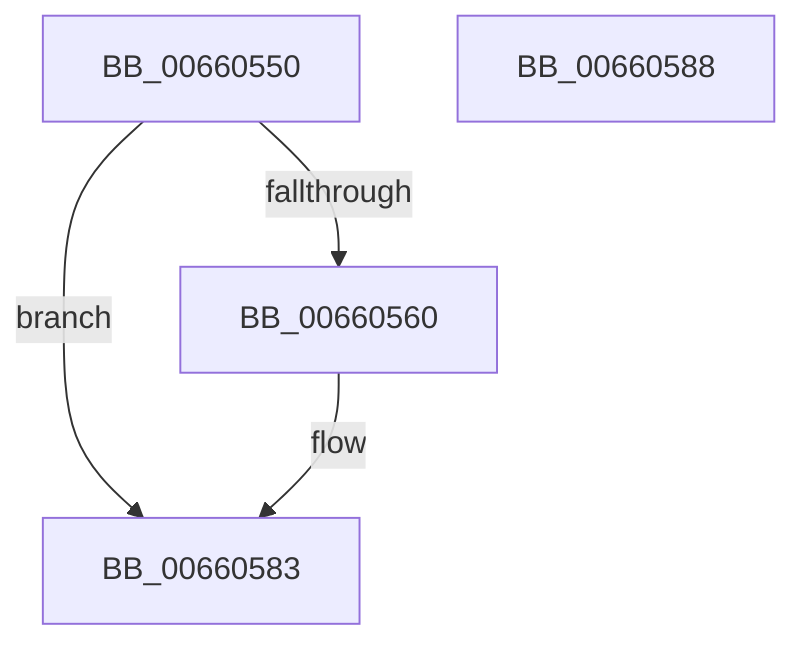

# WheaHighIrqlLogSelEventHandlerUnregister

- RVA: `0x00660550`–`0x00660589` (길이 `57` bytes)
- VA: `0x0000000140660550`
- 실행 섹션: `.text`
- PDB 이름 있음: `예`; PDB Function 태그: `아니요`
- unwind 정보 RVA: `0x0005C788`
- 디코드: `13`개 명령, `57/57` bytes 표시
- 미해석 바이트: `0` (있으면 어셈블리에 `.byte`로 보존)

> 이 문서는 커널 이미지의 기계어와 PDB 기호를 분석해 생성했습니다. 4번과 5번은 함수 원형과 자료형을 바이너리 사용 방식에서 추정한 C 해석이며 원본 소스 복구 결과는 아닙니다.

## 1. Dependencies

- 직접 호출 지점: **1**; 고유 호출 대상: **1**
- 직접 호출자로 확인된 함수: **0**
- RIP 상대 이미지 참조: **5**

### Outgoing calls
- `0x00660562` → [WheapHighIrqlLogSelEventHandlerAcquireLock](WheapHighIrqlLogSelEventHandlerAcquireLock_function_006608E8.md) (function, `0x006608E8`)

### Direct callers
- 이 함수 시작 RVA로 연결되는 직접 call은 확인되지 않았습니다. 간접 호출은 완전히 역산할 수 없습니다.

### Static image references
- `0x00660557` → RVA `0x00EF9F00` (`.data`; read)
- `0x00660567` → RVA `0x00EF9F08` (`.data`; write)
- `0x0066056E` → RVA `0x00EF9F10` (`.data`; write)
- `0x00660575` → RVA `0x00EF9F00` (`.data`; write)
- `0x0066057C` → RVA `0x00EF9F04` (`.data`; read/write)

## 2. Other-region calls and transfers

- 다른 실행 섹션으로 향하는 call: **0**
- 별도 외부 분기/꼬리 이동을 확인하지 못했습니다.

## 3. Assembly (complete function range)

```asm
00660550  48 83 EC 28                     sub rsp, 0x28
00660554  45 33 C9                        xor r9d, r9d
00660557  44 39 0D A2 99 89 00            cmp dword ptr [rip + 0x8999a2], r9d
0066055E  74 23                           je 0x140660583
00660560  B1 01                           mov cl, 1
00660562  E8 81 03 00 00                  call 0x1406608e8
00660567  4C 89 0D 9A 99 89 00            mov qword ptr [rip + 0x89999a], r9
0066056E  4C 89 0D 9B 99 89 00            mov qword ptr [rip + 0x89999b], r9
00660575  44 89 0D 84 99 89 00            mov dword ptr [rip + 0x899984], r9d
0066057C  44 87 0D 81 99 89 00            xchg dword ptr [rip + 0x899981], r9d
00660583  48 83 C4 28                     add rsp, 0x28
00660587  C3                              ret
00660588  CC                              int3
```

## 4. C-style interpretation (structured pseudocode)

```c
__int64 __fastcall WheaHighIrqlLogSelEventHandlerUnregister(__int64 a1, __int64 a2, __int64 a3, int a4)
{
    __int64 result;
    __int64 v_rsp;

    v_rsp = (v_rsp) - (40);
    a4 = 0;
    if ((*(unsigned int *)(v_rip + 9017762)) != 0) {
        a1 = 1;
        result = WheapHighIrqlLogSelEventHandlerAcquireLock(a1, a2, a3, a4);
        *(unsigned __int64 *)(v_rip + 9017754) = 0;
        *(unsigned __int64 *)(v_rip + 9017755) = 0;
        *(unsigned int *)(v_rip + 9017732) = 0;
    }
    v_rsp = (v_rsp) + (40);
    return result;
}
```

## 5. (Beta) C Style

```c
int64_t WheaHighIrqlLogSelEventHandlerUnregister(int64_t Arg1, int64_t Arg2, int64_t Arg3, int32_t Arg4)
{
    int64_t result;
    int64_t local_rsp;

    local_rsp = (local_rsp) - (40);
    Arg4 = 0;
    if ((*(uint32_t *)(v_rip + 0x8999A2)) != 0) {
        Arg1 = 1;
        result = WheapHighIrqlLogSelEventHandlerAcquireLock(Arg1, Arg2, Arg3, Arg4);
        *(uint64_t *)(v_rip + 0x89999A) = 0;
        *(uint64_t *)(v_rip + 0x89999B) = 0;
        *(uint32_t *)(v_rip + 0x899984) = 0;
    }
    local_rsp = (local_rsp) + (40);
    return result;
}
```

## 6. Execution-region graph

[열기: 2D/3D 그래프와 함수 탐색 컨트롤 패널](../../../control-panel.html?section=text&rva=0x00660550&view=graph)

- 2D 그래프는 위에서 아래로 흐르고, 3D 그래프는 빈 공간을 드래그해 회전합니다. Shift+드래그는 이동, 휠은 확대·축소, 함수 노드 선택은 대상 보고서 이동입니다.

### Static fallback


