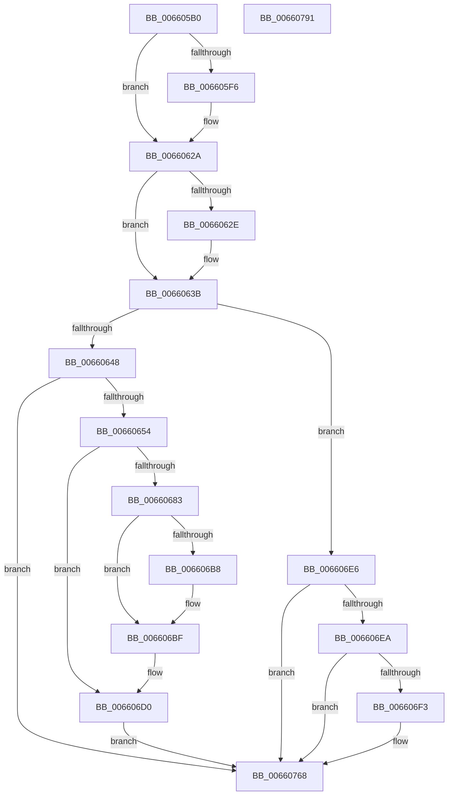

# WheaLogInternalEvent

- RVA: `0x006605B0`–`0x00660792` (길이 `482` bytes)
- VA: `0x00000001406605B0`
- 실행 섹션: `.text`
- PDB 이름 있음: `예`; PDB Function 태그: `아니요`
- unwind 정보 RVA: `0x000D5F74`
- 디코드: `124`개 명령, `482/482` bytes 표시
- 미해석 바이트: `0` (있으면 어셈블리에 `.byte`로 보존)

> 이 문서는 커널 이미지의 기계어와 PDB 기호를 분석해 생성했습니다. 4번과 5번은 함수 원형과 자료형을 바이너리 사용 방식에서 추정한 C 해석이며 원본 소스 복구 결과는 아닙니다.

## 1. Dependencies

- 직접 호출 지점: **8**; 고유 호출 대상: **8**
- 직접 호출자로 확인된 함수: **31**
- RIP 상대 이미지 참조: **11**

### Outgoing calls
- `0x00660620` → [NtPowerInformation](../../page/95/NtPowerInformation_function_00955D80.md) (function, `0x00955D80`)
- `0x00660631` → [WheaSelLogEvent](../65/WheaSelLogEvent_function_0065DA74.md) (function, `0x0065DA74`)
- `0x00660668` → [KeWaitForSingleObject](../20/KeWaitForSingleObject_function_0020E6B0.md) (function, `0x0020E6B0`)
- `0x0066069A` → [memcpy](../6C/memcpy_function_006C6840.md) (function, `0x006C6840`)
- `0x006606DC` → [KeSetEvent](../33/KeSetEvent_function_0033F310.md) (function, `0x0033F310`)
- `0x006606EA` → [WheaIsCriticalState](../48/WheaIsCriticalState_function_004849A0.md) (function, `0x004849A0`)
- `0x00660763` → [EtwWriteEx](../25/EtwWriteEx_function_0025F0D0.md) (function, `0x0025F0D0`)
- `0x0066076F` → [_security_check_cookie](../6A/_security_check_cookie_function_006AC640.md) (function, `0x006AC640`)

### Direct callers
- [WheaReportHwError](../4E/WheaReportHwError_function_004ED200.md) at `0x004ED5FD`
- [HalpCmcLogPollingTimeoutEvent](../54/HalpCmcLogPollingTimeoutEvent_function_00540A3C.md) at `0x00540A9C`
- [HalpCmciHandler](../54/HalpCmciHandler_function_00545168.md) at `0x00545330`
- [IoSaveBugCheckProgress](../59/IoSaveBugCheckProgress_function_00592E10.md) at `0x00592ECB`
- [IoSaveBugCheckRecoveryStatus](../59/IoSaveBugCheckRecoveryStatus_function_00592EEC.md) at `0x00592FFF`
- [KiBugCheckProgressCpusFrozen](../5B/KiBugCheckProgressCpusFrozen_function_005B3FE4.md) at `0x005B4080`
- [KiMcheckAlternateReturn](../5C/KiMcheckAlternateReturn_function_005CB180.md) at `0x005CB2F9`
- [PspVsmLogBugCheckCallback](../5E/PspVsmLogBugCheckCallback_function_005E49C0.md) at `0x005E4AE8`
- [WheapInitErrorReportDeviceDriver](../65/WheapInitErrorReportDeviceDriver_function_0065ED88.md) at `0x0065EFF6`
- [WheaAttemptRowOffline](../65/WheaAttemptRowOffline_function_0065F050.md) at `0x0065F19E`
- [WheaPersistBadPageToRegistry](../65/WheaPersistBadPageToRegistry_function_0065F58C.md) at `0x0065F765`
- [WheapCreateRecordFromGenericErrorData](../65/WheapCreateRecordFromGenericErrorData_function_0065FCE4.md) at `0x00660019`
- [WheapProcessOfflineList](WheapProcessOfflineList_function_00661D70.md) at `0x00661E3A`
- [WheaAddErrorSource](../../page/7D/WheaAddErrorSource_function_007D69D0.md) at `0x007D6C33`
- [WheaRemoveErrorSource](../../page/7D/WheaRemoveErrorSource_function_007D6C70.md) at `0x007D6E35`
- [WheaRemoveErrorSourceDeviceDriver](../../page/7D/WheaRemoveErrorSourceDeviceDriver_function_007D7060.md) at `0x007D7110`
- [WheapAttemptPhysicalPageOffline](../../page/7D/WheapAttemptPhysicalPageOffline_function_007D79AC.md) at `0x007D7B20`
- [WheapCallInUsePageNotificationCallbacks](../../page/7D/WheapCallInUsePageNotificationCallbacks_function_007D7C28.md) at `0x007D7D77`
- [WheapClearPoison](../../page/7D/WheapClearPoison_function_007D7DFC.md) at `0x007D7ED9`
- [WheapOfflinePage](../../page/7D/WheapOfflinePage_function_007D7FB0.md) at `0x007D80D6`
- [WheapOfflineRow](../../page/7D/WheapOfflineRow_function_007D8108.md) at `0x007D8396`
- [WheapLogInitEvent](../../page/7D/WheapLogInitEvent_function_007D83F8.md) at `0x007D8532`
- [WheapProcessWaitingETWEvents](../../page/7D/WheapProcessWaitingETWEvents_function_007D8680.md) at `0x007D8759`
- [WheaRegChangeNotifyCallback](../../page/7D/WheaRegChangeNotifyCallback_function_007D8A50.md) at `0x007D8BCB`
- [WheapExecuteRowFailureCheck](../../page/7D/WheapExecuteRowFailureCheck_function_007D8ED8.md) at `0x007D90A1`
- [WheapPfaLogPageMonitorRemoval](../../page/7D/WheapPfaLogPageMonitorRemoval_function_007D917C.md) at `0x007D91F4`
- [WheapTrackPendingPage](../../page/7D/WheapTrackPendingPage_function_007D9624.md) at `0x007D96D4`
- [sub_00B3E38E](../../page/B3/Unknown_function_00B3E38E.md) at `0x00B3E457`
- [HalpInitGenericErrorSourceEntry](../../pagelk/B5/HalpInitGenericErrorSourceEntry_function_00B5DF68.md) at `0x00B5E043`
- [HalpInitGenericErrorSourceEntryV2](../../pagelk/B5/HalpInitGenericErrorSourceEntryV2_function_00B5E1D0.md) at `0x00B5E2B9`
- [WheapOpenPolicyRegistryKey](../../init/C5/WheapOpenPolicyRegistryKey_function_00C55840.md) at `0x00C55967`

### Static image references
- `0x006605CF` → RVA `0x00E0A740` (`.data`; read)
- `0x0066063B` → RVA `0x00EF9F50` (`.data`; read)
- `0x0066065F` → RVA `0x00EF7E40` (`.data`; read)
- `0x0066066D` → RVA `0x00EEF57C` (`.data`; read)
- `0x00660689` → RVA `0x00EF7E60` (`.data`; read)
- `0x0066069F` → RVA `0x00EF9EE8` (`.data`; read)
- `0x006606A6` → RVA `0x00EF9EE0` (`.data`; read)
- `0x006606AD` → RVA `0x00EEF57C` (`.data`; write)
- `0x006606C9` → RVA `0x00EF9EE8` (`.data`; write)
- `0x006606F3` → RVA `0x00EF9EF0` (`.data`; read)
- `0x00660702` → RVA `0x00039610` (`.rdata`; read)

## 2. Other-region calls and transfers

- 다른 실행 섹션으로 향하는 call: **1**
  - `0x00660620` → [NtPowerInformation](../../page/95/NtPowerInformation_function_00955D80.md) (`.text` → `PAGE`)
- 별도 외부 분기/꼬리 이동을 확인하지 못했습니다.

## 3. Assembly (complete function range)

```asm
006605B0  48 8B C4                        mov rax, rsp
006605B3  48 89 58 10                     mov qword ptr [rax + 0x10], rbx
006605B7  48 89 70 18                     mov qword ptr [rax + 0x18], rsi
006605BB  48 89 78 20                     mov qword ptr [rax + 0x20], rdi
006605BF  55                              push rbp
006605C0  41 56                           push r14
006605C2  41 57                           push r15
006605C4  48 8D 68 A1                     lea rbp, [rax - 0x5f]
006605C8  48 81 EC D0 00 00 00            sub rsp, 0xd0
006605CF  48 8B 05 6A A1 7A 00            mov rax, qword ptr [rip + 0x7aa16a]
006605D6  48 33 C4                        xor rax, rsp
006605D9  48 89 45 37                     mov qword ptr [rbp + 0x37], rax
006605DD  45 33 F6                        xor r14d, r14d
006605E0  48 8D 59 18                     lea rbx, [rcx + 0x18]
006605E4  8B 03                           mov eax, dword ptr [rbx]
006605E6  48 8D 71 08                     lea rsi, [rcx + 8]
006605EA  48 8B F9                        mov rdi, rcx
006605ED  45 8D 7E 04                     lea r15d, [r14 + 4]
006605F1  41 84 C7                        test r15b, al
006605F4  74 34                           je 0x14066062a
006605F6  8B 06                           mov eax, dword ptr [rsi]
006605F8  45 8D 46 20                     lea r8d, [r14 + 0x20]
006605FC  48 89 4D B7                     mov qword ptr [rbp - 0x49], rcx
00660600  48 8D 55 B7                     lea rdx, [rbp - 0x49]
00660604  41 8D 4E 5E                     lea ecx, [r14 + 0x5e]
00660608  48 89 45 BF                     mov qword ptr [rbp - 0x41], rax
0066060C  45 33 C9                        xor r9d, r9d
0066060F  4C 89 75 C7                     mov qword ptr [rbp - 0x39], r14
00660613  48 C7 45 CF 0F 00 00 00         mov qword ptr [rbp - 0x31], 0xf
0066061B  44 89 74 24 20                  mov dword ptr [rsp + 0x20], r14d
00660620  E8 5B 57 2F 00                  call 0x140955d80
00660625  83 23 FB                        and dword ptr [rbx], 0xfffffffb
00660628  8B 03                           mov eax, dword ptr [rbx]
0066062A  A8 08                           test al, 8
0066062C  74 0D                           je 0x14066063b
0066062E  48 8B CF                        mov rcx, rdi
00660631  E8 3E D4 FF FF                  call 0x14065da74
00660636  83 23 F7                        and dword ptr [rbx], 0xfffffff7
00660639  8B 03                           mov eax, dword ptr [rbx]
0066063B  44 39 35 0E 99 89 00            cmp dword ptr [rip + 0x89990e], r14d
00660642  0F 85 9E 00 00 00               jne 0x1406606e6
00660648  44 0F 20 C0                     mov rax, cr8
0066064C  3C 02                           cmp al, 2
0066064E  0F 83 14 01 00 00               jae 0x140660768
00660654  45 33 C9                        xor r9d, r9d
00660657  4C 89 74 24 20                  mov qword ptr [rsp + 0x20], r14
0066065C  45 33 C0                        xor r8d, r8d
0066065F  48 8D 0D DA 77 89 00            lea rcx, [rip + 0x8977da]
00660666  33 D2                           xor edx, edx
00660668  E8 43 E0 BA FF                  call 0x14020e6b0
0066066D  8B 0D 09 EF 88 00               mov ecx, dword ptr [rip + 0x88ef09]
00660673  8B 47 1C                        mov eax, dword ptr [rdi + 0x1c]
00660676  8D 71 30                        lea esi, [rcx + 0x30]
00660679  03 F0                           add esi, eax
0066067B  81 FE 00 10 00 00               cmp esi, 0x1000
00660681  73 4D                           jae 0x1406606d0
00660683  8B D9                           mov ebx, ecx
00660685  4C 8D 40 20                     lea r8, [rax + 0x20]
00660689  48 8D 0D D0 77 89 00            lea rcx, [rip + 0x8977d0]
00660690  48 8B D7                        mov rdx, rdi
00660693  48 03 D9                        add rbx, rcx
00660696  48 8D 4B 10                     lea rcx, [rbx + 0x10]
0066069A  E8 A1 61 06 00                  call 0x1406c6840
0066069F  48 8B 05 42 98 89 00            mov rax, qword ptr [rip + 0x899842]
006606A6  48 8D 0D 33 98 89 00            lea rcx, [rip + 0x899833]
006606AD  89 35 C9 EE 88 00               mov dword ptr [rip + 0x88eec9], esi
006606B3  48 39 08                        cmp qword ptr [rax], rcx
006606B6  74 07                           je 0x1406606bf
006606B8  B9 03 00 00 00                  mov ecx, 3
006606BD  CD 29                           int 0x29
006606BF  48 89 0B                        mov qword ptr [rbx], rcx
006606C2  48 89 43 08                     mov qword ptr [rbx + 8], rax
006606C6  48 89 18                        mov qword ptr [rax], rbx
006606C9  48 89 1D 18 98 89 00            mov qword ptr [rip + 0x899818], rbx
006606D0  45 33 C0                        xor r8d, r8d
006606D3  48 8D 0D 66 77 89 00            lea rcx, [rip + 0x897766]
006606DA  33 D2                           xor edx, edx
006606DC  E8 2F EC CD FF                  call 0x14033f310
006606E1  E9 82 00 00 00                  jmp 0x140660768
006606E6  A8 02                           test al, 2
006606E8  74 7E                           je 0x140660768
006606EA  E8 B1 42 E2 FF                  call 0x1404849a0
006606EF  84 C0                           test al, al
006606F1  75 75                           jne 0x140660768
006606F3  48 8B 0D F6 97 89 00            mov rcx, qword ptr [rip + 0x8997f6]
006606FA  48 8D 47 0C                     lea rax, [rdi + 0xc]
006606FE  48 89 45 D7                     mov qword ptr [rbp - 0x29], rax
00660702  48 8D 15 07 8F 9D FF            lea rdx, [rip - 0x6270f9]
00660709  48 8D 47 10                     lea rax, [rdi + 0x10]
0066070D  4C 89 7D DF                     mov qword ptr [rbp - 0x21], r15
00660711  48 89 45 E7                     mov qword ptr [rbp - 0x19], rax
00660715  45 33 C9                        xor r9d, r9d
00660718  48 8D 47 14                     lea rax, [rdi + 0x14]
0066071C  4C 89 7D EF                     mov qword ptr [rbp - 0x11], r15
00660720  48 89 45 F7                     mov qword ptr [rbp - 9], rax
00660724  45 33 C0                        xor r8d, r8d
00660727  8B 06                           mov eax, dword ptr [rsi]
00660729  89 45 2F                        mov dword ptr [rbp + 0x2f], eax
0066072C  48 8D 45 D7                     lea rax, [rbp - 0x29]
00660730  48 89 44 24 38                  mov qword ptr [rsp + 0x38], rax
00660735  C7 44 24 30 06 00 00 00         mov dword ptr [rsp + 0x30], 6
0066073D  4C 89 74 24 28                  mov qword ptr [rsp + 0x28], r14
00660742  4C 89 74 24 20                  mov qword ptr [rsp + 0x20], r14
00660747  4C 89 7D FF                     mov qword ptr [rbp - 1], r15
0066074B  48 89 5D 07                     mov qword ptr [rbp + 7], rbx
0066074F  4C 89 7D 0F                     mov qword ptr [rbp + 0xf], r15
00660753  48 89 75 17                     mov qword ptr [rbp + 0x17], rsi
00660757  4C 89 7D 1F                     mov qword ptr [rbp + 0x1f], r15
0066075B  48 89 7D 27                     mov qword ptr [rbp + 0x27], rdi
0066075F  44 89 75 33                     mov dword ptr [rbp + 0x33], r14d
00660763  E8 68 E9 BF FF                  call 0x14025f0d0
00660768  48 8B 4D 37                     mov rcx, qword ptr [rbp + 0x37]
0066076C  48 33 CC                        xor rcx, rsp
0066076F  E8 CC BE 04 00                  call 0x1406ac640
00660774  4C 8D 9C 24 D0 00 00 00         lea r11, [rsp + 0xd0]
0066077C  49 8B 5B 28                     mov rbx, qword ptr [r11 + 0x28]
00660780  49 8B 73 30                     mov rsi, qword ptr [r11 + 0x30]
00660784  49 8B 7B 38                     mov rdi, qword ptr [r11 + 0x38]
00660788  49 8B E3                        mov rsp, r11
0066078B  41 5F                           pop r15
0066078D  41 5E                           pop r14
0066078F  5D                              pop rbp
00660790  C3                              ret
00660791  CC                              int3
```

## 4. C-style interpretation (structured pseudocode)

```c
__int64 __fastcall WheaLogInternalEvent(__int64 a1, __int64 a2, __int64 a3, int a4)
{
    __int64 result;
    __int64 v_r14;
    __int64 v_rbx;
    __int64 v_rsi;
    __int64 v_rsp;
    unsigned __int64 v_stack_m18;
    unsigned __int64 v_stack_mB0;
    unsigned int v_stack_mB8;
    unsigned __int64 v_stack_mC0;
    unsigned int v_stack_mC8;

    *(unsigned __int64 *)(v_rsp + 16) = v_rbx;
    *(unsigned __int64 *)(v_rsp + 24) = v_rsi;
    *(unsigned __int64 *)(v_rsp + 32) = v_rdi;
    v_rsp = (v_rsp) - (208);
    result = (*(unsigned __int64 *)(v_rip + 8036714)) ^ (v_rsp);
    *(unsigned __int64 *)(v_rsp - 95 + 55) = result;
    v_r14 = 0;
    result = (unsigned int)(*(unsigned int *)(a1 + 24));
    if ((((unsigned __int8)(v_r14 + 4)) & ((unsigned __int8)((unsigned int)(*(unsigned int *)(a1 + 24))))) != 0) {
        result = *(unsigned int *)(a1 + 8);
        a3 = v_r14 + 32;
        *(unsigned __int64 *)(v_rsp - 95 - 73) = a1;
        a2 = v_rsp - 95 - 73;
        a1 = v_r14 + 94;
        *(unsigned __int64 *)(v_rsp - 95 - 65) = result;
        a4 = 0;
        *(unsigned __int64 *)(v_rsp - 95 - 57) = 0;
        *(unsigned __int64 *)(v_rsp - 95 - 49) = 15;
        v_stack_mC8 = 0;
        result = NtPowerInformation(a1, a2, a3, a4);
        result = *(unsigned int *)(a1 + 24);
    }
    if ((((unsigned __int8)(result)) & (8)) != 0) {
        a1 = a1;
        result = WheaSelLogEvent(a1, a2, a3, a4);
        result = *(unsigned int *)(a1 + 24);
    }
    if ((*(unsigned int *)(v_rip + 9017614)) != 0) goto loc_006606E6;
    if (((unsigned __int8)(v_cr8)) >= 2) goto loc_00660768;
    a4 = 0;
    v_stack_mC8 = 0;
    a3 = 0;
    a2 = 0;
    result = KeWaitForSingleObject(v_rip + 9009114, a2, a3, a4);
    v_rsi = (unsigned int)(((unsigned int)(*(unsigned int *)(v_rip + 8974089)) + 48) + ((unsigned int)((unsigned int)(*(unsigned int *)(a1 + 28)))));
    if (((unsigned int)(v_rsi)) >= 0x1000ULL) goto loc_006606D0;
    v_rbx = ((unsigned int)((unsigned int)((unsigned int)(*(unsigned int *)(v_rip + 8974089))))) + (v_rip + 9009104);
    result = memcpy(v_rbx + 16, a1, (unsigned int)(*(unsigned int *)(a1 + 28)) + 32, a4);
    *(unsigned int *)(v_rip + 8974025) = (unsigned int)(v_rsi);
    if ((*(unsigned __int64 *)(*(unsigned __int64 *)(v_rip + 9017410))) != (v_rip + 9017395)) {
        a1 = 3;
    }
    *(unsigned __int64 *)(v_rbx) = a1;
    *(unsigned __int64 *)(v_rbx + 8) = *(unsigned __int64 *)(v_rip + 9017410);
    *(unsigned __int64 *)(*(unsigned __int64 *)(v_rip + 9017410)) = v_rbx;
    *(unsigned __int64 *)(v_rip + 9017368) = v_rbx;
loc_006606D0:
    a3 = 0;
    a2 = 0;
    result = KeSetEvent(v_rip + 9008998, a2, a3, a4);
    goto loc_00660768;
loc_006606E6:
    if ((((unsigned __int8)(result)) & (2)) == 0) goto loc_00660768;
    result = WheaIsCriticalState(v_rip + 9008998, a2, a3, a4);
    if ((unsigned __int8)(result) == 0) {
        a1 = *(unsigned __int64 *)(v_rip + 9017334);
        result = a1 + 12;
        *(unsigned __int64 *)(v_rsp - 95 - 41) = result;
        a2 = v_rip - 6451449;
        result = a1 + 16;
        *(unsigned __int64 *)(v_rsp - 95 - 33) = v_r14 + 4;
        *(unsigned __int64 *)(v_rsp - 95 - 25) = result;
        a4 = 0;
        result = a1 + 20;
        *(unsigned __int64 *)(v_rsp - 95 - 17) = v_r14 + 4;
        *(unsigned __int64 *)(v_rsp - 95 - 9) = result;
        a3 = 0;
        result = *(unsigned int *)(v_rsi);
        *(unsigned int *)(v_rsp - 95 + 47) = (unsigned int)(result);
        result = v_rsp - 95 - 41;
        v_stack_mB0 = result;
        v_stack_mB8 = 6;
        v_stack_mC0 = 0;
        v_stack_mC8 = 0;
        *(unsigned __int64 *)(v_rsp - 95 - 1) = v_r14 + 4;
        *(unsigned __int64 *)(v_rsp - 95 + 7) = v_rbx;
        *(unsigned __int64 *)(v_rsp - 95 + 15) = v_r14 + 4;
        *(unsigned __int64 *)(v_rsp - 95 + 23) = v_rsi;
        *(unsigned __int64 *)(v_rsp - 95 + 31) = v_r14 + 4;
        *(unsigned __int64 *)(v_rsp - 95 + 39) = a1;
        *(unsigned int *)(v_rsp - 95 + 51) = 0;
        result = EtwWriteEx(a1, a2, a3, a4);
    }
    a1 = (*(unsigned __int64 *)(v_rsp - 95 + 55)) ^ (v_rsp);
    result = _security_check_cookie(a1, a2, a3, a4);
    return result;
}
```

## 5. (Beta) C Style

```c
int64_t WheaLogInternalEvent(void *Arg1, int64_t Arg2, int64_t Arg3, int32_t Arg4)
{
    uint8_t *arg1 = (uint8_t *)Arg1;

    int64_t result;
    int64_t local_r14;
    int64_t local_rbx;
    int64_t local_rsi;
    int64_t local_rsp;
    uint64_t v_stack_m18;
    uint64_t v_stack_mB0;
    uint32_t v_stack_mB8;
    uint64_t v_stack_mC0;
    uint32_t v_stack_mC8;

    *(uint64_t *)(local_rsp + 0x10) = local_rbx;
    *(uint64_t *)(local_rsp + 0x18) = local_rsi;
    *(uint64_t *)(local_rsp + 0x20) = local_rdi;
    local_rsp = (local_rsp) - (208);
    result = (*(uint64_t *)(v_rip + 0x7AA16A)) ^ (local_rsp);
    *(uint64_t *)(local_rsp - 0x5F + 0x37) = result;
    local_r14 = 0;
    result = (uint32_t)(*(uint32_t *)(arg1 + 0x18));
    if ((((uint8_t)(local_r14 + 4)) & ((uint8_t)((uint32_t)(*(uint32_t *)(arg1 + 0x18))))) != 0) {
        result = *(uint32_t *)(arg1 + 0x8);
        Arg3 = local_r14 + 32;
        *(void **)(local_rsp - 0x5F - 0x49) = Arg1;
        Arg2 = local_rsp - 95 - 73;
        Arg1 = local_r14 + 94;
        *(uint64_t *)(local_rsp - 0x5F - 0x41) = result;
        Arg4 = 0;
        *(uint64_t *)(local_rsp - 0x5F - 0x39) = 0;
        *(uint64_t *)(local_rsp - 0x5F - 0x31) = 15;
        v_stack_mC8 = 0;
        result = NtPowerInformation(Arg1, Arg2, Arg3, Arg4);
        result = *(uint32_t *)(arg1 + 0x18);
    }
    if ((((uint8_t)(result)) & (8)) != 0) {
        Arg1 = Arg1;
        result = WheaSelLogEvent(Arg1, Arg2, Arg3, Arg4);
        result = *(uint32_t *)(arg1 + 0x18);
    }
    if ((*(uint32_t *)(v_rip + 0x89990E)) != 0) goto loc_006606E6;
    if (((uint8_t)(v_cr8)) >= 2) goto loc_00660768;
    Arg4 = 0;
    v_stack_mC8 = 0;
    Arg3 = 0;
    Arg2 = 0;
    result = KeWaitForSingleObject(v_rip + 9009114, Arg2, Arg3, Arg4);
    local_rsi = (uint32_t)(((uint32_t)(*(uint32_t *)(v_rip + 0x88EF09)) + 48) + ((uint32_t)((uint32_t)(*(uint32_t *)(arg1 + 0x1C)))));
    if (((uint32_t)(local_rsi)) >= 0x1000ULL) goto loc_006606D0;
    local_rbx = ((uint32_t)((uint32_t)((uint32_t)(*(uint32_t *)(v_rip + 0x88EF09))))) + (v_rip + 9009104);
    result = memcpy(local_rbx + 16, Arg1, (uint32_t)(*(uint32_t *)(arg1 + 0x1C)) + 32, Arg4);
    *(uint32_t *)(v_rip + 0x88EEC9) = (uint32_t)(local_rsi);
    if ((*(uint64_t *)(*(uint64_t *)(v_rip + 0x899842))) != (v_rip + 9017395)) {
        Arg1 = 3;
    }
    *(void **)(local_rbx) = Arg1;
    *(uint64_t *)(local_rbx + 0x8) = *(uint64_t *)(v_rip + 0x899842);
    *(uint64_t *)(*(uint64_t *)(v_rip + 0x899842)) = local_rbx;
    *(uint64_t *)(v_rip + 0x899818) = local_rbx;
loc_006606D0:
    Arg3 = 0;
    Arg2 = 0;
    result = KeSetEvent(v_rip + 9008998, Arg2, Arg3, Arg4);
    goto loc_00660768;
loc_006606E6:
    if ((((uint8_t)(result)) & (2)) == 0) goto loc_00660768;
    result = WheaIsCriticalState(v_rip + 9008998, Arg2, Arg3, Arg4);
    if ((uint8_t)(result) == 0) {
        Arg1 = *(uint64_t *)(v_rip + 0x8997F6);
        result = Arg1 + 12;
        *(uint64_t *)(local_rsp - 0x5F - 0x29) = result;
        Arg2 = v_rip - 6451449;
        result = Arg1 + 16;
        *(uint64_t *)(local_rsp - 0x5F - 0x21) = local_r14 + 4;
        *(uint64_t *)(local_rsp - 0x5F - 0x19) = result;
        Arg4 = 0;
        result = Arg1 + 20;
        *(uint64_t *)(local_rsp - 0x5F - 0x11) = local_r14 + 4;
        *(uint64_t *)(local_rsp - 0x5F - 0x9) = result;
        Arg3 = 0;
        result = *(uint32_t *)(local_rsi);
        *(uint32_t *)(local_rsp - 0x5F + 0x2F) = (uint32_t)(result);
        result = local_rsp - 95 - 41;
        v_stack_mB0 = result;
        v_stack_mB8 = 6;
        v_stack_mC0 = 0;
        v_stack_mC8 = 0;
        *(uint64_t *)(local_rsp - 0x5F - 0x1) = local_r14 + 4;
        *(uint64_t *)(local_rsp - 0x5F + 0x7) = local_rbx;
        *(uint64_t *)(local_rsp - 0x5F + 0xF) = local_r14 + 4;
        *(uint64_t *)(local_rsp - 0x5F + 0x17) = local_rsi;
        *(uint64_t *)(local_rsp - 0x5F + 0x1F) = local_r14 + 4;
        *(void **)(local_rsp - 0x5F + 0x27) = Arg1;
        *(uint32_t *)(local_rsp - 0x5F + 0x33) = 0;
        result = EtwWriteEx(Arg1, Arg2, Arg3, Arg4);
    }
    Arg1 = (*(uint64_t *)(local_rsp - 0x5F + 0x37)) ^ (local_rsp);
    result = _security_check_cookie(Arg1, Arg2, Arg3, Arg4);
    return result;
}
```

### 관측된 메모리 오프셋

구조체 형식이 확인되지 않은 접근은 인자 기준의 오프셋으로만 기록했습니다.

| 기준 인자 | 오프셋 표현 | 폭 (bit) | 접근 |
|---|---:|---:|---|
| `Arg1` | `+ 0x0` | `32` | `R` |
| `Arg1` | `+ 0x0` | `32` | `R/W` |
| `Arg1` | `+ 0x8` | `64` | `R` |
| `Arg1` | `+ 0xC` | `64` | `R` |
| `Arg1` | `+ 0x10` | `64` | `R` |
| `Arg1` | `+ 0x14` | `64` | `R` |
| `Arg1` | `+ 0x18` | `64` | `R` |
| `Arg1` | `+ 0x1C` | `32` | `R` |

## 6. Execution-region graph

[열기: 2D/3D 그래프와 함수 탐색 컨트롤 패널](../../../control-panel.html?section=text&rva=0x006605B0&view=graph)

- 2D 그래프는 위에서 아래로 흐르고, 3D 그래프는 빈 공간을 드래그해 회전합니다. Shift+드래그는 이동, 휠은 확대·축소, 함수 노드 선택은 대상 보고서 이동입니다.

### Static fallback


