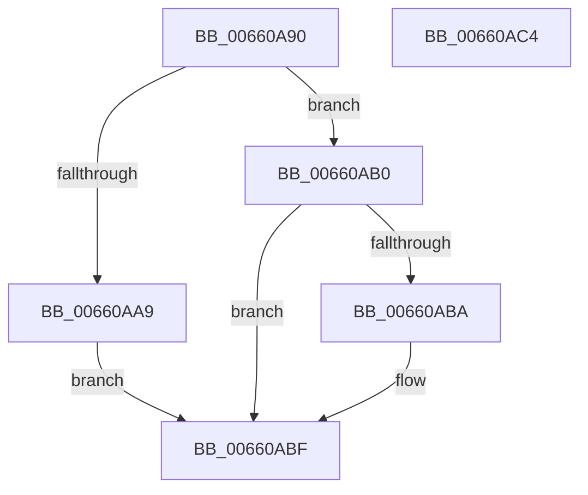

# WheaPrmTranslateDimmAddress

- RVA: `0x00660A90`–`0x00660AC5` (길이 `53` bytes)
- VA: `0x0000000140660A90`
- 실행 섹션: `.text`
- PDB 이름 있음: `예`; PDB Function 태그: `아니요`
- unwind 정보 RVA: `0x0005C788`
- 디코드: `13`개 명령, `53/53` bytes 표시
- 미해석 바이트: `0` (있으면 어셈블리에 `.byte`로 보존)

> 이 문서는 커널 이미지의 기계어와 PDB 기호를 분석해 생성했습니다. 4번과 5번은 함수 원형과 자료형을 바이너리 사용 방식에서 추정한 C 해석이며 원본 소스 복구 결과는 아닙니다.

## 1. Dependencies

- 직접 호출 지점: **1**; 고유 호출 대상: **1**
- 직접 호출자로 확인된 함수: **0**
- RIP 상대 이미지 참조: **0**

### Outgoing calls
- `0x00660ABA` → [WheapPrmTranslateDimmAddressIntel](WheapPrmTranslateDimmAddressIntel_function_00660B50.md) (function, `0x00660B50`)

### Direct callers
- 이 함수 시작 RVA로 연결되는 직접 call은 확인되지 않았습니다. 간접 호출은 완전히 역산할 수 없습니다.

### Static image references
- 디코드된 RIP-relative 메모리 참조가 없습니다.

## 2. Other-region calls and transfers

- 다른 실행 섹션으로 향하는 call: **0**
- 별도 외부 분기/꼬리 이동을 확인하지 못했습니다.

## 3. Assembly (complete function range)

```asm
00660A90  48 83 EC 28                     sub rsp, 0x28
00660A94  65 4C 8B 04 25 20 00 00 00      mov r8, qword ptr gs:[0x20]
00660A9D  B8 BB 00 00 C0                  mov eax, 0xc00000bb
00660AA2  41 80 78 41 00                  cmp byte ptr [r8 + 0x41], 0
00660AA7  75 07                           jne 0x140660ab0
00660AA9  B8 01 00 00 C0                  mov eax, 0xc0000001
00660AAE  EB 0F                           jmp 0x140660abf
00660AB0  41 80 B8 8D 00 00 00 02         cmp byte ptr [r8 + 0x8d], 2
00660AB8  75 05                           jne 0x140660abf
00660ABA  E8 91 00 00 00                  call 0x140660b50
00660ABF  48 83 C4 28                     add rsp, 0x28
00660AC3  C3                              ret
00660AC4  CC                              int3
```

## 4. C-style interpretation (structured pseudocode)

```c
__int64 __fastcall WheaPrmTranslateDimmAddress(void)
{
    __int64 result;
    __int64 v_rsp;

    v_rsp = (v_rsp) - (40);
    if ((*(unsigned __int8 *)(*(unsigned __int64 *)(gs_base + (0 + 32)) + 65)) != 0) goto loc_00660AB0;
    goto loc_00660ABF;
loc_00660AB0:
    result = (unsigned int)(0xC0000001ULL);
    if ((*(unsigned __int8 *)(*(unsigned __int64 *)(gs_base + (0 + 32)) + 141)) == 2) {
        result = WheapPrmTranslateDimmAddressIntel(a1, a2, *(unsigned __int64 *)(gs_base + (0 + 32)), a4);
    }
    v_rsp = (v_rsp) + (40);
    return result;
}
```

## 5. (Beta) C Style

```c
void WheaPrmTranslateDimmAddress(void)
{
    int64_t result;
    int64_t local_rsp;

    local_rsp = (local_rsp) - (40);
    if ((*(uint8_t *)(*(uint64_t *)(gs_base + (0 + 0x20)) + 0x41)) != 0) goto loc_00660AB0;
    goto loc_00660ABF;
loc_00660AB0:
    result = (uint32_t)(0xC0000001ULL);
    if ((*(uint8_t *)(*(uint64_t *)(gs_base + (0 + 0x20)) + 0x8D)) == 2) {
        result = WheapPrmTranslateDimmAddressIntel(a1, a2, *(uint64_t *)(gs_base + (0 + 0x20)), a4);
    }
    local_rsp = (local_rsp) + (40);
    return result;
}
```

## 6. Execution-region graph

[열기: 2D/3D 그래프와 함수 탐색 컨트롤 패널](../../../control-panel.html?section=text&rva=0x00660A90&view=graph)

- 2D 그래프는 위에서 아래로 흐르고, 3D 그래프는 빈 공간을 드래그해 회전합니다. Shift+드래그는 이동, 휠은 확대·축소, 함수 노드 선택은 대상 보고서 이동입니다.

### Static fallback


