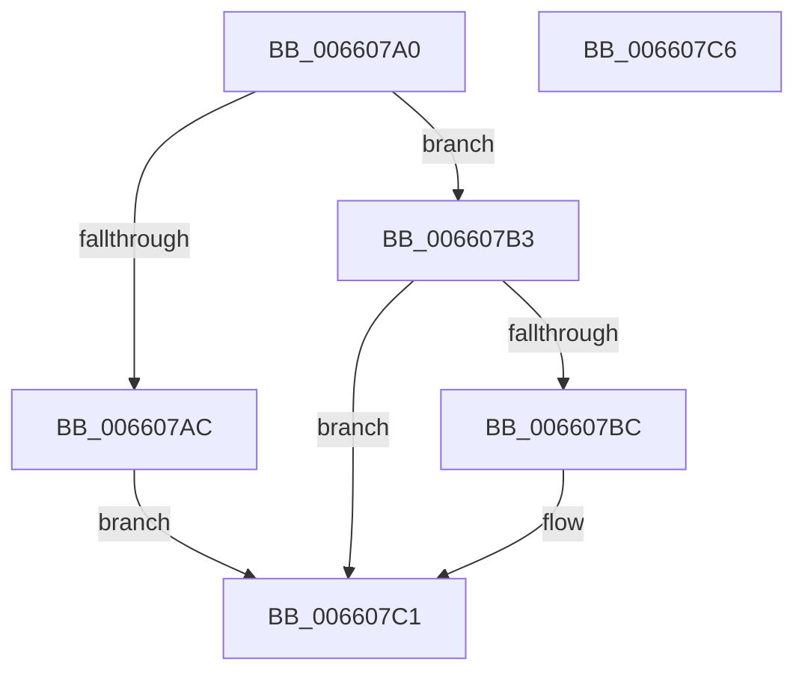

# WheaProcessWaitingETWEvents

- RVA: `0x006607A0`–`0x006607C7` (길이 `39` bytes)
- VA: `0x00000001406607A0`
- 실행 섹션: `.text`
- PDB 이름 있음: `예`; PDB Function 태그: `아니요`
- unwind 정보 RVA: `0x0005C788`
- 디코드: `12`개 명령, `39/39` bytes 표시
- 미해석 바이트: `0` (있으면 어셈블리에 `.byte`로 보존)

> 이 문서는 커널 이미지의 기계어와 PDB 기호를 분석해 생성했습니다. 4번과 5번은 함수 원형과 자료형을 바이너리 사용 방식에서 추정한 C 해석이며 원본 소스 복구 결과는 아닙니다.

## 1. Dependencies

- 직접 호출 지점: **2**; 고유 호출 대상: **2**
- 직접 호출자로 확인된 함수: **1**
- RIP 상대 이미지 참조: **1**

### Outgoing calls
- `0x006607AC` → [WheapProcessWaitingETWEvents](../../page/7D/WheapProcessWaitingETWEvents_function_007D8680.md) (function, `0x007D8680`)
- `0x006607BC` → [WheaFlushETWEventsAddWorkRtn](WheaFlushETWEventsAddWorkRtn_function_0066031C.md) (function, `0x0066031C`)

### Direct callers
- [KiMcheckAlternateReturn](../5C/KiMcheckAlternateReturn_function_005CB180.md) at `0x005CB50C`

### Static image references
- `0x006607B3` → RVA `0x00EEF578` (`.data`; read)

## 2. Other-region calls and transfers

- 다른 실행 섹션으로 향하는 call: **1**
  - `0x006607AC` → [WheapProcessWaitingETWEvents](../../page/7D/WheapProcessWaitingETWEvents_function_007D8680.md) (`.text` → `PAGE`)
- 별도 외부 분기/꼬리 이동을 확인하지 못했습니다.

## 3. Assembly (complete function range)

```asm
006607A0  48 83 EC 28                     sub rsp, 0x28
006607A4  44 0F 20 C0                     mov rax, cr8
006607A8  84 C0                           test al, al
006607AA  75 07                           jne 0x1406607b3
006607AC  E8 CF 7E 17 00                  call 0x1407d8680
006607B1  EB 0E                           jmp 0x1406607c1
006607B3  80 3D BE ED 88 00 00            cmp byte ptr [rip + 0x88edbe], 0
006607BA  74 05                           je 0x1406607c1
006607BC  E8 5B FB FF FF                  call 0x14066031c
006607C1  48 83 C4 28                     add rsp, 0x28
006607C5  C3                              ret
006607C6  CC                              int3
```

## 4. C-style interpretation (structured pseudocode)

```c
__int64 __fastcall WheaProcessWaitingETWEvents(void)
{
    __int64 result;
    __int64 v_rsp;

    v_rsp = (v_rsp) - (40);
    if ((unsigned __int8)(v_cr8) != 0) goto loc_006607B3;
    result = WheapProcessWaitingETWEvents(a1, a2, a3, a4);
    goto loc_006607C1;
loc_006607B3:
    if ((*(unsigned __int8 *)(v_rip + 8973758)) != 0) {
        result = WheaFlushETWEventsAddWorkRtn(a1, a2, a3, a4);
    }
    v_rsp = (v_rsp) + (40);
    return result;
}
```

## 5. (Beta) C Style

```c
void WheaProcessWaitingETWEvents(void)
{
    int64_t result;
    int64_t local_rsp;

    local_rsp = (local_rsp) - (40);
    if ((uint8_t)(v_cr8) != 0) goto loc_006607B3;
    result = WheapProcessWaitingETWEvents(a1, a2, a3, a4);
    goto loc_006607C1;
loc_006607B3:
    if ((*(uint8_t *)(v_rip + 0x88EDBE)) != 0) {
        result = WheaFlushETWEventsAddWorkRtn(a1, a2, a3, a4);
    }
    local_rsp = (local_rsp) + (40);
    return result;
}
```

## 6. Execution-region graph

[열기: 2D/3D 그래프와 함수 탐색 컨트롤 패널](../../../control-panel.html?section=text&rva=0x006607A0&view=graph)

- 2D 그래프는 위에서 아래로 흐르고, 3D 그래프는 빈 공간을 드래그해 회전합니다. Shift+드래그는 이동, 휠은 확대·축소, 함수 노드 선택은 대상 보고서 이동입니다.

### Static fallback


