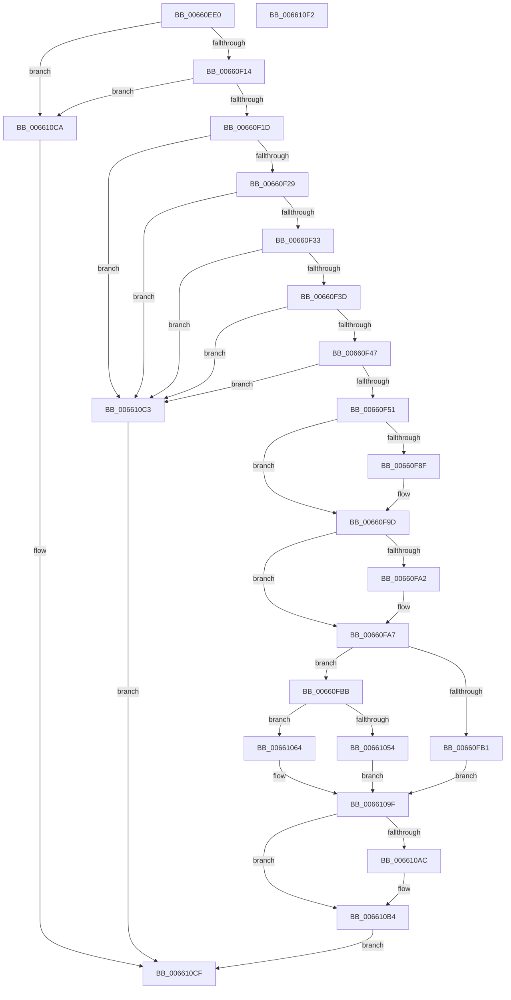

# WheaRegisterErrorSourceOverride

- RVA: `0x00660EE0`–`0x006610F3` (길이 `531` bytes)
- VA: `0x0000000140660EE0`
- 실행 섹션: `.text`
- PDB 이름 있음: `예`; PDB Function 태그: `아니요`
- unwind 정보 RVA: `0x000D5FDC`
- 디코드: `134`개 명령, `531/531` bytes 표시
- 미해석 바이트: `0` (있으면 어셈블리에 `.byte`로 보존)

> 이 문서는 커널 이미지의 기계어와 PDB 기호를 분석해 생성했습니다. 4번과 5번은 함수 원형과 자료형을 바이너리 사용 방식에서 추정한 C 해석이며 원본 소스 복구 결과는 아닙니다.

## 1. Dependencies

- 직접 호출 지점: **7**; 고유 호출 대상: **7**
- 직접 호출자로 확인된 함수: **0**
- RIP 상대 이미지 참조: **6**

### Outgoing calls
- `0x00660F7F` → [KeAbPreAcquire](../21/KeAbPreAcquire_function_00210230.md) (function, `0x00210230`)
- `0x00660F98` → [ExfAcquirePushLockExclusiveEx](../20/ExfAcquirePushLockExclusiveEx_function_0020FC90.md) (function, `0x0020FC90`)
- `0x00661000` → [memset](../6C/memset_function_006C6C40.md) (function, `0x006C6C40`)
- `0x00661049` → [WheaAddErrorSource](../../page/7D/WheaAddErrorSource_function_007D69D0.md) (function, `0x007D69D0`)
- `0x006610AF` → [ExfTryToWakePushLock](../26/ExfTryToWakePushLock_function_00265DD0.md) (function, `0x00265DD0`)
- `0x006610B7` → [KeAbPostRelease](../2E/KeAbPostRelease_function_002E1600.md) (function, `0x002E1600`)
- `0x006610BC` → [KeLeaveCriticalRegion](../25/KeLeaveCriticalRegion_function_0025D8B0.md) (function, `0x0025D8B0`)

### Direct callers
- 이 함수 시작 RVA로 연결되는 직접 call은 확인되지 않았습니다. 간접 호출은 완전히 역산할 수 없습니다.

### Static image references
- `0x00660F51` → RVA `0x00EEF590` (`.data`; read)
- `0x00661054` → RVA `0x00EEFA50` (`.data`; read)
- `0x00661064` → RVA `0x0048FDC0` (`HalAdjustResourceList`; read)
- `0x0066106F` → RVA `0x00B5D700` (`HalpQosInitSystem`; read)
- `0x0066107A` → RVA `0x00660050` (`WheapDefaultErrSrcCreateRecord`; read)
- `0x00661090` → RVA `0x0049E550` (`EmpCheckErrataList`; read)

## 2. Other-region calls and transfers

- 다른 실행 섹션으로 향하는 call: **1**
  - `0x00661049` → [WheaAddErrorSource](../../page/7D/WheaAddErrorSource_function_007D69D0.md) (`.text` → `PAGE`)
- 별도 외부 분기/꼬리 이동을 확인하지 못했습니다.

## 3. Assembly (complete function range)

```asm
00660EE0  48 89 5C 24 08                  mov qword ptr [rsp + 8], rbx
00660EE5  48 89 6C 24 10                  mov qword ptr [rsp + 0x10], rbp
00660EEA  48 89 74 24 18                  mov qword ptr [rsp + 0x18], rsi
00660EEF  57                              push rdi
00660EF0  41 54                           push r12
00660EF2  41 55                           push r13
00660EF4  41 56                           push r14
00660EF6  41 57                           push r15
00660EF8  48 81 EC F0 03 00 00            sub rsp, 0x3f0
00660EFF  48 63 29                        movsxd rbp, dword ptr [rcx]
00660F02  4D 8B E8                        mov r13, r8
00660F05  48 8B F2                        mov rsi, rdx
00660F08  4C 8B F9                        mov r15, rcx
00660F0B  83 FD 12                        cmp ebp, 0x12
00660F0E  0F 87 B6 01 00 00               ja 0x1406610ca
00660F14  83 FD 10                        cmp ebp, 0x10
00660F17  0F 84 AD 01 00 00               je 0x1406610ca
00660F1D  33 C0                           xor eax, eax
00660F1F  48 39 42 08                     cmp qword ptr [rdx + 8], rax
00660F23  0F 84 9A 01 00 00               je 0x1406610c3
00660F29  48 39 42 10                     cmp qword ptr [rdx + 0x10], rax
00660F2D  0F 84 90 01 00 00               je 0x1406610c3
00660F33  48 39 42 18                     cmp qword ptr [rdx + 0x18], rax
00660F37  0F 84 86 01 00 00               je 0x1406610c3
00660F3D  48 39 42 20                     cmp qword ptr [rdx + 0x20], rax
00660F41  0F 84 7C 01 00 00               je 0x1406610c3
00660F47  48 39 42 28                     cmp qword ptr [rdx + 0x28], rax
00660F4B  0F 84 72 01 00 00               je 0x1406610c3
00660F51  48 8D 05 38 E6 88 00            lea rax, [rip + 0x88e638]
00660F58  48 8B FD                        mov rdi, rbp
00660F5B  48 C1 E7 06                     shl rdi, 6
00660F5F  48 83 CB FF                     or rbx, 0xffffffffffffffff
00660F63  48 03 F8                        add rdi, rax
00660F66  45 33 C0                        xor r8d, r8d
00660F69  65 48 8B 04 25 88 01 00 00      mov rax, qword ptr gs:[0x188]
00660F72  33 D2                           xor edx, edx
00660F74  48 8B CF                        mov rcx, rdi
00660F77  66 01 98 E4 01 00 00            add word ptr [rax + 0x1e4], bx
00660F7E  90                              nop
00660F7F  E8 AC F2 BA FF                  call 0x140210230
00660F84  F0 48 0F BA 2F 00               lock bts qword ptr [rdi], 0
00660F8A  4C 8B F0                        mov r14, rax
00660F8D  73 0E                           jae 0x140660f9d
00660F8F  4C 8B C7                        mov r8, rdi
00660F92  48 8B D0                        mov rdx, rax
00660F95  48 8B CF                        mov rcx, rdi
00660F98  E8 F3 EC BA FF                  call 0x14020fc90
00660F9D  4D 85 F6                        test r14, r14
00660FA0  74 05                           je 0x140660fa7
00660FA2  41 C6 46 0A 01                  mov byte ptr [r14 + 0xa], 1
00660FA7  8A 47 08                        mov al, byte ptr [rdi + 8]
00660FAA  45 33 F6                        xor r14d, r14d
00660FAD  84 C0                           test al, al
00660FAF  74 0A                           je 0x140660fbb
00660FB1  BE 08 07 00 C0                  mov esi, 0xc0000708
00660FB6  E9 E4 00 00 00                  jmp 0x14066109f
00660FBB  8B 06                           mov eax, dword ptr [rsi]
00660FBD  89 47 0C                        mov dword ptr [rdi + 0xc], eax
00660FC0  48 8B 46 08                     mov rax, qword ptr [rsi + 8]
00660FC4  48 89 47 10                     mov qword ptr [rdi + 0x10], rax
00660FC8  48 8B 46 10                     mov rax, qword ptr [rsi + 0x10]
00660FCC  48 89 47 18                     mov qword ptr [rdi + 0x18], rax
00660FD0  48 8B 46 18                     mov rax, qword ptr [rsi + 0x18]
00660FD4  48 89 47 20                     mov qword ptr [rdi + 0x20], rax
00660FD8  48 8B 46 20                     mov rax, qword ptr [rsi + 0x20]
00660FDC  48 89 47 28                     mov qword ptr [rdi + 0x28], rax
00660FE0  48 8B 46 28                     mov rax, qword ptr [rsi + 0x28]
00660FE4  48 89 47 30                     mov qword ptr [rdi + 0x30], rax
00660FE8  F0 44 09 34 24                  lock or dword ptr [rsp], r14d
00660FED  BE CC 03 00 00                  mov esi, 0x3cc
00660FF2  C6 47 08 01                     mov byte ptr [rdi + 8], 1
00660FF6  44 8B C6                        mov r8d, esi
00660FF9  48 8D 4C 24 20                  lea rcx, [rsp + 0x20]
00660FFE  33 D2                           xor edx, edx
00661000  E8 3B 5C 06 00                  call 0x1406c6c40
00661005  41 8B 47 08                     mov eax, dword ptr [r15 + 8]
00661009  48 8D 4C 24 20                  lea rcx, [rsp + 0x20]
0066100E  89 44 24 34                     mov dword ptr [rsp + 0x34], eax
00661012  33 D2                           xor edx, edx
00661014  41 8B 47 0C                     mov eax, dword ptr [r15 + 0xc]
00661018  89 44 24 38                     mov dword ptr [rsp + 0x38], eax
0066101C  41 8B 47 04                     mov eax, dword ptr [r15 + 4]
00661020  89 44 24 30                     mov dword ptr [rsp + 0x30], eax
00661024  89 74 24 20                     mov dword ptr [rsp + 0x20], esi
00661028  C7 44 24 24 0A 00 00 00         mov dword ptr [rsp + 0x24], 0xa
00661030  89 6C 24 28                     mov dword ptr [rsp + 0x28], ebp
00661034  C7 44 24 2C 01 00 00 00         mov dword ptr [rsp + 0x2c], 1
0066103C  44 89 74 24 3C                  mov dword ptr [rsp + 0x3c], r14d
00661041  C7 44 24 44 00 00 00 40         mov dword ptr [rsp + 0x44], 0x40000000
00661049  E8 82 59 17 00                  call 0x1407d69d0
0066104E  8B F0                           mov esi, eax
00661050  85 C0                           test eax, eax
00661052  78 10                           js 0x140661064
00661054  48 8D 05 F5 E9 88 00            lea rax, [rip + 0x88e9f5]
0066105B  41 8B F6                        mov esi, r14d
0066105E  4C 89 2C E8                     mov qword ptr [rax + rbp*8], r13
00661062  EB 3B                           jmp 0x14066109f
00661064  48 8D 05 55 ED E2 FF            lea rax, [rip - 0x1d12ab]
0066106B  48 89 47 10                     mov qword ptr [rdi + 0x10], rax
0066106F  48 8D 05 8A C6 4F 00            lea rax, [rip + 0x4fc68a]
00661076  48 89 47 18                     mov qword ptr [rdi + 0x18], rax
0066107A  48 8D 05 CF EF FF FF            lea rax, [rip - 0x1031]
00661081  48 89 47 20                     mov qword ptr [rdi + 0x20], rax
00661085  48 8D 05 34 ED E2 FF            lea rax, [rip - 0x1d12cc]
0066108C  48 89 47 28                     mov qword ptr [rdi + 0x28], rax
00661090  48 8D 05 B9 D4 E3 FF            lea rax, [rip - 0x1c2b47]
00661097  48 89 47 30                     mov qword ptr [rdi + 0x30], rax
0066109B  4C 89 77 38                     mov qword ptr [rdi + 0x38], r14
0066109F  F0 48 0F C1 1F                  lock xadd qword ptr [rdi], rbx
006610A4  80 E3 06                        and bl, 6
006610A7  80 FB 02                        cmp bl, 2
006610AA  75 08                           jne 0x1406610b4
006610AC  48 8B CF                        mov rcx, rdi
006610AF  E8 1C 4D C0 FF                  call 0x140265dd0
006610B4  48 8B CF                        mov rcx, rdi
006610B7  E8 44 05 C8 FF                  call 0x1402e1600
006610BC  E8 EF C7 BF FF                  call 0x14025d8b0
006610C1  EB 0C                           jmp 0x1406610cf
006610C3  BE F0 00 00 C0                  mov esi, 0xc00000f0
006610C8  EB 05                           jmp 0x1406610cf
006610CA  BE EF 00 00 C0                  mov esi, 0xc00000ef
006610CF  4C 8D 9C 24 F0 03 00 00         lea r11, [rsp + 0x3f0]
006610D7  8B C6                           mov eax, esi
006610D9  49 8B 5B 30                     mov rbx, qword ptr [r11 + 0x30]
006610DD  49 8B 6B 38                     mov rbp, qword ptr [r11 + 0x38]
006610E1  49 8B 73 40                     mov rsi, qword ptr [r11 + 0x40]
006610E5  49 8B E3                        mov rsp, r11
006610E8  41 5F                           pop r15
006610EA  41 5E                           pop r14
006610EC  41 5D                           pop r13
006610EE  41 5C                           pop r12
006610F0  5F                              pop rdi
006610F1  C3                              ret
006610F2  CC                              int3
```

## 4. C-style interpretation (structured pseudocode)

```c
__int64 __fastcall WheaRegisterErrorSourceOverride(__int64 a1, __int64 a2, __int64 a3)
{
    __int64 result;
    __int64 v_r14;
    __int64 v_rbx;
    __int64 v_rdi;
    __int64 v_rsp;
    unsigned __int64 v_stack_m28;
    unsigned int v_stack_m3D4;
    unsigned int v_stack_m3DC;
    unsigned int v_stack_m3E0;
    unsigned int v_stack_m3E4;
    unsigned int v_stack_m3E8;
    unsigned int v_stack_m3EC;
    unsigned int v_stack_m3F0;
    unsigned int v_stack_m3F4;
    unsigned __int64 v_stack_m3F8;
    unsigned int v_stack_m418;
    unsigned __int64 v_stack_p10;
    unsigned __int64 v_stack_p18;
    unsigned __int64 v_stack_p8;

    v_stack_p8 = v_rbx;
    v_stack_p10 = v_rbp;
    v_stack_p18 = v_rsi;
    v_rsp = (v_rsp) - (0x3F0ULL);
    if (((unsigned int)((int)(*(unsigned int *)(a1)))) > 18) goto loc_006610CA;
    if (((unsigned int)((int)(*(unsigned int *)(a1)))) == 16) goto loc_006610CA;
    result = 0;
    if ((*(unsigned __int64 *)(a2 + 8)) == 0) goto loc_006610C3;
    if ((*(unsigned __int64 *)(a2 + 16)) == 0) goto loc_006610C3;
    if ((*(unsigned __int64 *)(a2 + 24)) == 0) goto loc_006610C3;
    if ((*(unsigned __int64 *)(a2 + 32)) == 0) goto loc_006610C3;
    if ((*(unsigned __int64 *)(a2 + 40)) == 0) goto loc_006610C3;
    v_rdi = ((int)(*(unsigned int *)(a1))) << (6);
    v_rbx = (v_rbx) | (-1);
    v_rdi = (v_rdi) + (v_rip + 8971832);
    a3 = 0;
    a2 = 0;
    result = KeAbPreAcquire(v_rdi, a2, a3, a4);
    if (!(condition_is_above_or_equal)) {
        a3 = v_rdi;
        a2 = result;
        a1 = v_rdi;
        result = ExfAcquirePushLockExclusiveEx(a1, a2, a3, a4);
    }
    if (result != 0) {
        *(unsigned __int8 *)(result + 10) = 1;
    }
    v_r14 = 0;
    if ((unsigned __int8)(*(unsigned __int8 *)(v_rdi + 8)) == 0) goto loc_00660FBB;
    goto loc_0066109F;
loc_00660FBB:
    *(unsigned int *)(v_rdi + 12) = (unsigned int)((unsigned int)(*(unsigned int *)((unsigned int)(0xC0000708ULL))));
    *(unsigned __int64 *)(v_rdi + 16) = *(unsigned __int64 *)((unsigned int)(0xC0000708ULL) + 8);
    *(unsigned __int64 *)(v_rdi + 24) = *(unsigned __int64 *)((unsigned int)(0xC0000708ULL) + 16);
    *(unsigned __int64 *)(v_rdi + 32) = *(unsigned __int64 *)((unsigned int)(0xC0000708ULL) + 24);
    *(unsigned __int64 *)(v_rdi + 40) = *(unsigned __int64 *)((unsigned int)(0xC0000708ULL) + 32);
    *(unsigned __int64 *)(v_rdi + 48) = *(unsigned __int64 *)((unsigned int)(0xC0000708ULL) + 40);
    *(unsigned __int8 *)(v_rdi + 8) = 1;
    a2 = 0;
    result = memset(v_stack_m3F8, a2, 972, a4);
    v_stack_m3E4 = (unsigned int)((unsigned int)(*(unsigned int *)(a1 + 8)));
    a2 = 0;
    v_stack_m3E0 = (unsigned int)((unsigned int)(*(unsigned int *)(a1 + 12)));
    v_stack_m3E8 = (unsigned int)((unsigned int)(*(unsigned int *)(a1 + 4)));
    v_stack_m3F8 = 972;
    v_stack_m3F4 = 10;
    v_stack_m3F0 = (unsigned int)((int)(*(unsigned int *)(a1)));
    v_stack_m3EC = 1;
    v_stack_m3DC = 0;
    v_stack_m3D4 = 0x40000000ULL;
    result = WheaAddErrorSource(v_stack_m3F8, a2, 972, a4);
    if (sign_flag) goto loc_00661064;
    *(unsigned __int64 *)(v_rip + 8972789 + (int)(*(unsigned int *)(a1)) * 8) = a3;
    goto loc_0066109F;
loc_00661064:
    *(unsigned __int64 *)(v_rdi + 16) = v_rip - 1905323;
    *(unsigned __int64 *)(v_rdi + 24) = v_rip + 5228170;
    *(unsigned __int64 *)(v_rdi + 32) = v_rip - 4145;
    *(unsigned __int64 *)(v_rdi + 40) = v_rip - 1905356;
    *(unsigned __int64 *)(v_rdi + 48) = v_rip - 1846087;
    *(unsigned __int64 *)(v_rdi + 56) = 0;
loc_0066109F:
    v_rbx = (unsigned __int8)((v_rbx) & (6));
    result = v_rip - 1846087;
    if (((unsigned __int8)(v_rbx)) == 2) {
        a1 = v_rdi;
        result = ExfTryToWakePushLock(a1, a2, 972, a4);
    }
    result = KeAbPostRelease(v_rdi, a2, 972, a4);
    result = KeLeaveCriticalRegion(v_rdi, a2, 972, a4);
    goto loc_006610CF;
loc_006610C3:
    goto loc_006610CF;
loc_006610CA:
loc_006610CF:
    return (unsigned int)((unsigned int)((unsigned int)(0xC00000EFULL)));
}
```

## 5. (Beta) C Style

```c
int64_t WheaRegisterErrorSourceOverride(void *Arg1, void *Arg2, int64_t Arg3)
{
    uint8_t *arg1 = (uint8_t *)Arg1;
    uint8_t *arg2 = (uint8_t *)Arg2;

    int64_t result;
    int64_t local_r14;
    int64_t local_rbx;
    int64_t local_rdi;
    int64_t local_rsp;
    uint64_t v_stack_m28;
    uint32_t v_stack_m3D4;
    uint32_t v_stack_m3DC;
    uint32_t v_stack_m3E0;
    uint32_t v_stack_m3E4;
    uint32_t v_stack_m3E8;
    uint32_t v_stack_m3EC;
    uint32_t v_stack_m3F0;
    uint32_t v_stack_m3F4;
    uint64_t v_stack_m3F8;
    uint32_t v_stack_m418;
    uint64_t v_stack_p10;
    uint64_t v_stack_p18;
    uint64_t v_stack_p8;

    v_stack_p8 = local_rbx;
    v_stack_p10 = local_rbp;
    v_stack_p18 = local_rsi;
    local_rsp = (local_rsp) - (0x3F0ULL);
    if (((uint32_t)((int32_t)(*(uint32_t *)(arg1)))) > 18) goto loc_006610CA;
    if (((uint32_t)((int32_t)(*(uint32_t *)(arg1)))) == 16) goto loc_006610CA;
    result = 0;
    if ((*(uint64_t *)(arg2 + 0x8)) == 0) goto loc_006610C3;
    if ((*(uint64_t *)(arg2 + 0x10)) == 0) goto loc_006610C3;
    if ((*(uint64_t *)(arg2 + 0x18)) == 0) goto loc_006610C3;
    if ((*(uint64_t *)(arg2 + 0x20)) == 0) goto loc_006610C3;
    if ((*(uint64_t *)(arg2 + 0x28)) == 0) goto loc_006610C3;
    local_rdi = ((int32_t)(*(uint32_t *)(arg1))) << (6);
    local_rbx = (local_rbx) | (-1);
    local_rdi = (local_rdi) + (v_rip + 8971832);
    Arg3 = 0;
    Arg2 = 0;
    result = KeAbPreAcquire(local_rdi, Arg2, Arg3, a4);
    if (!(condition_is_above_or_equal)) {
        Arg3 = local_rdi;
        Arg2 = result;
        Arg1 = local_rdi;
        result = ExfAcquirePushLockExclusiveEx(Arg1, Arg2, Arg3, a4);
    }
    if (result != 0) {
        *(uint8_t *)(result + 0xA) = 1;
    }
    local_r14 = 0;
    if ((uint8_t)(*(uint8_t *)(local_rdi + 0x8)) == 0) goto loc_00660FBB;
    goto loc_0066109F;
loc_00660FBB:
    *(uint32_t *)(local_rdi + 0xC) = (uint32_t)((uint32_t)(*(uint32_t *)((uint32_t)(0xC0000708ULL))));
    *(uint64_t *)(local_rdi + 0x10) = *(uint64_t *)((uint32_t)(0xC0000708ULL) + 0x8);
    *(uint64_t *)(local_rdi + 0x18) = *(uint64_t *)((uint32_t)(0xC0000708ULL) + 0x10);
    *(uint64_t *)(local_rdi + 0x20) = *(uint64_t *)((uint32_t)(0xC0000708ULL) + 0x18);
    *(uint64_t *)(local_rdi + 0x28) = *(uint64_t *)((uint32_t)(0xC0000708ULL) + 0x20);
    *(uint64_t *)(local_rdi + 0x30) = *(uint64_t *)((uint32_t)(0xC0000708ULL) + 0x28);
    *(uint8_t *)(local_rdi + 0x8) = 1;
    Arg2 = 0;
    result = memset(v_stack_m3F8, Arg2, 972, a4);
    v_stack_m3E4 = (uint32_t)((uint32_t)(*(uint32_t *)(arg1 + 0x8)));
    Arg2 = 0;
    v_stack_m3E0 = (uint32_t)((uint32_t)(*(uint32_t *)(arg1 + 0xC)));
    v_stack_m3E8 = (uint32_t)((uint32_t)(*(uint32_t *)(arg1 + 0x4)));
    v_stack_m3F8 = 972;
    v_stack_m3F4 = 10;
    v_stack_m3F0 = (uint32_t)((int32_t)(*(uint32_t *)(arg1)));
    v_stack_m3EC = 1;
    v_stack_m3DC = 0;
    v_stack_m3D4 = 0x40000000ULL;
    result = WheaAddErrorSource(v_stack_m3F8, Arg2, 972, a4);
    if (sign_flag) goto loc_00661064;
    *(uint64_t *)(v_rip + 0x88E9F5 + (int32_t)(*(uint32_t *)(arg1)) * 8) = Arg3;
    goto loc_0066109F;
loc_00661064:
    *(uint64_t *)(local_rdi + 0x10) = v_rip - 1905323;
    *(uint64_t *)(local_rdi + 0x18) = v_rip + 5228170;
    *(uint64_t *)(local_rdi + 0x20) = v_rip - 4145;
    *(uint64_t *)(local_rdi + 0x28) = v_rip - 1905356;
    *(uint64_t *)(local_rdi + 0x30) = v_rip - 1846087;
    *(uint64_t *)(local_rdi + 0x38) = 0;
loc_0066109F:
    local_rbx = (uint8_t)((local_rbx) & (6));
    result = v_rip - 1846087;
    if (((uint8_t)(local_rbx)) == 2) {
        Arg1 = local_rdi;
        result = ExfTryToWakePushLock(Arg1, Arg2, 972, a4);
    }
    result = KeAbPostRelease(local_rdi, Arg2, 972, a4);
    result = KeLeaveCriticalRegion(local_rdi, Arg2, 972, a4);
    goto loc_006610CF;
loc_006610C3:
    goto loc_006610CF;
loc_006610CA:
loc_006610CF:
    return (uint32_t)((uint32_t)((uint32_t)(0xC00000EFULL)));
}
```

### 관측된 메모리 오프셋

구조체 형식이 확인되지 않은 접근은 인자 기준의 오프셋으로만 기록했습니다.

| 기준 인자 | 오프셋 표현 | 폭 (bit) | 접근 |
|---|---:|---:|---|
| `Arg1` | `+ 0x0` | `32` | `R` |
| `Arg1` | `+ 0x4` | `32` | `R` |
| `Arg1` | `+ 0x8` | `32` | `R` |
| `Arg1` | `+ 0xC` | `32` | `R` |
| `Arg2` | `+ 0x0` | `32` | `R` |
| `Arg2` | `+ 0x8` | `64` | `R` |
| `Arg2` | `+ 0x10` | `64` | `R` |
| `Arg2` | `+ 0x18` | `64` | `R` |
| `Arg2` | `+ 0x20` | `64` | `R` |
| `Arg2` | `+ 0x28` | `64` | `R` |

## 6. Execution-region graph

[열기: 2D/3D 그래프와 함수 탐색 컨트롤 패널](../../../control-panel.html?section=text&rva=0x00660EE0&view=graph)

- 2D 그래프는 위에서 아래로 흐르고, 3D 그래프는 빈 공간을 드래그해 회전합니다. Shift+드래그는 이동, 휠은 확대·축소, 함수 노드 선택은 대상 보고서 이동입니다.

### Static fallback


