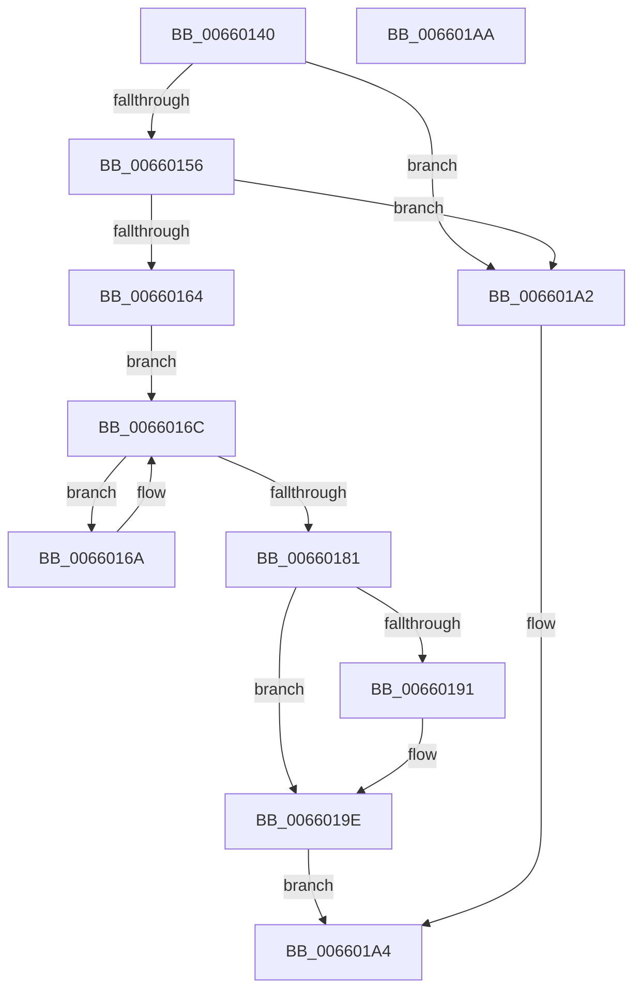

# WheaRequestDeferredRecovery

- RVA: `0x00660140`–`0x006601AB` (길이 `107` bytes)
- VA: `0x0000000140660140`
- 실행 섹션: `.text`
- PDB 이름 있음: `예`; PDB Function 태그: `아니요`
- unwind 정보 RVA: `0x0005CF00`
- 디코드: `32`개 명령, `107/107` bytes 표시
- 미해석 바이트: `0` (있으면 어셈블리에 `.byte`로 보존)

> 이 문서는 커널 이미지의 기계어와 PDB 기호를 분석해 생성했습니다. 4번과 5번은 함수 원형과 자료형을 바이너리 사용 방식에서 추정한 C 해석이며 원본 소스 복구 결과는 아닙니다.

## 1. Dependencies

- 직접 호출 지점: **1**; 고유 호출 대상: **1**
- 직접 호출자로 확인된 함수: **2**
- RIP 상대 이미지 참조: **4**

### Outgoing calls
- `0x00660199` → [HalRequestDeferredRecoveryServiceInterrupt](../54/HalRequestDeferredRecoveryServiceInterrupt_function_00545E40.md) (function, `0x00545E40`)

### Direct callers
- [HalpMemoryErrorDeferredRecovery](../55/HalpMemoryErrorDeferredRecovery_function_00556918.md) at `0x005569F1`
- [HalpPmemErrorDeferredRecovery](../55/HalpPmemErrorDeferredRecovery_function_00556B24.md) at `0x00556BBF`

### Static image references
- `0x00660146` → RVA `0x00EEF570` (`.data`; read)
- `0x0066016C` → RVA `0x00EEF558` (`.data`; read)
- `0x00660183` → RVA `0x00EEF550` (`.data`; read/write)
- `0x00660193` → RVA `0x00EEF560` (`.data`; read/write)

## 2. Other-region calls and transfers

- 다른 실행 섹션으로 향하는 call: **0**
- 별도 외부 분기/꼬리 이동을 확인하지 못했습니다.

## 3. Assembly (complete function range)

```asm
00660140  40 53                           push rbx
00660142  48 83 EC 20                     sub rsp, 0x20
00660146  8A 05 24 F4 88 00               mov al, byte ptr [rip + 0x88f424]
0066014C  8A 05 1E F4 88 00               mov al, byte ptr [rip + 0x88f41e]
00660152  84 C0                           test al, al
00660154  74 4C                           je 0x1406601a2
00660156  BB 01 00 00 00                  mov ebx, 1
0066015B  33 C0                           xor eax, eax
0066015D  F0 0F B1 59 08                  lock cmpxchg dword ptr [rcx + 8], ebx
00660162  75 3E                           jne 0x1406601a2
00660164  48 89 51 20                     mov qword ptr [rcx + 0x20], rdx
00660168  EB 02                           jmp 0x14066016c
0066016A  F3 90                           pause
0066016C  48 8B 05 E5 F3 88 00            mov rax, qword ptr [rip + 0x88f3e5]
00660173  48 89 01                        mov qword ptr [rcx], rax
00660176  F0 48 0F B1 0D D9 F3 88 00      lock cmpxchg qword ptr [rip + 0x88f3d9], rcx
0066017F  75 E9                           jne 0x14066016a
00660181  8B CB                           mov ecx, ebx
00660183  F0 0F C1 0D C5 F3 88 00         lock xadd dword ptr [rip + 0x88f3c5], ecx
0066018B  03 CB                           add ecx, ebx
0066018D  3B CB                           cmp ecx, ebx
0066018F  75 0D                           jne 0x14066019e
00660191  8B CB                           mov ecx, ebx
00660193  87 0D C7 F3 88 00               xchg dword ptr [rip + 0x88f3c7], ecx
00660199  E8 A2 5C EE FF                  call 0x140545e40
0066019E  8A C3                           mov al, bl
006601A0  EB 02                           jmp 0x1406601a4
006601A2  32 C0                           xor al, al
006601A4  48 83 C4 20                     add rsp, 0x20
006601A8  5B                              pop rbx
006601A9  C3                              ret
006601AA  CC                              int3
```

## 4. C-style interpretation (structured pseudocode)

```c
__int64 __fastcall WheaRequestDeferredRecovery(__int64 a1, __int64 a2)
{
    __int64 result;
    __int64 v_rsp;

    v_rsp = (v_rsp) - (32);
    if ((unsigned __int8)(*(unsigned __int8 *)(v_rip + 8975390)) == 0) goto loc_006601A2;
    result = 0;
    if (condition_is_not_equal) goto loc_006601A2;
    *(unsigned __int64 *)(a1 + 32) = a2;
    goto loc_0066016C;
loc_0066016A:
loc_0066016C:
    *(unsigned __int64 *)(a1) = *(unsigned __int64 *)(v_rip + 8975333);
    if (condition_is_not_equal) goto loc_0066016A;
    a1 = (unsigned int)((1) + (1));
    result = *(unsigned __int64 *)(v_rip + 8975333);
    if (((unsigned int)(a1)) == 1) {
        a1 = 1;
        result = HalRequestDeferredRecoveryServiceInterrupt(a1, a2, a3, a4);
    }
    goto loc_006601A4;
loc_006601A2:
    result = 0;
loc_006601A4:
    v_rsp = (v_rsp) + (32);
    return result;
}
```

## 5. (Beta) C Style

```c
int64_t WheaRequestDeferredRecovery(void *Arg1, int64_t Arg2)
{
    uint8_t *arg1 = (uint8_t *)Arg1;

    int64_t result;
    int64_t local_rsp;

    local_rsp = (local_rsp) - (32);
    if ((uint8_t)(*(uint8_t *)(v_rip + 0x88F41E)) == 0) goto loc_006601A2;
    result = 0;
    if (condition_is_not_equal) goto loc_006601A2;
    *(uint64_t *)(arg1 + 0x20) = Arg2;
    goto loc_0066016C;
loc_0066016A:
loc_0066016C:
    *(uint64_t *)(arg1) = *(uint64_t *)(v_rip + 0x88F3E5);
    if (condition_is_not_equal) goto loc_0066016A;
    Arg1 = (uint32_t)((1) + (1));
    result = *(uint64_t *)(v_rip + 0x88F3E5);
    if (((uint32_t)(Arg1)) == 1) {
        Arg1 = 1;
        result = HalRequestDeferredRecoveryServiceInterrupt(Arg1, Arg2, a3, a4);
    }
    goto loc_006601A4;
loc_006601A2:
    result = 0;
loc_006601A4:
    local_rsp = (local_rsp) + (32);
    return result;
}
```

### 관측된 메모리 오프셋

구조체 형식이 확인되지 않은 접근은 인자 기준의 오프셋으로만 기록했습니다.

| 기준 인자 | 오프셋 표현 | 폭 (bit) | 접근 |
|---|---:|---:|---|
| `Arg1` | `+ 0x0` | `64` | `W` |
| `Arg1` | `+ 0x8` | `32` | `R` |
| `Arg1` | `+ 0x20` | `64` | `W` |

## 6. Execution-region graph

[열기: 2D/3D 그래프와 함수 탐색 컨트롤 패널](../../../control-panel.html?section=text&rva=0x00660140&view=graph)

- 2D 그래프는 위에서 아래로 흐르고, 3D 그래프는 빈 공간을 드래그해 회전합니다. Shift+드래그는 이동, 휠은 확대·축소, 함수 노드 선택은 대상 보고서 이동입니다.

### Static fallback


