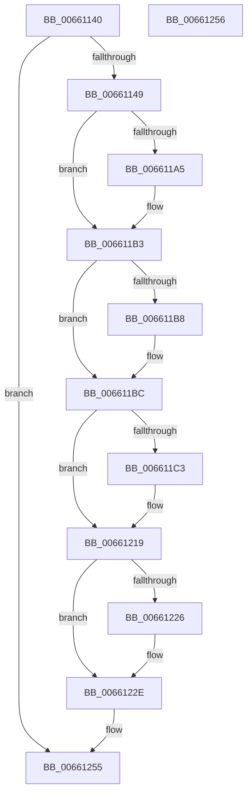

# WheaUnregisterErrorSourceOverride

- RVA: `0x00661140`–`0x00661257` (길이 `279` bytes)
- VA: `0x0000000140661140`
- 실행 섹션: `.text`
- PDB 이름 있음: `예`; PDB Function 태그: `아니요`
- unwind 정보 RVA: `0x000A851C`
- 디코드: `69`개 명령, `279/279` bytes 표시
- 미해석 바이트: `0` (있으면 어셈블리에 `.byte`로 보존)

> 이 문서는 커널 이미지의 기계어와 PDB 기호를 분석해 생성했습니다. 4번과 5번은 함수 원형과 자료형을 바이너리 사용 방식에서 추정한 C 해석이며 원본 소스 복구 결과는 아닙니다.

## 1. Dependencies

- 직접 호출 지점: **6**; 고유 호출 대상: **6**
- 직접 호출자로 확인된 함수: **0**
- RIP 상대 이미지 참조: **6**

### Outgoing calls
- `0x00661195` → [KeAbPreAcquire](../21/KeAbPreAcquire_function_00210230.md) (function, `0x00210230`)
- `0x006611AE` → [ExfAcquirePushLockExclusiveEx](../20/ExfAcquirePushLockExclusiveEx_function_0020FC90.md) (function, `0x0020FC90`)
- `0x006611D1` → [WheaRemoveErrorSource](../../page/7D/WheaRemoveErrorSource_function_007D6C70.md) (function, `0x007D6C70`)
- `0x00661229` → [ExfTryToWakePushLock](../26/ExfTryToWakePushLock_function_00265DD0.md) (function, `0x00265DD0`)
- `0x00661231` → [KeAbPostRelease](../2E/KeAbPostRelease_function_002E1600.md) (function, `0x002E1600`)
- `0x00661236` → [KeLeaveCriticalRegion](../25/KeLeaveCriticalRegion_function_0025D8B0.md) (function, `0x0025D8B0`)

### Direct callers
- 이 함수 시작 RVA로 연결되는 직접 call은 확인되지 않았습니다. 간접 호출은 완전히 역산할 수 없습니다.

### Static image references
- `0x00661165` → RVA `0x00EEF590` (`.data`; read)
- `0x006611C3` → RVA `0x00EEFA50` (`.data`; read)
- `0x006611DA` → RVA `0x0048FDC0` (`HalAdjustResourceList`; read)
- `0x006611E5` → RVA `0x00B5D700` (`HalpQosInitSystem`; read)
- `0x006611F0` → RVA `0x00660050` (`WheapDefaultErrSrcCreateRecord`; read)
- `0x00661206` → RVA `0x0049E550` (`EmpCheckErrataList`; read)

## 2. Other-region calls and transfers

- 다른 실행 섹션으로 향하는 call: **1**
  - `0x006611D1` → [WheaRemoveErrorSource](../../page/7D/WheaRemoveErrorSource_function_007D6C70.md) (`.text` → `PAGE`)
- 별도 외부 분기/꼬리 이동을 확인하지 못했습니다.

## 3. Assembly (complete function range)

```asm
00661140  83 F9 12                        cmp ecx, 0x12
00661143  0F 87 0C 01 00 00               ja 0x140661255
00661149  48 8B C4                        mov rax, rsp
0066114C  48 89 58 08                     mov qword ptr [rax + 8], rbx
00661150  48 89 68 10                     mov qword ptr [rax + 0x10], rbp
00661154  48 89 70 18                     mov qword ptr [rax + 0x18], rsi
00661158  48 89 78 20                     mov qword ptr [rax + 0x20], rdi
0066115C  41 56                           push r14
0066115E  48 83 EC 20                     sub rsp, 0x20
00661162  4C 63 F1                        movsxd r14, ecx
00661165  48 8D 05 24 E4 88 00            lea rax, [rip + 0x88e424]
0066116C  8B EA                           mov ebp, edx
0066116E  49 8B FE                        mov rdi, r14
00661171  48 C1 E7 06                     shl rdi, 6
00661175  48 83 CB FF                     or rbx, 0xffffffffffffffff
00661179  48 03 F8                        add rdi, rax
0066117C  45 33 C0                        xor r8d, r8d
0066117F  65 48 8B 04 25 88 01 00 00      mov rax, qword ptr gs:[0x188]
00661188  33 D2                           xor edx, edx
0066118A  48 8B CF                        mov rcx, rdi
0066118D  66 01 98 E4 01 00 00            add word ptr [rax + 0x1e4], bx
00661194  90                              nop
00661195  E8 96 F0 BA FF                  call 0x140210230
0066119A  F0 48 0F BA 2F 00               lock bts qword ptr [rdi], 0
006611A0  48 8B F0                        mov rsi, rax
006611A3  73 0E                           jae 0x1406611b3
006611A5  4C 8B C7                        mov r8, rdi
006611A8  48 8B D0                        mov rdx, rax
006611AB  48 8B CF                        mov rcx, rdi
006611AE  E8 DD EA BA FF                  call 0x14020fc90
006611B3  48 85 F6                        test rsi, rsi
006611B6  74 04                           je 0x1406611bc
006611B8  C6 46 0A 01                     mov byte ptr [rsi + 0xa], 1
006611BC  8A 47 08                        mov al, byte ptr [rdi + 8]
006611BF  84 C0                           test al, al
006611C1  74 56                           je 0x140661219
006611C3  48 8D 05 86 E8 88 00            lea rax, [rip + 0x88e886]
006611CA  8B CD                           mov ecx, ebp
006611CC  4A 83 24 F0 00                  and qword ptr [rax + r14*8], 0
006611D1  E8 9A 5A 17 00                  call 0x1407d6c70
006611D6  C6 47 08 00                     mov byte ptr [rdi + 8], 0
006611DA  48 8D 05 DF EB E2 FF            lea rax, [rip - 0x1d1421]
006611E1  48 89 47 10                     mov qword ptr [rdi + 0x10], rax
006611E5  48 8D 05 14 C5 4F 00            lea rax, [rip + 0x4fc514]
006611EC  48 89 47 18                     mov qword ptr [rdi + 0x18], rax
006611F0  48 8D 05 59 EE FF FF            lea rax, [rip - 0x11a7]
006611F7  48 89 47 20                     mov qword ptr [rdi + 0x20], rax
006611FB  48 8D 05 BE EB E2 FF            lea rax, [rip - 0x1d1442]
00661202  48 89 47 28                     mov qword ptr [rdi + 0x28], rax
00661206  48 8D 05 43 D3 E3 FF            lea rax, [rip - 0x1c2cbd]
0066120D  48 89 47 30                     mov qword ptr [rdi + 0x30], rax
00661211  48 C7 47 38 00 00 00 00         mov qword ptr [rdi + 0x38], 0
00661219  F0 48 0F C1 1F                  lock xadd qword ptr [rdi], rbx
0066121E  80 E3 06                        and bl, 6
00661221  80 FB 02                        cmp bl, 2
00661224  75 08                           jne 0x14066122e
00661226  48 8B CF                        mov rcx, rdi
00661229  E8 A2 4B C0 FF                  call 0x140265dd0
0066122E  48 8B CF                        mov rcx, rdi
00661231  E8 CA 03 C8 FF                  call 0x1402e1600
00661236  E8 75 C6 BF FF                  call 0x14025d8b0
0066123B  48 8B 5C 24 30                  mov rbx, qword ptr [rsp + 0x30]
00661240  48 8B 6C 24 38                  mov rbp, qword ptr [rsp + 0x38]
00661245  48 8B 74 24 40                  mov rsi, qword ptr [rsp + 0x40]
0066124A  48 8B 7C 24 48                  mov rdi, qword ptr [rsp + 0x48]
0066124F  48 83 C4 20                     add rsp, 0x20
00661253  41 5E                           pop r14
00661255  C3                              ret
00661256  CC                              int3
```

## 4. C-style interpretation (structured pseudocode)

```c
__int64 __fastcall WheaUnregisterErrorSourceOverride(int a1, int a2, int a3)
{
    __int64 result;
    __int64 v_rbx;
    __int64 v_rdi;
    __int64 v_rsp;
    unsigned __int64 v_stack_p10;
    unsigned __int64 v_stack_p18;
    unsigned __int64 v_stack_p20;
    unsigned __int64 v_stack_p8;

    if (a1 > 18) goto loc_00661255;
    *(unsigned __int64 *)(v_rsp + 8) = v_rbx;
    *(unsigned __int64 *)(v_rsp + 16) = v_rbp;
    *(unsigned __int64 *)(v_rsp + 24) = v_rsi;
    *(unsigned __int64 *)(v_rsp + 32) = v_rdi;
    v_rsp = (v_rsp) - (32);
    v_rdi = ((int)(a1)) << (6);
    v_rbx = (v_rbx) | (-1);
    v_rdi = (v_rdi) + (v_rip + 8971300);
    a3 = 0;
    a2 = 0;
    result = KeAbPreAcquire(v_rdi, a2, a3, a4);
    if (!(condition_is_above_or_equal)) {
        a3 = v_rdi;
        a2 = result;
        a1 = v_rdi;
        result = ExfAcquirePushLockExclusiveEx(a1, a2, a3, a4);
    }
    if (result != 0) {
        *(unsigned __int8 *)(result + 10) = 1;
    }
    result = *(unsigned __int8 *)(v_rdi + 8);
    if ((unsigned __int8)(*(unsigned __int8 *)(v_rdi + 8)) != 0) {
        result = v_rip + 8972422;
        a1 = (unsigned int)((unsigned int)(a2));
        result = WheaRemoveErrorSource(a1, a2, a3, a4);
        *(unsigned __int8 *)(v_rdi + 8) = 0;
        result = v_rip - 1905697;
        *(unsigned __int64 *)(v_rdi + 16) = result;
        result = v_rip + 5227796;
        *(unsigned __int64 *)(v_rdi + 24) = result;
        result = v_rip - 4519;
        *(unsigned __int64 *)(v_rdi + 32) = result;
        result = v_rip - 1905730;
        *(unsigned __int64 *)(v_rdi + 40) = result;
        result = v_rip - 1846461;
        *(unsigned __int64 *)(v_rdi + 48) = result;
        *(unsigned __int64 *)(v_rdi + 56) = 0;
    }
    v_rbx = (unsigned __int8)((v_rbx) & (6));
    if (((unsigned __int8)(v_rbx)) == 2) {
        a1 = v_rdi;
        result = ExfTryToWakePushLock(a1, a2, a3, a4);
    }
    result = KeAbPostRelease(v_rdi, a2, a3, a4);
    result = KeLeaveCriticalRegion(v_rdi, a2, a3, a4);
    v_rsp = (v_rsp) + (32);
loc_00661255:
    return result;
}
```

## 5. (Beta) C Style

```c
int64_t WheaUnregisterErrorSourceOverride(int32_t Arg1, int32_t Arg2, int32_t Arg3)
{
    int64_t result;
    int64_t local_rbx;
    int64_t local_rdi;
    int64_t local_rsp;
    uint64_t v_stack_p10;
    uint64_t v_stack_p18;
    uint64_t v_stack_p20;
    uint64_t v_stack_p8;

    if (Arg1 > 18) goto loc_00661255;
    *(uint64_t *)(local_rsp + 0x8) = local_rbx;
    *(uint64_t *)(local_rsp + 0x10) = local_rbp;
    *(uint64_t *)(local_rsp + 0x18) = local_rsi;
    *(uint64_t *)(local_rsp + 0x20) = local_rdi;
    local_rsp = (local_rsp) - (32);
    local_rdi = ((int32_t)(Arg1)) << (6);
    local_rbx = (local_rbx) | (-1);
    local_rdi = (local_rdi) + (v_rip + 8971300);
    Arg3 = 0;
    Arg2 = 0;
    result = KeAbPreAcquire(local_rdi, Arg2, Arg3, a4);
    if (!(condition_is_above_or_equal)) {
        Arg3 = local_rdi;
        Arg2 = result;
        Arg1 = local_rdi;
        result = ExfAcquirePushLockExclusiveEx(Arg1, Arg2, Arg3, a4);
    }
    if (result != 0) {
        *(uint8_t *)(result + 0xA) = 1;
    }
    result = *(uint8_t *)(local_rdi + 0x8);
    if ((uint8_t)(*(uint8_t *)(local_rdi + 0x8)) != 0) {
        result = v_rip + 8972422;
        Arg1 = (uint32_t)((uint32_t)(Arg2));
        result = WheaRemoveErrorSource(Arg1, Arg2, Arg3, a4);
        *(uint8_t *)(local_rdi + 0x8) = 0;
        result = v_rip - 1905697;
        *(uint64_t *)(local_rdi + 0x10) = result;
        result = v_rip + 5227796;
        *(uint64_t *)(local_rdi + 0x18) = result;
        result = v_rip - 4519;
        *(uint64_t *)(local_rdi + 0x20) = result;
        result = v_rip - 1905730;
        *(uint64_t *)(local_rdi + 0x28) = result;
        result = v_rip - 1846461;
        *(uint64_t *)(local_rdi + 0x30) = result;
        *(uint64_t *)(local_rdi + 0x38) = 0;
    }
    local_rbx = (uint8_t)((local_rbx) & (6));
    if (((uint8_t)(local_rbx)) == 2) {
        Arg1 = local_rdi;
        result = ExfTryToWakePushLock(Arg1, Arg2, Arg3, a4);
    }
    result = KeAbPostRelease(local_rdi, Arg2, Arg3, a4);
    result = KeLeaveCriticalRegion(local_rdi, Arg2, Arg3, a4);
    local_rsp = (local_rsp) + (32);
loc_00661255:
    return result;
}
```

## 6. Execution-region graph

[열기: 2D/3D 그래프와 함수 탐색 컨트롤 패널](../../../control-panel.html?section=text&rva=0x00661140&view=graph)

- 2D 그래프는 위에서 아래로 흐르고, 3D 그래프는 빈 공간을 드래그해 회전합니다. Shift+드래그는 이동, 휠은 확대·축소, 함수 노드 선택은 대상 보고서 이동입니다.

### Static fallback


