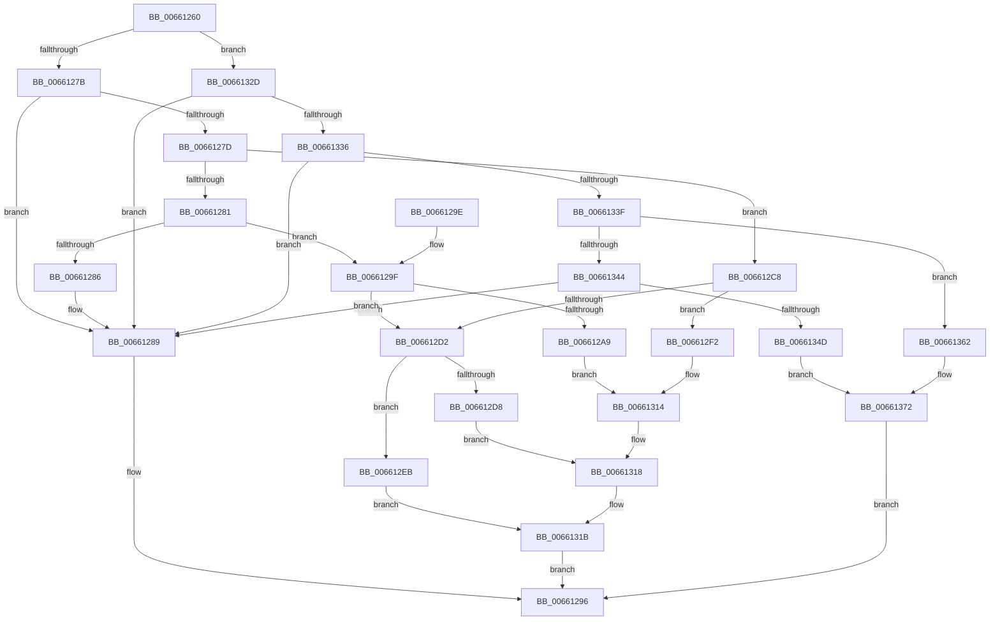

# WheaWmiDispatch

- RVA: `0x00661260`–`0x00661379` (길이 `281` bytes)
- VA: `0x0000000140661260`
- 실행 섹션: `.text`
- PDB 이름 있음: `예`; PDB Function 태그: `아니요`
- unwind 정보 RVA: `0x00081F60`
- 디코드: `74`개 명령, `281/281` bytes 표시
- 미해석 바이트: `0` (있으면 어셈블리에 `.byte`로 보존)

> 이 문서는 커널 이미지의 기계어와 PDB 기호를 분석해 생성했습니다. 4번과 5번은 함수 원형과 자료형을 바이너리 사용 방식에서 추정한 C 해석이며 원본 소스 복구 결과는 아닙니다.

## 1. Dependencies

- 직접 호출 지점: **2**; 고유 호출 대상: **2**
- 직접 호출자로 확인된 함수: **0**
- RIP 상대 이미지 참조: **0**

### Outgoing calls
- `0x0066135B` → [WheapWmiExecuteMethod](WheapWmiExecuteMethod_function_00661888.md) (function, `0x00661888`)
- `0x0066136D` → [WheapWmiRegisterInfo](WheapWmiRegisterInfo_function_00661CA0.md) (function, `0x00661CA0`)

### Direct callers
- 이 함수 시작 RVA로 연결되는 직접 call은 확인되지 않았습니다. 간접 호출은 완전히 역산할 수 없습니다.

### Static image references
- 디코드된 RIP-relative 메모리 참조가 없습니다.

## 2. Other-region calls and transfers

- 다른 실행 섹션으로 향하는 call: **0**
- 별도 외부 분기/꼬리 이동을 확인하지 못했습니다.

## 3. Assembly (complete function range)

```asm
00661260  40 53                           push rbx
00661262  48 83 EC 20                     sub rsp, 0x20
00661266  45 8B D8                        mov r11d, r8d
00661269  4D 8B D1                        mov r10, r9
0066126C  45 33 C0                        xor r8d, r8d
0066126F  48 8B DA                        mov rbx, rdx
00661272  83 F9 05                        cmp ecx, 5
00661275  0F 8F B2 00 00 00               jg 0x14066132d
0066127B  74 0C                           je 0x140661289
0066127D  85 C9                           test ecx, ecx
0066127F  74 47                           je 0x1406612c8
00661281  83 E9 01                        sub ecx, 1
00661284  74 19                           je 0x14066129f
00661286  83 E9 01                        sub ecx, 1
00661289  48 8B 44 24 58                  mov rax, qword ptr [rsp + 0x58]
0066128E  B9 10 00 00 C0                  mov ecx, 0xc0000010
00661293  44 89 00                        mov dword ptr [rax], r8d
00661296  8B C1                           mov eax, ecx
00661298  48 83 C4 20                     add rsp, 0x20
0066129C  5B                              pop rbx
0066129D  C3                              ret
0066129E  CC                              int3
0066129F  BA 66 00 00 00                  mov edx, 0x66
006612A4  44 3B DA                        cmp r11d, edx
006612A7  72 29                           jb 0x1406612d2
006612A9  41 89 11                        mov dword ptr [r9], edx
006612AC  48 A1 14 00 00 00 80 F7 FF FF   movabs rax, qword ptr [0xfffff78000000014]
006612B6  41 C7 41 3C 26 00 00 00         mov dword ptr [r9 + 0x3c], 0x26
006612BE  41 C7 41 38 40 00 00 00         mov dword ptr [r9 + 0x38], 0x40
006612C6  EB 4C                           jmp 0x140661314
006612C8  BA 48 00 00 00                  mov edx, 0x48
006612CD  44 3B DA                        cmp r11d, edx
006612D0  73 20                           jae 0x1406612f2
006612D2  41 83 FB 38                     cmp r11d, 0x38
006612D6  72 13                           jb 0x1406612eb
006612D8  41 89 51 30                     mov dword ptr [r9 + 0x30], edx
006612DC  BA 38 00 00 00                  mov edx, 0x38
006612E1  41 C7 41 2C 20 00 00 00         mov dword ptr [r9 + 0x2c], 0x20
006612E9  EB 2D                           jmp 0x140661318
006612EB  B9 23 00 00 C0                  mov ecx, 0xc0000023
006612F0  EB 29                           jmp 0x14066131b
006612F2  41 89 11                        mov dword ptr [r9], edx
006612F5  48 A1 14 00 00 00 80 F7 FF FF   movabs rax, qword ptr [0xfffff78000000014]
006612FF  41 83 49 2C 10                  or dword ptr [r9 + 0x2c], 0x10
00661304  41 C7 41 34 01 00 00 00         mov dword ptr [r9 + 0x34], 1
0066130C  45 89 41 3C                     mov dword ptr [r9 + 0x3c], r8d
00661310  41 89 51 30                     mov dword ptr [r9 + 0x30], edx
00661314  49 89 41 10                     mov qword ptr [r9 + 0x10], rax
00661318  41 8B C8                        mov ecx, r8d
0066131B  48 8B 44 24 58                  mov rax, qword ptr [rsp + 0x58]
00661320  85 C9                           test ecx, ecx
00661322  41 0F 48 D0                     cmovs edx, r8d
00661326  89 10                           mov dword ptr [rax], edx
00661328  E9 69 FF FF FF                  jmp 0x140661296
0066132D  83 E9 06                        sub ecx, 6
00661330  0F 84 53 FF FF FF               je 0x140661289
00661336  83 E9 01                        sub ecx, 1
00661339  0F 84 4A FF FF FF               je 0x140661289
0066133F  83 E9 01                        sub ecx, 1
00661342  74 1E                           je 0x140661362
00661344  83 F9 01                        cmp ecx, 1
00661347  0F 85 3C FF FF FF               jne 0x140661289
0066134D  4C 8B 4C 24 58                  mov r9, qword ptr [rsp + 0x58]
00661352  4D 8B C2                        mov r8, r10
00661355  41 8B D3                        mov edx, r11d
00661358  48 8B CB                        mov rcx, rbx
0066135B  E8 28 05 00 00                  call 0x140661888
00661360  EB 10                           jmp 0x140661372
00661362  4C 8B 4C 24 58                  mov r9, qword ptr [rsp + 0x58]
00661367  4D 8B C2                        mov r8, r10
0066136A  41 8B D3                        mov edx, r11d
0066136D  E8 2E 09 00 00                  call 0x140661ca0
00661372  8B C8                           mov ecx, eax
00661374  E9 1D FF FF FF                  jmp 0x140661296
```

## 4. C-style interpretation (structured pseudocode)

```c
__int64 __fastcall WheaWmiDispatch(int a1, __int64 a2, int a3, __int64 a4, __int64 a5, __int64 a6)
{
    __int64 result;
    __int64 v_rsp;

    v_rsp = (v_rsp) - (32);
    a3 = 0;
    if (a1 > 5) goto loc_0066132D;
    if (a1 == 5) goto loc_00661289;
    if (a1 == 0) goto loc_006612C8;
    a1 = (unsigned int)((a1) - (1));
    if (condition_is_equal) goto loc_0066129F;
    a1 = (unsigned int)((a1) - (1));
loc_00661289:
    *(unsigned int *)(a6) = 0;
loc_00661296:
    v_rsp = (v_rsp) + (32);
    return (unsigned int)((unsigned int)((unsigned int)(0xC0000010ULL)));
loc_0066129F:
    if (((unsigned int)((unsigned int)(a3))) < 102) goto loc_006612D2;
    *(unsigned int *)(a4) = 102;
    *(unsigned int *)(a4 + 60) = 38;
    *(unsigned int *)(a4 + 56) = 64;
    goto loc_00661314;
loc_006612C8:
    if (((unsigned int)((unsigned int)(a3))) >= 72) goto loc_006612F2;
loc_006612D2:
    if (((unsigned int)((unsigned int)(a3))) < 56) goto loc_006612EB;
    *(unsigned int *)(a4 + 48) = 72;
    *(unsigned int *)(a4 + 44) = 32;
    goto loc_00661318;
loc_006612EB:
    goto loc_0066131B;
loc_006612F2:
    *(unsigned int *)(a4) = 56;
    *(unsigned int *)(a4 + 52) = 1;
    *(unsigned int *)(a4 + 60) = 0;
    *(unsigned int *)(a4 + 48) = 56;
loc_00661314:
    *(unsigned __int64 *)(a4 + 16) = (unsigned int)((unsigned int)((unsigned int)(0xC0000010ULL)));
loc_00661318:
loc_0066131B:
    a2 = 56;
    if (sign_flag) { a2 = 0; }
    *(unsigned int *)(a6) = (unsigned int)(a2);
    goto loc_00661296;
loc_0066132D:
    a1 = (unsigned int)((0) - (6));
    if (condition_is_equal) goto loc_00661289;
    a1 = (unsigned int)((a1) - (1));
    if (condition_is_equal) goto loc_00661289;
    a1 = (unsigned int)((a1) - (1));
    if (condition_is_equal) goto loc_00661362;
    if (a1 != 1) goto loc_00661289;
    result = WheapWmiExecuteMethod(a2, (unsigned int)((unsigned int)((unsigned int)(a3))), a4, a6);
    goto loc_00661372;
loc_00661362:
    result = WheapWmiRegisterInfo(a2, (unsigned int)((unsigned int)((unsigned int)(a3))), a4, a6);
loc_00661372:
    goto loc_00661296;
}
```

## 5. (Beta) C Style

```c
int64_t WheaWmiDispatch(int32_t Arg1, int64_t Arg2, int32_t Arg3, void *Arg4, uint64_t Arg5, void *Arg6)
{
    uint8_t *arg4 = (uint8_t *)Arg4;
    uint8_t *arg6 = (uint8_t *)Arg6;

    int64_t result;
    int64_t local_rsp;

    local_rsp = (local_rsp) - (32);
    Arg3 = 0;
    if (Arg1 > 5) goto loc_0066132D;
    if (Arg1 == 5) goto loc_00661289;
    if (Arg1 == 0) goto loc_006612C8;
    Arg1 = (uint32_t)((Arg1) - (1));
    if (condition_is_equal) goto loc_0066129F;
    Arg1 = (uint32_t)((Arg1) - (1));
loc_00661289:
    *(uint32_t *)(arg6) = 0;
loc_00661296:
    local_rsp = (local_rsp) + (32);
    return (uint32_t)((uint32_t)((uint32_t)(0xC0000010ULL)));
loc_0066129F:
    if (((uint32_t)((uint32_t)(Arg3))) < 102) goto loc_006612D2;
    *(uint32_t *)(arg4) = 102;
    *(uint32_t *)(arg4 + 0x3C) = 38;
    *(uint32_t *)(arg4 + 0x38) = 64;
    goto loc_00661314;
loc_006612C8:
    if (((uint32_t)((uint32_t)(Arg3))) >= 72) goto loc_006612F2;
loc_006612D2:
    if (((uint32_t)((uint32_t)(Arg3))) < 56) goto loc_006612EB;
    *(uint32_t *)(arg4 + 0x30) = 72;
    *(uint32_t *)(arg4 + 0x2C) = 32;
    goto loc_00661318;
loc_006612EB:
    goto loc_0066131B;
loc_006612F2:
    *(uint32_t *)(arg4) = 56;
    *(uint32_t *)(arg4 + 0x34) = 1;
    *(uint32_t *)(arg4 + 0x3C) = 0;
    *(uint32_t *)(arg4 + 0x30) = 56;
loc_00661314:
    *(uint64_t *)(arg4 + 0x10) = (uint32_t)((uint32_t)((uint32_t)(0xC0000010ULL)));
loc_00661318:
loc_0066131B:
    Arg2 = 56;
    if (sign_flag) { Arg2 = 0; }
    *(uint32_t *)(arg6) = (uint32_t)(Arg2);
    goto loc_00661296;
loc_0066132D:
    Arg1 = (uint32_t)((0) - (6));
    if (condition_is_equal) goto loc_00661289;
    Arg1 = (uint32_t)((Arg1) - (1));
    if (condition_is_equal) goto loc_00661289;
    Arg1 = (uint32_t)((Arg1) - (1));
    if (condition_is_equal) goto loc_00661362;
    if (Arg1 != 1) goto loc_00661289;
    result = WheapWmiExecuteMethod(Arg2, (uint32_t)((uint32_t)((uint32_t)(Arg3))), Arg4, Arg6);
    goto loc_00661372;
loc_00661362:
    result = WheapWmiRegisterInfo(Arg2, (uint32_t)((uint32_t)((uint32_t)(Arg3))), Arg4, Arg6);
loc_00661372:
    goto loc_00661296;
}
```

### 관측된 메모리 오프셋

구조체 형식이 확인되지 않은 접근은 인자 기준의 오프셋으로만 기록했습니다.

| 기준 인자 | 오프셋 표현 | 폭 (bit) | 접근 |
|---|---:|---:|---|
| `Arg4` | `+ 0x0` | `32` | `W` |
| `Arg4` | `+ 0x10` | `64` | `W` |
| `Arg4` | `+ 0x2C` | `32` | `R/W` |
| `Arg4` | `+ 0x2C` | `32` | `W` |
| `Arg4` | `+ 0x30` | `32` | `W` |
| `Arg4` | `+ 0x34` | `32` | `W` |
| `Arg4` | `+ 0x38` | `32` | `W` |
| `Arg4` | `+ 0x3C` | `32` | `W` |
| `Arg6` | `+ 0x0` | `32` | `W` |

## 6. Execution-region graph

[열기: 2D/3D 그래프와 함수 탐색 컨트롤 패널](../../../control-panel.html?section=text&rva=0x00661260&view=graph)

- 2D 그래프는 위에서 아래로 흐르고, 3D 그래프는 빈 공간을 드래그해 회전합니다. Shift+드래그는 이동, 휠은 확대·축소, 함수 노드 선택은 대상 보고서 이동입니다.

### Static fallback


