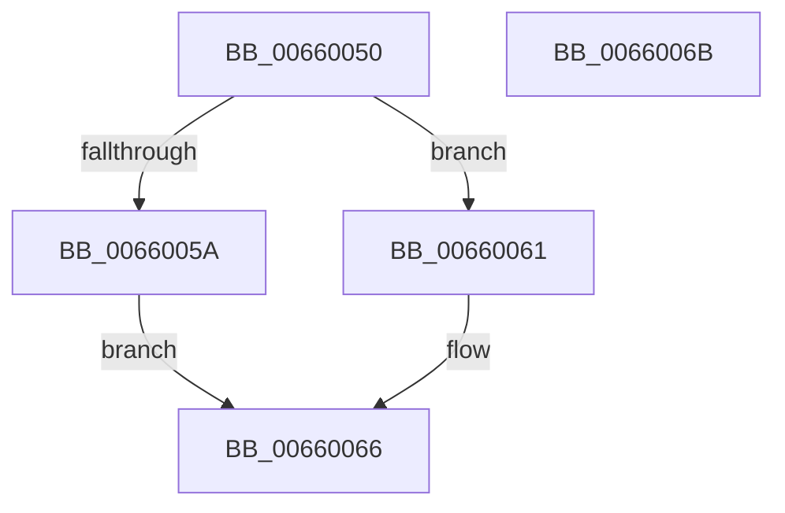

# WheapDefaultErrSrcCreateRecord

- RVA: `0x00660050`–`0x0066006C` (길이 `28` bytes)
- VA: `0x0000000140660050`
- 실행 섹션: `.text`
- PDB 이름 있음: `예`; PDB Function 태그: `아니요`
- unwind 정보 RVA: `0x0005D2F4`
- 디코드: `9`개 명령, `28/28` bytes 표시
- 미해석 바이트: `0` (있으면 어셈블리에 `.byte`로 보존)

> 이 문서는 커널 이미지의 기계어와 PDB 기호를 분석해 생성했습니다. 4번과 5번은 함수 원형과 자료형을 바이너리 사용 방식에서 추정한 C 해석이며 원본 소스 복구 결과는 아닙니다.

## 1. Dependencies

- 직접 호출 지점: **1**; 고유 호출 대상: **1**
- 직접 호출자로 확인된 함수: **0**
- RIP 상대 이미지 참조: **0**

### Outgoing calls
- `0x0066005A` → [WheapCreateRecordFromGenericErrorData](../65/WheapCreateRecordFromGenericErrorData_function_0065FCE4.md) (function, `0x0065FCE4`)

### Direct callers
- 이 함수 시작 RVA로 연결되는 직접 call은 확인되지 않았습니다. 간접 호출은 완전히 역산할 수 없습니다.

### Static image references
- 디코드된 RIP-relative 메모리 참조가 없습니다.

## 2. Other-region calls and transfers

- 다른 실행 섹션으로 향하는 call: **0**
- 별도 외부 분기/꼬리 이동을 확인하지 못했습니다.

## 3. Assembly (complete function range)

```asm
00660050  48 83 EC 38                     sub rsp, 0x38
00660054  83 7A 38 07                     cmp dword ptr [rdx + 0x38], 7
00660058  75 07                           jne 0x140660061
0066005A  E8 85 FC FF FF                  call 0x14065fce4
0066005F  EB 05                           jmp 0x140660066
00660061  B8 02 00 00 C0                  mov eax, 0xc0000002
00660066  48 83 C4 38                     add rsp, 0x38
0066006A  C3                              ret
0066006B  CC                              int3
```

## 4. C-style interpretation (structured pseudocode)

```c
__int64 __fastcall WheapDefaultErrSrcCreateRecord(__int64 a1, __int64 a2)
{
    __int64 result;
    __int64 v_rsp;

    v_rsp = (v_rsp) - (56);
    if ((*(unsigned int *)(a2 + 56)) != 7) goto loc_00660061;
    result = WheapCreateRecordFromGenericErrorData(a1, a2, a3, a4);
    goto loc_00660066;
loc_00660061:
loc_00660066:
    v_rsp = (v_rsp) + (56);
    return (unsigned int)(0xC0000002ULL);
}
```

## 5. (Beta) C Style

```c
int64_t WheapDefaultErrSrcCreateRecord(int64_t Arg1, void *Arg2)
{
    uint8_t *arg2 = (uint8_t *)Arg2;

    int64_t result;
    int64_t local_rsp;

    local_rsp = (local_rsp) - (56);
    if ((*(uint32_t *)(arg2 + 0x38)) != 7) goto loc_00660061;
    result = WheapCreateRecordFromGenericErrorData(Arg1, Arg2, a3, a4);
    goto loc_00660066;
loc_00660061:
loc_00660066:
    local_rsp = (local_rsp) + (56);
    return (uint32_t)(0xC0000002ULL);
}
```

### 관측된 메모리 오프셋

구조체 형식이 확인되지 않은 접근은 인자 기준의 오프셋으로만 기록했습니다.

| 기준 인자 | 오프셋 표현 | 폭 (bit) | 접근 |
|---|---:|---:|---|
| `Arg2` | `+ 0x38` | `32` | `R` |

## 6. Execution-region graph

[열기: 2D/3D 그래프와 함수 탐색 컨트롤 패널](../../../control-panel.html?section=text&rva=0x00660050&view=graph)

- 2D 그래프는 위에서 아래로 흐르고, 3D 그래프는 빈 공간을 드래그해 회전합니다. Shift+드래그는 이동, 휠은 확대·축소, 함수 노드 선택은 대상 보고서 이동입니다.

### Static fallback


