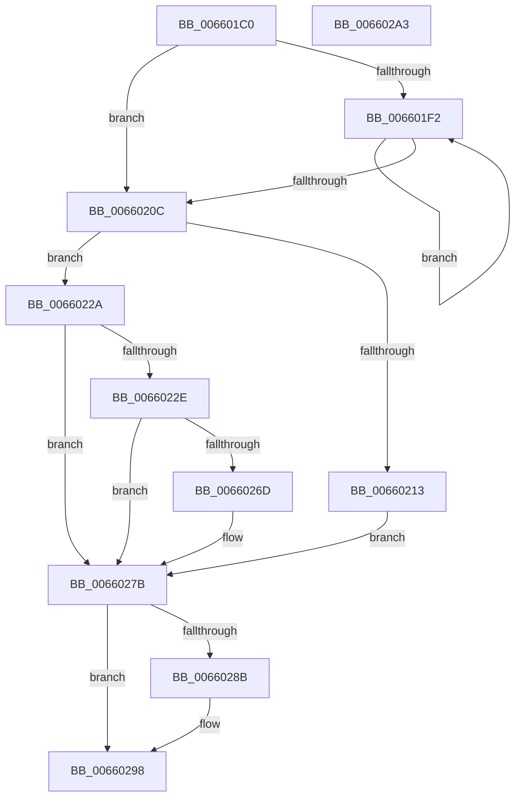

# WheapDeferredRecoveryServiceDpcRoutine

- RVA: `0x006601C0`–`0x006602A4` (길이 `228` bytes)
- VA: `0x00000001406601C0`
- 실행 섹션: `.text`
- PDB 이름 있음: `예`; PDB Function 태그: `아니요`
- unwind 정보 RVA: `0x0006E5F8`
- 디코드: `58`개 명령, `228/228` bytes 표시
- 미해석 바이트: `0` (있으면 어셈블리에 `.byte`로 보존)

> 이 문서는 커널 이미지의 기계어와 PDB 기호를 분석해 생성했습니다. 4번과 5번은 함수 원형과 자료형을 바이너리 사용 방식에서 추정한 C 해석이며 원본 소스 복구 결과는 아닙니다.

## 1. Dependencies

- 직접 호출 지점: **5**; 고유 호출 대상: **5**
- 직접 호출자로 확인된 함수: **0**
- RIP 상대 이미지 참조: **8**

### Outgoing calls
- `0x00660223` → [guard_dispatch_icall](../6B/guard_dispatch_icall_function_006BAAD0.md) (function, `0x006BAAD0`)
- `0x00660235` → [KeAcquireSpinLockRaiseToDpc](../20/KeAcquireSpinLockRaiseToDpc_function_00208470.md) (function, `0x00208470`)
- `0x00660254` → [KeReleaseSpinLock](../39/KeReleaseSpinLock_function_00392BA0.md) (function, `0x00392BA0`)
- `0x00660276` → [ExQueueWorkItem](../2F/ExQueueWorkItem_function_002F9520.md) (function, `0x002F9520`)
- `0x00660293` → [KeInsertQueueDpc](../20/KeInsertQueueDpc_function_00207C50.md) (function, `0x00207C50`)

### Direct callers
- 이 함수 시작 RVA로 연결되는 직접 call은 확인되지 않았습니다. 간접 호출은 완전히 역산할 수 없습니다.

### Static image references
- `0x006601CA` → RVA `0x00EEF550` (`.data`; read)
- `0x006601D3` → RVA `0x00EEF558` (`.data`; read)
- `0x0066022E` → RVA `0x00EF9FC0` (`.data`; read)
- `0x0066023A` → RVA `0x00EEF568` (`.data`; read)
- `0x0066024D` → RVA `0x00EEF568` (`.data`; write)
- `0x0066025E` → RVA `0x00EEF574` (`.data`; read/write)
- `0x0066026F` → RVA `0x00EF9FA0` (`.data`; read)
- `0x0066027E` → RVA `0x00EEF550` (`.data`; read/write)

## 2. Other-region calls and transfers

- 다른 실행 섹션으로 향하는 call: **0**
- 별도 외부 분기/꼬리 이동을 확인하지 못했습니다.

## 3. Assembly (complete function range)

```asm
006601C0  48 89 5C 24 08                  mov qword ptr [rsp + 8], rbx
006601C5  57                              push rdi
006601C6  48 83 EC 30                     sub rsp, 0x30
006601CA  8B 05 80 F3 88 00               mov eax, dword ptr [rip + 0x88f380]
006601D0  48 8B F9                        mov rdi, rcx
006601D3  48 8B 05 7E F3 88 00            mov rax, qword ptr [rip + 0x88f37e]
006601DA  48 8B 1D 77 F3 88 00            mov rbx, qword ptr [rip + 0x88f377]
006601E1  48 8B C3                        mov rax, rbx
006601E4  48 8B 13                        mov rdx, qword ptr [rbx]
006601E7  F0 48 0F B1 15 68 F3 88 00      lock cmpxchg qword ptr [rip + 0x88f368], rdx
006601F0  74 1A                           je 0x14066020c
006601F2  F3 90                           pause
006601F4  48 8B 1D 5D F3 88 00            mov rbx, qword ptr [rip + 0x88f35d]
006601FB  48 8B C3                        mov rax, rbx
006601FE  48 8B 0B                        mov rcx, qword ptr [rbx]
00660201  F0 48 0F B1 0D 4E F3 88 00      lock cmpxchg qword ptr [rip + 0x88f34e], rcx
0066020A  75 E6                           jne 0x1406601f2
0066020C  8A 43 18                        mov al, byte ptr [rbx + 0x18]
0066020F  3C 02                           cmp al, 2
00660211  75 17                           jne 0x14066022a
00660213  33 C0                           xor eax, eax
00660215  48 8B CB                        mov rcx, rbx
00660218  87 43 08                        xchg dword ptr [rbx + 8], eax
0066021B  48 8B 43 10                     mov rax, qword ptr [rbx + 0x10]
0066021F  48 8B 53 20                     mov rdx, qword ptr [rbx + 0x20]
00660223  E8 A8 A8 05 00                  call 0x1406baad0
00660228  EB 51                           jmp 0x14066027b
0066022A  84 C0                           test al, al
0066022C  75 4D                           jne 0x14066027b
0066022E  48 8D 0D 8B 9D 89 00            lea rcx, [rip + 0x899d8b]
00660235  E8 36 82 BA FF                  call 0x140208470
0066023A  48 8B 15 27 F3 88 00            mov rdx, qword ptr [rip + 0x88f327]
00660241  48 8D 0D 78 9D 89 00            lea rcx, [rip + 0x899d78]
00660248  48 89 13                        mov qword ptr [rbx], rdx
0066024B  8A D0                           mov dl, al
0066024D  48 89 1D 14 F3 88 00            mov qword ptr [rip + 0x88f314], rbx
00660254  E8 47 29 D3 FF                  call 0x140392ba0
00660259  B8 01 00 00 00                  mov eax, 1
0066025E  F0 0F C1 05 0E F3 88 00         lock xadd dword ptr [rip + 0x88f30e], eax
00660266  FF C0                           inc eax
00660268  83 F8 01                        cmp eax, 1
0066026B  75 0E                           jne 0x14066027b
0066026D  33 D2                           xor edx, edx
0066026F  48 8D 0D 2A 9D 89 00            lea rcx, [rip + 0x899d2a]
00660276  E8 A5 92 C9 FF                  call 0x1402f9520
0066027B  83 C8 FF                        or eax, 0xffffffff
0066027E  F0 0F C1 05 CA F2 88 00         lock xadd dword ptr [rip + 0x88f2ca], eax
00660286  83 E8 01                        sub eax, 1
00660289  7E 0D                           jle 0x140660298
0066028B  45 33 C0                        xor r8d, r8d
0066028E  33 D2                           xor edx, edx
00660290  48 8B CF                        mov rcx, rdi
00660293  E8 B8 79 BA FF                  call 0x140207c50
00660298  48 8B 5C 24 40                  mov rbx, qword ptr [rsp + 0x40]
0066029D  48 83 C4 30                     add rsp, 0x30
006602A1  5F                              pop rdi
006602A2  C3                              ret
006602A3  CC                              int3
```

## 4. C-style interpretation (structured pseudocode)

```c
__int64 __fastcall WheapDeferredRecoveryServiceDpcRoutine(__int64 a1, __int64 a2, int a3)
{
    __int64 result;
    __int64 v_rsp;
    unsigned __int64 v_stack_p8;

    v_stack_p8 = v_rbx;
    v_rsp = (v_rsp) - (48);
    if (condition_is_equal) goto loc_0066020C;
loc_006601F2:
    if (condition_is_not_equal) goto loc_006601F2;
loc_0066020C:
    if (((unsigned __int8)(*(unsigned __int8 *)(*(unsigned __int64 *)(v_rip + 8975197) + 24))) != 2) goto loc_0066022A;
    result = 0;
    result = guard_dispatch_icall(*(unsigned __int64 *)(v_rip + 8975197), *(unsigned __int64 *)(*(unsigned __int64 *)(v_rip + 8975197) + 32), a3, a4);
    goto loc_0066027B;
loc_0066022A:
    if ((unsigned __int8)(result) != 0) goto loc_0066027B;
    result = KeAcquireSpinLockRaiseToDpc(v_rip + 9018763, *(unsigned __int64 *)(*(unsigned __int64 *)(v_rip + 8975197) + 32), a3, a4);
    *(unsigned __int64 *)(*(unsigned __int64 *)(v_rip + 8975197)) = *(unsigned __int64 *)(v_rip + 8975143);
    *(unsigned __int64 *)(v_rip + 8975124) = *(unsigned __int64 *)(v_rip + 8975197);
    result = KeReleaseSpinLock(v_rip + 9018744, (unsigned __int8)(result), a3, a4);
    result = (unsigned int)((1) + 1);
    if (((unsigned int)(result)) == 1) {
        a2 = 0;
        a1 = v_rip + 9018666;
        result = ExQueueWorkItem(a1, a2, a3, a4);
    }
    result = (unsigned int)((result) | (0xFFFFFFFFULL));
    result = (unsigned int)((result) - (1));
    if (!(condition_is_less_or_equal)) {
        a3 = 0;
        a2 = 0;
        a1 = a1;
        result = KeInsertQueueDpc(a1, a2, a3, a4);
    }
    v_rsp = (v_rsp) + (48);
    return result;
}
```

## 5. (Beta) C Style

```c
int64_t WheapDeferredRecoveryServiceDpcRoutine(int64_t Arg1, int64_t Arg2, int32_t Arg3)
{
    int64_t result;
    int64_t local_rsp;
    uint64_t v_stack_p8;

    v_stack_p8 = local_rbx;
    local_rsp = (local_rsp) - (48);
    if (condition_is_equal) goto loc_0066020C;
loc_006601F2:
    if (condition_is_not_equal) goto loc_006601F2;
loc_0066020C:
    if (((uint8_t)(*(uint8_t *)(*(uint64_t *)(v_rip + 0x88F35D) + 0x18))) != 2) goto loc_0066022A;
    result = 0;
    result = guard_dispatch_icall(*(uint64_t *)(v_rip + 0x88F35D), *(uint64_t *)(*(uint64_t *)(v_rip + 0x88F35D) + 0x20), Arg3, a4);
    goto loc_0066027B;
loc_0066022A:
    if ((uint8_t)(result) != 0) goto loc_0066027B;
    result = KeAcquireSpinLockRaiseToDpc(v_rip + 9018763, *(uint64_t *)(*(uint64_t *)(v_rip + 0x88F35D) + 0x20), Arg3, a4);
    *(uint64_t *)(*(uint64_t *)(v_rip + 0x88F35D)) = *(uint64_t *)(v_rip + 0x88F327);
    *(uint64_t *)(v_rip + 0x88F314) = *(uint64_t *)(v_rip + 0x88F35D);
    result = KeReleaseSpinLock(v_rip + 9018744, (uint8_t)(result), Arg3, a4);
    result = (uint32_t)((1) + 1);
    if (((uint32_t)(result)) == 1) {
        Arg2 = 0;
        Arg1 = v_rip + 9018666;
        result = ExQueueWorkItem(Arg1, Arg2, Arg3, a4);
    }
    result = (uint32_t)((result) | (0xFFFFFFFFULL));
    result = (uint32_t)((result) - (1));
    if (!(condition_is_less_or_equal)) {
        Arg3 = 0;
        Arg2 = 0;
        Arg1 = Arg1;
        result = KeInsertQueueDpc(Arg1, Arg2, Arg3, a4);
    }
    local_rsp = (local_rsp) + (48);
    return result;
}
```

## 6. Execution-region graph

[열기: 2D/3D 그래프와 함수 탐색 컨트롤 패널](../../../control-panel.html?section=text&rva=0x006601C0&view=graph)

- 2D 그래프는 위에서 아래로 흐르고, 3D 그래프는 빈 공간을 드래그해 회전합니다. Shift+드래그는 이동, 휠은 확대·축소, 함수 노드 선택은 대상 보고서 이동입니다.

### Static fallback


