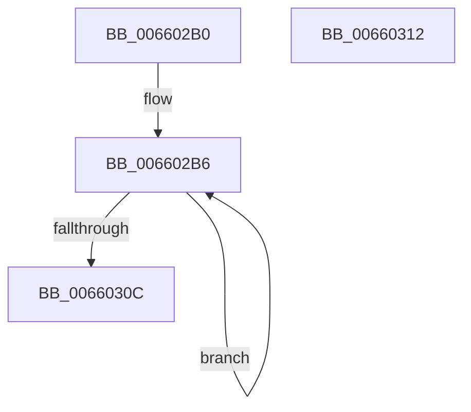

# WheapDeferredRecoveryServiceWorker

- RVA: `0x006602B0`–`0x00660313` (길이 `99` bytes)
- VA: `0x00000001406602B0`
- 실행 섹션: `.text`
- PDB 이름 있음: `예`; PDB Function 태그: `아니요`
- unwind 정보 RVA: `0x0005CF00`
- 디코드: `25`개 명령, `99/99` bytes 표시
- 미해석 바이트: `0` (있으면 어셈블리에 `.byte`로 보존)

> 이 문서는 커널 이미지의 기계어와 PDB 기호를 분석해 생성했습니다. 4번과 5번은 함수 원형과 자료형을 바이너리 사용 방식에서 추정한 C 해석이며 원본 소스 복구 결과는 아닙니다.

## 1. Dependencies

- 직접 호출 지점: **3**; 고유 호출 대상: **3**
- 직접 호출자로 확인된 함수: **0**
- RIP 상대 이미지 참조: **5**

### Outgoing calls
- `0x006602BD` → [KeAcquireSpinLockRaiseToDpc](../20/KeAcquireSpinLockRaiseToDpc_function_00208470.md) (function, `0x00208470`)
- `0x006602E2` → [KeReleaseSpinLock](../39/KeReleaseSpinLock_function_00392BA0.md) (function, `0x00392BA0`)
- `0x006602F7` → [guard_dispatch_icall](../6B/guard_dispatch_icall_function_006BAAD0.md) (function, `0x006BAAD0`)

### Direct callers
- 이 함수 시작 RVA로 연결되는 직접 call은 확인되지 않았습니다. 간접 호출은 완전히 역산할 수 없습니다.

### Static image references
- `0x006602B6` → RVA `0x00EF9FC0` (`.data`; read)
- `0x006602C2` → RVA `0x00EEF574` (`.data`; read)
- `0x006602C8` → RVA `0x00EEF568` (`.data`; read)
- `0x006602D9` → RVA `0x00EEF568` (`.data`; write)
- `0x006602FF` → RVA `0x00EEF574` (`.data`; read/write)

## 2. Other-region calls and transfers

- 다른 실행 섹션으로 향하는 call: **0**
- 별도 외부 분기/꼬리 이동을 확인하지 못했습니다.

## 3. Assembly (complete function range)

```asm
006602B0  40 53                           push rbx
006602B2  48 83 EC 20                     sub rsp, 0x20
006602B6  48 8D 0D 03 9D 89 00            lea rcx, [rip + 0x899d03]
006602BD  E8 AE 81 BA FF                  call 0x140208470
006602C2  8B 0D AC F2 88 00               mov ecx, dword ptr [rip + 0x88f2ac]
006602C8  48 8B 1D 99 F2 88 00            mov rbx, qword ptr [rip + 0x88f299]
006602CF  48 8D 0D EA 9C 89 00            lea rcx, [rip + 0x899cea]
006602D6  48 8B 13                        mov rdx, qword ptr [rbx]
006602D9  48 89 15 88 F2 88 00            mov qword ptr [rip + 0x88f288], rdx
006602E0  8A D0                           mov dl, al
006602E2  E8 B9 28 D3 FF                  call 0x140392ba0
006602E7  33 C0                           xor eax, eax
006602E9  48 8B CB                        mov rcx, rbx
006602EC  87 43 08                        xchg dword ptr [rbx + 8], eax
006602EF  48 8B 43 10                     mov rax, qword ptr [rbx + 0x10]
006602F3  48 8B 53 20                     mov rdx, qword ptr [rbx + 0x20]
006602F7  E8 D4 A7 05 00                  call 0x1406baad0
006602FC  83 C8 FF                        or eax, 0xffffffff
006602FF  F0 0F C1 05 6D F2 88 00         lock xadd dword ptr [rip + 0x88f26d], eax
00660307  83 E8 01                        sub eax, 1
0066030A  7F AA                           jg 0x1406602b6
0066030C  48 83 C4 20                     add rsp, 0x20
00660310  5B                              pop rbx
00660311  C3                              ret
00660312  CC                              int3
```

## 4. C-style interpretation (structured pseudocode)

```c
__int64 __fastcall WheapDeferredRecoveryServiceWorker(void)
{
    __int64 result;
    __int64 v_rsp;

    v_rsp = (v_rsp) - (32);
loc_006602B6:
    result = KeAcquireSpinLockRaiseToDpc(v_rip + 9018627, a2, a3, a4);
    *(unsigned __int64 *)(v_rip + 8974984) = *(unsigned __int64 *)(*(unsigned __int64 *)(v_rip + 8975001));
    result = KeReleaseSpinLock(v_rip + 9018602, (unsigned __int8)(result), a3, a4);
    result = 0;
    result = guard_dispatch_icall(*(unsigned __int64 *)(v_rip + 8975001), *(unsigned __int64 *)(*(unsigned __int64 *)(v_rip + 8975001) + 32), a3, a4);
    result = (unsigned int)((result) | (0xFFFFFFFFULL));
    result = (unsigned int)((result) - (1));
    if (condition_is_greater) goto loc_006602B6;
    v_rsp = (v_rsp) + (32);
    return result;
}
```

## 5. (Beta) C Style

```c
void WheapDeferredRecoveryServiceWorker(void)
{
    int64_t result;
    int64_t local_rsp;

    local_rsp = (local_rsp) - (32);
loc_006602B6:
    result = KeAcquireSpinLockRaiseToDpc(v_rip + 9018627, a2, a3, a4);
    *(uint64_t *)(v_rip + 0x88F288) = *(uint64_t *)(*(uint64_t *)(v_rip + 0x88F299));
    result = KeReleaseSpinLock(v_rip + 9018602, (uint8_t)(result), a3, a4);
    result = 0;
    result = guard_dispatch_icall(*(uint64_t *)(v_rip + 0x88F299), *(uint64_t *)(*(uint64_t *)(v_rip + 0x88F299) + 0x20), a3, a4);
    result = (uint32_t)((result) | (0xFFFFFFFFULL));
    result = (uint32_t)((result) - (1));
    if (condition_is_greater) goto loc_006602B6;
    local_rsp = (local_rsp) + (32);
    return result;
}
```

## 6. Execution-region graph

[열기: 2D/3D 그래프와 함수 탐색 컨트롤 패널](../../../control-panel.html?section=text&rva=0x006602B0&view=graph)

- 2D 그래프는 위에서 아래로 흐르고, 3D 그래프는 빈 공간을 드래그해 회전합니다. Shift+드래그는 이동, 휠은 확대·축소, 함수 노드 선택은 대상 보고서 이동입니다.

### Static fallback


