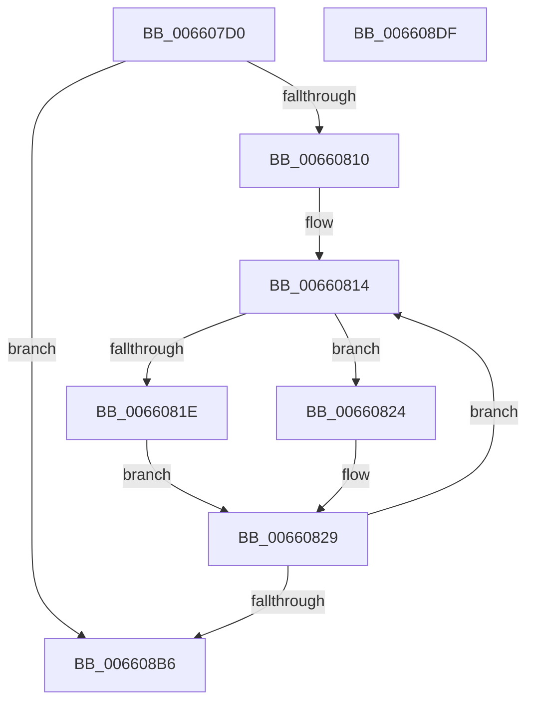

# WheapGenerateETWErrorRecordLarge

- RVA: `0x006607D0`–`0x006608E0` (길이 `272` bytes)
- VA: `0x00000001406607D0`
- 실행 섹션: `.text`
- PDB 이름 있음: `예`; PDB Function 태그: `아니요`
- unwind 정보 RVA: `0x000B8A1C`
- 디코드: `68`개 명령, `272/272` bytes 표시
- 미해석 바이트: `0` (있으면 어셈블리에 `.byte`로 보존)

> 이 문서는 커널 이미지의 기계어와 PDB 기호를 분석해 생성했습니다. 4번과 5번은 함수 원형과 자료형을 바이너리 사용 방식에서 추정한 C 해석이며 원본 소스 복구 결과는 아닙니다.

## 1. Dependencies

- 직접 호출 지점: **2**; 고유 호출 대상: **2**
- 직접 호출자로 확인된 함수: **1**
- RIP 상대 이미지 참조: **3**

### Outgoing calls
- `0x0066089D` → [EtwWriteEx](../25/EtwWriteEx_function_0025F0D0.md) (function, `0x0025F0D0`)
- `0x006608BD` → [_security_check_cookie](../6A/_security_check_cookie_function_006AC640.md) (function, `0x006AC640`)

### Direct callers
- [WheapGenerateETWEvents](../48/WheapGenerateETWEvents_function_0048494C.md) at `0x0048498C`

### Static image references
- `0x006607EF` → RVA `0x00E0A740` (`.data`; read)
- `0x00660835` → RVA `0x00039630` (`.rdata`; read)
- `0x00660865` → RVA `0x00EF9EF0` (`.data`; read)

## 2. Other-region calls and transfers

- 다른 실행 섹션으로 향하는 call: **0**
- 별도 외부 분기/꼬리 이동을 확인하지 못했습니다.

## 3. Assembly (complete function range)

```asm
006607D0  48 8B C4                        mov rax, rsp
006607D3  48 89 58 08                     mov qword ptr [rax + 8], rbx
006607D7  48 89 70 10                     mov qword ptr [rax + 0x10], rsi
006607DB  48 89 78 18                     mov qword ptr [rax + 0x18], rdi
006607DF  4C 89 70 20                     mov qword ptr [rax + 0x20], r14
006607E3  55                              push rbp
006607E4  48 8D 68 A1                     lea rbp, [rax - 0x5f]
006607E8  48 81 EC A0 00 00 00            sub rsp, 0xa0
006607EF  48 8B 05 4A 9F 7A 00            mov rax, qword ptr [rip + 0x7a9f4a]
006607F6  48 33 C4                        xor rax, rsp
006607F9  48 89 45 47                     mov qword ptr [rbp + 0x47], rax
006607FD  8B 59 14                        mov ebx, dword ptr [rcx + 0x14]
00660800  33 F6                           xor esi, esi
00660802  21 75 FB                        and dword ptr [rbp - 5], esi
00660805  48 8B F9                        mov rdi, rcx
00660808  85 DB                           test ebx, ebx
0066080A  0F 84 A6 00 00 00               je 0x1406608b6
00660810  4C 8D 71 60                     lea r14, [rcx + 0x60]
00660814  8D 86 F3 EF 00 00               lea eax, [rsi + 0xeff3]
0066081A  3B C3                           cmp eax, ebx
0066081C  72 06                           jb 0x140660824
0066081E  8B C3                           mov eax, ebx
00660820  2B C6                           sub eax, esi
00660822  EB 05                           jmp 0x140660829
00660824  B8 F3 EF 00 00                  mov eax, 0xeff3
00660829  83 65 13 00                     and dword ptr [rbp + 0x13], 0
0066082D  48 8D 4D FB                     lea rcx, [rbp - 5]
00660831  83 65 23 00                     and dword ptr [rbp + 0x23], 0
00660835  48 8D 15 F4 8D 9D FF            lea rdx, [rip - 0x62720c]
0066083C  83 65 33 00                     and dword ptr [rbp + 0x33], 0
00660840  45 33 C9                        xor r9d, r9d
00660843  83 65 43 00                     and dword ptr [rbp + 0x43], 0
00660847  45 33 C0                        xor r8d, r8d
0066084A  48 89 4D 17                     mov qword ptr [rbp + 0x17], rcx
0066084E  48 8D 4D F7                     lea rcx, [rbp - 9]
00660852  89 45 F7                        mov dword ptr [rbp - 9], eax
00660855  89 45 3F                        mov dword ptr [rbp + 0x3f], eax
00660858  48 8D 45 07                     lea rax, [rbp + 7]
0066085C  48 89 44 24 38                  mov qword ptr [rsp + 0x38], rax
00660861  48 89 4D 27                     mov qword ptr [rbp + 0x27], rcx
00660865  48 8B 0D 84 96 89 00            mov rcx, qword ptr [rip + 0x899684]
0066086C  C7 44 24 30 04 00 00 00         mov dword ptr [rsp + 0x30], 4
00660874  48 83 64 24 28 00               and qword ptr [rsp + 0x28], 0
0066087A  48 83 64 24 20 00               and qword ptr [rsp + 0x20], 0
00660880  4C 89 75 07                     mov qword ptr [rbp + 7], r14
00660884  C7 45 0F 04 00 00 00            mov dword ptr [rbp + 0xf], 4
0066088B  C7 45 1F 04 00 00 00            mov dword ptr [rbp + 0x1f], 4
00660892  C7 45 2F 04 00 00 00            mov dword ptr [rbp + 0x2f], 4
00660899  48 89 7D 37                     mov qword ptr [rbp + 0x37], rdi
0066089D  E8 2E E8 BF FF                  call 0x14025f0d0
006608A2  8B 45 F7                        mov eax, dword ptr [rbp - 9]
006608A5  03 75 F7                        add esi, dword ptr [rbp - 9]
006608A8  48 03 F8                        add rdi, rax
006608AB  FF 45 FB                        inc dword ptr [rbp - 5]
006608AE  3B F3                           cmp esi, ebx
006608B0  0F 82 5E FF FF FF               jb 0x140660814
006608B6  48 8B 4D 47                     mov rcx, qword ptr [rbp + 0x47]
006608BA  48 33 CC                        xor rcx, rsp
006608BD  E8 7E BD 04 00                  call 0x1406ac640
006608C2  4C 8D 9C 24 A0 00 00 00         lea r11, [rsp + 0xa0]
006608CA  49 8B 5B 10                     mov rbx, qword ptr [r11 + 0x10]
006608CE  49 8B 73 18                     mov rsi, qword ptr [r11 + 0x18]
006608D2  49 8B 7B 20                     mov rdi, qword ptr [r11 + 0x20]
006608D6  4D 8B 73 28                     mov r14, qword ptr [r11 + 0x28]
006608DA  49 8B E3                        mov rsp, r11
006608DD  5D                              pop rbp
006608DE  C3                              ret
006608DF  CC                              int3
```

## 4. C-style interpretation (structured pseudocode)

```c
__int64 __fastcall WheapGenerateETWErrorRecordLarge(__int64 a1, __int64 a2, int a3, int a4)
{
    __int64 result;
    __int64 v_rdi;
    __int64 v_rsi;
    __int64 v_rsp;
    unsigned __int64 v_stack_m70;
    unsigned int v_stack_m78;
    unsigned __int64 v_stack_m8;
    unsigned __int64 v_stack_m80;
    unsigned __int64 v_stack_m88;

    *(unsigned __int64 *)(v_rsp + 8) = v_rbx;
    *(unsigned __int64 *)(v_rsp + 16) = v_rsi;
    *(unsigned __int64 *)(v_rsp + 24) = v_rdi;
    *(unsigned __int64 *)(v_rsp + 32) = v_r14;
    v_rsp = (v_rsp) - (160);
    result = (*(unsigned __int64 *)(v_rip + 8036170)) ^ (v_rsp);
    *(unsigned __int64 *)(v_rsp - 95 + 71) = result;
    v_rsi = 0;
    if ((unsigned int)((unsigned int)(*(unsigned int *)(a1 + 20))) == 0) goto loc_006608B6;
loc_00660814:
    if (((unsigned int)(v_rsi + 61427)) < ((unsigned int)((unsigned int)(*(unsigned int *)(a1 + 20))))) goto loc_00660824;
    result = (unsigned int)(((unsigned int)((unsigned int)((unsigned int)(*(unsigned int *)(a1 + 20))))) - (0));
    goto loc_00660829;
loc_00660824:
loc_00660829:
    a4 = 0;
    a3 = 0;
    *(unsigned __int64 *)(v_rsp - 95 + 23) = v_rsp - 95 - 5;
    *(unsigned int *)(v_rsp - 95 - 9) = (unsigned int)((unsigned int)(0xEFF3ULL));
    *(unsigned int *)(v_rsp - 95 + 63) = (unsigned int)((unsigned int)(0xEFF3ULL));
    v_stack_m70 = v_rsp - 95 + 7;
    *(unsigned __int64 *)(v_rsp - 95 + 39) = v_rsp - 95 - 9;
    v_stack_m78 = 4;
    *(unsigned __int64 *)(v_rsp - 95 + 7) = a1 + 96;
    *(unsigned int *)(v_rsp - 95 + 15) = 4;
    *(unsigned int *)(v_rsp - 95 + 31) = 4;
    *(unsigned int *)(v_rsp - 95 + 47) = 4;
    *(unsigned __int64 *)(v_rsp - 95 + 55) = a1;
    result = EtwWriteEx(*(unsigned __int64 *)(v_rip + 9016964), v_rip - 6451724, a3, a4);
    v_rsi = (unsigned int)((v_rsi) + (*(unsigned int *)(v_rsp - 95 - 9)));
    v_rdi = (a1) + ((unsigned int)(*(unsigned int *)(v_rsp - 95 - 9)));
    if (((unsigned int)(v_rsi)) < ((unsigned int)((unsigned int)(*(unsigned int *)(a1 + 20))))) goto loc_00660814;
loc_006608B6:
    a1 = (*(unsigned __int64 *)(v_rsp - 95 + 71)) ^ (v_rsp);
    result = _security_check_cookie(a1, v_rip - 6451724, a3, a4);
    return result;
}
```

## 5. (Beta) C Style

```c
int64_t WheapGenerateETWErrorRecordLarge(void *Arg1, int64_t Arg2, int32_t Arg3, int32_t Arg4)
{
    uint8_t *arg1 = (uint8_t *)Arg1;

    int64_t result;
    int64_t local_rdi;
    int64_t local_rsi;
    int64_t local_rsp;
    uint64_t v_stack_m70;
    uint32_t v_stack_m78;
    uint64_t v_stack_m8;
    uint64_t v_stack_m80;
    uint64_t v_stack_m88;

    *(uint64_t *)(local_rsp + 0x8) = local_rbx;
    *(uint64_t *)(local_rsp + 0x10) = local_rsi;
    *(uint64_t *)(local_rsp + 0x18) = local_rdi;
    *(uint64_t *)(local_rsp + 0x20) = local_r14;
    local_rsp = (local_rsp) - (160);
    result = (*(uint64_t *)(v_rip + 0x7A9F4A)) ^ (local_rsp);
    *(uint64_t *)(local_rsp - 0x5F + 0x47) = result;
    local_rsi = 0;
    if ((uint32_t)((uint32_t)(*(uint32_t *)(arg1 + 0x14))) == 0) goto loc_006608B6;
loc_00660814:
    if (((uint32_t)(local_rsi + 61427)) < ((uint32_t)((uint32_t)(*(uint32_t *)(arg1 + 0x14))))) goto loc_00660824;
    result = (uint32_t)(((uint32_t)((uint32_t)((uint32_t)(*(uint32_t *)(arg1 + 0x14))))) - (0));
    goto loc_00660829;
loc_00660824:
loc_00660829:
    Arg4 = 0;
    Arg3 = 0;
    *(uint64_t *)(local_rsp - 0x5F + 0x17) = local_rsp - 95 - 5;
    *(uint32_t *)(local_rsp - 0x5F - 0x9) = (uint32_t)((uint32_t)(0xEFF3ULL));
    *(uint32_t *)(local_rsp - 0x5F + 0x3F) = (uint32_t)((uint32_t)(0xEFF3ULL));
    v_stack_m70 = local_rsp - 95 + 7;
    *(uint64_t *)(local_rsp - 0x5F + 0x27) = local_rsp - 95 - 9;
    v_stack_m78 = 4;
    *(void **)(local_rsp - 0x5F + 0x7) = Arg1 + 96;
    *(uint32_t *)(local_rsp - 0x5F + 0xF) = 4;
    *(uint32_t *)(local_rsp - 0x5F + 0x1F) = 4;
    *(uint32_t *)(local_rsp - 0x5F + 0x2F) = 4;
    *(void **)(local_rsp - 0x5F + 0x37) = Arg1;
    result = EtwWriteEx(*(uint64_t *)(v_rip + 0x899684), v_rip - 6451724, Arg3, Arg4);
    local_rsi = (uint32_t)((local_rsi) + (*(uint32_t *)(local_rsp - 0x5F - 0x9)));
    local_rdi = (Arg1) + ((uint32_t)(*(uint32_t *)(local_rsp - 0x5F - 0x9)));
    if (((uint32_t)(local_rsi)) < ((uint32_t)((uint32_t)(*(uint32_t *)(arg1 + 0x14))))) goto loc_00660814;
loc_006608B6:
    Arg1 = (*(uint64_t *)(local_rsp - 0x5F + 0x47)) ^ (local_rsp);
    result = _security_check_cookie(Arg1, v_rip - 6451724, Arg3, Arg4);
    return result;
}
```

### 관측된 메모리 오프셋

구조체 형식이 확인되지 않은 접근은 인자 기준의 오프셋으로만 기록했습니다.

| 기준 인자 | 오프셋 표현 | 폭 (bit) | 접근 |
|---|---:|---:|---|
| `Arg1` | `+ 0x14` | `32` | `R` |
| `Arg1` | `+ 0x60` | `64` | `R` |

## 6. Execution-region graph

[열기: 2D/3D 그래프와 함수 탐색 컨트롤 패널](../../../control-panel.html?section=text&rva=0x006607D0&view=graph)

- 2D 그래프는 위에서 아래로 흐르고, 3D 그래프는 빈 공간을 드래그해 회전합니다. Shift+드래그는 이동, 휠은 확대·축소, 함수 노드 선택은 대상 보고서 이동입니다.

### Static fallback


