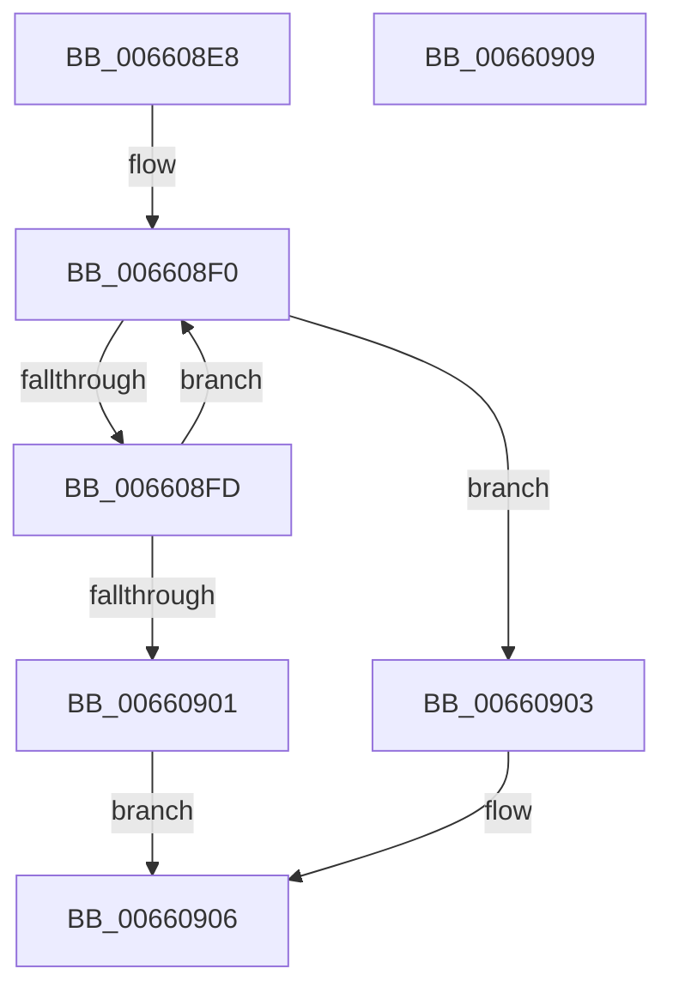

# WheapHighIrqlLogSelEventHandlerAcquireLock

- RVA: `0x006608E8`–`0x0066090A` (길이 `34` bytes)
- VA: `0x00000001406608E8`
- 실행 섹션: `.text`
- PDB 이름 있음: `예`; PDB Function 태그: `아니요`
- unwind 정보 RVA: `0x000DB714`
- 디코드: `12`개 명령, `34/34` bytes 표시
- 미해석 바이트: `0` (있으면 어셈블리에 `.byte`로 보존)

> 이 문서는 커널 이미지의 기계어와 PDB 기호를 분석해 생성했습니다. 4번과 5번은 함수 원형과 자료형을 바이너리 사용 방식에서 추정한 C 해석이며 원본 소스 복구 결과는 아닙니다.

## 1. Dependencies

- 직접 호출 지점: **0**; 고유 호출 대상: **0**
- 직접 호출자로 확인된 함수: **3**
- RIP 상대 이미지 참조: **1**

### Outgoing calls
- 직접 디코드된 call 명령이 없습니다.

### Direct callers
- [WheaHighIrqlLogSelEventHandlerRegister](WheaHighIrqlLogSelEventHandlerRegister_function_006604E0.md) at `0x006604FF`
- [WheaHighIrqlLogSelEventHandlerUnregister](WheaHighIrqlLogSelEventHandlerUnregister_function_00660550.md) at `0x00660562`
- [WheapLogIpmiSELEvent](WheapLogIpmiSELEvent_function_00660910.md) at `0x0066099C`

### Static image references
- `0x006608F2` → RVA `0x00EF9F04` (`.data`; read)

## 2. Other-region calls and transfers

- 다른 실행 섹션으로 향하는 call: **0**
- 별도 외부 분기/꼬리 이동을 확인하지 못했습니다.

## 3. Assembly (complete function range)

```asm
006608E8  32 D2                           xor dl, dl
006608EA  41 B8 01 00 00 00               mov r8d, 1
006608F0  33 C0                           xor eax, eax
006608F2  F0 44 0F B1 05 09 96 89 00      lock cmpxchg dword ptr [rip + 0x899609], r8d
006608FB  74 06                           je 0x140660903
006608FD  84 C9                           test cl, cl
006608FF  75 EF                           jne 0x1406608f0
00660901  EB 03                           jmp 0x140660906
00660903  41 8A D0                        mov dl, r8b
00660906  8A C2                           mov al, dl
00660908  C3                              ret
00660909  CC                              int3
```

## 4. C-style interpretation (structured pseudocode)

```c
__int64 __fastcall WheapHighIrqlLogSelEventHandlerAcquireLock(unsigned __int8 a1, unsigned __int8 a2)
{
    __int64 result;

    a2 = 0;
loc_006608F0:
    result = 0;
    if (condition_is_equal) goto loc_00660903;
    if (a1 != 0) goto loc_006608F0;
    goto loc_00660906;
loc_00660903:
loc_00660906:
    return 1;
}
```

## 5. (Beta) C Style

```c
int64_t WheapHighIrqlLogSelEventHandlerAcquireLock(uint8_t Arg1, uint8_t Arg2)
{
    int64_t result;

    Arg2 = 0;
loc_006608F0:
    result = 0;
    if (condition_is_equal) goto loc_00660903;
    if (Arg1 != 0) goto loc_006608F0;
    goto loc_00660906;
loc_00660903:
loc_00660906:
    return 1;
}
```

## 6. Execution-region graph

[열기: 2D/3D 그래프와 함수 탐색 컨트롤 패널](../../../control-panel.html?section=text&rva=0x006608E8&view=graph)

- 2D 그래프는 위에서 아래로 흐르고, 3D 그래프는 빈 공간을 드래그해 회전합니다. Shift+드래그는 이동, 휠은 확대·축소, 함수 노드 선택은 대상 보고서 이동입니다.

### Static fallback


