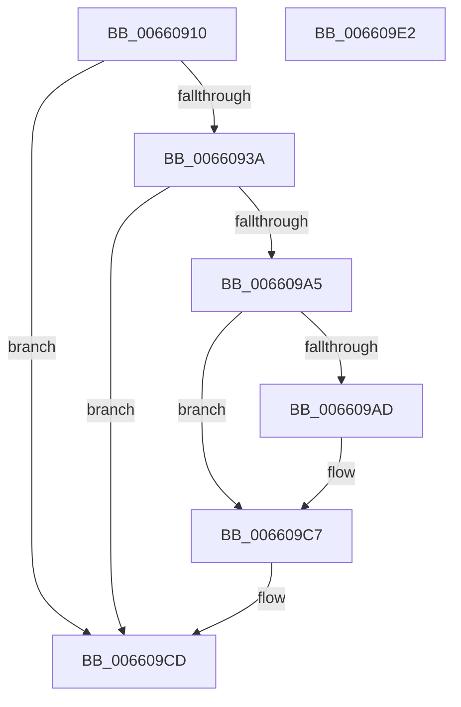

# WheapLogIpmiSELEvent

- RVA: `0x00660910`–`0x006609E3` (길이 `211` bytes)
- VA: `0x0000000140660910`
- 실행 섹션: `.text`
- PDB 이름 있음: `예`; PDB Function 태그: `아니요`
- unwind 정보 RVA: `0x0005C954`
- 디코드: `46`개 명령, `211/211` bytes 표시
- 미해석 바이트: `0` (있으면 어셈블리에 `.byte`로 보존)

> 이 문서는 커널 이미지의 기계어와 PDB 기호를 분석해 생성했습니다. 4번과 5번은 함수 원형과 자료형을 바이너리 사용 방식에서 추정한 C 해석이며 원본 소스 복구 결과는 아닙니다.

## 1. Dependencies

- 직접 호출 지점: **4**; 고유 호출 대상: **4**
- 직접 호출자로 확인된 함수: **2**
- RIP 상대 이미지 참조: **11**

### Outgoing calls
- `0x00660949` → [memset](../6C/memset_function_006C6C40.md) (function, `0x006C6C40`)
- `0x00660995` → [memcpy](../6C/memcpy_function_006C6840.md) (function, `0x006C6840`)
- `0x0066099C` → [WheapHighIrqlLogSelEventHandlerAcquireLock](WheapHighIrqlLogSelEventHandlerAcquireLock_function_006608E8.md) (function, `0x006608E8`)
- `0x006609C2` → [guard_dispatch_icall](../6B/guard_dispatch_icall_function_006BAAD0.md) (function, `0x006BAAD0`)

### Direct callers
- [WheaSelLogErrorPkt](../65/WheaSelLogErrorPkt_function_0065D988.md) at `0x0065DA55`
- [WheaSelLogEvent](../65/WheaSelLogEvent_function_0065DA74.md) at `0x0065DAE8`

### Static image references
- `0x00660929` → RVA `0x00EF9F00` (`.data`; read)
- `0x0066093C` → RVA `0x00EF8EF4` (`.data`; read)
- `0x00660951` → RVA `0x00EF8EE0` (`.data`; write)
- `0x00660960` → RVA `0x00EF8EE4` (`.data`; write)
- `0x00660970` → RVA `0x00EF8EEC` (`.data`; write)
- `0x00660984` → RVA `0x00EF8EF0` (`.data`; write)
- `0x0066098F` → RVA `0x00EF8EE8` (`.data`; write)
- `0x006609AD` → RVA `0x00EF9F08` (`.data`; read)
- `0x006609B4` → RVA `0x00EF8EE0` (`.data`; read)
- `0x006609BB` → RVA `0x00EF9F10` (`.data`; read)
- `0x006609C7` → RVA `0x00EF9F04` (`.data`; read/write)

## 2. Other-region calls and transfers

- 다른 실행 섹션으로 향하는 call: **0**
- 별도 외부 분기/꼬리 이동을 확인하지 못했습니다.

## 3. Assembly (complete function range)

```asm
00660910  48 89 5C 24 08                  mov qword ptr [rsp + 8], rbx
00660915  48 89 6C 24 10                  mov qword ptr [rsp + 0x10], rbp
0066091A  48 89 74 24 18                  mov qword ptr [rsp + 0x18], rsi
0066091F  57                              push rdi
00660920  48 83 EC 20                     sub rsp, 0x20
00660924  33 DB                           xor ebx, ebx
00660926  41 8B F0                        mov esi, r8d
00660929  39 1D D1 95 89 00               cmp dword ptr [rip + 0x8995d1], ebx
0066092F  8B FA                           mov edi, edx
00660931  48 8B E9                        mov rbp, rcx
00660934  0F 84 93 00 00 00               je 0x1406609cd
0066093A  33 D2                           xor edx, edx
0066093C  48 8D 0D B1 85 89 00            lea rcx, [rip + 0x8985b1]
00660943  41 B8 EC 0F 00 00               mov r8d, 0xfec
00660949  E8 F2 62 06 00                  call 0x1406c6c40
0066094E  8D 47 15                        lea eax, [rdi + 0x15]
00660951  C7 05 85 85 89 00 4F 53 53 52   mov dword ptr [rip + 0x898585], 0x5253534f
0066095B  3D 00 10 00 00                  cmp eax, 0x1000
00660960  C7 05 7A 85 89 00 01 00 00 00   mov dword ptr [rip + 0x89857a], 1
0066096A  41 B8 EB 0F 00 00               mov r8d, 0xfeb
00660970  89 35 76 85 89 00               mov dword ptr [rip + 0x898576], esi
00660976  44 0F 46 C7                     cmovbe r8d, edi
0066097A  48 8D 0D 73 85 89 00            lea rcx, [rip + 0x898573]
00660981  48 8B D5                        mov rdx, rbp
00660984  44 89 05 65 85 89 00            mov dword ptr [rip + 0x898565], r8d
0066098B  41 8D 40 14                     lea eax, [r8 + 0x14]
0066098F  89 05 53 85 89 00               mov dword ptr [rip + 0x898553], eax
00660995  E8 A6 5E 06 00                  call 0x1406c6840
0066099A  33 C9                           xor ecx, ecx
0066099C  E8 47 FF FF FF                  call 0x1406608e8
006609A1  84 C0                           test al, al
006609A3  74 28                           je 0x1406609cd
006609A5  39 1D 55 95 89 00               cmp dword ptr [rip + 0x899555], ebx
006609AB  74 1A                           je 0x1406609c7
006609AD  48 8B 05 54 95 89 00            mov rax, qword ptr [rip + 0x899554]
006609B4  48 8D 15 25 85 89 00            lea rdx, [rip + 0x898525]
006609BB  48 8B 0D 4E 95 89 00            mov rcx, qword ptr [rip + 0x89954e]
006609C2  E8 09 A1 05 00                  call 0x1406baad0
006609C7  87 1D 37 95 89 00               xchg dword ptr [rip + 0x899537], ebx
006609CD  48 8B 5C 24 30                  mov rbx, qword ptr [rsp + 0x30]
006609D2  48 8B 6C 24 38                  mov rbp, qword ptr [rsp + 0x38]
006609D7  48 8B 74 24 40                  mov rsi, qword ptr [rsp + 0x40]
006609DC  48 83 C4 20                     add rsp, 0x20
006609E0  5F                              pop rdi
006609E1  C3                              ret
006609E2  CC                              int3
```

## 4. C-style interpretation (structured pseudocode)

```c
__int64 __fastcall WheapLogIpmiSELEvent(__int64 a1, int a2, int a3)
{
    __int64 result;
    __int64 v_rbx;
    __int64 v_rsp;
    unsigned __int64 v_stack_p10;
    unsigned __int64 v_stack_p18;
    unsigned __int64 v_stack_p8;

    v_stack_p8 = v_rbx;
    v_stack_p10 = v_rbp;
    v_stack_p18 = v_rsi;
    v_rsp = (v_rsp) - (32);
    v_rbx = 0;
    if ((*(unsigned int *)(v_rip + 9016785)) == 0) goto loc_006609CD;
    a2 = 0;
    result = memset(v_rip + 9012657, a2, (unsigned int)(0xFECULL), a4);
    *(unsigned int *)(v_rip + 9012613) = 0x5253534FULL;
    *(unsigned int *)(v_rip + 9012602) = 1;
    *(unsigned int *)(v_rip + 9012598) = (unsigned int)((unsigned int)(a3));
    a3 = (unsigned int)(0xFEBULL);
    if (((unsigned int)((unsigned int)(a2) + 21)) <= 0x1000ULL) { a3 = (unsigned int)((unsigned int)(a2)); }
    *(unsigned int *)(v_rip + 9012581) = a3;
    *(unsigned int *)(v_rip + 9012563) = (unsigned int)(a3 + 20);
    result = memcpy(v_rip + 9012595, a1, a3, a4);
    a1 = 0;
    result = WheapHighIrqlLogSelEventHandlerAcquireLock(a1, a1, a3, a4);
    if ((unsigned __int8)(result) == 0) goto loc_006609CD;
    if ((*(unsigned int *)(v_rip + 9016661)) != 0) {
        result = *(unsigned __int64 *)(v_rip + 9016660);
        a2 = v_rip + 9012517;
        a1 = *(unsigned __int64 *)(v_rip + 9016654);
        result = guard_dispatch_icall(a1, a2, a3, a4);
    }
loc_006609CD:
    v_rsp = (v_rsp) + (32);
    return result;
}
```

## 5. (Beta) C Style

```c
int64_t WheapLogIpmiSELEvent(int64_t Arg1, void *Arg2, int32_t Arg3)
{
    uint8_t *arg2 = (uint8_t *)Arg2;

    int64_t result;
    int64_t local_rbx;
    int64_t local_rsp;
    uint64_t v_stack_p10;
    uint64_t v_stack_p18;
    uint64_t v_stack_p8;

    v_stack_p8 = local_rbx;
    v_stack_p10 = local_rbp;
    v_stack_p18 = local_rsi;
    local_rsp = (local_rsp) - (32);
    local_rbx = 0;
    if ((*(uint32_t *)(v_rip + 0x8995D1)) == 0) goto loc_006609CD;
    Arg2 = 0;
    result = memset(v_rip + 9012657, Arg2, (uint32_t)(0xFECULL), a4);
    *(uint32_t *)(v_rip + 0x898585) = 0x5253534FULL;
    *(uint32_t *)(v_rip + 0x89857A) = 1;
    *(uint32_t *)(v_rip + 0x898576) = (uint32_t)((uint32_t)(Arg3));
    Arg3 = (uint32_t)(0xFEBULL);
    if (((uint32_t)((uint32_t)(Arg2) + 21)) <= 0x1000ULL) { Arg3 = (uint32_t)((uint32_t)(Arg2)); }
    *(uint32_t *)(v_rip + 0x898565) = Arg3;
    *(uint32_t *)(v_rip + 0x898553) = (uint32_t)(Arg3 + 20);
    result = memcpy(v_rip + 9012595, Arg1, Arg3, a4);
    Arg1 = 0;
    result = WheapHighIrqlLogSelEventHandlerAcquireLock(Arg1, Arg1, Arg3, a4);
    if ((uint8_t)(result) == 0) goto loc_006609CD;
    if ((*(uint32_t *)(v_rip + 0x899555)) != 0) {
        result = *(uint64_t *)(v_rip + 0x899554);
        Arg2 = v_rip + 9012517;
        Arg1 = *(uint64_t *)(v_rip + 0x89954E);
        result = guard_dispatch_icall(Arg1, Arg2, Arg3, a4);
    }
loc_006609CD:
    local_rsp = (local_rsp) + (32);
    return result;
}
```

### 관측된 메모리 오프셋

구조체 형식이 확인되지 않은 접근은 인자 기준의 오프셋으로만 기록했습니다.

| 기준 인자 | 오프셋 표현 | 폭 (bit) | 접근 |
|---|---:|---:|---|
| `Arg2` | `+ 0x15` | `32` | `R` |

## 6. Execution-region graph

[열기: 2D/3D 그래프와 함수 탐색 컨트롤 패널](../../../control-panel.html?section=text&rva=0x00660910&view=graph)

- 2D 그래프는 위에서 아래로 흐르고, 3D 그래프는 빈 공간을 드래그해 회전합니다. Shift+드래그는 이동, 휠은 확대·축소, 함수 노드 선택은 대상 보고서 이동입니다.

### Static fallback


