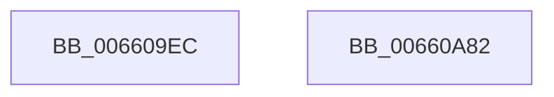

# WheapLogProcessTerminateEvent

- RVA: `0x006609EC`–`0x00660A83` (길이 `151` bytes)
- VA: `0x00000001406609EC`
- 실행 섹션: `.text`
- PDB 이름 있음: `예`; PDB Function 태그: `아니요`
- unwind 정보 RVA: `0x000B0904`
- 디코드: `34`개 명령, `151/151` bytes 표시
- 미해석 바이트: `0` (있으면 어셈블리에 `.byte`로 보존)

> 이 문서는 커널 이미지의 기계어와 PDB 기호를 분석해 생성했습니다. 4번과 5번은 함수 원형과 자료형을 바이너리 사용 방식에서 추정한 C 해석이며 원본 소스 복구 결과는 아닙니다.

## 1. Dependencies

- 직접 호출 지점: **2**; 고유 호출 대상: **2**
- 직접 호출자로 확인된 함수: **1**
- RIP 상대 이미지 참조: **4**

### Outgoing calls
- `0x00660A68` → [EtwWriteEx](../25/EtwWriteEx_function_0025F0D0.md) (function, `0x0025F0D0`)
- `0x00660A74` → [_security_check_cookie](../6A/_security_check_cookie_function_006AC640.md) (function, `0x006AC640`)

### Direct callers
- [WheaTerminateProcess](../../page/7D/WheaTerminateProcess_function_007D7810.md) at `0x007D786B`

### Static image references
- `0x006609F8` → RVA `0x00E0A740` (`.data`; read)
- `0x00660A13` → RVA `0x006C8EC0` (` ?? ::FNODOBFM::`string'`; read)
- `0x00660A22` → RVA `0x00039640` (`.rdata`; read)
- `0x00660A51` → RVA `0x00EF9EF0` (`.data`; read)

## 2. Other-region calls and transfers

- 다른 실행 섹션으로 향하는 call: **0**
- 별도 외부 분기/꼬리 이동을 확인하지 못했습니다.

## 3. Assembly (complete function range)

```asm
006609EC  40 55                           push rbp
006609EE  48 8B EC                        mov rbp, rsp
006609F1  48 81 EC 80 00 00 00            sub rsp, 0x80
006609F8  48 8B 05 41 9D 7A 00            mov rax, qword ptr [rip + 0x7a9d41]
006609FF  48 33 C4                        xor rax, rsp
00660A02  48 89 45 F8                     mov qword ptr [rbp - 8], rax
00660A06  89 4D C0                        mov dword ptr [rbp - 0x40], ecx
00660A09  48 8D 45 C0                     lea rax, [rbp - 0x40]
00660A0D  33 C9                           xor ecx, ecx
00660A0F  48 89 45 C8                     mov qword ptr [rbp - 0x38], rax
00660A13  48 8D 05 A6 84 06 00            lea rax, [rip + 0x684a6]
00660A1A  48 89 55 D8                     mov qword ptr [rbp - 0x28], rdx
00660A1E  48 89 45 E8                     mov qword ptr [rbp - 0x18], rax
00660A22  48 8D 15 17 8C 9D FF            lea rdx, [rip - 0x6273e9]
00660A29  48 8D 45 C8                     lea rax, [rbp - 0x38]
00660A2D  44 89 45 E0                     mov dword ptr [rbp - 0x20], r8d
00660A31  48 89 44 24 38                  mov qword ptr [rsp + 0x38], rax
00660A36  45 33 C9                        xor r9d, r9d
00660A39  C7 44 24 30 03 00 00 00         mov dword ptr [rsp + 0x30], 3
00660A41  45 33 C0                        xor r8d, r8d
00660A44  48 89 4C 24 28                  mov qword ptr [rsp + 0x28], rcx
00660A49  48 89 4C 24 20                  mov qword ptr [rsp + 0x20], rcx
00660A4E  89 4D E4                        mov dword ptr [rbp - 0x1c], ecx
00660A51  48 8B 0D 98 94 89 00            mov rcx, qword ptr [rip + 0x899498]
00660A58  48 C7 45 D0 04 00 00 00         mov qword ptr [rbp - 0x30], 4
00660A60  48 C7 45 F0 02 00 00 00         mov qword ptr [rbp - 0x10], 2
00660A68  E8 63 E6 BF FF                  call 0x14025f0d0
00660A6D  48 8B 4D F8                     mov rcx, qword ptr [rbp - 8]
00660A71  48 33 CC                        xor rcx, rsp
00660A74  E8 C7 BB 04 00                  call 0x1406ac640
00660A79  48 81 C4 80 00 00 00            add rsp, 0x80
00660A80  5D                              pop rbp
00660A81  C3                              ret
00660A82  CC                              int3
```

## 4. C-style interpretation (structured pseudocode)

```c
__int64 __fastcall WheapLogProcessTerminateEvent(int a1, __int64 a2, int a3, int a4)
{
    __int64 result;
    __int64 v_rsp;
    unsigned __int64 v_stack_m10;
    unsigned __int64 v_stack_m18;
    unsigned __int64 v_stack_m20;
    unsigned int v_stack_m24;
    unsigned int v_stack_m28;
    unsigned __int64 v_stack_m30;
    unsigned __int64 v_stack_m38;
    unsigned __int64 v_stack_m40;
    unsigned int v_stack_m48;
    unsigned __int64 v_stack_m50;
    unsigned int v_stack_m58;
    unsigned __int64 v_stack_m60;
    unsigned __int64 v_stack_m68;

    v_rsp = (v_rsp) - (128);
    result = (*(unsigned __int64 *)(v_rip + 8035649)) ^ (v_rsp);
    v_stack_m10 = result;
    v_stack_m48 = a1;
    a1 = 0;
    v_stack_m40 = v_stack_m48;
    v_stack_m30 = a2;
    v_stack_m20 = v_rip + 427174;
    v_stack_m28 = a3;
    v_stack_m50 = v_stack_m40;
    a4 = 0;
    v_stack_m58 = 3;
    a3 = 0;
    v_stack_m60 = 0;
    v_stack_m68 = 0;
    v_stack_m24 = 0;
    v_stack_m38 = 4;
    v_stack_m18 = 2;
    result = EtwWriteEx(*(unsigned __int64 *)(v_rip + 9016472), v_rip - 6452201, a3, a4);
    a1 = (v_stack_m10) ^ (v_rsp);
    result = _security_check_cookie(a1, v_rip - 6452201, a3, a4);
    v_rsp = (v_rsp) + (128);
    return result;
}
```

## 5. (Beta) C Style

```c
int64_t WheapLogProcessTerminateEvent(int32_t Arg1, int64_t Arg2, int32_t Arg3, int32_t Arg4)
{
    int64_t result;
    int64_t local_rsp;
    uint64_t v_stack_m10;
    uint64_t v_stack_m18;
    uint64_t v_stack_m20;
    uint32_t v_stack_m24;
    uint32_t v_stack_m28;
    uint64_t v_stack_m30;
    uint64_t v_stack_m38;
    uint64_t v_stack_m40;
    uint32_t v_stack_m48;
    uint64_t v_stack_m50;
    uint32_t v_stack_m58;
    uint64_t v_stack_m60;
    uint64_t v_stack_m68;

    local_rsp = (local_rsp) - (128);
    result = (*(uint64_t *)(v_rip + 0x7A9D41)) ^ (local_rsp);
    v_stack_m10 = result;
    v_stack_m48 = Arg1;
    Arg1 = 0;
    v_stack_m40 = v_stack_m48;
    v_stack_m30 = Arg2;
    v_stack_m20 = v_rip + 427174;
    v_stack_m28 = Arg3;
    v_stack_m50 = v_stack_m40;
    Arg4 = 0;
    v_stack_m58 = 3;
    Arg3 = 0;
    v_stack_m60 = 0;
    v_stack_m68 = 0;
    v_stack_m24 = 0;
    v_stack_m38 = 4;
    v_stack_m18 = 2;
    result = EtwWriteEx(*(uint64_t *)(v_rip + 0x899498), v_rip - 6452201, Arg3, Arg4);
    Arg1 = (v_stack_m10) ^ (local_rsp);
    result = _security_check_cookie(Arg1, v_rip - 6452201, Arg3, Arg4);
    local_rsp = (local_rsp) + (128);
    return result;
}
```

## 6. Execution-region graph

[열기: 2D/3D 그래프와 함수 탐색 컨트롤 패널](../../../control-panel.html?section=text&rva=0x006609EC&view=graph)

- 2D 그래프는 위에서 아래로 흐르고, 3D 그래프는 빈 공간을 드래그해 회전합니다. Shift+드래그는 이동, 휠은 확대·축소, 함수 노드 선택은 대상 보고서 이동입니다.

### Static fallback


