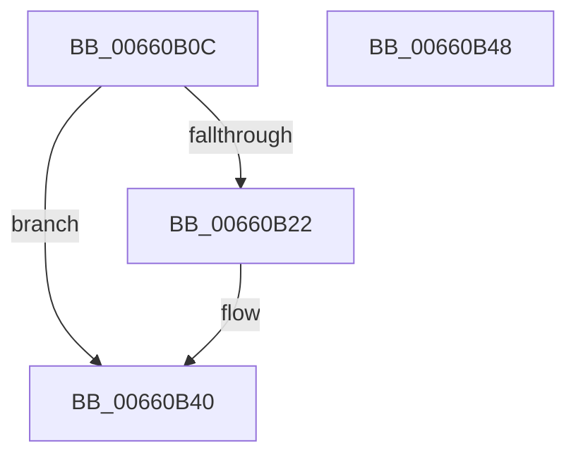

# WheapPrmInvokeHandler

- RVA: `0x00660B0C`–`0x00660B49` (길이 `61` bytes)
- VA: `0x0000000140660B0C`
- 실행 섹션: `.text`
- PDB 이름 있음: `예`; PDB Function 태그: `아니요`
- unwind 정보 RVA: `0x0005D2F4`
- 디코드: `15`개 명령, `61/61` bytes 표시
- 미해석 바이트: `0` (있으면 어셈블리에 `.byte`로 보존)

> 이 문서는 커널 이미지의 기계어와 PDB 기호를 분석해 생성했습니다. 4번과 5번은 함수 원형과 자료형을 바이너리 사용 방식에서 추정한 C 해석이며 원본 소스 복구 결과는 아닙니다.

## 1. Dependencies

- 직접 호출 지점: **1**; 고유 호출 대상: **1**
- 직접 호출자로 확인된 함수: **2**
- RIP 상대 이미지 참조: **3**

### Outgoing calls
- `0x00660B38` → [guard_dispatch_icall](../6B/guard_dispatch_icall_function_006BAAD0.md) (function, `0x006BAAD0`)

### Direct callers
- [WheapPrmTranslateDimmAddressIntel](WheapPrmTranslateDimmAddressIntel_function_00660B50.md) at `0x00660CA0`
- [WheapPrmTranslatePhysicalAddressIntel](WheapPrmTranslatePhysicalAddressIntel_function_00660D98.md) at `0x00660DF8`

### Static image references
- `0x00660B10` → RVA `0x00024D10` (`.rdata`; read)
- `0x00660B22` → RVA `0x00EF7E18` (`.data`; read)
- `0x00660B29` → RVA `0x00024D08` (`.rdata`; read)

## 2. Other-region calls and transfers

- 다른 실행 섹션으로 향하는 call: **0**
- 별도 외부 분기/꼬리 이동을 확인하지 못했습니다.

## 3. Assembly (complete function range)

```asm
00660B0C  48 83 EC 38                     sub rsp, 0x38
00660B10  48 8B 0D F9 41 9C FF            mov rcx, qword ptr [rip - 0x63be07]
00660B17  41 B8 0D 00 00 C0               mov r8d, 0xc000000d
00660B1D  48 3B C9                        cmp rcx, rcx
00660B20  75 1E                           jne 0x140660b40
00660B22  48 8B 05 EF 72 89 00            mov rax, qword ptr [rip + 0x8972ef]
00660B29  48 8D 0D D8 41 9C FF            lea rcx, [rip - 0x63be28]
00660B30  4C 8B 4C 24 60                  mov r9, qword ptr [rsp + 0x60]
00660B35  45 33 C0                        xor r8d, r8d
00660B38  E8 93 9F 05 00                  call 0x1406baad0
00660B3D  44 8B C0                        mov r8d, eax
00660B40  41 8B C0                        mov eax, r8d
00660B43  48 83 C4 38                     add rsp, 0x38
00660B47  C3                              ret
00660B48  CC                              int3
```

## 4. C-style interpretation (structured pseudocode)

```c
__int64 __fastcall WheapPrmInvokeHandler(__int64 a1, __int64 a2, __int64 a3, __int64 a4, __int64 a5)
{
    __int64 result;
    __int64 v_rsp;

    v_rsp = (v_rsp) - (56);
    if ((*(unsigned __int64 *)(v_rip - 6536711)) == (*(unsigned __int64 *)(v_rip - 6536711))) {
        result = *(unsigned __int64 *)(v_rip + 9007855);
        a1 = v_rip - 6536744;
        a4 = a5;
        a3 = 0;
        result = guard_dispatch_icall(a1, a2, a3, a4);
        a3 = (unsigned int)(result);
    }
    v_rsp = (v_rsp) + (56);
    return (unsigned int)((unsigned int)(a3));
}
```

## 5. (Beta) C Style

```c
int64_t WheapPrmInvokeHandler(int64_t Arg1, int64_t Arg2, int64_t Arg3, int64_t Arg4, int64_t Arg5)
{
    int64_t result;
    int64_t local_rsp;

    local_rsp = (local_rsp) - (56);
    if ((*(uint64_t *)(v_rip - 0x63BE07)) == (*(uint64_t *)(v_rip - 0x63BE07))) {
        result = *(uint64_t *)(v_rip + 0x8972EF);
        Arg1 = v_rip - 6536744;
        Arg4 = Arg5;
        Arg3 = 0;
        result = guard_dispatch_icall(Arg1, Arg2, Arg3, Arg4);
        Arg3 = (uint32_t)(result);
    }
    local_rsp = (local_rsp) + (56);
    return (uint32_t)((uint32_t)(Arg3));
}
```

## 6. Execution-region graph

[열기: 2D/3D 그래프와 함수 탐색 컨트롤 패널](../../../control-panel.html?section=text&rva=0x00660B0C&view=graph)

- 2D 그래프는 위에서 아래로 흐르고, 3D 그래프는 빈 공간을 드래그해 회전합니다. Shift+드래그는 이동, 휠은 확대·축소, 함수 노드 선택은 대상 보고서 이동입니다.

### Static fallback


