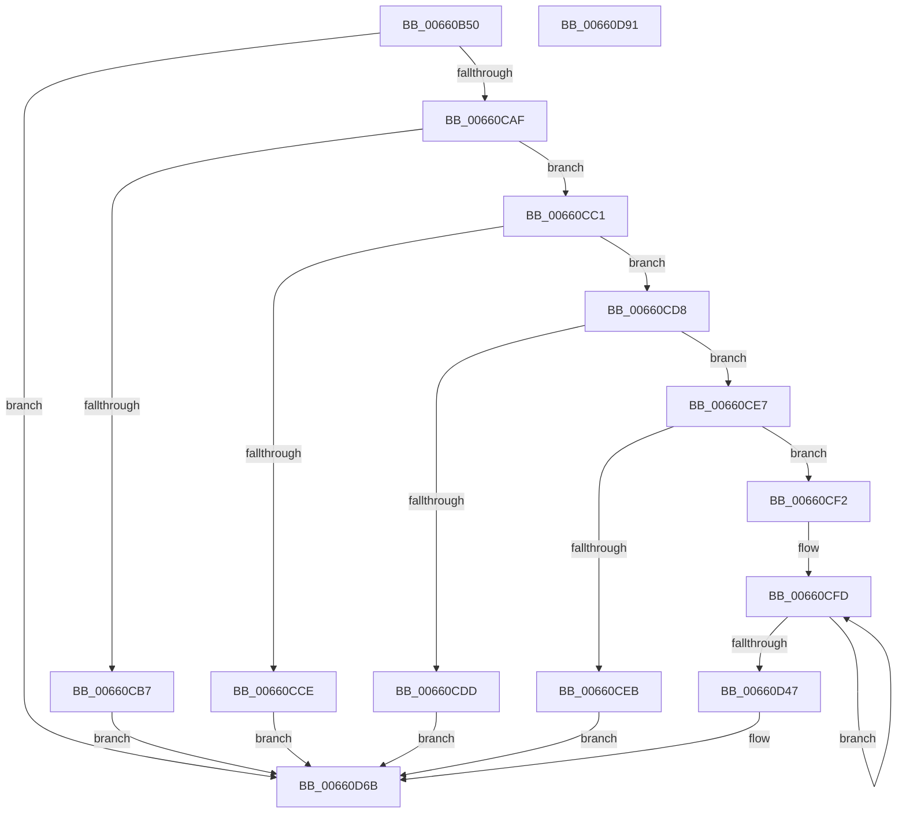

# WheapPrmTranslateDimmAddressIntel

- RVA: `0x00660B50`–`0x00660D92` (길이 `578` bytes)
- VA: `0x0000000140660B50`
- 실행 섹션: `.text`
- PDB 이름 있음: `예`; PDB Function 태그: `아니요`
- unwind 정보 RVA: `0x000D5F9C`
- 디코드: `130`개 명령, `578/578` bytes 표시
- 미해석 바이트: `0` (있으면 어셈블리에 `.byte`로 보존)

> 이 문서는 커널 이미지의 기계어와 PDB 기호를 분석해 생성했습니다. 4번과 5번은 함수 원형과 자료형을 바이너리 사용 방식에서 추정한 C 해석이며 원본 소스 복구 결과는 아닙니다.

## 1. Dependencies

- 직접 호출 지점: **3**; 고유 호출 대상: **3**
- 직접 호출자로 확인된 함수: **1**
- RIP 상대 이미지 참조: **1**

### Outgoing calls
- `0x00660B95` → [memset](../6C/memset_function_006C6C40.md) (function, `0x006C6C40`)
- `0x00660CA0` → [WheapPrmInvokeHandler](WheapPrmInvokeHandler_function_00660B0C.md) (function, `0x00660B0C`)
- `0x00660D77` → [_security_check_cookie](../6A/_security_check_cookie_function_006AC640.md) (function, `0x006AC640`)

### Direct callers
- [WheaPrmTranslateDimmAddress](WheaPrmTranslateDimmAddress_function_00660A90.md) at `0x00660ABA`

### Static image references
- `0x00660B6A` → RVA `0x00E0A740` (`.data`; read)

## 2. Other-region calls and transfers

- 다른 실행 섹션으로 향하는 call: **0**
- 별도 외부 분기/꼬리 이동을 확인하지 못했습니다.

## 3. Assembly (complete function range)

```asm
00660B50  48 89 5C 24 18                  mov qword ptr [rsp + 0x18], rbx
00660B55  48 89 7C 24 20                  mov qword ptr [rsp + 0x20], rdi
00660B5A  55                              push rbp
00660B5B  48 8D AC 24 70 FF FF FF         lea rbp, [rsp - 0x90]
00660B63  48 81 EC 90 01 00 00            sub rsp, 0x190
00660B6A  48 8B 05 CF 9B 7A 00            mov rax, qword ptr [rip + 0x7a9bcf]
00660B71  48 33 C4                        xor rax, rsp
00660B74  48 89 85 80 00 00 00            mov qword ptr [rbp + 0x80], rax
00660B7B  48 83 64 24 30 00               and qword ptr [rsp + 0x30], 0
00660B81  48 8B FA                        mov rdi, rdx
00660B84  BA FF 00 00 00                  mov edx, 0xff
00660B89  48 8B D9                        mov rbx, rcx
00660B8C  48 8D 4C 24 40                  lea rcx, [rsp + 0x40]
00660B91  44 8D 42 35                     lea r8d, [rdx + 0x35]
00660B95  E8 A6 60 06 00                  call 0x1406c6c40
00660B9A  48 8B 43 24                     mov rax, qword ptr [rbx + 0x24]
00660B9E  48 8D 54 24 40                  lea rdx, [rsp + 0x40]
00660BA3  48 89 44 24 64                  mov qword ptr [rsp + 0x64], rax
00660BA8  48 8B 43 2C                     mov rax, qword ptr [rbx + 0x2c]
00660BAC  48 89 44 24 6C                  mov qword ptr [rsp + 0x6c], rax
00660BB1  48 8B 43 34                     mov rax, qword ptr [rbx + 0x34]
00660BB5  48 89 44 24 74                  mov qword ptr [rsp + 0x74], rax
00660BBA  48 8B 43 3C                     mov rax, qword ptr [rbx + 0x3c]
00660BBE  48 89 44 24 7C                  mov qword ptr [rsp + 0x7c], rax
00660BC3  48 8B 43 64                     mov rax, qword ptr [rbx + 0x64]
00660BC7  48 89 45 A4                     mov qword ptr [rbp - 0x5c], rax
00660BCB  48 8B 43 6C                     mov rax, qword ptr [rbx + 0x6c]
00660BCF  48 89 45 AC                     mov qword ptr [rbp - 0x54], rax
00660BD3  48 8B 83 84 00 00 00            mov rax, qword ptr [rbx + 0x84]
00660BDA  48 89 45 C4                     mov qword ptr [rbp - 0x3c], rax
00660BDE  48 8B 83 8C 00 00 00            mov rax, qword ptr [rbx + 0x8c]
00660BE5  48 89 45 CC                     mov qword ptr [rbp - 0x34], rax
00660BE9  48 8B 83 94 00 00 00            mov rax, qword ptr [rbx + 0x94]
00660BF0  48 89 45 D4                     mov qword ptr [rbp - 0x2c], rax
00660BF4  48 8B 83 9C 00 00 00            mov rax, qword ptr [rbx + 0x9c]
00660BFB  48 89 45 DC                     mov qword ptr [rbp - 0x24], rax
00660BFF  48 8B 83 A4 00 00 00            mov rax, qword ptr [rbx + 0xa4]
00660C06  48 89 45 E4                     mov qword ptr [rbp - 0x1c], rax
00660C0A  48 8B 83 AC 00 00 00            mov rax, qword ptr [rbx + 0xac]
00660C11  48 89 45 EC                     mov qword ptr [rbp - 0x14], rax
00660C15  48 8B 83 B4 00 00 00            mov rax, qword ptr [rbx + 0xb4]
00660C1C  48 89 45 F4                     mov qword ptr [rbp - 0xc], rax
00660C20  48 8B 83 BC 00 00 00            mov rax, qword ptr [rbx + 0xbc]
00660C27  48 89 45 FC                     mov qword ptr [rbp - 4], rax
00660C2B  48 8B 83 C4 00 00 00            mov rax, qword ptr [rbx + 0xc4]
00660C32  48 89 45 04                     mov qword ptr [rbp + 4], rax
00660C36  48 8B 83 CC 00 00 00            mov rax, qword ptr [rbx + 0xcc]
00660C3D  48 89 45 0C                     mov qword ptr [rbp + 0xc], rax
00660C41  48 8B 83 D4 00 00 00            mov rax, qword ptr [rbx + 0xd4]
00660C48  48 89 45 14                     mov qword ptr [rbp + 0x14], rax
00660C4C  48 8B 83 DC 00 00 00            mov rax, qword ptr [rbx + 0xdc]
00660C53  48 89 45 1C                     mov qword ptr [rbp + 0x1c], rax
00660C57  48 8B 83 E4 00 00 00            mov rax, qword ptr [rbx + 0xe4]
00660C5E  48 89 45 24                     mov qword ptr [rbp + 0x24], rax
00660C62  48 8B 83 0C 01 00 00            mov rax, qword ptr [rbx + 0x10c]
00660C69  48 89 45 4C                     mov qword ptr [rbp + 0x4c], rax
00660C6D  48 8B 83 14 01 00 00            mov rax, qword ptr [rbx + 0x114]
00660C74  48 89 45 54                     mov qword ptr [rbp + 0x54], rax
00660C78  48 8B 83 24 01 00 00            mov rax, qword ptr [rbx + 0x124]
00660C7F  48 89 45 64                     mov qword ptr [rbp + 0x64], rax
00660C83  48 8B 83 2C 01 00 00            mov rax, qword ptr [rbx + 0x12c]
00660C8A  48 89 45 6C                     mov qword ptr [rbp + 0x6c], rax
00660C8E  48 8D 44 24 30                  lea rax, [rsp + 0x30]
00660C93  48 89 44 24 20                  mov qword ptr [rsp + 0x20], rax
00660C98  C7 44 24 44 03 00 00 00         mov dword ptr [rsp + 0x44], 3
00660CA0  E8 67 FE FF FF                  call 0x140660b0c
00660CA5  8B C8                           mov ecx, eax
00660CA7  85 C0                           test eax, eax
00660CA9  0F 88 BC 00 00 00               js 0x140660d6b
00660CAF  48 83 7C 24 30 00               cmp qword ptr [rsp + 0x30], 0
00660CB5  74 0A                           je 0x140660cc1
00660CB7  B9 BB 00 00 C0                  mov ecx, 0xc00000bb
00660CBC  E9 AA 00 00 00                  jmp 0x140660d6b
00660CC1  8B 44 24 48                     mov eax, dword ptr [rsp + 0x48]
00660CC5  BA 02 00 00 00                  mov edx, 2
00660CCA  3B C2                           cmp eax, edx
00660CCC  75 0A                           jne 0x140660cd8
00660CCE  B9 0D 00 00 C0                  mov ecx, 0xc000000d
00660CD3  E9 93 00 00 00                  jmp 0x140660d6b
00660CD8  83 F8 03                        cmp eax, 3
00660CDB  75 0A                           jne 0x140660ce7
00660CDD  B9 E5 00 00 C0                  mov ecx, 0xc00000e5
00660CE2  E9 84 00 00 00                  jmp 0x140660d6b
00660CE7  85 C0                           test eax, eax
00660CE9  74 07                           je 0x140660cf2
00660CEB  B9 01 00 00 C0                  mov ecx, 0xc0000001
00660CF0  EB 79                           jmp 0x140660d6b
00660CF2  48 8D 44 24 40                  lea rax, [rsp + 0x40]
00660CF7  41 B8 80 00 00 00               mov r8d, 0x80
00660CFD  0F 10 00                        movups xmm0, xmmword ptr [rax]
00660D00  0F 10 48 10                     movups xmm1, xmmword ptr [rax + 0x10]
00660D04  0F 11 03                        movups xmmword ptr [rbx], xmm0
00660D07  0F 10 40 20                     movups xmm0, xmmword ptr [rax + 0x20]
00660D0B  0F 11 4B 10                     movups xmmword ptr [rbx + 0x10], xmm1
00660D0F  0F 10 48 30                     movups xmm1, xmmword ptr [rax + 0x30]
00660D13  0F 11 43 20                     movups xmmword ptr [rbx + 0x20], xmm0
00660D17  0F 10 40 40                     movups xmm0, xmmword ptr [rax + 0x40]
00660D1B  0F 11 4B 30                     movups xmmword ptr [rbx + 0x30], xmm1
00660D1F  0F 10 48 50                     movups xmm1, xmmword ptr [rax + 0x50]
00660D23  0F 11 43 40                     movups xmmword ptr [rbx + 0x40], xmm0
00660D27  0F 10 40 60                     movups xmm0, xmmword ptr [rax + 0x60]
00660D2B  0F 11 4B 50                     movups xmmword ptr [rbx + 0x50], xmm1
00660D2F  0F 10 48 70                     movups xmm1, xmmword ptr [rax + 0x70]
00660D33  49 03 C0                        add rax, r8
00660D36  0F 11 43 60                     movups xmmword ptr [rbx + 0x60], xmm0
00660D3A  49 03 D8                        add rbx, r8
00660D3D  0F 11 4B F0                     movups xmmword ptr [rbx - 0x10], xmm1
00660D41  48 83 EA 01                     sub rdx, 1
00660D45  75 B6                           jne 0x140660cfd
00660D47  0F 10 00                        movups xmm0, xmmword ptr [rax]
00660D4A  0F 10 48 10                     movups xmm1, xmmword ptr [rax + 0x10]
00660D4E  0F 11 03                        movups xmmword ptr [rbx], xmm0
00660D51  0F 10 40 20                     movups xmm0, xmmword ptr [rax + 0x20]
00660D55  8B 40 30                        mov eax, dword ptr [rax + 0x30]
00660D58  0F 11 4B 10                     movups xmmword ptr [rbx + 0x10], xmm1
00660D5C  0F 11 43 20                     movups xmmword ptr [rbx + 0x20], xmm0
00660D60  89 43 30                        mov dword ptr [rbx + 0x30], eax
00660D63  48 8B 44 24 4C                  mov rax, qword ptr [rsp + 0x4c]
00660D68  48 89 07                        mov qword ptr [rdi], rax
00660D6B  8B C1                           mov eax, ecx
00660D6D  48 8B 8D 80 00 00 00            mov rcx, qword ptr [rbp + 0x80]
00660D74  48 33 CC                        xor rcx, rsp
00660D77  E8 C4 B8 04 00                  call 0x1406ac640
00660D7C  4C 8D 9C 24 90 01 00 00         lea r11, [rsp + 0x190]
00660D84  49 8B 5B 20                     mov rbx, qword ptr [r11 + 0x20]
00660D88  49 8B 7B 28                     mov rdi, qword ptr [r11 + 0x28]
00660D8C  49 8B E3                        mov rsp, r11
00660D8F  5D                              pop rbp
00660D90  C3                              ret
00660D91  CC                              int3
```

## 4. C-style interpretation (structured pseudocode)

```c
__int64 __fastcall WheapPrmTranslateDimmAddressIntel(__int64 a1, __int64 a2)
{
    __int64 result;
    __int64 v_rbx;
    __int64 v_rsp;
    unsigned __int64 v_stack_m11C;
    unsigned __int64 v_stack_m124;
    unsigned __int64 v_stack_m12C;
    unsigned __int64 v_stack_m134;
    unsigned __int64 v_stack_m14C;
    unsigned int v_stack_m150;
    unsigned int v_stack_m154;
    unsigned __int64 v_stack_m158;
    unsigned __int64 v_stack_m168;
    unsigned __int64 v_stack_m178;
    unsigned __int64 v_stack_m18;
    unsigned __int64 v_stack_m2C;
    unsigned __int64 v_stack_m34;
    unsigned __int64 v_stack_m44;
    unsigned __int64 v_stack_m4C;
    unsigned __int64 v_stack_m74;
    unsigned __int64 v_stack_m7C;
    unsigned __int64 v_stack_m8;
    unsigned __int64 v_stack_m84;
    unsigned __int64 v_stack_m8C;
    unsigned __int64 v_stack_m94;
    unsigned __int64 v_stack_m98;
    unsigned __int64 v_stack_m9C;
    unsigned __int64 v_stack_mA4;
    unsigned __int64 v_stack_mAC;
    unsigned __int64 v_stack_mB4;
    unsigned __int64 v_stack_mBC;
    unsigned __int64 v_stack_mC4;
    unsigned __int64 v_stack_mCC;
    unsigned __int64 v_stack_mD4;
    unsigned __int64 v_stack_mEC;
    unsigned __int64 v_stack_mF4;
    unsigned __int64 v_stack_p18;
    unsigned __int64 v_stack_p20;

    v_stack_p18 = v_rbx;
    v_stack_p20 = v_rdi;
    v_rsp = (v_rsp) - (400);
    result = (*(unsigned __int64 *)(v_rip + 8035279)) ^ (v_rsp);
    v_stack_m18 = result;
    result = memset(v_stack_m158, 255, 255 + 53, a4);
    v_stack_m134 = *(unsigned __int64 *)(a1 + 36);
    v_stack_m12C = *(unsigned __int64 *)(a1 + 44);
    v_stack_m124 = *(unsigned __int64 *)(a1 + 52);
    v_stack_m11C = *(unsigned __int64 *)(a1 + 60);
    v_stack_mF4 = *(unsigned __int64 *)(a1 + 100);
    v_stack_mEC = *(unsigned __int64 *)(a1 + 108);
    v_stack_mD4 = *(unsigned __int64 *)(a1 + 132);
    v_stack_mCC = *(unsigned __int64 *)(a1 + 140);
    v_stack_mC4 = *(unsigned __int64 *)(a1 + 148);
    v_stack_mBC = *(unsigned __int64 *)(a1 + 156);
    v_stack_mB4 = *(unsigned __int64 *)(a1 + 164);
    v_stack_mAC = *(unsigned __int64 *)(a1 + 172);
    v_stack_mA4 = *(unsigned __int64 *)(a1 + 180);
    v_stack_m9C = *(unsigned __int64 *)(a1 + 188);
    v_stack_m94 = *(unsigned __int64 *)(a1 + 196);
    v_stack_m8C = *(unsigned __int64 *)(a1 + 204);
    v_stack_m84 = *(unsigned __int64 *)(a1 + 212);
    v_stack_m7C = *(unsigned __int64 *)(a1 + 220);
    v_stack_m74 = *(unsigned __int64 *)(a1 + 228);
    v_stack_m4C = *(unsigned __int64 *)(a1 + 268);
    v_stack_m44 = *(unsigned __int64 *)(a1 + 276);
    v_stack_m34 = *(unsigned __int64 *)(a1 + 292);
    v_stack_m2C = *(unsigned __int64 *)(a1 + 300);
    v_stack_m178 = v_stack_m168;
    v_stack_m154 = 3;
    result = WheapPrmInvokeHandler(v_stack_m158, v_stack_m158, 255 + 53, a4);
    if (sign_flag) goto loc_00660D6B;
    if (v_stack_m168 == 0) goto loc_00660CC1;
    goto loc_00660D6B;
loc_00660CC1:
    if (((unsigned int)((unsigned int)(v_stack_m150))) != 2) goto loc_00660CD8;
    goto loc_00660D6B;
loc_00660CD8:
    if (((unsigned int)((unsigned int)(v_stack_m150))) != 3) goto loc_00660CE7;
    goto loc_00660D6B;
loc_00660CE7:
    if ((unsigned int)((unsigned int)(v_stack_m150)) == 0) goto loc_00660CF2;
    goto loc_00660D6B;
loc_00660CF2:
loc_00660CFD:
    *(unsigned __int64 *)(a1) = v_xmm0;
    *(unsigned __int64 *)(a1 + 16) = v_xmm1;
    *(unsigned __int64 *)(a1 + 32) = v_xmm0;
    *(unsigned __int64 *)(a1 + 48) = v_xmm1;
    *(unsigned __int64 *)(a1 + 64) = v_xmm0;
    *(unsigned __int64 *)(a1 + 80) = v_xmm1;
    result = (v_stack_m158) + (128);
    *(unsigned __int64 *)(a1 + 96) = v_xmm0;
    v_rbx = (a1) + (128);
    *(unsigned __int64 *)(v_rbx - 16) = v_xmm1;
    a2 = (2) - (1);
    if (condition_is_not_equal) goto loc_00660CFD;
    *(unsigned __int64 *)(v_rbx) = v_xmm0;
    *(unsigned __int64 *)(v_rbx + 16) = v_xmm1;
    *(unsigned __int64 *)(v_rbx + 32) = v_xmm0;
    *(unsigned int *)(v_rbx + 48) = (unsigned int)((unsigned int)(*(unsigned int *)(result + 48)));
    *(unsigned __int64 *)(a2) = v_stack_m14C;
loc_00660D6B:
    a1 = (v_stack_m18) ^ (v_rsp);
    result = _security_check_cookie(a1, a2, 128, a4);
    return result;
}
```

## 5. (Beta) C Style

```c
int64_t WheapPrmTranslateDimmAddressIntel(void *Arg1, void *Arg2)
{
    uint8_t *arg1 = (uint8_t *)Arg1;
    uint8_t *arg2 = (uint8_t *)Arg2;

    int64_t result;
    int64_t local_rbx;
    int64_t local_rsp;
    uint64_t v_stack_m11C;
    uint64_t v_stack_m124;
    uint64_t v_stack_m12C;
    uint64_t v_stack_m134;
    uint64_t v_stack_m14C;
    uint32_t v_stack_m150;
    uint32_t v_stack_m154;
    uint64_t v_stack_m158;
    uint64_t v_stack_m168;
    uint64_t v_stack_m178;
    uint64_t v_stack_m18;
    uint64_t v_stack_m2C;
    uint64_t v_stack_m34;
    uint64_t v_stack_m44;
    uint64_t v_stack_m4C;
    uint64_t v_stack_m74;
    uint64_t v_stack_m7C;
    uint64_t v_stack_m8;
    uint64_t v_stack_m84;
    uint64_t v_stack_m8C;
    uint64_t v_stack_m94;
    uint64_t v_stack_m98;
    uint64_t v_stack_m9C;
    uint64_t v_stack_mA4;
    uint64_t v_stack_mAC;
    uint64_t v_stack_mB4;
    uint64_t v_stack_mBC;
    uint64_t v_stack_mC4;
    uint64_t v_stack_mCC;
    uint64_t v_stack_mD4;
    uint64_t v_stack_mEC;
    uint64_t v_stack_mF4;
    uint64_t v_stack_p18;
    uint64_t v_stack_p20;

    v_stack_p18 = local_rbx;
    v_stack_p20 = local_rdi;
    local_rsp = (local_rsp) - (400);
    result = (*(uint64_t *)(v_rip + 0x7A9BCF)) ^ (local_rsp);
    v_stack_m18 = result;
    result = memset(v_stack_m158, 255, 255 + 53, a4);
    v_stack_m134 = *(uint64_t *)(arg1 + 0x24);
    v_stack_m12C = *(uint64_t *)(arg1 + 0x2C);
    v_stack_m124 = *(uint64_t *)(arg1 + 0x34);
    v_stack_m11C = *(uint64_t *)(arg1 + 0x3C);
    v_stack_mF4 = *(uint64_t *)(arg1 + 0x64);
    v_stack_mEC = *(uint64_t *)(arg1 + 0x6C);
    v_stack_mD4 = *(uint64_t *)(arg1 + 0x84);
    v_stack_mCC = *(uint64_t *)(arg1 + 0x8C);
    v_stack_mC4 = *(uint64_t *)(arg1 + 0x94);
    v_stack_mBC = *(uint64_t *)(arg1 + 0x9C);
    v_stack_mB4 = *(uint64_t *)(arg1 + 0xA4);
    v_stack_mAC = *(uint64_t *)(arg1 + 0xAC);
    v_stack_mA4 = *(uint64_t *)(arg1 + 0xB4);
    v_stack_m9C = *(uint64_t *)(arg1 + 0xBC);
    v_stack_m94 = *(uint64_t *)(arg1 + 0xC4);
    v_stack_m8C = *(uint64_t *)(arg1 + 0xCC);
    v_stack_m84 = *(uint64_t *)(arg1 + 0xD4);
    v_stack_m7C = *(uint64_t *)(arg1 + 0xDC);
    v_stack_m74 = *(uint64_t *)(arg1 + 0xE4);
    v_stack_m4C = *(uint64_t *)(arg1 + 0x10C);
    v_stack_m44 = *(uint64_t *)(arg1 + 0x114);
    v_stack_m34 = *(uint64_t *)(arg1 + 0x124);
    v_stack_m2C = *(uint64_t *)(arg1 + 0x12C);
    v_stack_m178 = v_stack_m168;
    v_stack_m154 = 3;
    result = WheapPrmInvokeHandler(v_stack_m158, v_stack_m158, 255 + 53, a4);
    if (sign_flag) goto loc_00660D6B;
    if (v_stack_m168 == 0) goto loc_00660CC1;
    goto loc_00660D6B;
loc_00660CC1:
    if (((uint32_t)((uint32_t)(v_stack_m150))) != 2) goto loc_00660CD8;
    goto loc_00660D6B;
loc_00660CD8:
    if (((uint32_t)((uint32_t)(v_stack_m150))) != 3) goto loc_00660CE7;
    goto loc_00660D6B;
loc_00660CE7:
    if ((uint32_t)((uint32_t)(v_stack_m150)) == 0) goto loc_00660CF2;
    goto loc_00660D6B;
loc_00660CF2:
loc_00660CFD:
    *(uint64_t *)(arg1) = v_xmm0;
    *(uint64_t *)(arg1 + 0x10) = v_xmm1;
    *(uint64_t *)(arg1 + 0x20) = v_xmm0;
    *(uint64_t *)(arg1 + 0x30) = v_xmm1;
    *(uint64_t *)(arg1 + 0x40) = v_xmm0;
    *(uint64_t *)(arg1 + 0x50) = v_xmm1;
    result = (v_stack_m158) + (128);
    *(uint64_t *)(arg1 + 0x60) = v_xmm0;
    local_rbx = (Arg1) + (128);
    *(uint64_t *)(local_rbx - 0x10) = v_xmm1;
    Arg2 = (2) - (1);
    if (condition_is_not_equal) goto loc_00660CFD;
    *(uint64_t *)(local_rbx) = v_xmm0;
    *(uint64_t *)(local_rbx + 0x10) = v_xmm1;
    *(uint64_t *)(local_rbx + 0x20) = v_xmm0;
    *(uint32_t *)(local_rbx + 0x30) = (uint32_t)((uint32_t)(*(uint32_t *)(result + 0x30)));
    *(uint64_t *)(arg2) = v_stack_m14C;
loc_00660D6B:
    Arg1 = (v_stack_m18) ^ (local_rsp);
    result = _security_check_cookie(Arg1, Arg2, 128, a4);
    return result;
}
```

### 관측된 메모리 오프셋

구조체 형식이 확인되지 않은 접근은 인자 기준의 오프셋으로만 기록했습니다.

| 기준 인자 | 오프셋 표현 | 폭 (bit) | 접근 |
|---|---:|---:|---|
| `Arg1` | `- 0x10` | `128` | `R` |
| `Arg1` | `+ 0x0` | `128` | `R` |
| `Arg1` | `+ 0x10` | `128` | `R` |
| `Arg1` | `+ 0x20` | `128` | `R` |
| `Arg1` | `+ 0x24` | `64` | `R` |
| `Arg1` | `+ 0x2C` | `64` | `R` |
| `Arg1` | `+ 0x30` | `32` | `W` |
| `Arg1` | `+ 0x30` | `128` | `R` |
| `Arg1` | `+ 0x34` | `64` | `R` |
| `Arg1` | `+ 0x3C` | `64` | `R` |
| `Arg1` | `+ 0x40` | `128` | `R` |
| `Arg1` | `+ 0x50` | `128` | `R` |
| `Arg1` | `+ 0x60` | `128` | `R` |
| `Arg1` | `+ 0x64` | `64` | `R` |
| `Arg1` | `+ 0x6C` | `64` | `R` |
| `Arg1` | `+ 0x84` | `64` | `R` |
| `Arg1` | `+ 0x8C` | `64` | `R` |
| `Arg1` | `+ 0x94` | `64` | `R` |
| `Arg1` | `+ 0x9C` | `64` | `R` |
| `Arg1` | `+ 0xA4` | `64` | `R` |
| `Arg1` | `+ 0xAC` | `64` | `R` |
| `Arg1` | `+ 0xB4` | `64` | `R` |
| `Arg1` | `+ 0xBC` | `64` | `R` |
| `Arg1` | `+ 0xC4` | `64` | `R` |
| `Arg1` | `+ 0xCC` | `64` | `R` |
| `Arg1` | `+ 0xD4` | `64` | `R` |
| `Arg1` | `+ 0xDC` | `64` | `R` |
| `Arg1` | `+ 0xE4` | `64` | `R` |
| `Arg1` | `+ 0x10C` | `64` | `R` |
| `Arg1` | `+ 0x114` | `64` | `R` |
| `Arg1` | `+ 0x124` | `64` | `R` |
| `Arg1` | `+ 0x12C` | `64` | `R` |

추가 오프셋 1개는 표에서 생략했습니다.

## 6. Execution-region graph

[열기: 2D/3D 그래프와 함수 탐색 컨트롤 패널](../../../control-panel.html?section=text&rva=0x00660B50&view=graph)

- 2D 그래프는 위에서 아래로 흐르고, 3D 그래프는 빈 공간을 드래그해 회전합니다. Shift+드래그는 이동, 휠은 확대·축소, 함수 노드 선택은 대상 보고서 이동입니다.

### Static fallback


