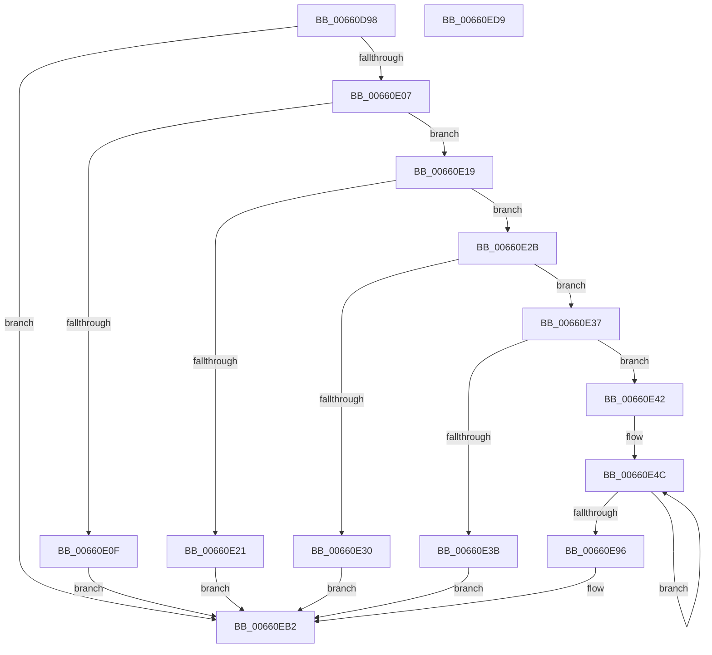

# WheapPrmTranslatePhysicalAddressIntel

- RVA: `0x00660D98`–`0x00660EDA` (길이 `322` bytes)
- VA: `0x0000000140660D98`
- 실행 섹션: `.text`
- PDB 이름 있음: `예`; PDB Function 태그: `아니요`
- unwind 정보 RVA: `0x000D5FBC`
- 디코드: `82`개 명령, `322/322` bytes 표시
- 미해석 바이트: `0` (있으면 어셈블리에 `.byte`로 보존)

> 이 문서는 커널 이미지의 기계어와 PDB 기호를 분석해 생성했습니다. 4번과 5번은 함수 원형과 자료형을 바이너리 사용 방식에서 추정한 C 해석이며 원본 소스 복구 결과는 아닙니다.

## 1. Dependencies

- 직접 호출 지점: **3**; 고유 호출 대상: **3**
- 직접 호출자로 확인된 함수: **1**
- RIP 상대 이미지 참조: **1**

### Outgoing calls
- `0x00660DD6` → [memset](../6C/memset_function_006C6C40.md) (function, `0x006C6C40`)
- `0x00660DF8` → [WheapPrmInvokeHandler](WheapPrmInvokeHandler_function_00660B0C.md) (function, `0x00660B0C`)
- `0x00660EBF` → [_security_check_cookie](../6A/_security_check_cookie_function_006AC640.md) (function, `0x006AC640`)

### Direct callers
- [WheaPrmTranslatePhysicalAddress](WheaPrmTranslatePhysicalAddress_function_00660AD0.md) at `0x00660AFA`

### Static image references
- `0x00660DAA` → RVA `0x00E0A740` (`.data`; read)

## 2. Other-region calls and transfers

- 다른 실행 섹션으로 향하는 call: **0**
- 별도 외부 분기/꼬리 이동을 확인하지 못했습니다.

## 3. Assembly (complete function range)

```asm
00660D98  48 89 5C 24 18                  mov qword ptr [rsp + 0x18], rbx
00660D9D  48 89 74 24 20                  mov qword ptr [rsp + 0x20], rsi
00660DA2  57                              push rdi
00660DA3  48 81 EC 90 01 00 00            sub rsp, 0x190
00660DAA  48 8B 05 8F 99 7A 00            mov rax, qword ptr [rip + 0x7a998f]
00660DB1  48 33 C4                        xor rax, rsp
00660DB4  48 89 84 24 80 01 00 00         mov qword ptr [rsp + 0x180], rax
00660DBC  48 83 64 24 30 00               and qword ptr [rsp + 0x30], 0
00660DC2  48 8B FA                        mov rdi, rdx
00660DC5  BA FF 00 00 00                  mov edx, 0xff
00660DCA  48 8B D9                        mov rbx, rcx
00660DCD  48 8D 4C 24 40                  lea rcx, [rsp + 0x40]
00660DD2  44 8D 42 35                     lea r8d, [rdx + 0x35]
00660DD6  E8 65 5E 06 00                  call 0x1406c6c40
00660DDB  48 8D 44 24 30                  lea rax, [rsp + 0x30]
00660DE0  48 89 5C 24 4C                  mov qword ptr [rsp + 0x4c], rbx
00660DE5  BE 02 00 00 00                  mov esi, 2
00660DEA  48 89 44 24 20                  mov qword ptr [rsp + 0x20], rax
00660DEF  48 8D 54 24 40                  lea rdx, [rsp + 0x40]
00660DF4  89 74 24 44                     mov dword ptr [rsp + 0x44], esi
00660DF8  E8 0F FD FF FF                  call 0x140660b0c
00660DFD  8B C8                           mov ecx, eax
00660DFF  85 C0                           test eax, eax
00660E01  0F 88 AB 00 00 00               js 0x140660eb2
00660E07  48 83 7C 24 30 00               cmp qword ptr [rsp + 0x30], 0
00660E0D  74 0A                           je 0x140660e19
00660E0F  B9 BB 00 00 C0                  mov ecx, 0xc00000bb
00660E14  E9 99 00 00 00                  jmp 0x140660eb2
00660E19  8B 44 24 48                     mov eax, dword ptr [rsp + 0x48]
00660E1D  3B C6                           cmp eax, esi
00660E1F  75 0A                           jne 0x140660e2b
00660E21  B9 0D 00 00 C0                  mov ecx, 0xc000000d
00660E26  E9 87 00 00 00                  jmp 0x140660eb2
00660E2B  83 F8 03                        cmp eax, 3
00660E2E  75 07                           jne 0x140660e37
00660E30  B9 E5 00 00 C0                  mov ecx, 0xc00000e5
00660E35  EB 7B                           jmp 0x140660eb2
00660E37  85 C0                           test eax, eax
00660E39  74 07                           je 0x140660e42
00660E3B  B9 01 00 00 C0                  mov ecx, 0xc0000001
00660E40  EB 70                           jmp 0x140660eb2
00660E42  48 8D 44 24 40                  lea rax, [rsp + 0x40]
00660E47  BA 80 00 00 00                  mov edx, 0x80
00660E4C  0F 10 00                        movups xmm0, xmmword ptr [rax]
00660E4F  0F 10 48 10                     movups xmm1, xmmword ptr [rax + 0x10]
00660E53  0F 11 07                        movups xmmword ptr [rdi], xmm0
00660E56  0F 10 40 20                     movups xmm0, xmmword ptr [rax + 0x20]
00660E5A  0F 11 4F 10                     movups xmmword ptr [rdi + 0x10], xmm1
00660E5E  0F 10 48 30                     movups xmm1, xmmword ptr [rax + 0x30]
00660E62  0F 11 47 20                     movups xmmword ptr [rdi + 0x20], xmm0
00660E66  0F 10 40 40                     movups xmm0, xmmword ptr [rax + 0x40]
00660E6A  0F 11 4F 30                     movups xmmword ptr [rdi + 0x30], xmm1
00660E6E  0F 10 48 50                     movups xmm1, xmmword ptr [rax + 0x50]
00660E72  0F 11 47 40                     movups xmmword ptr [rdi + 0x40], xmm0
00660E76  0F 10 40 60                     movups xmm0, xmmword ptr [rax + 0x60]
00660E7A  0F 11 4F 50                     movups xmmword ptr [rdi + 0x50], xmm1
00660E7E  0F 10 48 70                     movups xmm1, xmmword ptr [rax + 0x70]
00660E82  48 03 C2                        add rax, rdx
00660E85  0F 11 47 60                     movups xmmword ptr [rdi + 0x60], xmm0
00660E89  48 03 FA                        add rdi, rdx
00660E8C  0F 11 4F F0                     movups xmmword ptr [rdi - 0x10], xmm1
00660E90  48 83 EE 01                     sub rsi, 1
00660E94  75 B6                           jne 0x140660e4c
00660E96  0F 10 00                        movups xmm0, xmmword ptr [rax]
00660E99  0F 10 48 10                     movups xmm1, xmmword ptr [rax + 0x10]
00660E9D  0F 11 07                        movups xmmword ptr [rdi], xmm0
00660EA0  0F 10 40 20                     movups xmm0, xmmword ptr [rax + 0x20]
00660EA4  8B 40 30                        mov eax, dword ptr [rax + 0x30]
00660EA7  0F 11 4F 10                     movups xmmword ptr [rdi + 0x10], xmm1
00660EAB  0F 11 47 20                     movups xmmword ptr [rdi + 0x20], xmm0
00660EAF  89 47 30                        mov dword ptr [rdi + 0x30], eax
00660EB2  8B C1                           mov eax, ecx
00660EB4  48 8B 8C 24 80 01 00 00         mov rcx, qword ptr [rsp + 0x180]
00660EBC  48 33 CC                        xor rcx, rsp
00660EBF  E8 7C B7 04 00                  call 0x1406ac640
00660EC4  4C 8D 9C 24 90 01 00 00         lea r11, [rsp + 0x190]
00660ECC  49 8B 5B 20                     mov rbx, qword ptr [r11 + 0x20]
00660ED0  49 8B 73 28                     mov rsi, qword ptr [r11 + 0x28]
00660ED4  49 8B E3                        mov rsp, r11
00660ED7  5F                              pop rdi
00660ED8  C3                              ret
00660ED9  CC                              int3
```

## 4. C-style interpretation (structured pseudocode)

```c
__int64 __fastcall WheapPrmTranslatePhysicalAddressIntel(__int64 a1, __int64 a2)
{
    __int64 result;
    __int64 v_rdi;
    __int64 v_rsi;
    __int64 v_rsp;
    unsigned __int64 v_stack_m14C;
    unsigned int v_stack_m150;
    unsigned int v_stack_m154;
    unsigned __int64 v_stack_m158;
    unsigned __int64 v_stack_m168;
    unsigned __int64 v_stack_m178;
    unsigned __int64 v_stack_m18;
    unsigned __int64 v_stack_m8;
    unsigned __int64 v_stack_p18;
    unsigned __int64 v_stack_p20;

    v_stack_p18 = v_rbx;
    v_stack_p20 = v_rsi;
    v_rsp = (v_rsp) - (400);
    result = (*(unsigned __int64 *)(v_rip + 8034703)) ^ (v_rsp);
    v_stack_m18 = result;
    result = memset(v_stack_m158, 255, 255 + 53, a4);
    v_stack_m14C = a1;
    v_stack_m178 = v_stack_m168;
    v_stack_m154 = 2;
    result = WheapPrmInvokeHandler(v_stack_m158, v_stack_m158, 255 + 53, a4);
    if (sign_flag) goto loc_00660EB2;
    if (v_stack_m168 == 0) goto loc_00660E19;
    goto loc_00660EB2;
loc_00660E19:
    if (((unsigned int)((unsigned int)(v_stack_m150))) != 2) goto loc_00660E2B;
    goto loc_00660EB2;
loc_00660E2B:
    if (((unsigned int)((unsigned int)(v_stack_m150))) != 3) goto loc_00660E37;
    goto loc_00660EB2;
loc_00660E37:
    if ((unsigned int)((unsigned int)(v_stack_m150)) == 0) goto loc_00660E42;
    goto loc_00660EB2;
loc_00660E42:
loc_00660E4C:
    *(unsigned __int64 *)(a2) = v_xmm0;
    *(unsigned __int64 *)(a2 + 16) = v_xmm1;
    *(unsigned __int64 *)(a2 + 32) = v_xmm0;
    *(unsigned __int64 *)(a2 + 48) = v_xmm1;
    *(unsigned __int64 *)(a2 + 64) = v_xmm0;
    *(unsigned __int64 *)(a2 + 80) = v_xmm1;
    result = (v_stack_m158) + (128);
    *(unsigned __int64 *)(a2 + 96) = v_xmm0;
    v_rdi = (a2) + (128);
    *(unsigned __int64 *)(v_rdi - 16) = v_xmm1;
    v_rsi = (2) - (1);
    if (condition_is_not_equal) goto loc_00660E4C;
    *(unsigned __int64 *)(v_rdi) = v_xmm0;
    *(unsigned __int64 *)(v_rdi + 16) = v_xmm1;
    *(unsigned __int64 *)(v_rdi + 32) = v_xmm0;
    *(unsigned int *)(v_rdi + 48) = (unsigned int)((unsigned int)(*(unsigned int *)(result + 48)));
loc_00660EB2:
    a1 = (v_stack_m18) ^ (v_rsp);
    result = _security_check_cookie(a1, 128, 255 + 53, a4);
    return result;
}
```

## 5. (Beta) C Style

```c
int64_t WheapPrmTranslatePhysicalAddressIntel(int64_t Arg1, void *Arg2)
{
    uint8_t *arg2 = (uint8_t *)Arg2;

    int64_t result;
    int64_t local_rdi;
    int64_t local_rsi;
    int64_t local_rsp;
    uint64_t v_stack_m14C;
    uint32_t v_stack_m150;
    uint32_t v_stack_m154;
    uint64_t v_stack_m158;
    uint64_t v_stack_m168;
    uint64_t v_stack_m178;
    uint64_t v_stack_m18;
    uint64_t v_stack_m8;
    uint64_t v_stack_p18;
    uint64_t v_stack_p20;

    v_stack_p18 = local_rbx;
    v_stack_p20 = local_rsi;
    local_rsp = (local_rsp) - (400);
    result = (*(uint64_t *)(v_rip + 0x7A998F)) ^ (local_rsp);
    v_stack_m18 = result;
    result = memset(v_stack_m158, 255, 255 + 53, a4);
    v_stack_m14C = Arg1;
    v_stack_m178 = v_stack_m168;
    v_stack_m154 = 2;
    result = WheapPrmInvokeHandler(v_stack_m158, v_stack_m158, 255 + 53, a4);
    if (sign_flag) goto loc_00660EB2;
    if (v_stack_m168 == 0) goto loc_00660E19;
    goto loc_00660EB2;
loc_00660E19:
    if (((uint32_t)((uint32_t)(v_stack_m150))) != 2) goto loc_00660E2B;
    goto loc_00660EB2;
loc_00660E2B:
    if (((uint32_t)((uint32_t)(v_stack_m150))) != 3) goto loc_00660E37;
    goto loc_00660EB2;
loc_00660E37:
    if ((uint32_t)((uint32_t)(v_stack_m150)) == 0) goto loc_00660E42;
    goto loc_00660EB2;
loc_00660E42:
loc_00660E4C:
    *(uint64_t *)(arg2) = v_xmm0;
    *(uint64_t *)(arg2 + 0x10) = v_xmm1;
    *(uint64_t *)(arg2 + 0x20) = v_xmm0;
    *(uint64_t *)(arg2 + 0x30) = v_xmm1;
    *(uint64_t *)(arg2 + 0x40) = v_xmm0;
    *(uint64_t *)(arg2 + 0x50) = v_xmm1;
    result = (v_stack_m158) + (128);
    *(uint64_t *)(arg2 + 0x60) = v_xmm0;
    local_rdi = (Arg2) + (128);
    *(uint64_t *)(local_rdi - 0x10) = v_xmm1;
    local_rsi = (2) - (1);
    if (condition_is_not_equal) goto loc_00660E4C;
    *(uint64_t *)(local_rdi) = v_xmm0;
    *(uint64_t *)(local_rdi + 0x10) = v_xmm1;
    *(uint64_t *)(local_rdi + 0x20) = v_xmm0;
    *(uint32_t *)(local_rdi + 0x30) = (uint32_t)((uint32_t)(*(uint32_t *)(result + 0x30)));
loc_00660EB2:
    Arg1 = (v_stack_m18) ^ (local_rsp);
    result = _security_check_cookie(Arg1, 128, 255 + 53, a4);
    return result;
}
```

### 관측된 메모리 오프셋

구조체 형식이 확인되지 않은 접근은 인자 기준의 오프셋으로만 기록했습니다.

| 기준 인자 | 오프셋 표현 | 폭 (bit) | 접근 |
|---|---:|---:|---|
| `Arg2` | `- 0x10` | `128` | `R` |
| `Arg2` | `+ 0x0` | `128` | `R` |
| `Arg2` | `+ 0x10` | `128` | `R` |
| `Arg2` | `+ 0x20` | `128` | `R` |
| `Arg2` | `+ 0x30` | `32` | `W` |
| `Arg2` | `+ 0x30` | `128` | `R` |
| `Arg2` | `+ 0x40` | `128` | `R` |
| `Arg2` | `+ 0x50` | `128` | `R` |
| `Arg2` | `+ 0x60` | `128` | `R` |

## 6. Execution-region graph

[열기: 2D/3D 그래프와 함수 탐색 컨트롤 패널](../../../control-panel.html?section=text&rva=0x00660D98&view=graph)

- 2D 그래프는 위에서 아래로 흐르고, 3D 그래프는 빈 공간을 드래그해 회전합니다. Shift+드래그는 이동, 휠은 확대·축소, 함수 노드 선택은 대상 보고서 이동입니다.

### Static fallback


