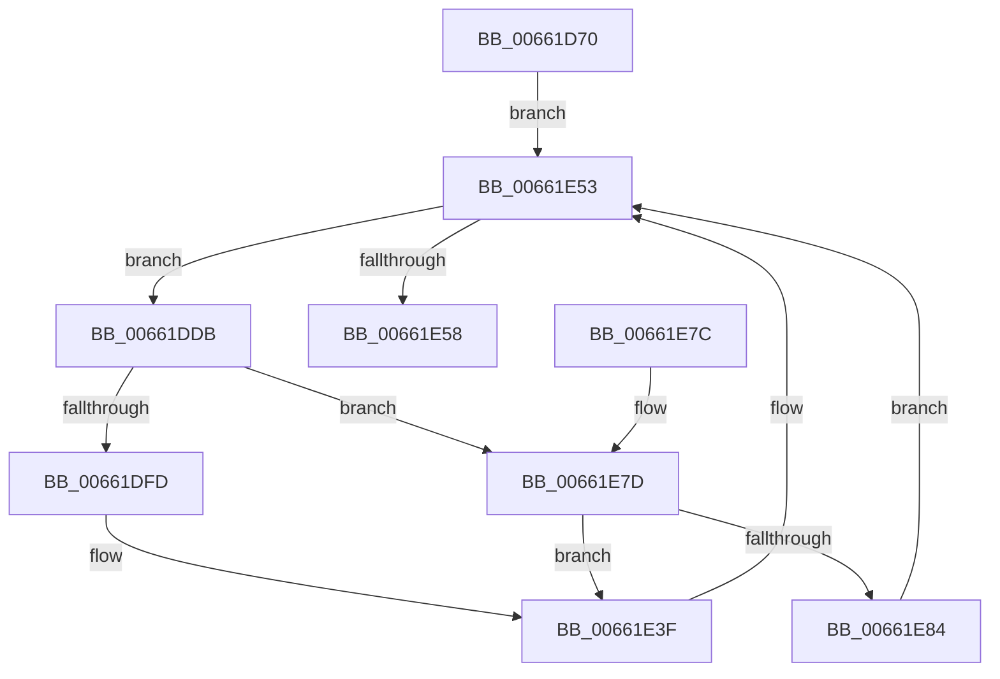

# WheapProcessOfflineList

- RVA: `0x00661D70`–`0x00661E8E` (길이 `286` bytes)
- VA: `0x0000000140661D70`
- 실행 섹션: `.text`
- PDB 이름 있음: `예`; PDB Function 태그: `아니요`
- unwind 정보 RVA: `0x000D60B4`
- 디코드: `65`개 명령, `286/286` bytes 표시
- 미해석 바이트: `0` (있으면 어셈블리에 `.byte`로 보존)

> 이 문서는 커널 이미지의 기계어와 PDB 기호를 분석해 생성했습니다. 4번과 5번은 함수 원형과 자료형을 바이너리 사용 방식에서 추정한 C 해석이며 원본 소스 복구 결과는 아닙니다.

## 1. Dependencies

- 직접 호출 지점: **7**; 고유 호출 대상: **7**
- 직접 호출자로 확인된 함수: **0**
- RIP 상대 이미지 참조: **6**

### Outgoing calls
- `0x00661DAD` → [KeAcquireSpinLockRaiseToDpc](../20/KeAcquireSpinLockRaiseToDpc_function_00208470.md) (function, `0x00208470`)
- `0x00661DD4` → [KeReleaseSpinLock](../39/KeReleaseSpinLock_function_00392BA0.md) (function, `0x00392BA0`)
- `0x00661DED` → [MmGetPageBadStatus](../67/MmGetPageBadStatus_function_0067A9B0.md) (function, `0x0067A9B0`)
- `0x00661E3A` → [WheaLogInternalEvent](WheaLogInternalEvent_function_006605B0.md) (function, `0x006605B0`)
- `0x00661E47` → [ExFreePoolWithTag](../../poolcode/B8/ExFreePoolWithTag_function_00B82870.md) (function, `0x00B82870`)
- `0x00661E61` → [_security_check_cookie](../6A/_security_check_cookie_function_006AC640.md) (function, `0x006AC640`)
- `0x00661E87` → [WheapPushPendingOfflineWrapper](../../page/7D/WheapPushPendingOfflineWrapper_function_007D95F4.md) (function, `0x007D95F4`)

### Direct callers
- 이 함수 시작 RVA로 연결되는 직접 call은 확인되지 않았습니다. 간접 호출은 완전히 역산할 수 없습니다.

### Static image references
- `0x00661D87` → RVA `0x00E0A740` (`.data`; read)
- `0x00661D98` → RVA `0x00EF7D08` (`.data`; read)
- `0x00661DB2` → RVA `0x00EF7D00` (`.data`; read)
- `0x00661DC0` → RVA `0x00EF7D00` (`.data`; read/write)
- `0x00661DCA` → RVA `0x00EF7D10` (`.data`; write)
- `0x00661E4C` → RVA `0x00EF7D20` (`.data`; read/write)

## 2. Other-region calls and transfers

- 다른 실행 섹션으로 향하는 call: **2**
  - `0x00661E47` → [ExFreePoolWithTag](../../poolcode/B8/ExFreePoolWithTag_function_00B82870.md) (`.text` → `POOLCODE`)
  - `0x00661E87` → [WheapPushPendingOfflineWrapper](../../page/7D/WheapPushPendingOfflineWrapper_function_007D95F4.md) (`.text` → `PAGE`)
- 별도 외부 분기/꼬리 이동을 확인하지 못했습니다.

## 3. Assembly (complete function range)

```asm
00661D70  48 89 5C 24 08                  mov qword ptr [rsp + 8], rbx
00661D75  48 89 74 24 10                  mov qword ptr [rsp + 0x10], rsi
00661D7A  48 89 7C 24 18                  mov qword ptr [rsp + 0x18], rdi
00661D7F  55                              push rbp
00661D80  48 8B EC                        mov rbp, rsp
00661D83  48 83 EC 60                     sub rsp, 0x60
00661D87  48 8B 05 B2 89 7A 00            mov rax, qword ptr [rip + 0x7a89b2]
00661D8E  48 33 C4                        xor rax, rsp
00661D91  48 89 45 F0                     mov qword ptr [rbp - 0x10], rax
00661D95  0F 57 C0                        xorps xmm0, xmm0
00661D98  48 8D 0D 69 5F 89 00            lea rcx, [rip + 0x895f69]
00661D9F  33 C0                           xor eax, eax
00661DA1  0F 11 45 C8                     movups xmmword ptr [rbp - 0x38], xmm0
00661DA5  48 89 45 E8                     mov qword ptr [rbp - 0x18], rax
00661DA9  0F 11 45 D8                     movups xmmword ptr [rbp - 0x28], xmm0
00661DAD  E8 BE 66 BA FF                  call 0x140208470
00661DB2  48 8B 1D 47 5F 89 00            mov rbx, qword ptr [rip + 0x895f47]
00661DB9  48 8D 0D 48 5F 89 00            lea rcx, [rip + 0x895f48]
00661DC0  48 83 25 38 5F 89 00 00         and qword ptr [rip + 0x895f38], 0
00661DC8  8A D0                           mov dl, al
00661DCA  C7 05 3C 5F 89 00 00 00 00 00   mov dword ptr [rip + 0x895f3c], 0
00661DD4  E8 C7 0D D3 FF                  call 0x140392ba0
00661DD9  EB 78                           jmp 0x140661e53
00661DDB  48 8B F3                        mov rsi, rbx
00661DDE  48 8D 4D C0                     lea rcx, [rbp - 0x40]
00661DE2  48 8B 1B                        mov rbx, qword ptr [rbx]
00661DE5  48 8B 7E 08                     mov rdi, qword ptr [rsi + 8]
00661DE9  48 89 7D C0                     mov qword ptr [rbp - 0x40], rdi
00661DED  E8 BE 8B 01 00                  call 0x14067a9b0
00661DF2  3D 09 07 00 C0                  cmp eax, 0xc0000709
00661DF7  0F 85 80 00 00 00               jne 0x140661e7d
00661DFD  83 65 D4 00                     and dword ptr [rbp - 0x2c], 0
00661E01  48 8D 4D C8                     lea rcx, [rbp - 0x38]
00661E05  C7 45 C8 57 68 4C 67            mov dword ptr [rbp - 0x38], 0x674c6857
00661E0C  C7 45 CC 01 00 00 00            mov dword ptr [rbp - 0x34], 1
00661E13  C7 45 D0 28 00 00 00            mov dword ptr [rbp - 0x30], 0x28
00661E1A  C7 45 DC 32 00 00 80            mov dword ptr [rbp - 0x24], 0x80000032
00661E21  C7 45 D8 4B 52 4E 4C            mov dword ptr [rbp - 0x28], 0x4c4e524b
00661E28  C7 45 E0 02 00 00 00            mov dword ptr [rbp - 0x20], 2
00661E2F  C7 45 E4 08 00 00 00            mov dword ptr [rbp - 0x1c], 8
00661E36  48 89 7D E8                     mov qword ptr [rbp - 0x18], rdi
00661E3A  E8 71 E7 FF FF                  call 0x1406605b0
00661E3F  BA 57 68 65 61                  mov edx, 0x61656857
00661E44  48 8B CE                        mov rcx, rsi
00661E47  E8 24 0A 52 00                  call 0x140b82870
00661E4C  F0 FF 0D CD 5E 89 00            lock dec dword ptr [rip + 0x895ecd]
00661E53  48 85 DB                        test rbx, rbx
00661E56  75 83                           jne 0x140661ddb
00661E58  33 C0                           xor eax, eax
00661E5A  48 8B 4D F0                     mov rcx, qword ptr [rbp - 0x10]
00661E5E  48 33 CC                        xor rcx, rsp
00661E61  E8 DA A7 04 00                  call 0x1406ac640
00661E66  4C 8D 5C 24 60                  lea r11, [rsp + 0x60]
00661E6B  49 8B 5B 10                     mov rbx, qword ptr [r11 + 0x10]
00661E6F  49 8B 73 18                     mov rsi, qword ptr [r11 + 0x18]
00661E73  49 8B 7B 20                     mov rdi, qword ptr [r11 + 0x20]
00661E77  49 8B E3                        mov rsp, r11
00661E7A  5D                              pop rbp
00661E7B  C3                              ret
00661E7C  CC                              int3
00661E7D  3D 03 01 00 00                  cmp eax, 0x103
00661E82  75 BB                           jne 0x140661e3f
00661E84  48 8B CE                        mov rcx, rsi
00661E87  E8 68 77 17 00                  call 0x1407d95f4
00661E8C  EB C5                           jmp 0x140661e53
```

## 4. C-style interpretation (structured pseudocode)

```c
__int64 __fastcall WheapProcessOfflineList(void)
{
    __int64 result;
    __int64 v_rsp;
    unsigned __int64 v_stack_m18;
    unsigned __int64 v_stack_m20;
    unsigned int v_stack_m24;
    unsigned int v_stack_m28;
    unsigned int v_stack_m2C;
    unsigned __int64 v_stack_m30;
    unsigned int v_stack_m34;
    unsigned int v_stack_m38;
    unsigned int v_stack_m3C;
    unsigned __int64 v_stack_m40;
    unsigned __int64 v_stack_m48;
    unsigned __int64 v_stack_m8;
    unsigned __int64 v_stack_p10;
    unsigned __int64 v_stack_p18;
    unsigned __int64 v_stack_p8;

    v_stack_p8 = v_rbx;
    v_stack_p10 = v_rsi;
    v_stack_p18 = v_rdi;
    v_rsp = (v_rsp) - (96);
    result = (*(unsigned __int64 *)(v_rip + 8030642)) ^ (v_rsp);
    v_stack_m18 = result;
    result = 0;
    v_stack_m40 = v_xmm0;
    v_stack_m20 = 0;
    v_stack_m30 = v_xmm0;
    result = KeAcquireSpinLockRaiseToDpc(v_rip + 9002857, a2, a3, a4);
    *(unsigned int *)(v_rip + 9002812) = 0;
    result = KeReleaseSpinLock(v_rip + 9002824, (unsigned __int8)(result), a3, a4);
    goto loc_00661E53;
loc_00661DDB:
    v_stack_m48 = *(unsigned __int64 *)(*(unsigned __int64 *)(v_rip + 9002823) + 8);
    result = MmGetPageBadStatus(v_stack_m48, (unsigned __int8)(result), a3, a4);
    if (((unsigned int)(result)) != 0xC0000709ULL) goto loc_00661E7D;
    v_stack_m40 = 0x674C6857ULL;
    v_stack_m3C = 1;
    v_stack_m38 = 40;
    v_stack_m2C = 0x80000032ULL;
    v_stack_m30 = 0x4C4E524BULL;
    v_stack_m28 = 2;
    v_stack_m24 = 8;
    v_stack_m20 = *(unsigned __int64 *)(*(unsigned __int64 *)(v_rip + 9002823) + 8);
    result = WheaLogInternalEvent(v_stack_m40, (unsigned __int8)(result), a3, a4);
loc_00661E3F:
    result = ExFreePoolWithTag(*(unsigned __int64 *)(v_rip + 9002823), (unsigned int)(0x61656857ULL), a3, a4);
loc_00661E53:
    if (*(unsigned __int64 *)(*(unsigned __int64 *)(v_rip + 9002823)) != 0) goto loc_00661DDB;
    result = 0;
    a1 = (v_stack_m18) ^ (v_rsp);
    result = _security_check_cookie(a1, (unsigned int)(0x61656857ULL), a3, a4);
    return result;
loc_00661E7D:
    if (((unsigned int)(result)) != 259) goto loc_00661E3F;
    result = WheapPushPendingOfflineWrapper(*(unsigned __int64 *)(v_stack_m8 + 24), (unsigned int)(0x61656857ULL), a3, a4);
    goto loc_00661E53;
}
```

## 5. (Beta) C Style

```c
void WheapProcessOfflineList(void)
{
    int64_t result;
    int64_t local_rsp;
    uint64_t v_stack_m18;
    uint64_t v_stack_m20;
    uint32_t v_stack_m24;
    uint32_t v_stack_m28;
    uint32_t v_stack_m2C;
    uint64_t v_stack_m30;
    uint32_t v_stack_m34;
    uint32_t v_stack_m38;
    uint32_t v_stack_m3C;
    uint64_t v_stack_m40;
    uint64_t v_stack_m48;
    uint64_t v_stack_m8;
    uint64_t v_stack_p10;
    uint64_t v_stack_p18;
    uint64_t v_stack_p8;

    v_stack_p8 = local_rbx;
    v_stack_p10 = local_rsi;
    v_stack_p18 = local_rdi;
    local_rsp = (local_rsp) - (96);
    result = (*(uint64_t *)(v_rip + 0x7A89B2)) ^ (local_rsp);
    v_stack_m18 = result;
    result = 0;
    v_stack_m40 = v_xmm0;
    v_stack_m20 = 0;
    v_stack_m30 = v_xmm0;
    result = KeAcquireSpinLockRaiseToDpc(v_rip + 9002857, a2, a3, a4);
    *(uint32_t *)(v_rip + 0x895F3C) = 0;
    result = KeReleaseSpinLock(v_rip + 9002824, (uint8_t)(result), a3, a4);
    goto loc_00661E53;
loc_00661DDB:
    v_stack_m48 = *(uint64_t *)(*(uint64_t *)(v_rip + 0x895F47) + 0x8);
    result = MmGetPageBadStatus(v_stack_m48, (uint8_t)(result), a3, a4);
    if (((uint32_t)(result)) != 0xC0000709ULL) goto loc_00661E7D;
    v_stack_m40 = 0x674C6857ULL;
    v_stack_m3C = 1;
    v_stack_m38 = 40;
    v_stack_m2C = 0x80000032ULL;
    v_stack_m30 = 0x4C4E524BULL;
    v_stack_m28 = 2;
    v_stack_m24 = 8;
    v_stack_m20 = *(uint64_t *)(*(uint64_t *)(v_rip + 0x895F47) + 0x8);
    result = WheaLogInternalEvent(v_stack_m40, (uint8_t)(result), a3, a4);
loc_00661E3F:
    result = ExFreePoolWithTag(*(uint64_t *)(v_rip + 0x895F47), (uint32_t)(0x61656857ULL), a3, a4);
loc_00661E53:
    if (*(uint64_t *)(*(uint64_t *)(v_rip + 0x895F47)) != 0) goto loc_00661DDB;
    result = 0;
    a1 = (v_stack_m18) ^ (local_rsp);
    result = _security_check_cookie(a1, (uint32_t)(0x61656857ULL), a3, a4);
    return result;
loc_00661E7D:
    if (((uint32_t)(result)) != 259) goto loc_00661E3F;
    result = WheapPushPendingOfflineWrapper(*(uint64_t *)(v_stack_m8 + 0x18), (uint32_t)(0x61656857ULL), a3, a4);
    goto loc_00661E53;
}
```

## 6. Execution-region graph

[열기: 2D/3D 그래프와 함수 탐색 컨트롤 패널](../../../control-panel.html?section=text&rva=0x00661D70&view=graph)

- 2D 그래프는 위에서 아래로 흐르고, 3D 그래프는 빈 공간을 드래그해 회전합니다. Shift+드래그는 이동, 휠은 확대·축소, 함수 노드 선택은 대상 보고서 이동입니다.

### Static fallback


