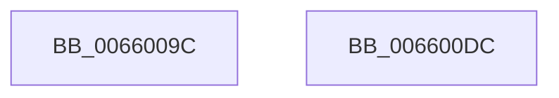

# WheapSetDefaultErrorConfigurationCalls

- RVA: `0x0066009C`–`0x006600DD` (길이 `65` bytes)
- VA: `0x000000014066009C`
- 실행 섹션: `.text`
- PDB 이름 있음: `예`; PDB Function 태그: `아니요`
- unwind 정보 RVA: `0x000DB714`
- 디코드: `13`개 명령, `65/65` bytes 표시
- 미해석 바이트: `0` (있으면 어셈블리에 `.byte`로 보존)

> 이 문서는 커널 이미지의 기계어와 PDB 기호를 분석해 생성했습니다. 4번과 5번은 함수 원형과 자료형을 바이너리 사용 방식에서 추정한 C 해석이며 원본 소스 복구 결과는 아닙니다.

## 1. Dependencies

- 직접 호출 지점: **0**; 고유 호출 대상: **0**
- 직접 호출자로 확인된 함수: **1**
- RIP 상대 이미지 참조: **4**

### Outgoing calls
- 직접 디코드된 call 명령이 없습니다.

### Direct callers
- [WheaUnconfigureErrorSource](../../pagelk/B7/WheaUnconfigureErrorSource_function_00B73560.md) at `0x00B7362B`

### Static image references
- `0x0066009C` → RVA `0x0048FDC0` (`HalAdjustResourceList`; read)
- `0x006600A7` → RVA `0x00B5D700` (`HalpQosInitSystem`; read)
- `0x006600B2` → RVA `0x00660050` (`WheapDefaultErrSrcCreateRecord`; read)
- `0x006600C8` → RVA `0x0049E550` (`EmpCheckErrataList`; read)

## 2. Other-region calls and transfers

- 다른 실행 섹션으로 향하는 call: **0**
- 별도 외부 분기/꼬리 이동을 확인하지 못했습니다.

## 3. Assembly (complete function range)

```asm
0066009C  48 8D 05 1D FD E2 FF            lea rax, [rip - 0x1d02e3]
006600A3  48 89 41 10                     mov qword ptr [rcx + 0x10], rax
006600A7  48 8D 05 52 D6 4F 00            lea rax, [rip + 0x4fd652]
006600AE  48 89 41 18                     mov qword ptr [rcx + 0x18], rax
006600B2  48 8D 05 97 FF FF FF            lea rax, [rip - 0x69]
006600B9  48 89 41 20                     mov qword ptr [rcx + 0x20], rax
006600BD  48 8D 05 FC FC E2 FF            lea rax, [rip - 0x1d0304]
006600C4  48 89 41 28                     mov qword ptr [rcx + 0x28], rax
006600C8  48 8D 05 81 E4 E3 FF            lea rax, [rip - 0x1c1b7f]
006600CF  48 89 41 30                     mov qword ptr [rcx + 0x30], rax
006600D3  48 C7 41 38 00 00 00 00         mov qword ptr [rcx + 0x38], 0
006600DB  C3                              ret
006600DC  CC                              int3
```

## 4. C-style interpretation (structured pseudocode)

```c
__int64 __fastcall WheapSetDefaultErrorConfigurationCalls(__int64 a1)
{
    *(unsigned __int64 *)(a1 + 16) = v_rip - 1901283;
    *(unsigned __int64 *)(a1 + 24) = v_rip + 5232210;
    *(unsigned __int64 *)(a1 + 32) = v_rip - 105;
    *(unsigned __int64 *)(a1 + 40) = v_rip - 1901316;
    *(unsigned __int64 *)(a1 + 48) = v_rip - 1842047;
    *(unsigned __int64 *)(a1 + 56) = 0;
    return v_rip - 1842047;
}
```

## 5. (Beta) C Style

```c
int64_t WheapSetDefaultErrorConfigurationCalls(void *Arg1)
{
    uint8_t *arg1 = (uint8_t *)Arg1;

    *(uint64_t *)(arg1 + 0x10) = v_rip - 1901283;
    *(uint64_t *)(arg1 + 0x18) = v_rip + 5232210;
    *(uint64_t *)(arg1 + 0x20) = v_rip - 105;
    *(uint64_t *)(arg1 + 0x28) = v_rip - 1901316;
    *(uint64_t *)(arg1 + 0x30) = v_rip - 1842047;
    *(uint64_t *)(arg1 + 0x38) = 0;
    return v_rip - 1842047;
}
```

### 관측된 메모리 오프셋

구조체 형식이 확인되지 않은 접근은 인자 기준의 오프셋으로만 기록했습니다.

| 기준 인자 | 오프셋 표현 | 폭 (bit) | 접근 |
|---|---:|---:|---|
| `Arg1` | `+ 0x10` | `64` | `W` |
| `Arg1` | `+ 0x18` | `64` | `W` |
| `Arg1` | `+ 0x20` | `64` | `W` |
| `Arg1` | `+ 0x28` | `64` | `W` |
| `Arg1` | `+ 0x30` | `64` | `W` |
| `Arg1` | `+ 0x38` | `64` | `W` |

## 6. Execution-region graph

[열기: 2D/3D 그래프와 함수 탐색 컨트롤 패널](../../../control-panel.html?section=text&rva=0x0066009C&view=graph)

- 2D 그래프는 위에서 아래로 흐르고, 3D 그래프는 빈 공간을 드래그해 회전합니다. Shift+드래그는 이동, 휠은 확대·축소, 함수 노드 선택은 대상 보고서 이동입니다.

### Static fallback


