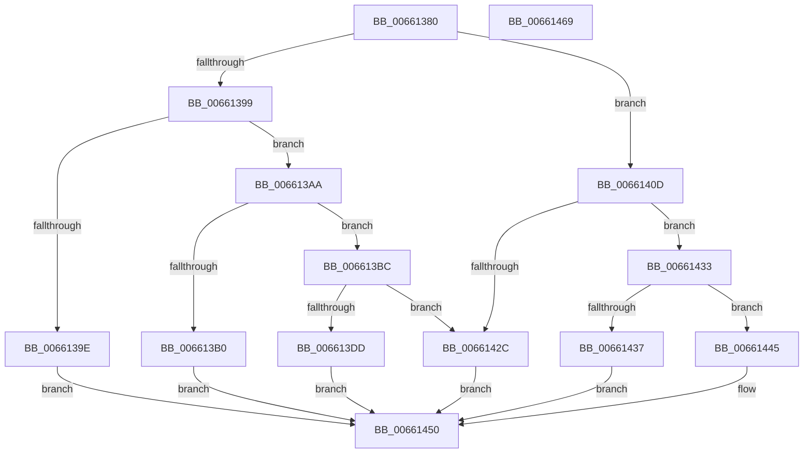

# WheapWmiExecuteErrorInjectionMethod

- RVA: `0x00661380`–`0x0066146A` (길이 `234` bytes)
- VA: `0x0000000140661380`
- 실행 섹션: `.text`
- PDB 이름 있음: `예`; PDB Function 태그: `아니요`
- unwind 정보 RVA: `0x000717F8`
- 디코드: `68`개 명령, `234/234` bytes 표시
- 미해석 바이트: `0` (있으면 어셈블리에 `.byte`로 보존)

> 이 문서는 커널 이미지의 기계어와 PDB 기호를 분석해 생성했습니다. 4번과 5번은 함수 원형과 자료형을 바이너리 사용 방식에서 추정한 C 해석이며 원본 소스 복구 결과는 아닙니다.

## 1. Dependencies

- 직접 호출 지점: **2**; 고유 호출 대상: **2**
- 직접 호출자로 확인된 함수: **1**
- RIP 상대 이미지 참조: **2**

### Outgoing calls
- `0x006613E9` → `PSHED.dll!PshedInjectError` (import, 간접 대상; import `PSHED.dll!PshedInjectError`)
- `0x00661417` → `PSHED.dll!PshedGetInjectionCapabilities` (import, 간접 대상; import `PSHED.dll!PshedGetInjectionCapabilities`)

### Direct callers
- [WheapWmiExecuteMethod](WheapWmiExecuteMethod_function_00661888.md) at `0x00661933`

### Static image references
- `0x006613E9` → RVA `0x001510F8` (`PSHED.dll!PshedInjectError (IAT)`; read)
- `0x00661417` → RVA `0x001510F0` (`PSHED.dll!PshedGetInjectionCapabilities (IAT)`; read)

## 2. Other-region calls and transfers

- 다른 실행 섹션으로 향하는 call: **0**
- 별도 외부 분기/꼬리 이동을 확인하지 못했습니다.

## 3. Assembly (complete function range)

```asm
00661380  48 89 5C 24 10                  mov qword ptr [rsp + 0x10], rbx
00661385  48 89 74 24 18                  mov qword ptr [rsp + 0x18], rsi
0066138A  57                              push rdi
0066138B  48 83 EC 30                     sub rsp, 0x30
0066138F  49 8B F8                        mov rdi, r8
00661392  8B F2                           mov esi, edx
00661394  83 E9 01                        sub ecx, 1
00661397  74 74                           je 0x14066140d
00661399  83 F9 01                        cmp ecx, 1
0066139C  74 0C                           je 0x1406613aa
0066139E  33 DB                           xor ebx, ebx
006613A0  BA 97 02 00 C0                  mov edx, 0xc0000297
006613A5  E9 A6 00 00 00                  jmp 0x140661450
006613AA  41 83 F9 24                     cmp r9d, 0x24
006613AE  73 0C                           jae 0x1406613bc
006613B0  BA 0D 00 00 C0                  mov edx, 0xc000000d
006613B5  33 DB                           xor ebx, ebx
006613B7  E9 94 00 00 00                  jmp 0x140661450
006613BC  41 8B 08                        mov ecx, dword ptr [r8]
006613BF  4D 8D 48 08                     lea r9, [r8 + 8]
006613C3  49 8B 11                        mov rdx, qword ptr [r9]
006613C6  BB 08 00 00 00                  mov ebx, 8
006613CB  4C 03 CB                        add r9, rbx
006613CE  4D 8B 01                        mov r8, qword ptr [r9]
006613D1  4C 03 CB                        add r9, rbx
006613D4  BB 04 00 00 00                  mov ebx, 4
006613D9  3B F3                           cmp esi, ebx
006613DB  72 4F                           jb 0x14066142c
006613DD  49 8B 41 08                     mov rax, qword ptr [r9 + 8]
006613E1  4D 8B 09                        mov r9, qword ptr [r9]
006613E4  48 89 44 24 20                  mov qword ptr [rsp + 0x20], rax
006613E9  48 FF 15 08 FD AE FF            call qword ptr [rip - 0x5102f8]
006613F0  0F 1F 44 00 00                  nop dword ptr [rax + rax]
006613F5  85 C0                           test eax, eax
006613F7  8B D0                           mov edx, eax
006613F9  B9 01 00 00 C0                  mov ecx, 0xc0000001
006613FE  0F 48 D1                        cmovs edx, ecx
00661401  C1 F8 1F                        sar eax, 0x1f
00661404  25 01 00 00 C0                  and eax, 0xc0000001
00661409  89 07                           mov dword ptr [rdi], eax
0066140B  EB 43                           jmp 0x140661450
0066140D  83 64 24 40 00                  and dword ptr [rsp + 0x40], 0
00661412  48 8D 4C 24 40                  lea rcx, [rsp + 0x40]
00661417  48 FF 15 D2 FC AE FF            call qword ptr [rip - 0x51032e]
0066141E  0F 1F 44 00 00                  nop dword ptr [rax + rax]
00661423  BB 08 00 00 00                  mov ebx, 8
00661428  3B F3                           cmp esi, ebx
0066142A  73 07                           jae 0x140661433
0066142C  BA 23 00 00 C0                  mov edx, 0xc0000023
00661431  EB 1D                           jmp 0x140661450
00661433  85 C0                           test eax, eax
00661435  78 0E                           js 0x140661445
00661437  83 27 00                        and dword ptr [rdi], 0
0066143A  8B 44 24 40                     mov eax, dword ptr [rsp + 0x40]
0066143E  33 D2                           xor edx, edx
00661440  89 47 04                        mov dword ptr [rdi + 4], eax
00661443  EB 0B                           jmp 0x140661450
00661445  C7 07 01 00 00 C0               mov dword ptr [rdi], 0xc0000001
0066144B  BA 01 00 00 C0                  mov edx, 0xc0000001
00661450  48 8B 4C 24 60                  mov rcx, qword ptr [rsp + 0x60]
00661455  8B C2                           mov eax, edx
00661457  48 8B 74 24 50                  mov rsi, qword ptr [rsp + 0x50]
0066145C  89 19                           mov dword ptr [rcx], ebx
0066145E  48 8B 5C 24 48                  mov rbx, qword ptr [rsp + 0x48]
00661463  48 83 C4 30                     add rsp, 0x30
00661467  5F                              pop rdi
00661468  C3                              ret
00661469  CC                              int3
```

## 4. C-style interpretation (structured pseudocode)

```c
__int64 __fastcall WheapWmiExecuteErrorInjectionMethod(int a1, int a2, __int64 a3, int a4, __int64 a5)
{
    __int64 result;
    __int64 v_rbx;
    __int64 v_rsp;
    unsigned __int64 v_stack_m18;
    unsigned __int64 v_stack_p10;
    unsigned __int64 v_stack_p18;
    unsigned int v_stack_p8;

    v_stack_p10 = v_rbx;
    v_stack_p18 = v_rsi;
    v_rsp = (v_rsp) - (48);
    a1 = (unsigned int)((a1) - (1));
    if (condition_is_equal) goto loc_0066140D;
    if (a1 == 1) goto loc_006613AA;
    v_rbx = 0;
    goto loc_00661450;
loc_006613AA:
    if (a4 >= 36) goto loc_006613BC;
    v_rbx = 0;
    goto loc_00661450;
loc_006613BC:
    a4 = (a3 + 8) + (8);
    a4 = (a4) + (8);
    if (((unsigned int)((unsigned int)(a2))) < 4) goto loc_0066142C;
    v_stack_m18 = *(unsigned __int64 *)(a4 + 8);
    result = PSHED_dll_PshedInjectError((unsigned int)(*(unsigned int *)(a3)), *(unsigned __int64 *)(a3 + 8), *(unsigned __int64 *)(a4), *(unsigned __int64 *)(a4));
    a2 = (unsigned int)((unsigned int)(result));
    if (sign_flag) { a2 = (unsigned int)((unsigned int)(0xC0000001ULL)); }
    result = (unsigned int)((result) >> (31));
    result = (unsigned int)((result) & (0xC0000001ULL));
    *(unsigned int *)(a3) = (unsigned int)(result);
    goto loc_00661450;
loc_0066140D:
    result = PSHED_dll_PshedGetInjectionCapabilities(v_stack_p8, a2, *(unsigned __int64 *)(a4), *(unsigned __int64 *)(a4));
    if (((unsigned int)((unsigned int)(a2))) >= 8) goto loc_00661433;
loc_0066142C:
    goto loc_00661450;
loc_00661433:
    if (sign_flag) goto loc_00661445;
    a2 = 0;
    *(unsigned int *)(a3 + 4) = (unsigned int)((unsigned int)(v_stack_p8));
    goto loc_00661450;
loc_00661445:
    *(unsigned int *)(a3) = 0xC0000001ULL;
loc_00661450:
    *(unsigned int *)(a5) = 8;
    v_rsp = (v_rsp) + (48);
    return (unsigned int)((unsigned int)((unsigned int)(0xC0000001ULL)));
}
```

## 5. (Beta) C Style

```c
int64_t WheapWmiExecuteErrorInjectionMethod(int32_t Arg1, int32_t Arg2, void *Arg3, int32_t Arg4, void *Arg5)
{
    uint8_t *arg3 = (uint8_t *)Arg3;
    uint8_t *arg5 = (uint8_t *)Arg5;

    int64_t result;
    int64_t local_rbx;
    int64_t local_rsp;
    uint64_t v_stack_m18;
    uint64_t v_stack_p10;
    uint64_t v_stack_p18;
    uint32_t v_stack_p8;

    v_stack_p10 = local_rbx;
    v_stack_p18 = local_rsi;
    local_rsp = (local_rsp) - (48);
    Arg1 = (uint32_t)((Arg1) - (1));
    if (condition_is_equal) goto loc_0066140D;
    if (Arg1 == 1) goto loc_006613AA;
    local_rbx = 0;
    goto loc_00661450;
loc_006613AA:
    if (Arg4 >= 36) goto loc_006613BC;
    local_rbx = 0;
    goto loc_00661450;
loc_006613BC:
    Arg4 = (Arg3 + 8) + (8);
    Arg4 = (Arg4) + (8);
    if (((uint32_t)((uint32_t)(Arg2))) < 4) goto loc_0066142C;
    v_stack_m18 = *(uint64_t *)(Arg4 + 0x8);
    result = kernel_indirect_call((uint32_t)(*(uint32_t *)(arg3)), *(uint64_t *)(arg3 + 0x8), *(uint64_t *)(Arg4), *(uint64_t *)(Arg4));
    Arg2 = (uint32_t)((uint32_t)(result));
    if (sign_flag) { Arg2 = (uint32_t)((uint32_t)(0xC0000001ULL)); }
    result = (uint32_t)((result) >> (31));
    result = (uint32_t)((result) & (0xC0000001ULL));
    *(uint32_t *)(arg3) = (uint32_t)(result);
    goto loc_00661450;
loc_0066140D:
    result = kernel_indirect_call(v_stack_p8, Arg2, *(uint64_t *)(Arg4), *(uint64_t *)(Arg4));
    if (((uint32_t)((uint32_t)(Arg2))) >= 8) goto loc_00661433;
loc_0066142C:
    goto loc_00661450;
loc_00661433:
    if (sign_flag) goto loc_00661445;
    Arg2 = 0;
    *(uint32_t *)(arg3 + 0x4) = (uint32_t)((uint32_t)(v_stack_p8));
    goto loc_00661450;
loc_00661445:
    *(uint32_t *)(arg3) = 0xC0000001ULL;
loc_00661450:
    *(uint32_t *)(arg5) = 8;
    local_rsp = (local_rsp) + (48);
    return (uint32_t)((uint32_t)((uint32_t)(0xC0000001ULL)));
}
```

### 관측된 메모리 오프셋

구조체 형식이 확인되지 않은 접근은 인자 기준의 오프셋으로만 기록했습니다.

| 기준 인자 | 오프셋 표현 | 폭 (bit) | 접근 |
|---|---:|---:|---|
| `Arg3` | `+ 0x0` | `32` | `R` |
| `Arg3` | `+ 0x0` | `32` | `R/W` |
| `Arg3` | `+ 0x0` | `32` | `W` |
| `Arg3` | `+ 0x0` | `64` | `R` |
| `Arg3` | `+ 0x4` | `32` | `W` |
| `Arg3` | `+ 0x8` | `64` | `R` |
| `Arg5` | `+ 0x0` | `32` | `W` |

## 6. Execution-region graph

[열기: 2D/3D 그래프와 함수 탐색 컨트롤 패널](../../../control-panel.html?section=text&rva=0x00661380&view=graph)

- 2D 그래프는 위에서 아래로 흐르고, 3D 그래프는 빈 공간을 드래그해 회전합니다. Shift+드래그는 이동, 휠은 확대·축소, 함수 노드 선택은 대상 보고서 이동입니다.

### Static fallback


