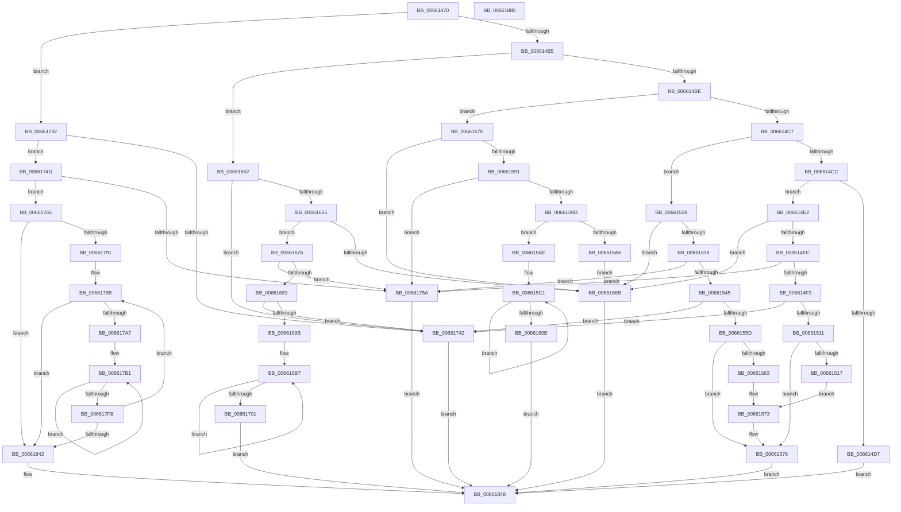

# WheapWmiExecuteErrorSourceMethod

- RVA: `0x00661470`–`0x00661881` (길이 `1,041` bytes)
- VA: `0x0000000140661470`
- 실행 섹션: `.text`
- PDB 이름 있음: `예`; PDB Function 태그: `아니요`
- unwind 정보 RVA: `0x000D6088`
- 디코드: `259`개 명령, `1,041/1,041` bytes 표시
- 미해석 바이트: `0` (있으면 어셈블리에 `.byte`로 보존)

> 이 문서는 커널 이미지의 기계어와 PDB 기호를 분석해 생성했습니다. 4번과 5번은 함수 원형과 자료형을 바이너리 사용 방식에서 추정한 C 해석이며 원본 소스 복구 결과는 아닙니다.

## 1. Dependencies

- 직접 호출 지점: **7**; 고유 호출 대상: **5**
- 직접 호출자로 확인된 함수: **1**
- RIP 상대 이미지 참조: **7**

### Outgoing calls
- `0x00661503` → [WheapGetErrorSource](../49/WheapGetErrorSource_function_0049554C.md) (function, `0x0049554C`)
- `0x0066151B` → `PSHED.dll!PshedDisableErrorSource` (import, 간접 대상; import `PSHED.dll!PshedDisableErrorSource`)
- `0x0066154F` → [WheapGetErrorSource](../49/WheapGetErrorSource_function_0049554C.md) (function, `0x0049554C`)
- `0x00661567` → `PSHED.dll!PshedEnableErrorSource` (import, 간접 대상; import `PSHED.dll!PshedEnableErrorSource`)
- `0x0066163C` → `PSHED.dll!PshedSetErrorSourceInfo` (import, 간접 대상; import `PSHED.dll!PshedSetErrorSourceInfo`)
- `0x0066168D` → [WheapGetErrorSource](../49/WheapGetErrorSource_function_0049554C.md) (function, `0x0049554C`)
- `0x0066185A` → [_security_check_cookie](../6A/_security_check_cookie_function_006AC640.md) (function, `0x006AC640`)

### Direct callers
- [WheapWmiExecuteMethod](WheapWmiExecuteMethod_function_00661888.md) at `0x006618F6`

### Static image references
- `0x0066148F` → RVA `0x00E0A740` (`.data`; read)
- `0x006614FC` → RVA `0x00EEF018` (`.data`; read)
- `0x0066151B` → RVA `0x001510E8` (`PSHED.dll!PshedDisableErrorSource (IAT)`; read)
- `0x00661567` → RVA `0x001510D8` (`PSHED.dll!PshedEnableErrorSource (IAT)`; read)
- `0x0066163C` → RVA `0x00151100` (`PSHED.dll!PshedSetErrorSourceInfo (IAT)`; read)
- `0x00661655` → RVA `0x00EEF01C` (`.data`; read)
- `0x00661768` → RVA `0x00EEF028` (`.data`; read)

## 2. Other-region calls and transfers

- 다른 실행 섹션으로 향하는 call: **0**
- 별도 외부 분기/꼬리 이동을 확인하지 못했습니다.

## 3. Assembly (complete function range)

```asm
00661470  48 89 5C 24 08                  mov qword ptr [rsp + 8], rbx
00661475  48 89 6C 24 10                  mov qword ptr [rsp + 0x10], rbp
0066147A  48 89 74 24 20                  mov qword ptr [rsp + 0x20], rsi
0066147F  57                              push rdi
00661480  41 54                           push r12
00661482  41 55                           push r13
00661484  41 56                           push r14
00661486  41 57                           push r15
00661488  48 81 EC 00 04 00 00            sub rsp, 0x400
0066148F  48 8B 05 AA 92 7A 00            mov rax, qword ptr [rip + 0x7a92aa]
00661496  48 33 C4                        xor rax, rsp
00661499  48 89 84 24 F0 03 00 00         mov qword ptr [rsp + 0x3f0], rax
006614A1  4C 8B A4 24 50 04 00 00         mov r12, qword ptr [rsp + 0x450]
006614A9  49 8B D8                        mov rbx, r8
006614AC  83 E9 01                        sub ecx, 1
006614AF  0F 84 7D 02 00 00               je 0x140661732
006614B5  83 E9 01                        sub ecx, 1
006614B8  0F 84 94 01 00 00               je 0x140661652
006614BE  83 E9 01                        sub ecx, 1
006614C1  0F 84 B7 00 00 00               je 0x14066157e
006614C7  83 E9 01                        sub ecx, 1
006614CA  74 5D                           je 0x140661529
006614CC  45 33 DB                        xor r11d, r11d
006614CF  41 8B FB                        mov edi, r11d
006614D2  83 F9 01                        cmp ecx, 1
006614D5  74 0B                           je 0x1406614e2
006614D7  41 BB 97 02 00 C0               mov r11d, 0xc0000297
006614DD  E9 66 03 00 00                  jmp 0x140661848
006614E2  41 83 F9 04                     cmp r9d, 4
006614E6  0F 82 7F 01 00 00               jb 0x14066166b
006614EC  BF 04 00 00 00                  mov edi, 4
006614F1  3B D7                           cmp edx, edi
006614F3  0F 82 61 02 00 00               jb 0x14066175a
006614F9  41 8B 10                        mov edx, dword ptr [r8]
006614FC  48 8D 0D 15 DB 88 00            lea rcx, [rip + 0x88db15]
00661503  E8 44 40 E3 FF                  call 0x14049554c
00661508  48 85 C0                        test rax, rax
0066150B  0F 84 31 02 00 00               je 0x140661742
00661511  83 78 6C 01                     cmp dword ptr [rax + 0x6c], 1
00661515  74 5F                           je 0x140661576
00661517  48 8D 48 60                     lea rcx, [rax + 0x60]
0066151B  48 FF 15 C6 FB AE FF            call qword ptr [rip - 0x51043a]
00661522  0F 1F 44 00 00                  nop dword ptr [rax + rax]
00661527  EB 4A                           jmp 0x140661573
00661529  45 33 DB                        xor r11d, r11d
0066152C  41 8B FB                        mov edi, r11d
0066152F  41 83 F9 04                     cmp r9d, 4
00661533  0F 82 32 01 00 00               jb 0x14066166b
00661539  41 8D 7B 04                     lea edi, [r11 + 4]
0066153D  3B D7                           cmp edx, edi
0066153F  0F 82 15 02 00 00               jb 0x14066175a
00661545  41 8B 10                        mov edx, dword ptr [r8]
00661548  48 8D 0D C9 DA 88 00            lea rcx, [rip + 0x88dac9]
0066154F  E8 F8 3F E3 FF                  call 0x14049554c
00661554  48 85 C0                        test rax, rax
00661557  0F 84 E5 01 00 00               je 0x140661742
0066155D  83 78 6C 02                     cmp dword ptr [rax + 0x6c], 2
00661561  74 13                           je 0x140661576
00661563  48 8D 48 60                     lea rcx, [rax + 0x60]
00661567  48 FF 15 6A FB AE FF            call qword ptr [rip - 0x510496]
0066156E  0F 1F 44 00 00                  nop dword ptr [rax + rax]
00661573  44 8B D8                        mov r11d, eax
00661576  44 89 1B                        mov dword ptr [rbx], r11d
00661579  E9 CA 02 00 00                  jmp 0x140661848
0066157E  45 33 DB                        xor r11d, r11d
00661581  41 8B FB                        mov edi, r11d
00661584  41 81 F9 D0 03 00 00            cmp r9d, 0x3d0
0066158B  0F 82 DA 00 00 00               jb 0x14066166b
00661591  41 8D 7B 04                     lea edi, [r11 + 4]
00661595  3B D7                           cmp edx, edi
00661597  0F 82 BD 01 00 00               jb 0x14066175a
0066159D  41 81 38 CC 03 00 00            cmp dword ptr [r8], 0x3cc
006615A4  74 08                           je 0x1406615ae
006615A6  41 8B FB                        mov edi, r11d
006615A9  E9 BD 00 00 00                  jmp 0x14066166b
006615AE  49 8D 48 04                     lea rcx, [r8 + 4]
006615B2  41 B8 07 00 00 00               mov r8d, 7
006615B8  48 8D 54 24 20                  lea rdx, [rsp + 0x20]
006615BD  45 8D 48 79                     lea r9d, [r8 + 0x79]
006615C1  0F 10 01                        movups xmm0, xmmword ptr [rcx]
006615C4  0F 10 49 10                     movups xmm1, xmmword ptr [rcx + 0x10]
006615C8  0F 11 02                        movups xmmword ptr [rdx], xmm0
006615CB  0F 10 41 20                     movups xmm0, xmmword ptr [rcx + 0x20]
006615CF  0F 11 4A 10                     movups xmmword ptr [rdx + 0x10], xmm1
006615D3  0F 10 49 30                     movups xmm1, xmmword ptr [rcx + 0x30]
006615D7  0F 11 42 20                     movups xmmword ptr [rdx + 0x20], xmm0
006615DB  0F 10 41 40                     movups xmm0, xmmword ptr [rcx + 0x40]
006615DF  0F 11 4A 30                     movups xmmword ptr [rdx + 0x30], xmm1
006615E3  0F 10 49 50                     movups xmm1, xmmword ptr [rcx + 0x50]
006615E7  0F 11 42 40                     movups xmmword ptr [rdx + 0x40], xmm0
006615EB  0F 10 41 60                     movups xmm0, xmmword ptr [rcx + 0x60]
006615EF  0F 11 4A 50                     movups xmmword ptr [rdx + 0x50], xmm1
006615F3  0F 10 49 70                     movups xmm1, xmmword ptr [rcx + 0x70]
006615F7  49 03 C9                        add rcx, r9
006615FA  0F 11 42 60                     movups xmmword ptr [rdx + 0x60], xmm0
006615FE  49 03 D1                        add rdx, r9
00661601  0F 11 4A F0                     movups xmmword ptr [rdx - 0x10], xmm1
00661605  49 83 E8 01                     sub r8, 1
00661609  75 B6                           jne 0x1406615c1
0066160B  0F 10 01                        movups xmm0, xmmword ptr [rcx]
0066160E  48 8B 41 40                     mov rax, qword ptr [rcx + 0x40]
00661612  0F 10 49 10                     movups xmm1, xmmword ptr [rcx + 0x10]
00661616  0F 11 02                        movups xmmword ptr [rdx], xmm0
00661619  0F 10 41 20                     movups xmm0, xmmword ptr [rcx + 0x20]
0066161D  0F 11 4A 10                     movups xmmword ptr [rdx + 0x10], xmm1
00661621  0F 10 49 30                     movups xmm1, xmmword ptr [rcx + 0x30]
00661625  0F 11 42 20                     movups xmmword ptr [rdx + 0x20], xmm0
00661629  0F 11 4A 30                     movups xmmword ptr [rdx + 0x30], xmm1
0066162D  48 89 42 40                     mov qword ptr [rdx + 0x40], rax
00661631  8B 41 48                        mov eax, dword ptr [rcx + 0x48]
00661634  48 8D 4C 24 20                  lea rcx, [rsp + 0x20]
00661639  89 42 48                        mov dword ptr [rdx + 0x48], eax
0066163C  48 FF 15 BD FA AE FF            call qword ptr [rip - 0x510543]
00661643  0F 1F 44 00 00                  nop dword ptr [rax + rax]
00661648  44 8B D8                        mov r11d, eax
0066164B  89 03                           mov dword ptr [rbx], eax
0066164D  E9 F6 01 00 00                  jmp 0x140661848
00661652  45 33 DB                        xor r11d, r11d
00661655  44 39 1D C0 D9 88 00            cmp dword ptr [rip + 0x88d9c0], r11d
0066165C  41 8B FB                        mov edi, r11d
0066165F  0F 84 DD 00 00 00               je 0x140661742
00661665  41 83 F9 04                     cmp r9d, 4
00661669  73 0B                           jae 0x140661676
0066166B  41 BB 0D 00 00 C0               mov r11d, 0xc000000d
00661671  E9 D2 01 00 00                  jmp 0x140661848
00661676  BF D4 03 00 00                  mov edi, 0x3d4
0066167B  3B D7                           cmp edx, edi
0066167D  0F 82 D7 00 00 00               jb 0x14066175a
00661683  41 8B 10                        mov edx, dword ptr [r8]
00661686  48 8D 0D 8B D9 88 00            lea rcx, [rip + 0x88d98b]
0066168D  E8 BA 3E E3 FF                  call 0x14049554c
00661692  48 85 C0                        test rax, rax
00661695  0F 84 A7 00 00 00               je 0x140661742
0066169B  44 89 1B                        mov dword ptr [rbx], r11d
0066169E  48 8D 48 60                     lea rcx, [rax + 0x60]
006616A2  41 B8 07 00 00 00               mov r8d, 7
006616A8  C7 43 04 CC 03 00 00            mov dword ptr [rbx + 4], 0x3cc
006616AF  48 83 C3 08                     add rbx, 8
006616B3  45 8D 48 79                     lea r9d, [r8 + 0x79]
006616B7  0F 10 01                        movups xmm0, xmmword ptr [rcx]
006616BA  0F 11 03                        movups xmmword ptr [rbx], xmm0
006616BD  0F 10 49 10                     movups xmm1, xmmword ptr [rcx + 0x10]
006616C1  0F 11 4B 10                     movups xmmword ptr [rbx + 0x10], xmm1
006616C5  0F 10 41 20                     movups xmm0, xmmword ptr [rcx + 0x20]
006616C9  0F 11 43 20                     movups xmmword ptr [rbx + 0x20], xmm0
006616CD  0F 10 49 30                     movups xmm1, xmmword ptr [rcx + 0x30]
006616D1  0F 11 4B 30                     movups xmmword ptr [rbx + 0x30], xmm1
006616D5  0F 10 41 40                     movups xmm0, xmmword ptr [rcx + 0x40]
006616D9  0F 11 43 40                     movups xmmword ptr [rbx + 0x40], xmm0
006616DD  0F 10 49 50                     movups xmm1, xmmword ptr [rcx + 0x50]
006616E1  0F 11 4B 50                     movups xmmword ptr [rbx + 0x50], xmm1
006616E5  0F 10 41 60                     movups xmm0, xmmword ptr [rcx + 0x60]
006616E9  0F 11 43 60                     movups xmmword ptr [rbx + 0x60], xmm0
006616ED  49 03 D9                        add rbx, r9
006616F0  0F 10 49 70                     movups xmm1, xmmword ptr [rcx + 0x70]
006616F4  49 03 C9                        add rcx, r9
006616F7  0F 11 4B F0                     movups xmmword ptr [rbx - 0x10], xmm1
006616FB  49 83 E8 01                     sub r8, 1
006616FF  75 B6                           jne 0x1406616b7
00661701  0F 10 01                        movups xmm0, xmmword ptr [rcx]
00661704  0F 11 03                        movups xmmword ptr [rbx], xmm0
00661707  0F 10 49 10                     movups xmm1, xmmword ptr [rcx + 0x10]
0066170B  0F 11 4B 10                     movups xmmword ptr [rbx + 0x10], xmm1
0066170F  0F 10 41 20                     movups xmm0, xmmword ptr [rcx + 0x20]
00661713  0F 11 43 20                     movups xmmword ptr [rbx + 0x20], xmm0
00661717  0F 10 49 30                     movups xmm1, xmmword ptr [rcx + 0x30]
0066171B  0F 11 4B 30                     movups xmmword ptr [rbx + 0x30], xmm1
0066171F  48 8B 41 40                     mov rax, qword ptr [rcx + 0x40]
00661723  48 89 43 40                     mov qword ptr [rbx + 0x40], rax
00661727  8B 41 48                        mov eax, dword ptr [rcx + 0x48]
0066172A  89 43 48                        mov dword ptr [rbx + 0x48], eax
0066172D  E9 16 01 00 00                  jmp 0x140661848
00661732  8B 05 E4 D8 88 00               mov eax, dword ptr [rip + 0x88d8e4]
00661738  45 33 DB                        xor r11d, r11d
0066173B  41 8B FB                        mov edi, r11d
0066173E  85 C0                           test eax, eax
00661740  75 0B                           jne 0x14066174d
00661742  41 BB 25 02 00 C0               mov r11d, 0xc0000225
00661748  E9 FB 00 00 00                  jmp 0x140661848
0066174D  69 F8 CC 03 00 00               imul edi, eax, 0x3cc
00661753  83 C7 0C                        add edi, 0xc
00661756  3B FA                           cmp edi, edx
00661758  76 0B                           jbe 0x140661765
0066175A  41 BB 23 00 00 C0               mov r11d, 0xc0000023
00661760  E9 E3 00 00 00                  jmp 0x140661848
00661765  45 89 18                        mov dword ptr [r8], r11d
00661768  4C 8D 2D B9 D8 88 00            lea r13, [rip + 0x88d8b9]
0066176F  4C 8B 15 B2 D8 88 00            mov r10, qword ptr [rip + 0x88d8b2]
00661776  4D 8D 70 04                     lea r14, [r8 + 4]
0066177A  48 83 C3 0C                     add rbx, 0xc
0066177E  4D 8D 78 08                     lea r15, [r8 + 8]
00661782  41 8B EB                        mov ebp, r11d
00661785  41 8B F3                        mov esi, r11d
00661788  4D 3B D5                        cmp r10, r13
0066178B  0F 84 B1 00 00 00               je 0x140661842
00661791  41 B8 07 00 00 00               mov r8d, 7
00661797  45 8D 48 79                     lea r9d, [r8 + 0x79]
0066179B  3B 35 7B D8 88 00               cmp esi, dword ptr [rip + 0x88d87b]
006617A1  0F 83 9B 00 00 00               jae 0x140661842
006617A7  48 8B CB                        mov rcx, rbx
006617AA  49 8D 52 60                     lea rdx, [r10 + 0x60]
006617AE  49 8B C0                        mov rax, r8
006617B1  0F 10 02                        movups xmm0, xmmword ptr [rdx]
006617B4  0F 11 01                        movups xmmword ptr [rcx], xmm0
006617B7  0F 10 4A 10                     movups xmm1, xmmword ptr [rdx + 0x10]
006617BB  0F 11 49 10                     movups xmmword ptr [rcx + 0x10], xmm1
006617BF  0F 10 42 20                     movups xmm0, xmmword ptr [rdx + 0x20]
006617C3  0F 11 41 20                     movups xmmword ptr [rcx + 0x20], xmm0
006617C7  0F 10 4A 30                     movups xmm1, xmmword ptr [rdx + 0x30]
006617CB  0F 11 49 30                     movups xmmword ptr [rcx + 0x30], xmm1
006617CF  0F 10 42 40                     movups xmm0, xmmword ptr [rdx + 0x40]
006617D3  0F 11 41 40                     movups xmmword ptr [rcx + 0x40], xmm0
006617D7  0F 10 4A 50                     movups xmm1, xmmword ptr [rdx + 0x50]
006617DB  0F 11 49 50                     movups xmmword ptr [rcx + 0x50], xmm1
006617DF  0F 10 42 60                     movups xmm0, xmmword ptr [rdx + 0x60]
006617E3  0F 11 41 60                     movups xmmword ptr [rcx + 0x60], xmm0
006617E7  49 03 C9                        add rcx, r9
006617EA  0F 10 4A 70                     movups xmm1, xmmword ptr [rdx + 0x70]
006617EE  49 03 D1                        add rdx, r9
006617F1  0F 11 49 F0                     movups xmmword ptr [rcx - 0x10], xmm1
006617F5  48 83 E8 01                     sub rax, 1
006617F9  75 B6                           jne 0x1406617b1
006617FB  0F 10 02                        movups xmm0, xmmword ptr [rdx]
006617FE  48 81 C3 CC 03 00 00            add rbx, 0x3cc
00661805  81 C5 CC 03 00 00               add ebp, 0x3cc
0066180B  FF C6                           inc esi
0066180D  0F 11 01                        movups xmmword ptr [rcx], xmm0
00661810  0F 10 4A 10                     movups xmm1, xmmword ptr [rdx + 0x10]
00661814  0F 11 49 10                     movups xmmword ptr [rcx + 0x10], xmm1
00661818  0F 10 42 20                     movups xmm0, xmmword ptr [rdx + 0x20]
0066181C  0F 11 41 20                     movups xmmword ptr [rcx + 0x20], xmm0
00661820  0F 10 4A 30                     movups xmm1, xmmword ptr [rdx + 0x30]
00661824  0F 11 49 30                     movups xmmword ptr [rcx + 0x30], xmm1
00661828  48 8B 42 40                     mov rax, qword ptr [rdx + 0x40]
0066182C  48 89 41 40                     mov qword ptr [rcx + 0x40], rax
00661830  8B 42 48                        mov eax, dword ptr [rdx + 0x48]
00661833  89 41 48                        mov dword ptr [rcx + 0x48], eax
00661836  4D 8B 12                        mov r10, qword ptr [r10]
00661839  4D 3B D5                        cmp r10, r13
0066183C  0F 85 59 FF FF FF               jne 0x14066179b
00661842  41 89 36                        mov dword ptr [r14], esi
00661845  41 89 2F                        mov dword ptr [r15], ebp
00661848  41 89 3C 24                     mov dword ptr [r12], edi
0066184C  41 8B C3                        mov eax, r11d
0066184F  48 8B 8C 24 F0 03 00 00         mov rcx, qword ptr [rsp + 0x3f0]
00661857  48 33 CC                        xor rcx, rsp
0066185A  E8 E1 AD 04 00                  call 0x1406ac640
0066185F  4C 8D 9C 24 00 04 00 00         lea r11, [rsp + 0x400]
00661867  49 8B 5B 30                     mov rbx, qword ptr [r11 + 0x30]
0066186B  49 8B 6B 38                     mov rbp, qword ptr [r11 + 0x38]
0066186F  49 8B 73 48                     mov rsi, qword ptr [r11 + 0x48]
00661873  49 8B E3                        mov rsp, r11
00661876  41 5F                           pop r15
00661878  41 5E                           pop r14
0066187A  41 5D                           pop r13
0066187C  41 5C                           pop r12
0066187E  5F                              pop rdi
0066187F  C3                              ret
00661880  CC                              int3
```

## 4. C-style interpretation (structured pseudocode)

```c
__int64 __fastcall WheapWmiExecuteErrorSourceMethod(int a1, int a2, __int64 a3, int a4, __int64 a5)
{
    __int64 result;
    __int64 v_r11;
    __int64 v_rbp;
    __int64 v_rbx;
    __int64 v_rdi;
    __int64 v_rsi;
    __int64 v_rsp;
    unsigned __int64 v_stack_m28;
    unsigned __int64 v_stack_m38;
    unsigned __int64 v_stack_m408;
    unsigned __int64 v_stack_p10;
    unsigned __int64 v_stack_p20;
    unsigned __int64 v_stack_p8;

    v_stack_p8 = v_rbx;
    v_stack_p10 = v_rbp;
    v_stack_p20 = v_rsi;
    v_rsp = (v_rsp) - (0x400ULL);
    result = (*(unsigned __int64 *)(v_rip + 8032938)) ^ (v_rsp);
    v_stack_m38 = result;
    a1 = (unsigned int)((a1) - (1));
    if (condition_is_equal) goto loc_00661732;
    a1 = (unsigned int)((a1) - (1));
    if (condition_is_equal) goto loc_00661652;
    a1 = (unsigned int)((a1) - (1));
    if (condition_is_equal) goto loc_0066157E;
    a1 = (unsigned int)((a1) - (1));
    if (condition_is_equal) goto loc_00661529;
    v_r11 = 0;
    if (a1 == 1) goto loc_006614E2;
    goto loc_00661848;
loc_006614E2:
    if (a4 < 4) goto loc_0066166B;
    if (a2 < 4) goto loc_0066175A;
    result = WheapGetErrorSource(v_rip + 8968981, (unsigned int)(*(unsigned int *)(a3)), a3, a4);
    if (result == 0) goto loc_00661742;
    if ((*(unsigned int *)(result + 108)) == 1) goto loc_00661576;
    result = PSHED_dll_PshedDisableErrorSource(result + 96, (unsigned int)(*(unsigned int *)(a3)), a3, a4);
    goto loc_00661573;
loc_00661529:
    v_r11 = 0;
    if (a4 < 4) goto loc_0066166B;
    if (((unsigned int)((unsigned int)(*(unsigned int *)(a3)))) < ((unsigned int)(v_r11 + 4))) goto loc_0066175A;
    result = WheapGetErrorSource(v_rip + 8968905, (unsigned int)(*(unsigned int *)(a3)), a3, a4);
    if (result == 0) goto loc_00661742;
    if ((*(unsigned int *)(result + 108)) == 2) goto loc_00661576;
    result = PSHED_dll_PshedEnableErrorSource(result + 96, (unsigned int)(*(unsigned int *)(a3)), a3, a4);
loc_00661573:
loc_00661576:
    *(unsigned int *)(a3) = (unsigned int)((unsigned int)((unsigned int)(result)));
    goto loc_00661848;
loc_0066157E:
    v_r11 = 0;
    if (a4 < 976) goto loc_0066166B;
    if (((unsigned int)((unsigned int)(*(unsigned int *)(a3)))) < ((unsigned int)(v_r11 + 4))) goto loc_0066175A;
    if ((*(unsigned int *)(a3)) == 972) goto loc_006615AE;
    goto loc_0066166B;
loc_006615AE:
loc_006615C1:
    *(unsigned __int64 *)(v_stack_m408) = v_xmm0;
    *(unsigned __int64 *)(v_stack_m408 + 16) = v_xmm1;
    *(unsigned __int64 *)(v_stack_m408 + 32) = v_xmm0;
    *(unsigned __int64 *)(v_stack_m408 + 48) = v_xmm1;
    *(unsigned __int64 *)(v_stack_m408 + 64) = v_xmm0;
    *(unsigned __int64 *)(v_stack_m408 + 80) = v_xmm1;
    a1 = (a3 + 4) + (7 + 121);
    *(unsigned __int64 *)(v_stack_m408 + 96) = v_xmm0;
    a2 = (v_stack_m408) + (7 + 121);
    *(unsigned __int64 *)(a2 - 16) = v_xmm1;
    a3 = (7) - (1);
    if (condition_is_not_equal) goto loc_006615C1;
    *(unsigned __int64 *)(a2) = v_xmm0;
    *(unsigned __int64 *)(a2 + 16) = v_xmm1;
    *(unsigned __int64 *)(a2 + 32) = v_xmm0;
    *(unsigned __int64 *)(a2 + 48) = v_xmm1;
    *(unsigned __int64 *)(a2 + 64) = *(unsigned __int64 *)(a1 + 64);
    *(unsigned int *)(a2 + 72) = (unsigned int)((unsigned int)(*(unsigned int *)(a1 + 72)));
    result = PSHED_dll_PshedSetErrorSourceInfo(v_stack_m408, a2, a3, 7 + 121);
    *(unsigned int *)(a3) = (unsigned int)(result);
    goto loc_00661848;
loc_00661652:
    v_r11 = 0;
    if ((*(unsigned int *)(v_rip + 8968640)) == 0) goto loc_00661742;
    if (((unsigned int)(7 + 121)) >= 4) goto loc_00661676;
loc_0066166B:
    goto loc_00661848;
loc_00661676:
    if (a2 < 980) goto loc_0066175A;
    result = WheapGetErrorSource(v_rip + 8968587, (unsigned int)(*(unsigned int *)(a3)), a3, 7 + 121);
    if (result == 0) goto loc_00661742;
    *(unsigned int *)(a3) = (unsigned int)((unsigned int)(0xC000000DULL));
    *(unsigned int *)(a3 + 4) = 972;
    v_rbx = (a3) + (8);
loc_006616B7:
    *(unsigned __int64 *)(v_rbx) = v_xmm0;
    *(unsigned __int64 *)(v_rbx + 16) = v_xmm1;
    *(unsigned __int64 *)(v_rbx + 32) = v_xmm0;
    *(unsigned __int64 *)(v_rbx + 48) = v_xmm1;
    *(unsigned __int64 *)(v_rbx + 64) = v_xmm0;
    *(unsigned __int64 *)(v_rbx + 80) = v_xmm1;
    *(unsigned __int64 *)(v_rbx + 96) = v_xmm0;
    v_rbx = (v_rbx) + (7 + 121);
    a1 = (result + 96) + (7 + 121);
    *(unsigned __int64 *)(v_rbx - 16) = v_xmm1;
    a3 = (7) - (1);
    if (condition_is_not_equal) goto loc_006616B7;
    *(unsigned __int64 *)(v_rbx) = v_xmm0;
    *(unsigned __int64 *)(v_rbx + 16) = v_xmm1;
    *(unsigned __int64 *)(v_rbx + 32) = v_xmm0;
    *(unsigned __int64 *)(v_rbx + 48) = v_xmm1;
    *(unsigned __int64 *)(v_rbx + 64) = *(unsigned __int64 *)(a1 + 64);
    *(unsigned int *)(v_rbx + 72) = (unsigned int)((unsigned int)(*(unsigned int *)(a1 + 72)));
    goto loc_00661848;
loc_00661732:
    v_r11 = 0;
    if ((unsigned int)((unsigned int)(*(unsigned int *)(v_rip + 8968420))) != 0) goto loc_0066174D;
loc_00661742:
    goto loc_00661848;
loc_0066174D:
    v_rdi = (unsigned int)((0) * ((unsigned int)((unsigned int)(*(unsigned int *)(v_rip + 8968420)))));
    v_rdi = (unsigned int)((v_rdi) + (12));
    if (((unsigned int)(v_rdi)) <= ((unsigned int)((unsigned int)(*(unsigned int *)(a3))))) goto loc_00661765;
loc_0066175A:
    goto loc_00661848;
loc_00661765:
    *(unsigned int *)(a3) = (unsigned int)((unsigned int)(0xC0000023ULL));
    v_rbx = (v_rbx) + (12);
    if ((*(unsigned __int64 *)(v_rip + 8968370)) == (v_rip + 8968377)) goto loc_00661842;
loc_0066179B:
    if (((unsigned int)((unsigned int)((unsigned int)((unsigned int)(0xC0000023ULL))))) >= (*(unsigned int *)(v_rip + 8968315))) goto loc_00661842;
loc_006617B1:
    *(unsigned __int64 *)(v_rbx) = v_xmm0;
    *(unsigned __int64 *)(v_rbx + 16) = v_xmm1;
    *(unsigned __int64 *)(v_rbx + 32) = v_xmm0;
    *(unsigned __int64 *)(v_rbx + 48) = v_xmm1;
    *(unsigned __int64 *)(v_rbx + 64) = v_xmm0;
    *(unsigned __int64 *)(v_rbx + 80) = v_xmm1;
    *(unsigned __int64 *)(v_rbx + 96) = v_xmm0;
    a1 = (v_rbx) + (7 + 121);
    a2 = (*(unsigned __int64 *)(v_rip + 8968370) + 96) + (7 + 121);
    *(unsigned __int64 *)(a1 - 16) = v_xmm1;
    result = (7) - (1);
    if (condition_is_not_equal) goto loc_006617B1;
    v_rbx = (v_rbx) + (972);
    v_rbp = (unsigned int)(((unsigned int)((unsigned int)((unsigned int)(0xC0000023ULL)))) + (972));
    v_rsi = (unsigned int)(((unsigned int)((unsigned int)((unsigned int)(0xC0000023ULL)))) + 1);
    *(unsigned __int64 *)(a1) = v_xmm0;
    *(unsigned __int64 *)(a1 + 16) = v_xmm1;
    *(unsigned __int64 *)(a1 + 32) = v_xmm0;
    *(unsigned __int64 *)(a1 + 48) = v_xmm1;
    *(unsigned __int64 *)(a1 + 64) = *(unsigned __int64 *)(a2 + 64);
    *(unsigned int *)(a1 + 72) = (unsigned int)((unsigned int)(*(unsigned int *)(a2 + 72)));
    if ((*(unsigned __int64 *)(*(unsigned __int64 *)(v_rip + 8968370))) != (v_rip + 8968377)) goto loc_0066179B;
loc_00661842:
    *(unsigned int *)(a3 + 4) = (unsigned int)(v_rsi);
    *(unsigned int *)(a3 + 8) = (unsigned int)(v_rbp);
loc_00661848:
    *(unsigned int *)(a5) = (unsigned int)(v_rdi);
    a1 = (v_stack_m38) ^ (v_rsp);
    result = _security_check_cookie(a1, a2, 7, 7 + 121);
    return result;
}
```

## 5. (Beta) C Style

```c
int64_t WheapWmiExecuteErrorSourceMethod(int32_t Arg1, int32_t Arg2, void *Arg3, int32_t Arg4, void *Arg5)
{
    uint8_t *arg3 = (uint8_t *)Arg3;
    uint8_t *arg5 = (uint8_t *)Arg5;

    int64_t result;
    int64_t local_r11;
    int64_t local_rbp;
    int64_t local_rbx;
    int64_t local_rdi;
    int64_t local_rsi;
    int64_t local_rsp;
    uint64_t v_stack_m28;
    uint64_t v_stack_m38;
    uint64_t v_stack_m408;
    uint64_t v_stack_p10;
    uint64_t v_stack_p20;
    uint64_t v_stack_p8;

    v_stack_p8 = local_rbx;
    v_stack_p10 = local_rbp;
    v_stack_p20 = local_rsi;
    local_rsp = (local_rsp) - (0x400ULL);
    result = (*(uint64_t *)(v_rip + 0x7A92AA)) ^ (local_rsp);
    v_stack_m38 = result;
    Arg1 = (uint32_t)((Arg1) - (1));
    if (condition_is_equal) goto loc_00661732;
    Arg1 = (uint32_t)((Arg1) - (1));
    if (condition_is_equal) goto loc_00661652;
    Arg1 = (uint32_t)((Arg1) - (1));
    if (condition_is_equal) goto loc_0066157E;
    Arg1 = (uint32_t)((Arg1) - (1));
    if (condition_is_equal) goto loc_00661529;
    local_r11 = 0;
    if (Arg1 == 1) goto loc_006614E2;
    goto loc_00661848;
loc_006614E2:
    if (Arg4 < 4) goto loc_0066166B;
    if (Arg2 < 4) goto loc_0066175A;
    result = WheapGetErrorSource(v_rip + 8968981, (uint32_t)(*(uint32_t *)(arg3)), Arg3, Arg4);
    if (result == 0) goto loc_00661742;
    if ((*(uint32_t *)(result + 0x6C)) == 1) goto loc_00661576;
    result = kernel_indirect_call(result + 96, (uint32_t)(*(uint32_t *)(arg3)), Arg3, Arg4);
    goto loc_00661573;
loc_00661529:
    local_r11 = 0;
    if (Arg4 < 4) goto loc_0066166B;
    if (((uint32_t)((uint32_t)(*(uint32_t *)(arg3)))) < ((uint32_t)(local_r11 + 4))) goto loc_0066175A;
    result = WheapGetErrorSource(v_rip + 8968905, (uint32_t)(*(uint32_t *)(arg3)), Arg3, Arg4);
    if (result == 0) goto loc_00661742;
    if ((*(uint32_t *)(result + 0x6C)) == 2) goto loc_00661576;
    result = kernel_indirect_call(result + 96, (uint32_t)(*(uint32_t *)(arg3)), Arg3, Arg4);
loc_00661573:
loc_00661576:
    *(uint32_t *)(arg3) = (uint32_t)((uint32_t)((uint32_t)(result)));
    goto loc_00661848;
loc_0066157E:
    local_r11 = 0;
    if (Arg4 < 976) goto loc_0066166B;
    if (((uint32_t)((uint32_t)(*(uint32_t *)(arg3)))) < ((uint32_t)(local_r11 + 4))) goto loc_0066175A;
    if ((*(uint32_t *)(arg3)) == 972) goto loc_006615AE;
    goto loc_0066166B;
loc_006615AE:
loc_006615C1:
    *(uint64_t *)(v_stack_m408) = v_xmm0;
    *(uint64_t *)(v_stack_m408 + 0x10) = v_xmm1;
    *(uint64_t *)(v_stack_m408 + 0x20) = v_xmm0;
    *(uint64_t *)(v_stack_m408 + 0x30) = v_xmm1;
    *(uint64_t *)(v_stack_m408 + 0x40) = v_xmm0;
    *(uint64_t *)(v_stack_m408 + 0x50) = v_xmm1;
    Arg1 = (Arg3 + 4) + (7 + 121);
    *(uint64_t *)(v_stack_m408 + 0x60) = v_xmm0;
    Arg2 = (v_stack_m408) + (7 + 121);
    *(uint64_t *)(Arg2 - 0x10) = v_xmm1;
    Arg3 = (7) - (1);
    if (condition_is_not_equal) goto loc_006615C1;
    *(uint64_t *)(Arg2) = v_xmm0;
    *(uint64_t *)(Arg2 + 0x10) = v_xmm1;
    *(uint64_t *)(Arg2 + 0x20) = v_xmm0;
    *(uint64_t *)(Arg2 + 0x30) = v_xmm1;
    *(uint64_t *)(Arg2 + 0x40) = *(uint64_t *)(Arg1 + 0x40);
    *(uint32_t *)(Arg2 + 0x48) = (uint32_t)((uint32_t)(*(uint32_t *)(Arg1 + 0x48)));
    result = kernel_indirect_call(v_stack_m408, Arg2, Arg3, 7 + 121);
    *(uint32_t *)(arg3) = (uint32_t)(result);
    goto loc_00661848;
loc_00661652:
    local_r11 = 0;
    if ((*(uint32_t *)(v_rip + 0x88D9C0)) == 0) goto loc_00661742;
    if (((uint32_t)(7 + 121)) >= 4) goto loc_00661676;
loc_0066166B:
    goto loc_00661848;
loc_00661676:
    if (Arg2 < 980) goto loc_0066175A;
    result = WheapGetErrorSource(v_rip + 8968587, (uint32_t)(*(uint32_t *)(arg3)), Arg3, 7 + 121);
    if (result == 0) goto loc_00661742;
    *(uint32_t *)(arg3) = (uint32_t)((uint32_t)(0xC000000DULL));
    *(uint32_t *)(arg3 + 0x4) = 972;
    local_rbx = (Arg3) + (8);
loc_006616B7:
    *(uint64_t *)(local_rbx) = v_xmm0;
    *(uint64_t *)(local_rbx + 0x10) = v_xmm1;
    *(uint64_t *)(local_rbx + 0x20) = v_xmm0;
    *(uint64_t *)(local_rbx + 0x30) = v_xmm1;
    *(uint64_t *)(local_rbx + 0x40) = v_xmm0;
    *(uint64_t *)(local_rbx + 0x50) = v_xmm1;
    *(uint64_t *)(local_rbx + 0x60) = v_xmm0;
    local_rbx = (local_rbx) + (7 + 121);
    Arg1 = (result + 96) + (7 + 121);
    *(uint64_t *)(local_rbx - 0x10) = v_xmm1;
    Arg3 = (7) - (1);
    if (condition_is_not_equal) goto loc_006616B7;
    *(uint64_t *)(local_rbx) = v_xmm0;
    *(uint64_t *)(local_rbx + 0x10) = v_xmm1;
    *(uint64_t *)(local_rbx + 0x20) = v_xmm0;
    *(uint64_t *)(local_rbx + 0x30) = v_xmm1;
    *(uint64_t *)(local_rbx + 0x40) = *(uint64_t *)(Arg1 + 0x40);
    *(uint32_t *)(local_rbx + 0x48) = (uint32_t)((uint32_t)(*(uint32_t *)(Arg1 + 0x48)));
    goto loc_00661848;
loc_00661732:
    local_r11 = 0;
    if ((uint32_t)((uint32_t)(*(uint32_t *)(v_rip + 0x88D8E4))) != 0) goto loc_0066174D;
loc_00661742:
    goto loc_00661848;
loc_0066174D:
    local_rdi = (uint32_t)((0) * ((uint32_t)((uint32_t)(*(uint32_t *)(v_rip + 0x88D8E4)))));
    local_rdi = (uint32_t)((local_rdi) + (12));
    if (((uint32_t)(local_rdi)) <= ((uint32_t)((uint32_t)(*(uint32_t *)(arg3))))) goto loc_00661765;
loc_0066175A:
    goto loc_00661848;
loc_00661765:
    *(uint32_t *)(arg3) = (uint32_t)((uint32_t)(0xC0000023ULL));
    local_rbx = (local_rbx) + (12);
    if ((*(uint64_t *)(v_rip + 0x88D8B2)) == (v_rip + 8968377)) goto loc_00661842;
loc_0066179B:
    if (((uint32_t)((uint32_t)((uint32_t)((uint32_t)(0xC0000023ULL))))) >= (*(uint32_t *)(v_rip + 0x88D87B))) goto loc_00661842;
loc_006617B1:
    *(uint64_t *)(local_rbx) = v_xmm0;
    *(uint64_t *)(local_rbx + 0x10) = v_xmm1;
    *(uint64_t *)(local_rbx + 0x20) = v_xmm0;
    *(uint64_t *)(local_rbx + 0x30) = v_xmm1;
    *(uint64_t *)(local_rbx + 0x40) = v_xmm0;
    *(uint64_t *)(local_rbx + 0x50) = v_xmm1;
    *(uint64_t *)(local_rbx + 0x60) = v_xmm0;
    Arg1 = (local_rbx) + (7 + 121);
    Arg2 = (*(uint64_t *)(v_rip + 0x88D8B2) + 96) + (7 + 121);
    *(uint64_t *)(Arg1 - 0x10) = v_xmm1;
    result = (7) - (1);
    if (condition_is_not_equal) goto loc_006617B1;
    local_rbx = (local_rbx) + (972);
    local_rbp = (uint32_t)(((uint32_t)((uint32_t)((uint32_t)(0xC0000023ULL)))) + (972));
    local_rsi = (uint32_t)(((uint32_t)((uint32_t)((uint32_t)(0xC0000023ULL)))) + 1);
    *(uint64_t *)(Arg1) = v_xmm0;
    *(uint64_t *)(Arg1 + 0x10) = v_xmm1;
    *(uint64_t *)(Arg1 + 0x20) = v_xmm0;
    *(uint64_t *)(Arg1 + 0x30) = v_xmm1;
    *(uint64_t *)(Arg1 + 0x40) = *(uint64_t *)(Arg2 + 0x40);
    *(uint32_t *)(Arg1 + 0x48) = (uint32_t)((uint32_t)(*(uint32_t *)(Arg2 + 0x48)));
    if ((*(uint64_t *)(*(uint64_t *)(v_rip + 0x88D8B2))) != (v_rip + 8968377)) goto loc_0066179B;
loc_00661842:
    *(uint32_t *)(arg3 + 0x4) = (uint32_t)(local_rsi);
    *(uint32_t *)(arg3 + 0x8) = (uint32_t)(local_rbp);
loc_00661848:
    *(uint32_t *)(arg5) = (uint32_t)(local_rdi);
    Arg1 = (v_stack_m38) ^ (local_rsp);
    result = _security_check_cookie(Arg1, Arg2, 7, 7 + 121);
    return result;
}
```

### 관측된 메모리 오프셋

구조체 형식이 확인되지 않은 접근은 인자 기준의 오프셋으로만 기록했습니다.

| 기준 인자 | 오프셋 표현 | 폭 (bit) | 접근 |
|---|---:|---:|---|
| `Arg3` | `- 0x10` | `128` | `R` |
| `Arg3` | `+ 0x0` | `32` | `R` |
| `Arg3` | `+ 0x0` | `32` | `W` |
| `Arg3` | `+ 0x0` | `128` | `R` |
| `Arg3` | `+ 0x4` | `32` | `W` |
| `Arg3` | `+ 0x4` | `64` | `R` |
| `Arg3` | `+ 0x8` | `64` | `R` |
| `Arg3` | `+ 0x10` | `128` | `R` |
| `Arg3` | `+ 0x20` | `128` | `R` |
| `Arg3` | `+ 0x30` | `128` | `R` |
| `Arg3` | `+ 0x40` | `64` | `R` |
| `Arg3` | `+ 0x40` | `64` | `W` |
| `Arg3` | `+ 0x40` | `128` | `R` |
| `Arg3` | `+ 0x48` | `32` | `R` |
| `Arg3` | `+ 0x48` | `32` | `W` |
| `Arg3` | `+ 0x50` | `128` | `R` |
| `Arg3` | `+ 0x60` | `128` | `R` |
| `Arg3` | `+ 0x70` | `128` | `R` |
| `Arg5` | `+ 0x0` | `32` | `W` |

## 6. Execution-region graph

[열기: 2D/3D 그래프와 함수 탐색 컨트롤 패널](../../../control-panel.html?section=text&rva=0x00661470&view=graph)

- 2D 그래프는 위에서 아래로 흐르고, 3D 그래프는 빈 공간을 드래그해 회전합니다. Shift+드래그는 이동, 휠은 확대·축소, 함수 노드 선택은 대상 보고서 이동입니다.

### Static fallback


