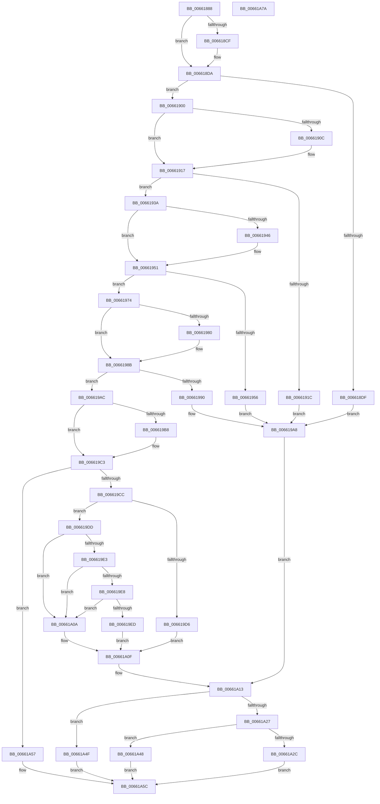

# WheapWmiExecuteMethod

- RVA: `0x00661888`–`0x00661A7B` (길이 `499` bytes)
- VA: `0x0000000140661888`
- 실행 섹션: `.text`
- PDB 이름 있음: `예`; PDB Function 태그: `아니요`
- unwind 정보 RVA: `0x000BD20C`
- 디코드: `139`개 명령, `499/499` bytes 표시
- 미해석 바이트: `0` (있으면 어셈블리에 `.byte`로 보존)

> 이 문서는 커널 이미지의 기계어와 PDB 기호를 분석해 생성했습니다. 4번과 5번은 함수 원형과 자료형을 바이너리 사용 방식에서 추정한 C 해석이며 원본 소스 복구 결과는 아닙니다.

## 1. Dependencies

- 직접 호출 지점: **5**; 고유 호출 대상: **5**
- 직접 호출자로 확인된 함수: **1**
- RIP 상대 이미지 참조: **10**

### Outgoing calls
- `0x006618F6` → [WheapWmiExecuteErrorSourceMethod](WheapWmiExecuteErrorSourceMethod_function_00661470.md) (function, `0x00661470`)
- `0x00661933` → [WheapWmiExecuteErrorInjectionMethod](WheapWmiExecuteErrorInjectionMethod_function_00661380.md) (function, `0x00661380`)
- `0x0066196D` → [WheapWmiExecutePolicyManagementMethod](WheapWmiExecutePolicyManagementMethod_function_00661B8C.md) (function, `0x00661B8C`)
- `0x006619A3` → [WheapWmiExecutePluginCtlMethod](WheapWmiExecutePluginCtlMethod_function_00661A84.md) (function, `0x00661A84`)
- `0x006619F6` → [WheaPageOfflineAndPersist](../../page/7D/WheaPageOfflineAndPersist_function_007D7594.md) (function, `0x007D7594`)

### Direct callers
- [WheaWmiDispatch](WheaWmiDispatch_function_00661260.md) at `0x0066135B`

### Static image references
- `0x006618AC` → RVA `0x00039978` (`.rdata`; read)
- `0x006618CF` → RVA `0x00039980` (`.rdata`; read)
- `0x00661900` → RVA `0x00039998` (`.rdata`; read)
- `0x0066190C` → RVA `0x000399A0` (`.rdata`; read)
- `0x0066193A` → RVA `0x00039958` (`.rdata`; read)
- `0x00661946` → RVA `0x00039960` (`.rdata`; read)
- `0x00661974` → RVA `0x00039988` (`.rdata`; read)
- `0x00661980` → RVA `0x00039990` (`.rdata`; read)
- `0x006619AC` → RVA `0x00039968` (`.rdata`; read)
- `0x006619B8` → RVA `0x00039970` (`.rdata`; read)

## 2. Other-region calls and transfers

- 다른 실행 섹션으로 향하는 call: **1**
  - `0x006619F6` → [WheaPageOfflineAndPersist](../../page/7D/WheaPageOfflineAndPersist_function_007D7594.md) (`.text` → `PAGE`)
- 별도 외부 분기/꼬리 이동을 확인하지 못했습니다.

## 3. Assembly (complete function range)

```asm
00661888  4C 8B DC                        mov r11, rsp
0066188B  49 89 5B 08                     mov qword ptr [r11 + 8], rbx
0066188F  49 89 6B 18                     mov qword ptr [r11 + 0x18], rbp
00661893  49 89 73 20                     mov qword ptr [r11 + 0x20], rsi
00661897  57                              push rdi
00661898  41 56                           push r14
0066189A  41 57                           push r15
0066189C  48 83 EC 30                     sub rsp, 0x30
006618A0  41 8B 40 3C                     mov eax, dword ptr [r8 + 0x3c]
006618A4  44 8B D2                        mov r10d, edx
006618A7  45 33 FF                        xor r15d, r15d
006618AA  8B EA                           mov ebp, edx
006618AC  48 8B 15 C5 80 9D FF            mov rdx, qword ptr [rip - 0x627f3b]
006618B3  44 2B D0                        sub r10d, eax
006618B6  4D 8B F1                        mov r14, r9
006618B9  45 89 7B 10                     mov dword ptr [r11 + 0x10], r15d
006618BD  49 8D 3C 00                     lea rdi, [r8 + rax]
006618C1  49 8B D8                        mov rbx, r8
006618C4  48 8B 01                        mov rax, qword ptr [rcx]
006618C7  45 8B CF                        mov r9d, r15d
006618CA  48 2B D0                        sub rdx, rax
006618CD  75 0B                           jne 0x1406618da
006618CF  48 8B 15 AA 80 9D FF            mov rdx, qword ptr [rip - 0x627f56]
006618D6  48 2B 51 08                     sub rdx, qword ptr [rcx + 8]
006618DA  48 85 D2                        test rdx, rdx
006618DD  75 21                           jne 0x140661900
006618DF  45 8B 48 40                     mov r9d, dword ptr [r8 + 0x40]
006618E3  48 8D 44 24 58                  lea rax, [rsp + 0x58]
006618E8  8B 4B 38                        mov ecx, dword ptr [rbx + 0x38]
006618EB  4C 8B C7                        mov r8, rdi
006618EE  41 8B D2                        mov edx, r10d
006618F1  48 89 44 24 20                  mov qword ptr [rsp + 0x20], rax
006618F6  E8 75 FB FF FF                  call 0x140661470
006618FB  E9 A8 00 00 00                  jmp 0x1406619a8
00661900  48 8B 15 91 80 9D FF            mov rdx, qword ptr [rip - 0x627f6f]
00661907  48 2B D0                        sub rdx, rax
0066190A  75 0B                           jne 0x140661917
0066190C  48 8B 15 8D 80 9D FF            mov rdx, qword ptr [rip - 0x627f73]
00661913  48 2B 51 08                     sub rdx, qword ptr [rcx + 8]
00661917  48 85 D2                        test rdx, rdx
0066191A  75 1E                           jne 0x14066193a
0066191C  45 8B 48 40                     mov r9d, dword ptr [r8 + 0x40]
00661920  48 8D 44 24 58                  lea rax, [rsp + 0x58]
00661925  8B 4B 38                        mov ecx, dword ptr [rbx + 0x38]
00661928  4C 8B C7                        mov r8, rdi
0066192B  41 8B D2                        mov edx, r10d
0066192E  48 89 44 24 20                  mov qword ptr [rsp + 0x20], rax
00661933  E8 48 FA FF FF                  call 0x140661380
00661938  EB 6E                           jmp 0x1406619a8
0066193A  48 8B 15 17 80 9D FF            mov rdx, qword ptr [rip - 0x627fe9]
00661941  48 2B D0                        sub rdx, rax
00661944  75 0B                           jne 0x140661951
00661946  48 8B 15 13 80 9D FF            mov rdx, qword ptr [rip - 0x627fed]
0066194D  48 2B 51 08                     sub rdx, qword ptr [rcx + 8]
00661951  48 85 D2                        test rdx, rdx
00661954  75 1E                           jne 0x140661974
00661956  45 8B 48 40                     mov r9d, dword ptr [r8 + 0x40]
0066195A  48 8D 44 24 58                  lea rax, [rsp + 0x58]
0066195F  8B 4B 38                        mov ecx, dword ptr [rbx + 0x38]
00661962  4C 8B C7                        mov r8, rdi
00661965  41 8B D2                        mov edx, r10d
00661968  48 89 44 24 20                  mov qword ptr [rsp + 0x20], rax
0066196D  E8 1A 02 00 00                  call 0x140661b8c
00661972  EB 34                           jmp 0x1406619a8
00661974  48 8B 15 0D 80 9D FF            mov rdx, qword ptr [rip - 0x627ff3]
0066197B  48 2B D0                        sub rdx, rax
0066197E  75 0B                           jne 0x14066198b
00661980  48 8B 15 09 80 9D FF            mov rdx, qword ptr [rip - 0x627ff7]
00661987  48 2B 51 08                     sub rdx, qword ptr [rcx + 8]
0066198B  48 85 D2                        test rdx, rdx
0066198E  75 1C                           jne 0x1406619ac
00661990  8B 4B 38                        mov ecx, dword ptr [rbx + 0x38]
00661993  48 8D 44 24 58                  lea rax, [rsp + 0x58]
00661998  4C 8B C7                        mov r8, rdi
0066199B  48 89 44 24 20                  mov qword ptr [rsp + 0x20], rax
006619A0  41 8B D2                        mov edx, r10d
006619A3  E8 DC 00 00 00                  call 0x140661a84
006619A8  8B C8                           mov ecx, eax
006619AA  EB 67                           jmp 0x140661a13
006619AC  48 8B 15 B5 7F 9D FF            mov rdx, qword ptr [rip - 0x62804b]
006619B3  48 2B D0                        sub rdx, rax
006619B6  75 0B                           jne 0x1406619c3
006619B8  48 8B 15 B1 7F 9D FF            mov rdx, qword ptr [rip - 0x62804f]
006619BF  48 2B 51 08                     sub rdx, qword ptr [rcx + 8]
006619C3  48 85 D2                        test rdx, rdx
006619C6  0F 85 8B 00 00 00               jne 0x140661a57
006619CC  41 83 78 38 01                  cmp dword ptr [r8 + 0x38], 1
006619D1  41 8B F7                        mov esi, r15d
006619D4  74 07                           je 0x1406619dd
006619D6  B9 97 02 00 C0                  mov ecx, 0xc0000297
006619DB  EB 32                           jmp 0x140661a0f
006619DD  41 83 FA 04                     cmp r10d, 4
006619E1  72 27                           jb 0x140661a0a
006619E3  48 85 FF                        test rdi, rdi
006619E6  74 22                           je 0x140661a0a
006619E8  83 3F 38                        cmp dword ptr [rdi], 0x38
006619EB  72 1D                           jb 0x140661a0a
006619ED  48 8D 4F 04                     lea rcx, [rdi + 4]
006619F1  BE 04 00 00 00                  mov esi, 4
006619F6  E8 99 5B 17 00                  call 0x1407d7594
006619FB  3D 03 01 00 00                  cmp eax, 0x103
00661A00  89 07                           mov dword ptr [rdi], eax
00661A02  8B C8                           mov ecx, eax
00661A04  41 0F 44 CF                     cmove ecx, r15d
00661A08  EB 05                           jmp 0x140661a0f
00661A0A  B9 0D 00 00 C0                  mov ecx, 0xc000000d
00661A0F  89 74 24 58                     mov dword ptr [rsp + 0x58], esi
00661A13  44 8B 4B 3C                     mov r9d, dword ptr [rbx + 0x3c]
00661A17  B8 23 00 00 C0                  mov eax, 0xc0000023
00661A1C  8B 54 24 58                     mov edx, dword ptr [rsp + 0x58]
00661A20  44 03 CA                        add r9d, edx
00661A23  3B C8                           cmp ecx, eax
00661A25  75 28                           jne 0x140661a4f
00661A27  83 FD 38                        cmp ebp, 0x38
00661A2A  72 1C                           jb 0x140661a48
00661A2C  44 89 4B 30                     mov dword ptr [rbx + 0x30], r9d
00661A30  41 8B CF                        mov ecx, r15d
00661A33  41 B9 38 00 00 00               mov r9d, 0x38
00661A39  C7 03 38 00 00 00               mov dword ptr [rbx], 0x38
00661A3F  C7 43 2C 20 00 00 00            mov dword ptr [rbx + 0x2c], 0x20
00661A46  EB 14                           jmp 0x140661a5c
00661A48  8B C8                           mov ecx, eax
00661A4A  45 8B CF                        mov r9d, r15d
00661A4D  EB 0D                           jmp 0x140661a5c
00661A4F  44 89 0B                        mov dword ptr [rbx], r9d
00661A52  89 53 40                        mov dword ptr [rbx + 0x40], edx
00661A55  EB 05                           jmp 0x140661a5c
00661A57  B9 10 00 00 C0                  mov ecx, 0xc0000010
00661A5C  48 8B 5C 24 50                  mov rbx, qword ptr [rsp + 0x50]
00661A61  8B C1                           mov eax, ecx
00661A63  48 8B 6C 24 60                  mov rbp, qword ptr [rsp + 0x60]
00661A68  48 8B 74 24 68                  mov rsi, qword ptr [rsp + 0x68]
00661A6D  45 89 0E                        mov dword ptr [r14], r9d
00661A70  48 83 C4 30                     add rsp, 0x30
00661A74  41 5F                           pop r15
00661A76  41 5E                           pop r14
00661A78  5F                              pop rdi
00661A79  C3                              ret
00661A7A  CC                              int3
```

## 4. C-style interpretation (structured pseudocode)

```c
__int64 __fastcall WheapWmiExecuteMethod(__int64 a1, int a2, __int64 a3, __int64 a4)
{
    __int64 result;
    __int64 v_r10;
    __int64 v_r15;
    __int64 v_rsp;
    unsigned __int64 v_stack_m28;
    unsigned __int64 v_stack_p10;
    unsigned __int64 v_stack_p18;
    unsigned __int64 v_stack_p20;
    unsigned __int64 v_stack_p8;

    *(unsigned __int64 *)(v_rsp + 8) = v_rbx;
    *(unsigned __int64 *)(v_rsp + 24) = v_rbp;
    *(unsigned __int64 *)(v_rsp + 32) = v_rsi;
    v_rsp = (v_rsp) - (48);
    v_r15 = 0;
    v_r10 = (unsigned int)(((unsigned int)(a2)) - ((unsigned int)((unsigned int)(*(unsigned int *)(a3 + 60)))));
    *(unsigned int *)(v_rsp + 16) = 0;
    a2 = (*(unsigned __int64 *)(v_rip - 6455099)) - (*(unsigned __int64 *)(a1));
    if (!(condition_is_not_equal)) {
        a2 = *(unsigned __int64 *)(v_rip - 6455126);
        a2 = (a2) - (*(unsigned __int64 *)(a1 + 8));
    }
    if (a2 != 0) goto loc_00661900;
    v_stack_m28 = v_stack_p10;
    result = WheapWmiExecuteErrorSourceMethod((unsigned int)(*(unsigned int *)(a3 + 56)), (unsigned int)((unsigned int)(v_r10)), a3 + (unsigned int)(*(unsigned int *)(a3 + 60)) * 1, (unsigned int)(*(unsigned int *)(a3 + 64)));
    goto loc_006619A8;
loc_00661900:
    a2 = (*(unsigned __int64 *)(v_rip - 6455151)) - (result);
    if (!(condition_is_not_equal)) {
        a2 = *(unsigned __int64 *)(v_rip - 6455155);
        a2 = (a2) - (*(unsigned __int64 *)((unsigned int)(*(unsigned int *)(a3 + 56)) + 8));
    }
    if (a2 != 0) goto loc_0066193A;
    v_stack_m28 = v_stack_p10;
    result = WheapWmiExecuteErrorInjectionMethod((unsigned int)(*(unsigned int *)(a3 + 56)), (unsigned int)((unsigned int)(v_r10)), a3 + (unsigned int)(*(unsigned int *)(a3 + 60)) * 1, (unsigned int)(*(unsigned int *)(a3 + (unsigned int)(*(unsigned int *)(a3 + 60)) * 1 + 64)));
    goto loc_006619A8;
loc_0066193A:
    a2 = (*(unsigned __int64 *)(v_rip - 6455273)) - (result);
    if (!(condition_is_not_equal)) {
        a2 = *(unsigned __int64 *)(v_rip - 6455277);
        a2 = (a2) - (*(unsigned __int64 *)((unsigned int)(*(unsigned int *)(a3 + 56)) + 8));
    }
    if (a2 != 0) goto loc_00661974;
    v_stack_m28 = v_stack_p10;
    result = WheapWmiExecutePolicyManagementMethod((unsigned int)(*(unsigned int *)(a3 + 56)), (unsigned int)((unsigned int)(v_r10)), a3 + (unsigned int)(*(unsigned int *)(a3 + 60)) * 1, (unsigned int)(*(unsigned int *)(a3 + (unsigned int)(*(unsigned int *)(a3 + 60)) * 1 + 64)));
    goto loc_006619A8;
loc_00661974:
    a2 = (*(unsigned __int64 *)(v_rip - 6455283)) - (result);
    if (!(condition_is_not_equal)) {
        a2 = *(unsigned __int64 *)(v_rip - 6455287);
        a2 = (a2) - (*(unsigned __int64 *)((unsigned int)(*(unsigned int *)(a3 + 56)) + 8));
    }
    if (a2 != 0) goto loc_006619AC;
    v_stack_m28 = v_stack_p10;
    result = WheapWmiExecutePluginCtlMethod((unsigned int)(*(unsigned int *)(a3 + 56)), (unsigned int)((unsigned int)(v_r10)), a3 + (unsigned int)(*(unsigned int *)(a3 + 60)) * 1, (unsigned int)(*(unsigned int *)(a3 + (unsigned int)(*(unsigned int *)(a3 + 60)) * 1 + 64)));
loc_006619A8:
    goto loc_00661A13;
loc_006619AC:
    a2 = (*(unsigned __int64 *)(v_rip - 6455371)) - (result);
    if (!(condition_is_not_equal)) {
        a2 = *(unsigned __int64 *)(v_rip - 6455375);
        a2 = (a2) - (*(unsigned __int64 *)((unsigned int)((unsigned int)(result)) + 8));
    }
    if (a2 != 0) goto loc_00661A57;
    if ((*(unsigned int *)(a3 + (unsigned int)(*(unsigned int *)(a3 + 60)) * 1 + 56)) == 1) goto loc_006619DD;
    goto loc_00661A0F;
loc_006619DD:
    if (((unsigned int)(v_r10)) < 4) goto loc_00661A0A;
    if (a3 + (unsigned int)(*(unsigned int *)(a3 + 60)) * 1 == 0) goto loc_00661A0A;
    if ((*(unsigned int *)(a3 + (unsigned int)(*(unsigned int *)(a3 + 60)) * 1)) < 56) goto loc_00661A0A;
    result = WheaPageOfflineAndPersist(a3 + (unsigned int)(*(unsigned int *)(a3 + 60)) * 1 + 4, a2, a3 + (unsigned int)(*(unsigned int *)(a3 + 60)) * 1, (unsigned int)(*(unsigned int *)(a3 + (unsigned int)(*(unsigned int *)(a3 + 60)) * 1 + 64)));
    *(unsigned int *)(a3 + (unsigned int)(*(unsigned int *)(a3 + 60)) * 1) = (unsigned int)(result);
    a1 = (unsigned int)((unsigned int)(result));
    if (((unsigned int)(result)) == 259) { a1 = 0; }
    goto loc_00661A0F;
loc_00661A0A:
loc_00661A0F:
    v_stack_p10 = 4;
loc_00661A13:
    a4 = (unsigned int)(((unsigned int)(*(unsigned int *)(a3 + 60))) + ((unsigned int)((unsigned int)(v_stack_p10))));
    if (((unsigned int)((unsigned int)(0xC000000DULL))) != ((unsigned int)((unsigned int)(0xC0000023ULL)))) goto loc_00661A4F;
    if (((unsigned int)((unsigned int)(a2))) < 56) goto loc_00661A48;
    *(unsigned int *)(a3 + 48) = (unsigned int)(a4);
    *(unsigned int *)(a3) = 56;
    *(unsigned int *)(a3 + 44) = 32;
    goto loc_00661A5C;
loc_00661A48:
    goto loc_00661A5C;
loc_00661A4F:
    *(unsigned int *)(a3) = 0;
    *(unsigned int *)(a3 + 64) = (unsigned int)((unsigned int)(v_stack_p10));
    goto loc_00661A5C;
loc_00661A57:
loc_00661A5C:
    *(unsigned int *)(a4) = 0;
    v_rsp = (v_rsp) + (48);
    return (unsigned int)((unsigned int)((unsigned int)(0xC0000010ULL)));
}
```

## 5. (Beta) C Style

```c
int64_t WheapWmiExecuteMethod(void *Arg1, int32_t Arg2, void *Arg3, void *Arg4)
{
    uint8_t *arg1 = (uint8_t *)Arg1;
    uint8_t *arg3 = (uint8_t *)Arg3;
    uint8_t *arg4 = (uint8_t *)Arg4;

    int64_t result;
    int64_t local_r10;
    int64_t local_r15;
    int64_t local_rsp;
    uint64_t v_stack_m28;
    uint64_t v_stack_p10;
    uint64_t v_stack_p18;
    uint64_t v_stack_p20;
    uint64_t v_stack_p8;

    *(uint64_t *)(local_rsp + 0x8) = local_rbx;
    *(uint64_t *)(local_rsp + 0x18) = local_rbp;
    *(uint64_t *)(local_rsp + 0x20) = local_rsi;
    local_rsp = (local_rsp) - (48);
    local_r15 = 0;
    local_r10 = (uint32_t)(((uint32_t)(Arg2)) - ((uint32_t)((uint32_t)(*(uint32_t *)(arg3 + 0x3C)))));
    *(uint32_t *)(local_rsp + 0x10) = 0;
    Arg2 = (*(uint64_t *)(v_rip - 0x627F3B)) - (*(uint64_t *)(arg1));
    if (!(condition_is_not_equal)) {
        Arg2 = *(uint64_t *)(v_rip - 0x627F56);
        Arg2 = (Arg2) - (*(uint64_t *)(arg1 + 0x8));
    }
    if (Arg2 != 0) goto loc_00661900;
    v_stack_m28 = v_stack_p10;
    result = WheapWmiExecuteErrorSourceMethod((uint32_t)(*(uint32_t *)(arg3 + 0x38)), (uint32_t)((uint32_t)(local_r10)), Arg3 + (uint32_t)(*(uint32_t *)(arg3 + 0x3C)) * 1, (uint32_t)(*(uint32_t *)(arg3 + 0x40)));
    goto loc_006619A8;
loc_00661900:
    Arg2 = (*(uint64_t *)(v_rip - 0x627F6F)) - (result);
    if (!(condition_is_not_equal)) {
        Arg2 = *(uint64_t *)(v_rip - 0x627F73);
        Arg2 = (Arg2) - (*(uint64_t *)((uint32_t)(*(uint32_t *)(arg3 + 0x38)) + 0x8));
    }
    if (Arg2 != 0) goto loc_0066193A;
    v_stack_m28 = v_stack_p10;
    result = WheapWmiExecuteErrorInjectionMethod((uint32_t)(*(uint32_t *)(arg3 + 0x38)), (uint32_t)((uint32_t)(local_r10)), Arg3 + (uint32_t)(*(uint32_t *)(arg3 + 0x3C)) * 1, (uint32_t)(*(uint32_t *)(arg3 + (uint32_t)(*(uint32_t *)(arg3 + 0x3C)) * 1 + 0x40)));
    goto loc_006619A8;
loc_0066193A:
    Arg2 = (*(uint64_t *)(v_rip - 0x627FE9)) - (result);
    if (!(condition_is_not_equal)) {
        Arg2 = *(uint64_t *)(v_rip - 0x627FED);
        Arg2 = (Arg2) - (*(uint64_t *)((uint32_t)(*(uint32_t *)(arg3 + 0x38)) + 0x8));
    }
    if (Arg2 != 0) goto loc_00661974;
    v_stack_m28 = v_stack_p10;
    result = WheapWmiExecutePolicyManagementMethod((uint32_t)(*(uint32_t *)(arg3 + 0x38)), (uint32_t)((uint32_t)(local_r10)), Arg3 + (uint32_t)(*(uint32_t *)(arg3 + 0x3C)) * 1, (uint32_t)(*(uint32_t *)(arg3 + (uint32_t)(*(uint32_t *)(arg3 + 0x3C)) * 1 + 0x40)));
    goto loc_006619A8;
loc_00661974:
    Arg2 = (*(uint64_t *)(v_rip - 0x627FF3)) - (result);
    if (!(condition_is_not_equal)) {
        Arg2 = *(uint64_t *)(v_rip - 0x627FF7);
        Arg2 = (Arg2) - (*(uint64_t *)((uint32_t)(*(uint32_t *)(arg3 + 0x38)) + 0x8));
    }
    if (Arg2 != 0) goto loc_006619AC;
    v_stack_m28 = v_stack_p10;
    result = WheapWmiExecutePluginCtlMethod((uint32_t)(*(uint32_t *)(arg3 + 0x38)), (uint32_t)((uint32_t)(local_r10)), Arg3 + (uint32_t)(*(uint32_t *)(arg3 + 0x3C)) * 1, (uint32_t)(*(uint32_t *)(arg3 + (uint32_t)(*(uint32_t *)(arg3 + 0x3C)) * 1 + 0x40)));
loc_006619A8:
    goto loc_00661A13;
loc_006619AC:
    Arg2 = (*(uint64_t *)(v_rip - 0x62804B)) - (result);
    if (!(condition_is_not_equal)) {
        Arg2 = *(uint64_t *)(v_rip - 0x62804F);
        Arg2 = (Arg2) - (*(uint64_t *)((uint32_t)((uint32_t)(result)) + 0x8));
    }
    if (Arg2 != 0) goto loc_00661A57;
    if ((*(uint32_t *)(arg3 + (uint32_t)(*(uint32_t *)(arg3 + 0x3C)) * 1 + 0x38)) == 1) goto loc_006619DD;
    goto loc_00661A0F;
loc_006619DD:
    if (((uint32_t)(local_r10)) < 4) goto loc_00661A0A;
    if (Arg3 + (uint32_t)(*(uint32_t *)(arg3 + 0x3C)) * 1 == 0) goto loc_00661A0A;
    if ((*(uint32_t *)(arg3 + (uint32_t)(*(uint32_t *)(arg3 + 0x3C)) * 1)) < 56) goto loc_00661A0A;
    result = WheaPageOfflineAndPersist(Arg3 + (uint32_t)(*(uint32_t *)(arg3 + 0x3C)) * 1 + 4, Arg2, Arg3 + (uint32_t)(*(uint32_t *)(arg3 + 0x3C)) * 1, (uint32_t)(*(uint32_t *)(arg3 + (uint32_t)(*(uint32_t *)(arg3 + 0x3C)) * 1 + 0x40)));
    *(uint32_t *)(arg3 + (uint32_t)(*(uint32_t *)(arg3 + 0x3C)) * 1) = (uint32_t)(result);
    Arg1 = (uint32_t)((uint32_t)(result));
    if (((uint32_t)(result)) == 259) { Arg1 = 0; }
    goto loc_00661A0F;
loc_00661A0A:
loc_00661A0F:
    v_stack_p10 = 4;
loc_00661A13:
    Arg4 = (uint32_t)(((uint32_t)(*(uint32_t *)(arg3 + 0x3C))) + ((uint32_t)((uint32_t)(v_stack_p10))));
    if (((uint32_t)((uint32_t)(0xC000000DULL))) != ((uint32_t)((uint32_t)(0xC0000023ULL)))) goto loc_00661A4F;
    if (((uint32_t)((uint32_t)(Arg2))) < 56) goto loc_00661A48;
    *(uint32_t *)(arg3 + 0x30) = (uint32_t)(Arg4);
    *(uint32_t *)(arg3) = 56;
    *(uint32_t *)(arg3 + 0x2C) = 32;
    goto loc_00661A5C;
loc_00661A48:
    goto loc_00661A5C;
loc_00661A4F:
    *(uint32_t *)(arg3) = 0;
    *(uint32_t *)(arg3 + 0x40) = (uint32_t)((uint32_t)(v_stack_p10));
    goto loc_00661A5C;
loc_00661A57:
loc_00661A5C:
    *(uint32_t *)(arg4) = 0;
    local_rsp = (local_rsp) + (48);
    return (uint32_t)((uint32_t)((uint32_t)(0xC0000010ULL)));
}
```

### 관측된 메모리 오프셋

구조체 형식이 확인되지 않은 접근은 인자 기준의 오프셋으로만 기록했습니다.

| 기준 인자 | 오프셋 표현 | 폭 (bit) | 접근 |
|---|---:|---:|---|
| `Arg1` | `+ 0x0` | `64` | `R` |
| `Arg1` | `+ 0x8` | `64` | `R` |
| `Arg3` | `+ 0x0` | `32` | `W` |
| `Arg3` | `+ 0x0 + rax*1` | `64` | `R` |
| `Arg3` | `+ 0x2C` | `32` | `W` |
| `Arg3` | `+ 0x30` | `32` | `W` |
| `Arg3` | `+ 0x38` | `32` | `R` |
| `Arg3` | `+ 0x3C` | `32` | `R` |
| `Arg3` | `+ 0x40` | `32` | `R` |
| `Arg3` | `+ 0x40` | `32` | `W` |
| `Arg4` | `+ 0x0` | `32` | `W` |

## 6. Execution-region graph

[열기: 2D/3D 그래프와 함수 탐색 컨트롤 패널](../../../control-panel.html?section=text&rva=0x00661888&view=graph)

- 2D 그래프는 위에서 아래로 흐르고, 3D 그래프는 빈 공간을 드래그해 회전합니다. Shift+드래그는 이동, 휠은 확대·축소, 함수 노드 선택은 대상 보고서 이동입니다.

### Static fallback


