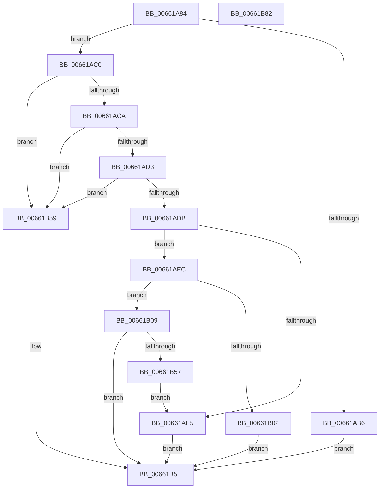

# WheapWmiExecutePluginCtlMethod

- RVA: `0x00661A84`–`0x00661B83` (길이 `255` bytes)
- VA: `0x0000000140661A84`
- 실행 섹션: `.text`
- PDB 이름 있음: `예`; PDB Function 태그: `아니요`
- unwind 정보 RVA: `0x0005FEF8`
- 디코드: `75`개 명령, `255/255` bytes 표시
- 미해석 바이트: `0` (있으면 어셈블리에 `.byte`로 보존)

> 이 문서는 커널 이미지의 기계어와 PDB 기호를 분석해 생성했습니다. 4번과 5번은 함수 원형과 자료형을 바이너리 사용 방식에서 추정한 C 해석이며 원본 소스 복구 결과는 아닙니다.

## 1. Dependencies

- 직접 호출 지점: **4**; 고유 호출 대상: **4**
- 직접 호출자로 확인된 함수: **1**
- RIP 상대 이미지 참조: **3**

### Outgoing calls
- `0x00661AEE` → `PSHED.dll!PshedAllocateMemory` (import, 간접 대상; import `PSHED.dll!PshedAllocateMemory`)
- `0x00661B16` → [memcpy](../6C/memcpy_function_006C6840.md) (function, `0x006C6840`)
- `0x00661B2D` → `PSHED.dll!PshedDoPluginCtl` (import, 간접 대상; import `PSHED.dll!PshedDoPluginCtl`)
- `0x00661B3E` → `PSHED.dll!PshedFreeMemory` (import, 간접 대상; import `PSHED.dll!PshedFreeMemory`)

### Direct callers
- [WheapWmiExecuteMethod](WheapWmiExecuteMethod_function_00661888.md) at `0x006619A3`

### Static image references
- `0x00661AEE` → RVA `0x00151070` (`PSHED.dll!PshedAllocateMemory (IAT)`; read)
- `0x00661B2D` → RVA `0x001510E0` (`PSHED.dll!PshedDoPluginCtl (IAT)`; read)
- `0x00661B3E` → RVA `0x00151120` (`PSHED.dll!PshedFreeMemory (IAT)`; read)

## 2. Other-region calls and transfers

- 다른 실행 섹션으로 향하는 call: **0**
- 별도 외부 분기/꼬리 이동을 확인하지 못했습니다.

## 3. Assembly (complete function range)

```asm
00661A84  48 8B C4                        mov rax, rsp
00661A87  48 89 58 08                     mov qword ptr [rax + 8], rbx
00661A8B  48 89 68 10                     mov qword ptr [rax + 0x10], rbp
00661A8F  48 89 70 18                     mov qword ptr [rax + 0x18], rsi
00661A93  48 89 78 20                     mov qword ptr [rax + 0x20], rdi
00661A97  41 54                           push r12
00661A99  41 56                           push r14
00661A9B  41 57                           push r15
00661A9D  48 83 EC 20                     sub rsp, 0x20
00661AA1  4C 8B 7C 24 60                  mov r15, qword ptr [rsp + 0x60]
00661AA6  33 FF                           xor edi, edi
00661AA8  49 8B F0                        mov rsi, r8
00661AAB  44 8B F2                        mov r14d, edx
00661AAE  41 21 3F                        and dword ptr [r15], edi
00661AB1  83 F9 01                        cmp ecx, 1
00661AB4  74 0A                           je 0x140661ac0
00661AB6  B9 97 02 00 C0                  mov ecx, 0xc0000297
00661ABB  E9 9E 00 00 00                  jmp 0x140661b5e
00661AC0  41 83 FE 04                     cmp r14d, 4
00661AC4  0F 82 8F 00 00 00               jb 0x140661b59
00661ACA  48 85 F6                        test rsi, rsi
00661ACD  0F 84 86 00 00 00               je 0x140661b59
00661AD3  41 8B 28                        mov ebp, dword ptr [r8]
00661AD6  83 FD 04                        cmp ebp, 4
00661AD9  72 7E                           jb 0x140661b59
00661ADB  BF 08 00 00 00                  mov edi, 8
00661AE0  44 3B F7                        cmp r14d, edi
00661AE3  73 07                           jae 0x140661aec
00661AE5  B9 23 00 00 C0                  mov ecx, 0xc0000023
00661AEA  EB 72                           jmp 0x140661b5e
00661AEC  8B CD                           mov ecx, ebp
00661AEE  48 FF 15 7B F5 AE FF            call qword ptr [rip - 0x510a85]
00661AF5  0F 1F 44 00 00                  nop dword ptr [rax + rax]
00661AFA  4C 8B E0                        mov r12, rax
00661AFD  48 85 C0                        test rax, rax
00661B00  75 07                           jne 0x140661b09
00661B02  B9 9A 00 00 C0                  mov ecx, 0xc000009a
00661B07  EB 55                           jmp 0x140661b5e
00661B09  48 8D 5E 04                     lea rbx, [rsi + 4]
00661B0D  4C 8B C5                        mov r8, rbp
00661B10  48 8B D3                        mov rdx, rbx
00661B13  49 8B CC                        mov rcx, r12
00661B16  E8 25 4D 06 00                  call 0x1406c6840
00661B1B  41 8D 46 F8                     lea eax, [r14 - 8]
00661B1F  4C 8B C3                        mov r8, rbx
00661B22  4C 8D 4B 04                     lea r9, [rbx + 4]
00661B26  89 03                           mov dword ptr [rbx], eax
00661B28  49 8B D4                        mov rdx, r12
00661B2B  8B CD                           mov ecx, ebp
00661B2D  48 FF 15 AC F5 AE FF            call qword ptr [rip - 0x510a54]
00661B34  0F 1F 44 00 00                  nop dword ptr [rax + rax]
00661B39  49 8B CC                        mov rcx, r12
00661B3C  89 06                           mov dword ptr [rsi], eax
00661B3E  48 FF 15 DB F5 AE FF            call qword ptr [rip - 0x510a25]
00661B45  0F 1F 44 00 00                  nop dword ptr [rax + rax]
00661B4A  8B 03                           mov eax, dword ptr [rbx]
00661B4C  8B 0E                           mov ecx, dword ptr [rsi]
00661B4E  03 C7                           add eax, edi
00661B50  8B F8                           mov edi, eax
00661B52  44 3B F0                        cmp r14d, eax
00661B55  73 07                           jae 0x140661b5e
00661B57  EB 8C                           jmp 0x140661ae5
00661B59  B9 0D 00 00 C0                  mov ecx, 0xc000000d
00661B5E  48 8B 5C 24 40                  mov rbx, qword ptr [rsp + 0x40]
00661B63  8B C1                           mov eax, ecx
00661B65  48 8B 6C 24 48                  mov rbp, qword ptr [rsp + 0x48]
00661B6A  48 8B 74 24 50                  mov rsi, qword ptr [rsp + 0x50]
00661B6F  41 89 3F                        mov dword ptr [r15], edi
00661B72  48 8B 7C 24 58                  mov rdi, qword ptr [rsp + 0x58]
00661B77  48 83 C4 20                     add rsp, 0x20
00661B7B  41 5F                           pop r15
00661B7D  41 5E                           pop r14
00661B7F  41 5C                           pop r12
00661B81  C3                              ret
00661B82  CC                              int3
```

## 4. C-style interpretation (structured pseudocode)

```c
__int64 __fastcall WheapWmiExecutePluginCtlMethod(int a1, int a2, __int64 a3, __int64 a4, __int64 a5)
{
    __int64 result;
    __int64 v_rdi;
    __int64 v_rsp;
    unsigned __int64 v_stack_p10;
    unsigned __int64 v_stack_p18;
    unsigned __int64 v_stack_p20;
    unsigned __int64 v_stack_p8;

    *(unsigned __int64 *)(v_rsp + 8) = v_rbx;
    *(unsigned __int64 *)(v_rsp + 16) = v_rbp;
    *(unsigned __int64 *)(v_rsp + 24) = v_rsi;
    *(unsigned __int64 *)(v_rsp + 32) = v_rdi;
    v_rsp = (v_rsp) - (32);
    v_rdi = 0;
    if (a1 == 1) goto loc_00661AC0;
    goto loc_00661B5E;
loc_00661AC0:
    if (((unsigned int)((unsigned int)(a2))) < 4) goto loc_00661B59;
    if (a3 == 0) goto loc_00661B59;
    if (((unsigned int)((unsigned int)(*(unsigned int *)(a3)))) < 4) goto loc_00661B59;
    if (((unsigned int)((unsigned int)(a2))) >= 8) goto loc_00661AEC;
loc_00661AE5:
    goto loc_00661B5E;
loc_00661AEC:
    result = PSHED_dll_PshedAllocateMemory((unsigned int)((unsigned int)((unsigned int)(*(unsigned int *)(a3)))), a2, a3, a4);
    if (result != 0) goto loc_00661B09;
    goto loc_00661B5E;
loc_00661B09:
    result = memcpy(result, a3 + 4, (unsigned int)(*(unsigned int *)(a3)), a4);
    *(unsigned int *)(a3 + 4) = (unsigned int)((unsigned int)(a2) - 8);
    result = PSHED_dll_PshedDoPluginCtl((unsigned int)((unsigned int)((unsigned int)(*(unsigned int *)(a3)))), result, a3 + 4, a3 + 4 + 4);
    *(unsigned int *)(a3) = (unsigned int)(result);
    result = PSHED_dll_PshedFreeMemory(result, result, a3 + 4, a3 + 4 + 4);
    result = (unsigned int)(((unsigned int)(*(unsigned int *)(a3 + 4))) + (8));
    if (((unsigned int)((unsigned int)(a2))) >= ((unsigned int)(result))) goto loc_00661B5E;
    goto loc_00661AE5;
loc_00661B59:
loc_00661B5E:
    *(unsigned int *)(a5) = (unsigned int)((unsigned int)((unsigned int)(result)));
    v_rsp = (v_rsp) + (32);
    return (unsigned int)((unsigned int)((unsigned int)(0xC000000DULL)));
}
```

## 5. (Beta) C Style

```c
int64_t WheapWmiExecutePluginCtlMethod(int32_t Arg1, int32_t Arg2, void *Arg3, int64_t Arg4, void *Arg5)
{
    uint8_t *arg3 = (uint8_t *)Arg3;
    uint8_t *arg5 = (uint8_t *)Arg5;

    int64_t result;
    int64_t local_rdi;
    int64_t local_rsp;
    uint64_t v_stack_p10;
    uint64_t v_stack_p18;
    uint64_t v_stack_p20;
    uint64_t v_stack_p8;

    *(uint64_t *)(local_rsp + 0x8) = local_rbx;
    *(uint64_t *)(local_rsp + 0x10) = local_rbp;
    *(uint64_t *)(local_rsp + 0x18) = local_rsi;
    *(uint64_t *)(local_rsp + 0x20) = local_rdi;
    local_rsp = (local_rsp) - (32);
    local_rdi = 0;
    if (Arg1 == 1) goto loc_00661AC0;
    goto loc_00661B5E;
loc_00661AC0:
    if (((uint32_t)((uint32_t)(Arg2))) < 4) goto loc_00661B59;
    if (Arg3 == NULL) goto loc_00661B59;
    if (((uint32_t)((uint32_t)(*(uint32_t *)(arg3)))) < 4) goto loc_00661B59;
    if (((uint32_t)((uint32_t)(Arg2))) >= 8) goto loc_00661AEC;
loc_00661AE5:
    goto loc_00661B5E;
loc_00661AEC:
    result = kernel_indirect_call((uint32_t)((uint32_t)((uint32_t)(*(uint32_t *)(arg3)))), Arg2, Arg3, Arg4);
    if (result != 0) goto loc_00661B09;
    goto loc_00661B5E;
loc_00661B09:
    result = memcpy(result, Arg3 + 4, (uint32_t)(*(uint32_t *)(arg3)), Arg4);
    *(uint32_t *)(arg3 + 0x4) = (uint32_t)((uint32_t)(Arg2) - 8);
    result = kernel_indirect_call((uint32_t)((uint32_t)((uint32_t)(*(uint32_t *)(arg3)))), result, Arg3 + 4, Arg3 + 4 + 4);
    *(uint32_t *)(arg3) = (uint32_t)(result);
    result = kernel_indirect_call(result, result, Arg3 + 4, Arg3 + 4 + 4);
    result = (uint32_t)(((uint32_t)(*(uint32_t *)(arg3 + 0x4))) + (8));
    if (((uint32_t)((uint32_t)(Arg2))) >= ((uint32_t)(result))) goto loc_00661B5E;
    goto loc_00661AE5;
loc_00661B59:
loc_00661B5E:
    *(uint32_t *)(arg5) = (uint32_t)((uint32_t)((uint32_t)(result)));
    local_rsp = (local_rsp) + (32);
    return (uint32_t)((uint32_t)((uint32_t)(0xC000000DULL)));
}
```

### 관측된 메모리 오프셋

구조체 형식이 확인되지 않은 접근은 인자 기준의 오프셋으로만 기록했습니다.

| 기준 인자 | 오프셋 표현 | 폭 (bit) | 접근 |
|---|---:|---:|---|
| `Arg3` | `+ 0x0` | `32` | `R` |
| `Arg5` | `+ 0x0` | `32` | `R/W` |
| `Arg5` | `+ 0x0` | `32` | `W` |

## 6. Execution-region graph

[열기: 2D/3D 그래프와 함수 탐색 컨트롤 패널](../../../control-panel.html?section=text&rva=0x00661A84&view=graph)

- 2D 그래프는 위에서 아래로 흐르고, 3D 그래프는 빈 공간을 드래그해 회전합니다. Shift+드래그는 이동, 휠은 확대·축소, 함수 노드 선택은 대상 보고서 이동입니다.

### Static fallback


