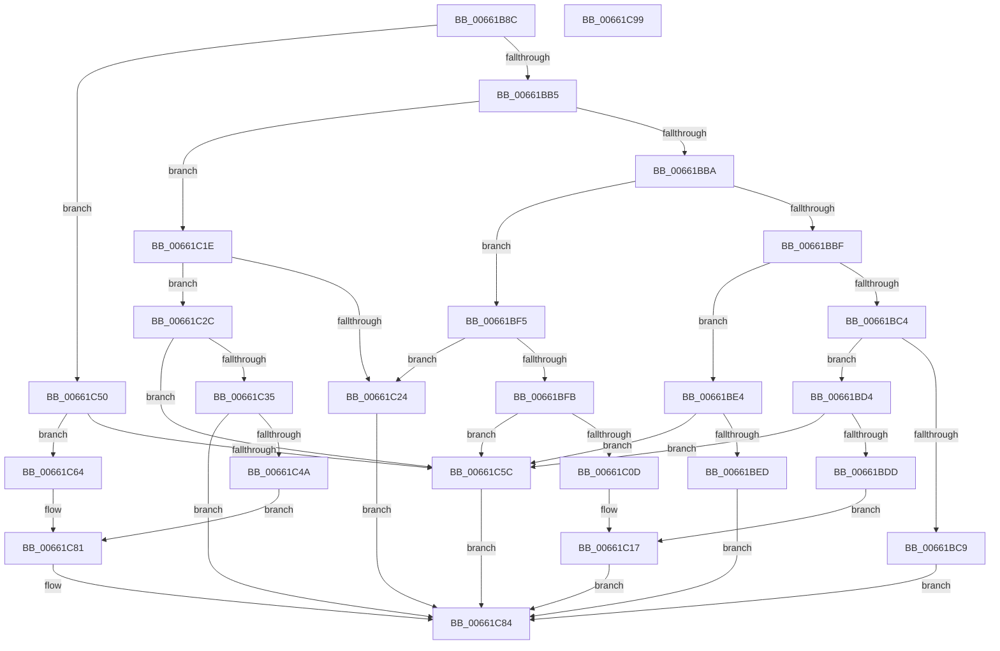

# WheapWmiExecutePolicyManagementMethod

- RVA: `0x00661B8C`–`0x00661C9A` (길이 `270` bytes)
- VA: `0x0000000140661B8C`
- 실행 섹션: `.text`
- PDB 이름 있음: `예`; PDB Function 태그: `아니요`
- unwind 정보 RVA: `0x0008A658`
- 디코드: `83`개 명령, `270/270` bytes 표시
- 미해석 바이트: `0` (있으면 어셈블리에 `.byte`로 보존)

> 이 문서는 커널 이미지의 기계어와 PDB 기호를 분석해 생성했습니다. 4번과 5번은 함수 원형과 자료형을 바이너리 사용 방식에서 추정한 C 해석이며 원본 소스 복구 결과는 아닙니다.

## 1. Dependencies

- 직접 호출 지점: **5**; 고유 호출 대상: **5**
- 직접 호출자로 확인된 함수: **1**
- RIP 상대 이미지 참조: **0**

### Outgoing calls
- `0x00661BDD` → [WheapResetPolicyDefaults](../../page/7D/WheapResetPolicyDefaults_function_007D8D10.md) (function, `0x007D8D10`)
- `0x00661C12` → [WheaWritePolicyValueToRegistry](../../page/7D/WheaWritePolicyValueToRegistry_function_007D8C2C.md) (function, `0x007D8C2C`)
- `0x00661C3C` → [WheapGetPolicyValue](../../page/7D/WheapGetPolicyValue_function_007D8CE0.md) (function, `0x007D8CE0`)
- `0x00661C50` → [WheapGetAllPolicyBufferSize](../../page/7D/WheapGetAllPolicyBufferSize_function_007D8C8C.md) (function, `0x007D8C8C`)
- `0x00661C75` → [WheapGetAllPolicyValues](../../page/7D/WheapGetAllPolicyValues_function_007D8C9C.md) (function, `0x007D8C9C`)

### Direct callers
- [WheapWmiExecuteMethod](WheapWmiExecuteMethod_function_00661888.md) at `0x0066196D`

### Static image references
- 디코드된 RIP-relative 메모리 참조가 없습니다.

## 2. Other-region calls and transfers

- 다른 실행 섹션으로 향하는 call: **5**
  - `0x00661BDD` → [WheapResetPolicyDefaults](../../page/7D/WheapResetPolicyDefaults_function_007D8D10.md) (`.text` → `PAGE`)
  - `0x00661C12` → [WheaWritePolicyValueToRegistry](../../page/7D/WheaWritePolicyValueToRegistry_function_007D8C2C.md) (`.text` → `PAGE`)
  - `0x00661C3C` → [WheapGetPolicyValue](../../page/7D/WheapGetPolicyValue_function_007D8CE0.md) (`.text` → `PAGE`)
  - `0x00661C50` → [WheapGetAllPolicyBufferSize](../../page/7D/WheapGetAllPolicyBufferSize_function_007D8C8C.md) (`.text` → `PAGE`)
  - `0x00661C75` → [WheapGetAllPolicyValues](../../page/7D/WheapGetAllPolicyValues_function_007D8C9C.md) (`.text` → `PAGE`)
- 별도 외부 분기/꼬리 이동을 확인하지 못했습니다.

## 3. Assembly (complete function range)

```asm
00661B8C  48 89 5C 24 10                  mov qword ptr [rsp + 0x10], rbx
00661B91  57                              push rdi
00661B92  48 83 EC 30                     sub rsp, 0x30
00661B96  49 8B D8                        mov rbx, r8
00661B99  45 33 C0                        xor r8d, r8d
00661B9C  44 89 44 24 40                  mov dword ptr [rsp + 0x40], r8d
00661BA1  41 8B F8                        mov edi, r8d
00661BA4  44 89 44 24 20                  mov dword ptr [rsp + 0x20], r8d
00661BA9  45 8B D8                        mov r11d, r8d
00661BAC  83 E9 01                        sub ecx, 1
00661BAF  0F 84 9B 00 00 00               je 0x140661c50
00661BB5  83 E9 01                        sub ecx, 1
00661BB8  74 64                           je 0x140661c1e
00661BBA  83 E9 01                        sub ecx, 1
00661BBD  74 36                           je 0x140661bf5
00661BBF  83 E9 01                        sub ecx, 1
00661BC2  74 20                           je 0x140661be4
00661BC4  83 F9 01                        cmp ecx, 1
00661BC7  74 0B                           je 0x140661bd4
00661BC9  41 BB 97 02 00 C0               mov r11d, 0xc0000297
00661BCF  E9 B0 00 00 00                  jmp 0x140661c84
00661BD4  BF 04 00 00 00                  mov edi, 4
00661BD9  3B D7                           cmp edx, edi
00661BDB  72 7F                           jb 0x140661c5c
00661BDD  E8 2E 71 17 00                  call 0x1407d8d10
00661BE2  EB 33                           jmp 0x140661c17
00661BE4  BF 04 00 00 00                  mov edi, 4
00661BE9  3B D7                           cmp edx, edi
00661BEB  72 6F                           jb 0x140661c5c
00661BED  44 89 03                        mov dword ptr [rbx], r8d
00661BF0  E9 8F 00 00 00                  jmp 0x140661c84
00661BF5  41 83 F9 08                     cmp r9d, 8
00661BF9  72 29                           jb 0x140661c24
00661BFB  8B 43 04                        mov eax, dword ptr [rbx + 4]
00661BFE  BF 04 00 00 00                  mov edi, 4
00661C03  8B 0B                           mov ecx, dword ptr [rbx]
00661C05  89 44 24 40                     mov dword ptr [rsp + 0x40], eax
00661C09  3B D7                           cmp edx, edi
00661C0B  72 4F                           jb 0x140661c5c
00661C0D  48 8D 54 24 40                  lea rdx, [rsp + 0x40]
00661C12  E8 15 70 17 00                  call 0x1407d8c2c
00661C17  44 8B D8                        mov r11d, eax
00661C1A  89 03                           mov dword ptr [rbx], eax
00661C1C  EB 66                           jmp 0x140661c84
00661C1E  41 83 F9 04                     cmp r9d, 4
00661C22  73 08                           jae 0x140661c2c
00661C24  41 BB 0D 00 00 C0               mov r11d, 0xc000000d
00661C2A  EB 58                           jmp 0x140661c84
00661C2C  BF 08 00 00 00                  mov edi, 8
00661C31  3B D7                           cmp edx, edi
00661C33  72 27                           jb 0x140661c5c
00661C35  8B 0B                           mov ecx, dword ptr [rbx]
00661C37  48 8D 54 24 40                  lea rdx, [rsp + 0x40]
00661C3C  E8 9F 70 17 00                  call 0x1407d8ce0
00661C41  89 03                           mov dword ptr [rbx], eax
00661C43  44 8B D8                        mov r11d, eax
00661C46  85 C0                           test eax, eax
00661C48  75 3A                           jne 0x140661c84
00661C4A  8B 44 24 40                     mov eax, dword ptr [rsp + 0x40]
00661C4E  EB 31                           jmp 0x140661c81
00661C50  E8 37 70 17 00                  call 0x1407d8c8c
00661C55  8D 78 0C                        lea edi, [rax + 0xc]
00661C58  3B D7                           cmp edx, edi
00661C5A  73 08                           jae 0x140661c64
00661C5C  41 BB 23 00 00 C0               mov r11d, 0xc0000023
00661C62  EB 20                           jmp 0x140661c84
00661C64  44 89 03                        mov dword ptr [rbx], r8d
00661C67  48 8D 4C 24 20                  lea rcx, [rsp + 0x20]
00661C6C  4C 8D 43 0C                     lea r8, [rbx + 0xc]
00661C70  89 43 08                        mov dword ptr [rbx + 8], eax
00661C73  8B D0                           mov edx, eax
00661C75  E8 22 70 17 00                  call 0x1407d8c9c
00661C7A  44 8B D8                        mov r11d, eax
00661C7D  8B 44 24 20                     mov eax, dword ptr [rsp + 0x20]
00661C81  89 43 04                        mov dword ptr [rbx + 4], eax
00661C84  48 8B 44 24 60                  mov rax, qword ptr [rsp + 0x60]
00661C89  48 8B 5C 24 48                  mov rbx, qword ptr [rsp + 0x48]
00661C8E  89 38                           mov dword ptr [rax], edi
00661C90  41 8B C3                        mov eax, r11d
00661C93  48 83 C4 30                     add rsp, 0x30
00661C97  5F                              pop rdi
00661C98  C3                              ret
00661C99  CC                              int3
```

## 4. C-style interpretation (structured pseudocode)

```c
__int64 __fastcall WheapWmiExecutePolicyManagementMethod(int a1, int a2, __int64 a3, int a4, __int64 a5)
{
    __int64 result;
    __int64 v_rsp;
    unsigned int v_stack_m18;
    unsigned __int64 v_stack_p10;
    unsigned int v_stack_p8;

    v_stack_p10 = v_rbx;
    v_rsp = (v_rsp) - (48);
    a3 = 0;
    v_stack_p8 = 0;
    v_stack_m18 = 0;
    a1 = (unsigned int)((a1) - (1));
    if (condition_is_equal) goto loc_00661C50;
    a1 = (unsigned int)((a1) - (1));
    if (condition_is_equal) goto loc_00661C1E;
    a1 = (unsigned int)((a1) - (1));
    if (condition_is_equal) goto loc_00661BF5;
    a1 = (unsigned int)((a1) - (1));
    if (condition_is_equal) goto loc_00661BE4;
    if (a1 == 1) goto loc_00661BD4;
    goto loc_00661C84;
loc_00661BD4:
    if (a2 < 4) goto loc_00661C5C;
    result = WheapResetPolicyDefaults(a1, a2, a3, a4);
    goto loc_00661C17;
loc_00661BE4:
    if (a2 < 4) goto loc_00661C5C;
    *(unsigned int *)(a3) = 0;
    goto loc_00661C84;
loc_00661BF5:
    if (a4 < 8) goto loc_00661C24;
    v_stack_p8 = (unsigned int)((unsigned int)(*(unsigned int *)(a3 + 4)));
    if (a2 < 4) goto loc_00661C5C;
    result = WheaWritePolicyValueToRegistry((unsigned int)(*(unsigned int *)(a3)), v_stack_p8, a3, a4);
loc_00661C17:
    *(unsigned int *)(a3) = (unsigned int)(result);
    goto loc_00661C84;
loc_00661C1E:
    if (a4 >= 4) goto loc_00661C2C;
loc_00661C24:
    goto loc_00661C84;
loc_00661C2C:
    if (((unsigned int)(v_stack_p8)) < 8) goto loc_00661C5C;
    result = WheapGetPolicyValue((unsigned int)(*(unsigned int *)(a3)), v_stack_p8, a3, a4);
    *(unsigned int *)(a3) = (unsigned int)(result);
    if ((unsigned int)(result) != 0) goto loc_00661C84;
    goto loc_00661C81;
loc_00661C50:
    result = WheapGetAllPolicyBufferSize((unsigned int)(*(unsigned int *)(a3)), v_stack_p8, a3, a4);
    if (((unsigned int)(v_stack_p8)) >= ((unsigned int)(result + 12))) goto loc_00661C64;
loc_00661C5C:
    goto loc_00661C84;
loc_00661C64:
    *(unsigned int *)(a3) = 0;
    *(unsigned int *)(a3 + 8) = (unsigned int)(result);
    result = WheapGetAllPolicyValues(v_stack_m18, (unsigned int)((unsigned int)(result)), a3 + 12, a4);
loc_00661C81:
    *(unsigned int *)(a3 + 4) = (unsigned int)((unsigned int)(v_stack_m18));
loc_00661C84:
    *(unsigned int *)(a5) = (unsigned int)(result + 12);
    v_rsp = (v_rsp) + (48);
    return (unsigned int)((unsigned int)((unsigned int)((unsigned int)(result))));
}
```

## 5. (Beta) C Style

```c
int64_t WheapWmiExecutePolicyManagementMethod(int32_t Arg1, int32_t Arg2, void *Arg3, int32_t Arg4, void *Arg5)
{
    uint8_t *arg3 = (uint8_t *)Arg3;
    uint8_t *arg5 = (uint8_t *)Arg5;

    int64_t result;
    int64_t local_rsp;
    uint32_t v_stack_m18;
    uint64_t v_stack_p10;
    uint32_t v_stack_p8;

    v_stack_p10 = local_rbx;
    local_rsp = (local_rsp) - (48);
    Arg3 = 0;
    v_stack_p8 = 0;
    v_stack_m18 = 0;
    Arg1 = (uint32_t)((Arg1) - (1));
    if (condition_is_equal) goto loc_00661C50;
    Arg1 = (uint32_t)((Arg1) - (1));
    if (condition_is_equal) goto loc_00661C1E;
    Arg1 = (uint32_t)((Arg1) - (1));
    if (condition_is_equal) goto loc_00661BF5;
    Arg1 = (uint32_t)((Arg1) - (1));
    if (condition_is_equal) goto loc_00661BE4;
    if (Arg1 == 1) goto loc_00661BD4;
    goto loc_00661C84;
loc_00661BD4:
    if (Arg2 < 4) goto loc_00661C5C;
    result = WheapResetPolicyDefaults(Arg1, Arg2, Arg3, Arg4);
    goto loc_00661C17;
loc_00661BE4:
    if (Arg2 < 4) goto loc_00661C5C;
    *(uint32_t *)(arg3) = 0;
    goto loc_00661C84;
loc_00661BF5:
    if (Arg4 < 8) goto loc_00661C24;
    v_stack_p8 = (uint32_t)((uint32_t)(*(uint32_t *)(arg3 + 0x4)));
    if (Arg2 < 4) goto loc_00661C5C;
    result = WheaWritePolicyValueToRegistry((uint32_t)(*(uint32_t *)(arg3)), v_stack_p8, Arg3, Arg4);
loc_00661C17:
    *(uint32_t *)(arg3) = (uint32_t)(result);
    goto loc_00661C84;
loc_00661C1E:
    if (Arg4 >= 4) goto loc_00661C2C;
loc_00661C24:
    goto loc_00661C84;
loc_00661C2C:
    if (((uint32_t)(v_stack_p8)) < 8) goto loc_00661C5C;
    result = WheapGetPolicyValue((uint32_t)(*(uint32_t *)(arg3)), v_stack_p8, Arg3, Arg4);
    *(uint32_t *)(arg3) = (uint32_t)(result);
    if ((uint32_t)(result) != 0) goto loc_00661C84;
    goto loc_00661C81;
loc_00661C50:
    result = WheapGetAllPolicyBufferSize((uint32_t)(*(uint32_t *)(arg3)), v_stack_p8, Arg3, Arg4);
    if (((uint32_t)(v_stack_p8)) >= ((uint32_t)(result + 12))) goto loc_00661C64;
loc_00661C5C:
    goto loc_00661C84;
loc_00661C64:
    *(uint32_t *)(arg3) = 0;
    *(uint32_t *)(arg3 + 0x8) = (uint32_t)(result);
    result = WheapGetAllPolicyValues(v_stack_m18, (uint32_t)((uint32_t)(result)), Arg3 + 12, Arg4);
loc_00661C81:
    *(uint32_t *)(arg3 + 0x4) = (uint32_t)((uint32_t)(v_stack_m18));
loc_00661C84:
    *(uint32_t *)(arg5) = (uint32_t)(result + 12);
    local_rsp = (local_rsp) + (48);
    return (uint32_t)((uint32_t)((uint32_t)((uint32_t)(result))));
}
```

### 관측된 메모리 오프셋

구조체 형식이 확인되지 않은 접근은 인자 기준의 오프셋으로만 기록했습니다.

| 기준 인자 | 오프셋 표현 | 폭 (bit) | 접근 |
|---|---:|---:|---|
| `Arg3` | `+ 0x0` | `32` | `R` |
| `Arg3` | `+ 0x0` | `32` | `W` |
| `Arg3` | `+ 0x4` | `32` | `R` |
| `Arg3` | `+ 0x4` | `32` | `W` |
| `Arg3` | `+ 0x8` | `32` | `W` |
| `Arg3` | `+ 0xC` | `64` | `R` |
| `Arg5` | `+ 0x0` | `32` | `W` |

## 6. Execution-region graph

[열기: 2D/3D 그래프와 함수 탐색 컨트롤 패널](../../../control-panel.html?section=text&rva=0x00661B8C&view=graph)

- 2D 그래프는 위에서 아래로 흐르고, 3D 그래프는 빈 공간을 드래그해 회전합니다. Shift+드래그는 이동, 휠은 확대·축소, 함수 노드 선택은 대상 보고서 이동입니다.

### Static fallback


