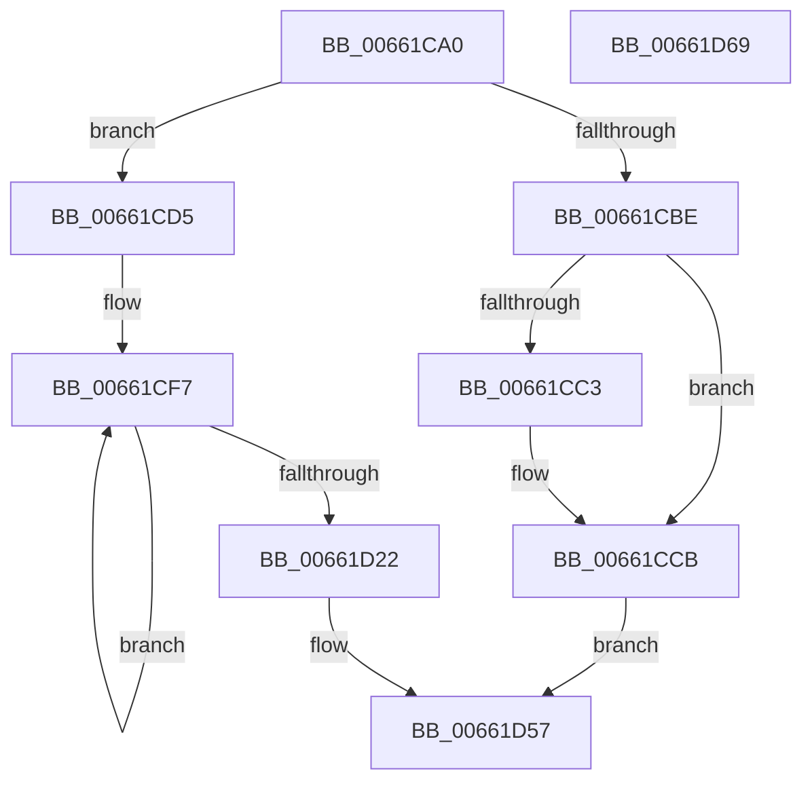

# WheapWmiRegisterInfo

- RVA: `0x00661CA0`–`0x00661D6A` (길이 `202` bytes)
- VA: `0x0000000140661CA0`
- 실행 섹션: `.text`
- PDB 이름 있음: `예`; PDB Function 태그: `예`
- unwind 정보 RVA: `0x00060BC4`
- 디코드: `51`개 명령, `202/202` bytes 표시
- 미해석 바이트: `0` (있으면 어셈블리에 `.byte`로 보존)

> 이 문서는 커널 이미지의 기계어와 PDB 기호를 분석해 생성했습니다. 4번과 5번은 함수 원형과 자료형을 바이너리 사용 방식에서 추정한 C 해석이며 원본 소스 복구 결과는 아닙니다.

## 1. Dependencies

- 직접 호출 지점: **1**; 고유 호출 대상: **1**
- 직접 호출자로 확인된 함수: **1**
- RIP 상대 이미지 참조: **4**

### Outgoing calls
- `0x00661CDD` → [memset](../6C/memset_function_006C6C40.md) (function, `0x006C6C40`)

### Direct callers
- [WheaWmiDispatch](WheaWmiDispatch_function_00661260.md) at `0x0066136D`

### Static image references
- `0x00661CE8` → RVA `0x0000BDFC` (`.rdata`; read)
- `0x00661D2B` → RVA `0x006D0940` (` ?? ::FNODOBFM::`string'`; read)
- `0x00661D39` → RVA `0x006D0950` (`.text`; read)
- `0x00661D47` → RVA `0x006D0960` (`.text`; read)

## 2. Other-region calls and transfers

- 다른 실행 섹션으로 향하는 call: **0**
- 별도 외부 분기/꼬리 이동을 확인하지 못했습니다.

## 3. Assembly (complete function range)

```asm
00661CA0  48 89 5C 24 08                  mov qword ptr [rsp + 8], rbx
00661CA5  48 89 74 24 10                  mov qword ptr [rsp + 0x10], rsi
00661CAA  57                              push rdi
00661CAB  48 83 EC 20                     sub rsp, 0x20
00661CAF  BB DE 00 00 00                  mov ebx, 0xde
00661CB4  49 8B F1                        mov rsi, r9
00661CB7  49 8B F8                        mov rdi, r8
00661CBA  3B D3                           cmp edx, ebx
00661CBC  73 17                           jae 0x140661cd5
00661CBE  83 FA 04                        cmp edx, 4
00661CC1  72 08                           jb 0x140661ccb
00661CC3  41 89 18                        mov dword ptr [r8], ebx
00661CC6  BB 04 00 00 00                  mov ebx, 4
00661CCB  B8 23 00 00 C0                  mov eax, 0xc0000023
00661CD0  E9 82 00 00 00                  jmp 0x140661d57
00661CD5  4C 8B C3                        mov r8, rbx
00661CD8  33 D2                           xor edx, edx
00661CDA  48 8B CF                        mov rcx, rdi
00661CDD  E8 5E 4F 06 00                  call 0x1406c6c40
00661CE2  41 B8 05 00 00 00               mov r8d, 5
00661CE8  48 8D 15 0D A1 9A FF            lea rdx, [rip - 0x655ef3]
00661CEF  44 89 47 10                     mov dword ptr [rdi + 0x10], r8d
00661CF3  48 8D 4F 2C                     lea rcx, [rdi + 0x2c]
00661CF7  48 8B 42 F4                     mov rax, qword ptr [rdx - 0xc]
00661CFB  0F 10 00                        movups xmm0, xmmword ptr [rax]
00661CFE  F3 0F 7F 41 EC                  movdqu xmmword ptr [rcx - 0x14], xmm0
00661D03  8B 02                           mov eax, dword ptr [rdx]
00661D05  48 8D 52 10                     lea rdx, [rdx + 0x10]
00661D09  89 41 FC                        mov dword ptr [rcx - 4], eax
00661D0C  8B 42 EC                        mov eax, dword ptr [rdx - 0x14]
00661D0F  89 01                           mov dword ptr [rcx], eax
00661D11  C7 41 04 B8 00 00 00            mov dword ptr [rcx + 4], 0xb8
00661D18  48 8D 49 20                     lea rcx, [rcx + 0x20]
00661D1C  49 83 E8 01                     sub r8, 1
00661D20  75 D5                           jne 0x140661cf7
00661D22  66 C7 87 B8 00 00 00 24 00      mov word ptr [rdi + 0xb8], 0x24
00661D2B  0F 10 05 0E EC 06 00            movups xmm0, xmmword ptr [rip + 0x6ec0e]
00661D32  0F 11 87 BA 00 00 00            movups xmmword ptr [rdi + 0xba], xmm0
00661D39  0F 10 0D 10 EC 06 00            movups xmm1, xmmword ptr [rip + 0x6ec10]
00661D40  0F 11 8F CA 00 00 00            movups xmmword ptr [rdi + 0xca], xmm1
00661D47  8B 05 13 EC 06 00               mov eax, dword ptr [rip + 0x6ec13]
00661D4D  89 87 DA 00 00 00               mov dword ptr [rdi + 0xda], eax
00661D53  33 C0                           xor eax, eax
00661D55  89 1F                           mov dword ptr [rdi], ebx
00661D57  89 1E                           mov dword ptr [rsi], ebx
00661D59  48 8B 5C 24 30                  mov rbx, qword ptr [rsp + 0x30]
00661D5E  48 8B 74 24 38                  mov rsi, qword ptr [rsp + 0x38]
00661D63  48 83 C4 20                     add rsp, 0x20
00661D67  5F                              pop rdi
00661D68  C3                              ret
00661D69  CC                              int3
```

## 4. C-style interpretation (structured pseudocode)

```c
__int64 __fastcall WheapWmiRegisterInfo(__int64 a1, int a2, __int64 a3, __int64 a4)
{
    __int64 result;
    __int64 v_rbx;
    __int64 v_rsp;
    unsigned __int64 v_stack_p10;
    unsigned __int64 v_stack_p8;

    v_stack_p8 = v_rbx;
    v_stack_p10 = v_rsi;
    v_rsp = (v_rsp) - (32);
    if (a2 >= 222) goto loc_00661CD5;
    v_rbx = 222;
    if (a2 >= 4) {
        *(unsigned int *)(a3) = 222;
        v_rbx = 4;
    }
    goto loc_00661D57;
loc_00661CD5:
    a2 = 0;
    result = memset(a3, a2, v_rbx, a4);
    *(unsigned int *)(a3 + 16) = 5;
loc_00661CF7:
    *(unsigned __int64 *)(a3 + 44 - 20) = v_xmm0;
    *(unsigned int *)(a3 + 44 - 4) = (unsigned int)((unsigned int)(*(unsigned int *)(v_rip - 6643443)));
    *(unsigned int *)(a3 + 44) = (unsigned int)((unsigned int)(*(unsigned int *)(v_rip - 6643443 + 16 - 20)));
    *(unsigned int *)(a3 + 44 + 4) = 184;
    a3 = (5) - (1);
    if (condition_is_not_equal) goto loc_00661CF7;
    *(unsigned __int16 *)(a3 + 184) = 36;
    *(unsigned __int64 *)(a3 + 186) = v_xmm0;
    *(unsigned __int64 *)(a3 + 202) = v_xmm1;
    *(unsigned int *)(a3 + 218) = (unsigned int)((unsigned int)(*(unsigned int *)(v_rip + 453651)));
    result = 0;
    *(unsigned int *)(a3) = (unsigned int)(v_rbx);
loc_00661D57:
    *(unsigned int *)(a4) = (unsigned int)(v_rbx);
    v_rsp = (v_rsp) + (32);
    return result;
}
```

## 5. (Beta) C Style

```c
int64_t WheapWmiRegisterInfo(int64_t Arg1, int32_t Arg2, void *Arg3, void *Arg4)
{
    uint8_t *arg3 = (uint8_t *)Arg3;
    uint8_t *arg4 = (uint8_t *)Arg4;

    int64_t result;
    int64_t local_rbx;
    int64_t local_rsp;
    uint64_t v_stack_p10;
    uint64_t v_stack_p8;

    v_stack_p8 = local_rbx;
    v_stack_p10 = local_rsi;
    local_rsp = (local_rsp) - (32);
    if (Arg2 >= 222) goto loc_00661CD5;
    local_rbx = 222;
    if (Arg2 >= 4) {
        *(uint32_t *)(arg3) = 222;
        local_rbx = 4;
    }
    goto loc_00661D57;
loc_00661CD5:
    Arg2 = 0;
    result = memset(Arg3, Arg2, local_rbx, Arg4);
    *(uint32_t *)(arg3 + 0x10) = 5;
loc_00661CF7:
    *(uint64_t *)(arg3 + 0x2C - 0x14) = v_xmm0;
    *(uint32_t *)(arg3 + 0x2C - 0x4) = (uint32_t)((uint32_t)(*(uint32_t *)(v_rip - 0x655EF3)));
    *(uint32_t *)(arg3 + 0x2C) = (uint32_t)((uint32_t)(*(uint32_t *)(v_rip - 0x655EF3 + 0x10 - 0x14)));
    *(uint32_t *)(arg3 + 0x2C + 0x4) = 184;
    Arg3 = (5) - (1);
    if (condition_is_not_equal) goto loc_00661CF7;
    *(uint16_t *)(arg3 + 0xB8) = 36;
    *(uint64_t *)(arg3 + 0xBA) = v_xmm0;
    *(uint64_t *)(arg3 + 0xCA) = v_xmm1;
    *(uint32_t *)(arg3 + 0xDA) = (uint32_t)((uint32_t)(*(uint32_t *)(v_rip + 0x6EC13)));
    result = 0;
    *(uint32_t *)(arg3) = (uint32_t)(local_rbx);
loc_00661D57:
    *(uint32_t *)(arg4) = (uint32_t)(local_rbx);
    local_rsp = (local_rsp) + (32);
    return result;
}
```

### 관측된 메모리 오프셋

구조체 형식이 확인되지 않은 접근은 인자 기준의 오프셋으로만 기록했습니다.

| 기준 인자 | 오프셋 표현 | 폭 (bit) | 접근 |
|---|---:|---:|---|
| `Arg3` | `- 0x14` | `128` | `W` |
| `Arg3` | `- 0x4` | `32` | `W` |
| `Arg3` | `+ 0x0` | `32` | `W` |
| `Arg3` | `+ 0x4` | `32` | `W` |
| `Arg3` | `+ 0x10` | `32` | `W` |
| `Arg3` | `+ 0x20` | `64` | `R` |
| `Arg3` | `+ 0x2C` | `64` | `R` |
| `Arg3` | `+ 0xB8` | `16` | `W` |
| `Arg3` | `+ 0xBA` | `128` | `R` |
| `Arg3` | `+ 0xCA` | `128` | `R` |
| `Arg3` | `+ 0xDA` | `32` | `W` |
| `Arg4` | `+ 0x0` | `32` | `W` |

## 6. Execution-region graph

[열기: 2D/3D 그래프와 함수 탐색 컨트롤 패널](../../../control-panel.html?section=text&rva=0x00661CA0&view=graph)

- 2D 그래프는 위에서 아래로 흐르고, 3D 그래프는 빈 공간을 드래그해 회전합니다. Shift+드래그는 이동, 휠은 확대·축소, 함수 노드 선택은 대상 보고서 이동입니다.

### Static fallback


