# wil_details_RecordFeatureUsageReporting

- RVA: `0x0066AAB0`–`0x0066AB3D` (길이 `141` bytes)
- VA: `0x000000014066AAB0`
- 실행 섹션: `.text`
- PDB 이름 있음: `예`; PDB Function 태그: `아니요`
- unwind 정보 RVA: `0x0005CAAC`
- 디코드: `40`개 명령, `141/141` bytes 표시
- 미해석 바이트: `0` (있으면 어셈블리에 `.byte`로 보존)

> 이 문서는 커널 이미지의 기계어와 PDB 기호를 분석해 생성했습니다. 4번과 5번은 함수 원형과 자료형을 바이너리 사용 방식에서 추정한 C 해석이며 원본 소스 복구 결과는 아닙니다.

## 1. Dependencies

- 직접 호출 지점: **2**; 고유 호출 대상: **2**
- 직접 호출자로 확인된 함수: **0**
- RIP 상대 이미지 참조: **2**

### Outgoing calls
- `0x0066AB01` → [CmFcpManagerArmFeatureUsageProviderFlushNotification](../49/CmFcpManagerArmFeatureUsageProviderFlushNotification_function_0049C978.md) (function, `0x0049C978`)
- `0x0066AB2C` → [RtlRecordFeatureUsage](../49/RtlRecordFeatureUsage_function_0049C790.md) (function, `0x0049C790`)

### Direct callers
- 이 함수 시작 RVA로 연결되는 직접 call은 확인되지 않았습니다. 간접 호출은 완전히 역산할 수 없습니다.

### Static image references
- `0x0066AACB` → RVA `0x00E0F458` (`.data`; read/write)
- `0x0066AAD5` → RVA `0x00E0F3B0` (`.data`; read)

## 2. Other-region calls and transfers

- 다른 실행 섹션으로 향하는 call: **0**
- 별도 외부 분기/꼬리 이동을 확인하지 못했습니다.

## 3. Assembly (complete function range)

```asm
0066AAB0  48 89 5C 24 08                  mov qword ptr [rsp + 8], rbx
0066AAB5  57                              push rdi
0066AAB6  48 83 EC 20                     sub rsp, 0x20
0066AABA  48 8B 5C 24 50                  mov rbx, qword ptr [rsp + 0x50]
0066AABF  8B F9                           mov edi, ecx
0066AAC1  83 3B 00                        cmp dword ptr [rbx], 0
0066AAC4  74 40                           je 0x14066ab06
0066AAC6  B8 01 00 00 00                  mov eax, 1
0066AACB  87 05 87 49 7A 00               xchg dword ptr [rip + 0x7a4987], eax
0066AAD1  85 C0                           test eax, eax
0066AAD3  75 31                           jne 0x14066ab06
0066AAD5  48 8B 15 D4 48 7A 00            mov rdx, qword ptr [rip + 0x7a48d4]
0066AADC  48 85 D2                        test rdx, rdx
0066AADF  74 25                           je 0x14066ab06
0066AAE1  0F 0D 4A 64                     prefetchw byte ptr [rdx + 0x64]
0066AAE5  8B 42 64                        mov eax, dword ptr [rdx + 0x64]
0066AAE8  8B C8                           mov ecx, eax
0066AAEA  83 C9 01                        or ecx, 1
0066AAED  F0 0F B1 4A 64                  lock cmpxchg dword ptr [rdx + 0x64], ecx
0066AAF2  75 F4                           jne 0x14066aae8
0066AAF4  F7 D0                           not eax
0066AAF6  BA 01 00 00 00                  mov edx, 1
0066AAFB  83 E0 01                        and eax, 1
0066AAFE  44 8B C0                        mov r8d, eax
0066AB01  E8 72 1E E3 FF                  call 0x14049c978
0066AB06  83 7B 04 00                     cmp dword ptr [rbx + 4], 0
0066AB0A  76 25                           jbe 0x14066ab31
0066AB0C  0F B7 43 08                     movzx eax, word ptr [rbx + 8]
0066AB10  48 8D 4C 24 50                  lea rcx, [rsp + 0x50]
0066AB15  66 89 44 24 54                  mov word ptr [rsp + 0x54], ax
0066AB1A  BA 01 00 00 00                  mov edx, 1
0066AB1F  0F B7 43 04                     movzx eax, word ptr [rbx + 4]
0066AB23  66 89 44 24 56                  mov word ptr [rsp + 0x56], ax
0066AB28  89 7C 24 50                     mov dword ptr [rsp + 0x50], edi
0066AB2C  E8 5F 1C E3 FF                  call 0x14049c790
0066AB31  48 8B 5C 24 30                  mov rbx, qword ptr [rsp + 0x30]
0066AB36  48 83 C4 20                     add rsp, 0x20
0066AB3A  5F                              pop rdi
0066AB3B  C3                              ret
0066AB3C  CC                              int3
```

## 4. C-style interpretation (structured pseudocode)

```c
__int64 __fastcall wil_details_RecordFeatureUsageReporting(int a1, __int64 a2, __int64 a3, __int64 a4, __int64 a5)
{
    __int64 result;
    __int64 v_rsp;
    unsigned int v_stack_p28;
    unsigned __int16 v_stack_p2C;
    unsigned __int16 v_stack_p2E;
    unsigned __int64 v_stack_p8;

    v_stack_p8 = v_rbx;
    v_rsp = (v_rsp) - (32);
    if ((*(unsigned int *)(a5)) == 0) goto loc_0066AB06;
    if (1 != 0) goto loc_0066AB06;
    if (*(unsigned __int64 *)(v_rip + 8014036) == 0) goto loc_0066AB06;
loc_0066AAE8:
    a1 = (unsigned int)(((unsigned int)((unsigned int)((unsigned int)(*(unsigned int *)(*(unsigned __int64 *)(v_rip + 8014036) + 100))))) | (1));
    if (condition_is_not_equal) goto loc_0066AAE8;
    result = (unsigned int)(~((unsigned int)(*(unsigned int *)(*(unsigned __int64 *)(v_rip + 8014036) + 100))));
    result = (unsigned int)((result) & (1));
    result = CmFcpManagerArmFeatureUsageProviderFlushNotification(a1, 1, (unsigned int)((unsigned int)(result)), a4);
loc_0066AB06:
    if ((*(unsigned int *)(a5 + 4)) >= = 0) {
        result = *(unsigned __int16 *)(a5 + 8);
        a1 = a5;
        v_stack_p2C = (unsigned __int16)(result);
        a2 = 1;
        result = *(unsigned __int16 *)(a5 + 4);
        v_stack_p2E = (unsigned __int16)(result);
        v_stack_p28 = (unsigned int)((unsigned int)(a1));
        result = RtlRecordFeatureUsage(a1, a2, (unsigned int)((unsigned int)(result)), a4);
    }
    v_rsp = (v_rsp) + (32);
    return result;
}
```

## 5. (Beta) C Style

```c
int64_t wil_details_RecordFeatureUsageReporting(int32_t Arg1, int64_t Arg2, int64_t Arg3, int64_t Arg4, void *Arg5)
{
    uint8_t *arg5 = (uint8_t *)Arg5;

    int64_t result;
    int64_t local_rsp;
    uint32_t v_stack_p28;
    uint16_t v_stack_p2C;
    uint16_t v_stack_p2E;
    uint64_t v_stack_p8;

    v_stack_p8 = local_rbx;
    local_rsp = (local_rsp) - (32);
    if ((*(uint32_t *)(arg5)) == 0) goto loc_0066AB06;
    if (1 != 0) goto loc_0066AB06;
    if (*(uint64_t *)(v_rip + 0x7A48D4) == 0) goto loc_0066AB06;
loc_0066AAE8:
    Arg1 = (uint32_t)(((uint32_t)((uint32_t)((uint32_t)(*(uint32_t *)(*(uint64_t *)(v_rip + 0x7A48D4) + 0x64))))) | (1));
    if (condition_is_not_equal) goto loc_0066AAE8;
    result = (uint32_t)(~((uint32_t)(*(uint32_t *)(*(uint64_t *)(v_rip + 0x7A48D4) + 0x64))));
    result = (uint32_t)((result) & (1));
    result = CmFcpManagerArmFeatureUsageProviderFlushNotification(Arg1, 1, (uint32_t)((uint32_t)(result)), Arg4);
loc_0066AB06:
    if ((*(uint32_t *)(arg5 + 0x4)) >= = 0) {
        result = *(uint16_t *)(arg5 + 0x8);
        Arg1 = Arg5;
        v_stack_p2C = (uint16_t)(result);
        Arg2 = 1;
        result = *(uint16_t *)(arg5 + 0x4);
        v_stack_p2E = (uint16_t)(result);
        v_stack_p28 = (uint32_t)((uint32_t)(Arg1));
        result = RtlRecordFeatureUsage(Arg1, Arg2, (uint32_t)((uint32_t)(result)), Arg4);
    }
    local_rsp = (local_rsp) + (32);
    return result;
}
```

### 관측된 메모리 오프셋

구조체 형식이 확인되지 않은 접근은 인자 기준의 오프셋으로만 기록했습니다.

| 기준 인자 | 오프셋 표현 | 폭 (bit) | 접근 |
|---|---:|---:|---|
| `Arg5` | `+ 0x0` | `32` | `R` |
| `Arg5` | `+ 0x4` | `16` | `R` |
| `Arg5` | `+ 0x4` | `32` | `R` |
| `Arg5` | `+ 0x8` | `16` | `R` |

## 6. Execution-region graph

[열기: 2D/3D 그래프와 함수 탐색 컨트롤 패널](../../../control-panel.html?section=text&rva=0x0066AAB0&view=graph)

- 2D 그래프는 위에서 아래로 흐르고, 3D 그래프는 빈 공간을 드래그해 회전합니다. Shift+드래그는 이동, 휠은 확대·축소, 함수 노드 선택은 대상 보고서 이동입니다.

### Static fallback

```mermaid
flowchart TD
  bb_0066AAB0[BB_0066AAB0]
  bb_0066AAC6[BB_0066AAC6]
  bb_0066AAD5[BB_0066AAD5]
  bb_0066AAE1[BB_0066AAE1]
  bb_0066AAE8[BB_0066AAE8]
  bb_0066AAF4[BB_0066AAF4]
  bb_0066AB06[BB_0066AB06]
  bb_0066AB0C[BB_0066AB0C]
  bb_0066AB31[BB_0066AB31]
  bb_0066AB3C[BB_0066AB3C]
  bb_0066AAB0 -->|branch| bb_0066AB06
  bb_0066AAB0 -->|fallthrough| bb_0066AAC6
  bb_0066AAC6 -->|branch| bb_0066AB06
  bb_0066AAC6 -->|fallthrough| bb_0066AAD5
  bb_0066AAD5 -->|branch| bb_0066AB06
  bb_0066AAD5 -->|fallthrough| bb_0066AAE1
  bb_0066AAE1 -->|flow| bb_0066AAE8
  bb_0066AAE8 -->|branch| bb_0066AAE8
  bb_0066AAE8 -->|fallthrough| bb_0066AAF4
  bb_0066AAF4 -->|flow| bb_0066AB06
  bb_0066AB06 -->|branch| bb_0066AB31
  bb_0066AB06 -->|fallthrough| bb_0066AB0C
  bb_0066AB0C -->|flow| bb_0066AB31
```


