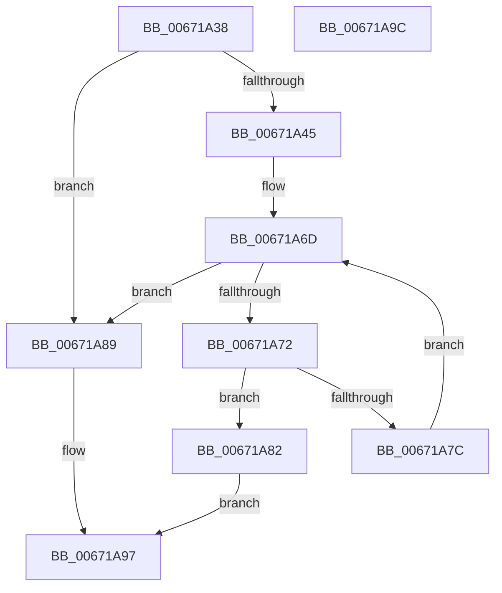

# MiAcquireRemoveMemoryResources

- RVA: `0x00671A38`–`0x00671A9D` (길이 `101` bytes)
- VA: `0x0000000140671A38`
- 실행 섹션: `.text`
- PDB 이름 있음: `예`; PDB Function 태그: `아니요`
- unwind 정보 RVA: `0x0005C788`
- 디코드: `30`개 명령, `101/101` bytes 표시
- 미해석 바이트: `0` (있으면 어셈블리에 `.byte`로 보존)

> 이 문서는 커널 이미지의 기계어와 PDB 기호를 분석해 생성했습니다. 4번과 5번은 함수 원형과 자료형을 바이너리 사용 방식에서 추정한 C 해석이며 원본 소스 복구 결과는 아닙니다.

## 1. Dependencies

- 직접 호출 지점: **1**; 고유 호출 대상: **1**
- 직접 호출자로 확인된 함수: **1**
- RIP 상대 이미지 참조: **0**

### Outgoing calls
- `0x00671A89` → [MiAllocateInitialMemoryBlocks](../../page/7F/MiAllocateInitialMemoryBlocks_function_007F9E34.md) (function, `0x007F9E34`)

### Direct callers
- [MiRemovePhysicalMemory](../../page/7F/MiRemovePhysicalMemory_function_007FAD3C.md) at `0x007FAEFA`

### Static image references
- 디코드된 RIP-relative 메모리 참조가 없습니다.

## 2. Other-region calls and transfers

- 다른 실행 섹션으로 향하는 call: **1**
  - `0x00671A89` → [MiAllocateInitialMemoryBlocks](../../page/7F/MiAllocateInitialMemoryBlocks_function_007F9E34.md) (`.text` → `PAGE`)
- 별도 외부 분기/꼬리 이동을 확인하지 못했습니다.

## 3. Assembly (complete function range)

```asm
00671A38  48 83 EC 28                     sub rsp, 0x28
00671A3C  F7 41 28 00 00 01 00            test dword ptr [rcx + 0x28], 0x10000
00671A43  74 44                           je 0x140671a89
00671A45  48 8B 41 10                     mov rax, qword ptr [rcx + 0x10]
00671A49  48 8D 14 40                     lea rdx, [rax + rax*2]
00671A4D  48 C1 E2 04                     shl rdx, 4
00671A51  48 B8 00 00 00 00 00 DE FF FF   movabs rax, 0xffffde0000000000
00671A5B  48 03 D0                        add rdx, rax
00671A5E  48 8B 41 20                     mov rax, qword ptr [rcx + 0x20]
00671A62  4C 8D 04 40                     lea r8, [rax + rax*2]
00671A66  49 C1 E0 04                     shl r8, 4
00671A6A  4C 03 C2                        add r8, rdx
00671A6D  49 3B D0                        cmp rdx, r8
00671A70  73 17                           jae 0x140671a89
00671A72  8B 42 20                        mov eax, dword ptr [rdx + 0x20]
00671A75  C1 E8 18                        shr eax, 0x18
00671A78  A8 40                           test al, 0x40
00671A7A  75 06                           jne 0x140671a82
00671A7C  48 83 C2 30                     add rdx, 0x30
00671A80  EB EB                           jmp 0x140671a6d
00671A82  B8 09 07 00 C0                  mov eax, 0xc0000709
00671A87  EB 0E                           jmp 0x140671a97
00671A89  E8 A6 83 18 00                  call 0x1407f9e34
00671A8E  33 C9                           xor ecx, ecx
00671A90  85 C0                           test eax, eax
00671A92  0F 48 C8                        cmovs ecx, eax
00671A95  8B C1                           mov eax, ecx
00671A97  48 83 C4 28                     add rsp, 0x28
00671A9B  C3                              ret
00671A9C  CC                              int3
```

## 4. C-style interpretation (structured pseudocode)

```c
__int64 __fastcall MiAcquireRemoveMemoryResources(__int64 a1)
{
    __int64 result;
    __int64 v_rsp;

    v_rsp = (v_rsp) - (40);
    if (((*(unsigned int *)(a1 + 40)) & (0x10000ULL)) == 0) goto loc_00671A89;
    a2 = (*(unsigned __int64 *)(a1 + 16) + *(unsigned __int64 *)(a1 + 16) * 2) << (4);
    a2 = (a2) + (*(unsigned __int64 *)(a1 + 16));
    a3 = (*(unsigned __int64 *)(a1 + 32) + *(unsigned __int64 *)(a1 + 32) * 2) << (4);
    a3 = (a3) + (a2);
loc_00671A6D:
    if (a2 >= a3) goto loc_00671A89;
    result = (unsigned int)(((unsigned int)(*(unsigned int *)(a2 + 32))) >> (24));
    if ((((unsigned __int8)(result)) & (64)) != 0) goto loc_00671A82;
    a2 = (a2) + (48);
    goto loc_00671A6D;
loc_00671A82:
    goto loc_00671A97;
loc_00671A89:
    result = MiAllocateInitialMemoryBlocks(a1, a2, a3, a4);
    a1 = 0;
    if (sign_flag) { a1 = (unsigned int)(result); }
loc_00671A97:
    v_rsp = (v_rsp) + (40);
    return (unsigned int)((unsigned int)(a1));
}
```

## 5. (Beta) C Style

```c
int64_t MiAcquireRemoveMemoryResources(void *Arg1)
{
    uint8_t *arg1 = (uint8_t *)Arg1;

    int64_t result;
    int64_t local_rsp;

    local_rsp = (local_rsp) - (40);
    if (((*(uint32_t *)(arg1 + 0x28)) & (0x10000ULL)) == 0) goto loc_00671A89;
    a2 = (*(uint64_t *)(arg1 + 0x10) + *(uint64_t *)(arg1 + 0x10) * 2) << (4);
    a2 = (a2) + (*(uint64_t *)(arg1 + 0x10));
    a3 = (*(uint64_t *)(arg1 + 0x20) + *(uint64_t *)(arg1 + 0x20) * 2) << (4);
    a3 = (a3) + (a2);
loc_00671A6D:
    if (a2 >= a3) goto loc_00671A89;
    result = (uint32_t)(((uint32_t)(*(uint32_t *)(a2 + 0x20))) >> (24));
    if ((((uint8_t)(result)) & (64)) != 0) goto loc_00671A82;
    a2 = (a2) + (48);
    goto loc_00671A6D;
loc_00671A82:
    goto loc_00671A97;
loc_00671A89:
    result = MiAllocateInitialMemoryBlocks(Arg1, a2, a3, a4);
    Arg1 = 0;
    if (sign_flag) { Arg1 = (uint32_t)(result); }
loc_00671A97:
    local_rsp = (local_rsp) + (40);
    return (uint32_t)((uint32_t)(Arg1));
}
```

### 관측된 메모리 오프셋

구조체 형식이 확인되지 않은 접근은 인자 기준의 오프셋으로만 기록했습니다.

| 기준 인자 | 오프셋 표현 | 폭 (bit) | 접근 |
|---|---:|---:|---|
| `Arg1` | `+ 0x10` | `64` | `R` |
| `Arg1` | `+ 0x20` | `64` | `R` |
| `Arg1` | `+ 0x28` | `32` | `R` |

## 6. Execution-region graph

[열기: 2D/3D 그래프와 함수 탐색 컨트롤 패널](../../../control-panel.html?section=text&rva=0x00671A38&view=graph)

- 2D 그래프는 위에서 아래로 흐르고, 3D 그래프는 빈 공간을 드래그해 회전합니다. Shift+드래그는 이동, 휠은 확대·축소, 함수 노드 선택은 대상 보고서 이동입니다.

### Static fallback


