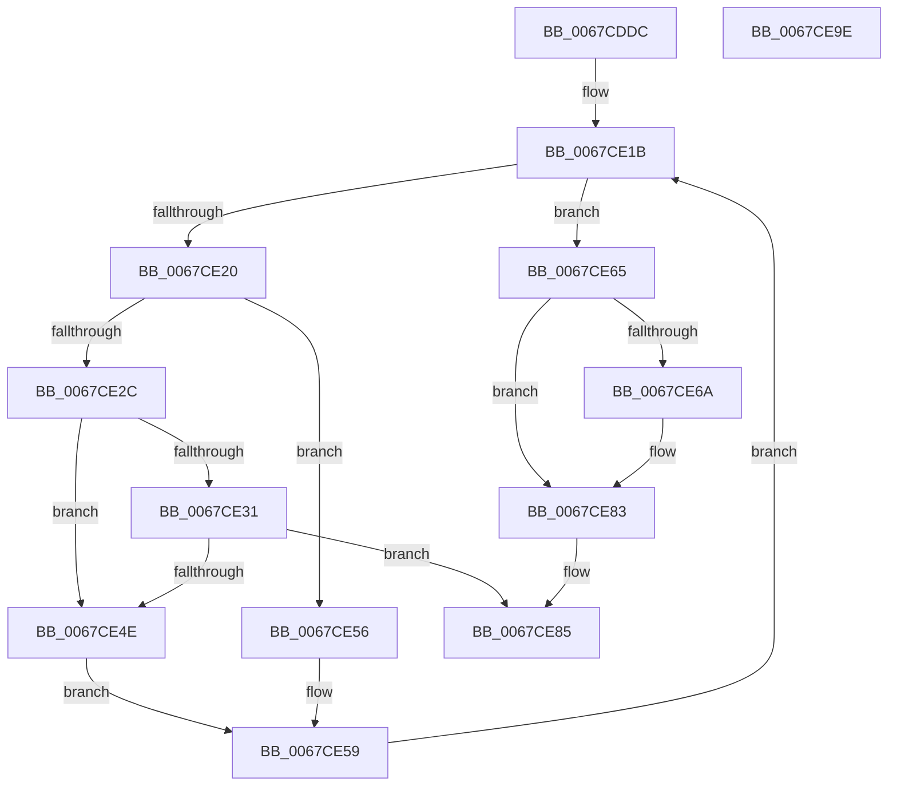

# MiAddNonSecuredPagesToDump

- RVA: `0x0067CDDC`–`0x0067CE9F` (길이 `195` bytes)
- VA: `0x000000014067CDDC`
- 실행 섹션: `.text`
- PDB 이름 있음: `예`; PDB Function 태그: `아니요`
- unwind 정보 RVA: `0x00084C9C`
- 디코드: `61`개 명령, `195/195` bytes 표시
- 미해석 바이트: `0` (있으면 어셈블리에 `.byte`로 보존)

> 이 문서는 커널 이미지의 기계어와 PDB 기호를 분석해 생성했습니다. 4번과 5번은 함수 원형과 자료형을 바이너리 사용 방식에서 추정한 C 해석이며 원본 소스 복구 결과는 아닙니다.

## 1. Dependencies

- 직접 호출 지점: **3**; 고유 호출 대상: **2**
- 직접 호출자로 확인된 함수: **1**
- RIP 상대 이미지 참조: **0**

### Outgoing calls
- `0x0067CE23` → [MiIsPageSecured](../22/MiIsPageSecured_function_00228524.md) (function, `0x00228524`)
- `0x0067CE43` → [guard_dispatch_icall](../6B/guard_dispatch_icall_function_006BAAD0.md) (function, `0x006BAAD0`)
- `0x0067CE7C` → [guard_dispatch_icall](../6B/guard_dispatch_icall_function_006BAAD0.md) (function, `0x006BAAD0`)

### Direct callers
- [MmGetDumpRange](MmGetDumpRange_function_0067DA68.md) at `0x0067DB7C`

### Static image references
- 디코드된 RIP-relative 메모리 참조가 없습니다.

## 2. Other-region calls and transfers

- 다른 실행 섹션으로 향하는 call: **0**
- 별도 외부 분기/꼬리 이동을 확인하지 못했습니다.

## 3. Assembly (complete function range)

```asm
0067CDDC  48 89 5C 24 08                  mov qword ptr [rsp + 8], rbx
0067CDE1  48 89 6C 24 10                  mov qword ptr [rsp + 0x10], rbp
0067CDE6  48 89 74 24 18                  mov qword ptr [rsp + 0x18], rsi
0067CDEB  57                              push rdi
0067CDEC  41 56                           push r14
0067CDEE  41 57                           push r15
0067CDF0  48 83 EC 30                     sub rsp, 0x30
0067CDF4  48 8D 3C 52                     lea rdi, [rdx + rdx*2]
0067CDF8  49 8B E8                        mov rbp, r8
0067CDFB  48 C1 E7 04                     shl rdi, 4
0067CDFF  48 8B F2                        mov rsi, rdx
0067CE02  4C 8B F9                        mov r15, rcx
0067CE05  45 33 DB                        xor r11d, r11d
0067CE08  33 DB                           xor ebx, ebx
0067CE0A  48 B8 00 00 00 00 00 DE FF FF   movabs rax, 0xffffde0000000000
0067CE14  48 03 F8                        add rdi, rax
0067CE17  4C 8D 72 01                     lea r14, [rdx + 1]
0067CE1B  48 85 ED                        test rbp, rbp
0067CE1E  74 45                           je 0x14067ce65
0067CE20  48 8B CF                        mov rcx, rdi
0067CE23  E8 FC B6 BA FF                  call 0x140228524
0067CE28  85 C0                           test eax, eax
0067CE2A  74 2A                           je 0x14067ce56
0067CE2C  4D 85 DB                        test r11, r11
0067CE2F  74 1D                           je 0x14067ce4e
0067CE31  49 8B 07                        mov rax, qword ptr [r15]
0067CE34  41 B9 02 00 00 00               mov r9d, 2
0067CE3A  4D 8B C3                        mov r8, r11
0067CE3D  48 8B D6                        mov rdx, rsi
0067CE40  49 8B CF                        mov rcx, r15
0067CE43  E8 88 DC 03 00                  call 0x1406baad0
0067CE48  8B D8                           mov ebx, eax
0067CE4A  85 C0                           test eax, eax
0067CE4C  78 37                           js 0x14067ce85
0067CE4E  49 8B F6                        mov rsi, r14
0067CE51  45 33 DB                        xor r11d, r11d
0067CE54  EB 03                           jmp 0x14067ce59
0067CE56  49 FF C3                        inc r11
0067CE59  48 83 C7 30                     add rdi, 0x30
0067CE5D  49 FF C6                        inc r14
0067CE60  48 FF CD                        dec rbp
0067CE63  EB B6                           jmp 0x14067ce1b
0067CE65  4D 85 DB                        test r11, r11
0067CE68  74 19                           je 0x14067ce83
0067CE6A  49 8B 07                        mov rax, qword ptr [r15]
0067CE6D  41 B9 02 00 00 00               mov r9d, 2
0067CE73  4D 8B C3                        mov r8, r11
0067CE76  48 8B D6                        mov rdx, rsi
0067CE79  49 8B CF                        mov rcx, r15
0067CE7C  E8 4F DC 03 00                  call 0x1406baad0
0067CE81  8B D8                           mov ebx, eax
0067CE83  8B C3                           mov eax, ebx
0067CE85  48 8B 5C 24 50                  mov rbx, qword ptr [rsp + 0x50]
0067CE8A  48 8B 6C 24 58                  mov rbp, qword ptr [rsp + 0x58]
0067CE8F  48 8B 74 24 60                  mov rsi, qword ptr [rsp + 0x60]
0067CE94  48 83 C4 30                     add rsp, 0x30
0067CE98  41 5F                           pop r15
0067CE9A  41 5E                           pop r14
0067CE9C  5F                              pop rdi
0067CE9D  C3                              ret
0067CE9E  CC                              int3
```

## 4. C-style interpretation (structured pseudocode)

```c
__int64 __fastcall MiAddNonSecuredPagesToDump(__int64 a1, __int64 a2, __int64 a3)
{
    __int64 result;
    __int64 v_r11;
    __int64 v_r14;
    __int64 v_rbp;
    __int64 v_rbx;
    __int64 v_rdi;
    __int64 v_rsp;
    unsigned __int64 v_stack_p10;
    unsigned __int64 v_stack_p18;
    unsigned __int64 v_stack_p8;

    v_stack_p8 = v_rbx;
    v_stack_p10 = v_rbp;
    v_stack_p18 = v_rsi;
    v_rsp = (v_rsp) - (48);
    v_rdi = (a2 + a2 * 2) << (4);
    v_r11 = 0;
    v_rbx = 0;
    v_rdi = (v_rdi) + (result);
loc_0067CE1B:
    if (a3 == 0) goto loc_0067CE65;
    result = MiIsPageSecured(v_rdi, a2, a3, a4);
    if ((unsigned int)(result) == 0) goto loc_0067CE56;
    if (0 == 0) goto loc_0067CE4E;
    result = guard_dispatch_icall(a1, a2, 0, 2);
    if (sign_flag) goto loc_0067CE85;
loc_0067CE4E:
    v_r11 = 0;
    goto loc_0067CE59;
loc_0067CE56:
    v_r11 = (v_r11) + 1;
loc_0067CE59:
    v_rdi = (v_rdi) + (48);
    v_r14 = (a2 + 1) + 1;
    v_rbp = (a3) - 1;
    goto loc_0067CE1B;
loc_0067CE65:
    v_rbx = (unsigned int)((unsigned int)(result));
    if (v_r11 != 0) {
        result = *(unsigned __int64 *)(a1);
        a4 = 2;
        a3 = v_r11;
        a2 = a2 + 1;
        a1 = a1;
        result = guard_dispatch_icall(a1, a2, a3, a4);
        v_rbx = (unsigned int)(result);
    }
loc_0067CE85:
    v_rsp = (v_rsp) + (48);
    return (unsigned int)((unsigned int)(v_rbx));
}
```

## 5. (Beta) C Style

```c
int64_t MiAddNonSecuredPagesToDump(void *Arg1, void *Arg2, int64_t Arg3)
{
    uint8_t *arg1 = (uint8_t *)Arg1;
    uint8_t *arg2 = (uint8_t *)Arg2;

    int64_t result;
    int64_t local_r11;
    int64_t local_r14;
    int64_t local_rbp;
    int64_t local_rbx;
    int64_t local_rdi;
    int64_t local_rsp;
    uint64_t v_stack_p10;
    uint64_t v_stack_p18;
    uint64_t v_stack_p8;

    v_stack_p8 = local_rbx;
    v_stack_p10 = local_rbp;
    v_stack_p18 = local_rsi;
    local_rsp = (local_rsp) - (48);
    local_rdi = (Arg2 + Arg2 * 2) << (4);
    local_r11 = 0;
    local_rbx = 0;
    local_rdi = (local_rdi) + (result);
loc_0067CE1B:
    if (Arg3 == 0) goto loc_0067CE65;
    result = MiIsPageSecured(local_rdi, Arg2, Arg3, a4);
    if ((uint32_t)(result) == 0) goto loc_0067CE56;
    if (0 == 0) goto loc_0067CE4E;
    result = guard_dispatch_icall(Arg1, Arg2, 0, 2);
    if (sign_flag) goto loc_0067CE85;
loc_0067CE4E:
    local_r11 = 0;
    goto loc_0067CE59;
loc_0067CE56:
    local_r11 = (local_r11) + 1;
loc_0067CE59:
    local_rdi = (local_rdi) + (48);
    local_r14 = (Arg2 + 1) + 1;
    local_rbp = (Arg3) - 1;
    goto loc_0067CE1B;
loc_0067CE65:
    local_rbx = (uint32_t)((uint32_t)(result));
    if (local_r11 != 0) {
        result = *(uint64_t *)(arg1);
        a4 = 2;
        Arg3 = local_r11;
        Arg2 = Arg2 + 1;
        Arg1 = Arg1;
        result = guard_dispatch_icall(Arg1, Arg2, Arg3, a4);
        local_rbx = (uint32_t)(result);
    }
loc_0067CE85:
    local_rsp = (local_rsp) + (48);
    return (uint32_t)((uint32_t)(local_rbx));
}
```

### 관측된 메모리 오프셋

구조체 형식이 확인되지 않은 접근은 인자 기준의 오프셋으로만 기록했습니다.

| 기준 인자 | 오프셋 표현 | 폭 (bit) | 접근 |
|---|---:|---:|---|
| `Arg1` | `+ 0x0` | `64` | `R` |
| `Arg2` | `+ 0x0 + rdx*2` | `64` | `R` |
| `Arg2` | `+ 0x1` | `64` | `R` |

## 6. Execution-region graph

[열기: 2D/3D 그래프와 함수 탐색 컨트롤 패널](../../../control-panel.html?section=text&rva=0x0067CDDC&view=graph)

- 2D 그래프는 위에서 아래로 흐르고, 3D 그래프는 빈 공간을 드래그해 회전합니다. Shift+드래그는 이동, 휠은 확대·축소, 함수 노드 선택은 대상 보고서 이동입니다.

### Static fallback


