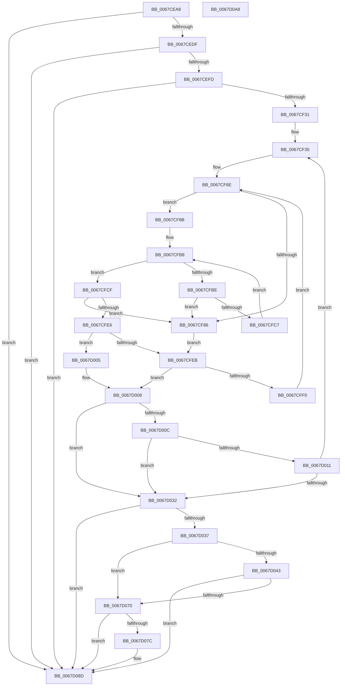

# MiAddPartitionDataToCrashDump

- RVA: `0x0067CEA8`–`0x0067D0A9` (길이 `513` bytes)
- VA: `0x000000014067CEA8`
- 실행 섹션: `.text`
- PDB 이름 있음: `예`; PDB Function 태그: `아니요`
- unwind 정보 RVA: `0x000D7F04`
- 디코드: `152`개 명령, `513/513` bytes 표시
- 미해석 바이트: `0` (있으면 어셈블리에 `.byte`로 보존)

> 이 문서는 커널 이미지의 기계어와 PDB 기호를 분석해 생성했습니다. 4번과 5번은 함수 원형과 자료형을 바이너리 사용 방식에서 추정한 C 해석이며 원본 소스 복구 결과는 아닙니다.

## 1. Dependencies

- 직접 호출 지점: **6**; 고유 호출 대상: **2**
- 직접 호출자로 확인된 함수: **1**
- RIP 상대 이미지 참조: **5**

### Outgoing calls
- `0x0067CECF` → [MmAddRangeToCrashDump](MmAddRangeToCrashDump_function_0067D8B0.md) (function, `0x0067D8B0`)
- `0x0067CEED` → [MmAddRangeToCrashDump](MmAddRangeToCrashDump_function_0067D8B0.md) (function, `0x0067D8B0`)
- `0x0067CF21` → [MmAddRangeToCrashDump](MmAddRangeToCrashDump_function_0067D8B0.md) (function, `0x0067D8B0`)
- `0x0067D022` → [MiAddPartitionToCrashDump](MiAddPartitionToCrashDump_function_0067D0B0.md) (function, `0x0067D0B0`)
- `0x0067D064` → [MmAddRangeToCrashDump](MmAddRangeToCrashDump_function_0067D8B0.md) (function, `0x0067D8B0`)
- `0x0067D085` → [MmAddRangeToCrashDump](MmAddRangeToCrashDump_function_0067D8B0.md) (function, `0x0067D8B0`)

### Direct callers
- [MmAddPrivateDataToCrashDump](MmAddPrivateDataToCrashDump_function_0067D794.md) at `0x0067D880`

### Static image references
- `0x0067CEBF` → RVA `0x00E30088` (`.data`; read)
- `0x0067CEDF` → RVA `0x00E30068` (`.data`; read)
- `0x0067D037` → RVA `0x00E300B8` (`.data`; read)
- `0x0067D043` → RVA `0x00E300B0` (`.data`; read)
- `0x0067D070` → RVA `0x00E300C0` (`.data`; read)

## 2. Other-region calls and transfers

- 다른 실행 섹션으로 향하는 call: **0**
- 별도 외부 분기/꼬리 이동을 확인하지 못했습니다.

## 3. Assembly (complete function range)

```asm
0067CEA8  48 89 5C 24 08                  mov qword ptr [rsp + 8], rbx
0067CEAD  48 89 74 24 18                  mov qword ptr [rsp + 0x18], rsi
0067CEB2  57                              push rdi
0067CEB3  41 54                           push r12
0067CEB5  41 55                           push r13
0067CEB7  41 56                           push r14
0067CEB9  41 57                           push r15
0067CEBB  48 83 EC 20                     sub rsp, 0x20
0067CEBF  48 8B 15 C2 31 7B 00            mov rdx, qword ptr [rip + 0x7b31c2]
0067CEC6  33 FF                           xor edi, edi
0067CEC8  48 8B D9                        mov rbx, rcx
0067CECB  44 8D 47 08                     lea r8d, [rdi + 8]
0067CECF  E8 DC 09 00 00                  call 0x14067d8b0
0067CED4  44 8B C0                        mov r8d, eax
0067CED7  85 C0                           test eax, eax
0067CED9  0F 88 AE 01 00 00               js 0x14067d08d
0067CEDF  48 8B 15 82 31 7B 00            mov rdx, qword ptr [rip + 0x7b3182]
0067CEE6  44 8D 47 10                     lea r8d, [rdi + 0x10]
0067CEEA  48 8B CB                        mov rcx, rbx
0067CEED  E8 BE 09 00 00                  call 0x14067d8b0
0067CEF2  44 8B C0                        mov r8d, eax
0067CEF5  85 C0                           test eax, eax
0067CEF7  0F 88 90 01 00 00               js 0x14067d08d
0067CEFD  48 8B 15 64 31 7B 00            mov rdx, qword ptr [rip + 0x7b3164]
0067CF04  44 8B C7                        mov r8d, edi
0067CF07  48 8B CB                        mov rcx, rbx
0067CF0A  8B 02                           mov eax, dword ptr [rdx]
0067CF0C  48 8B 52 08                     mov rdx, qword ptr [rdx + 8]
0067CF10  A8 3F                           test al, 0x3f
0067CF12  41 0F 95 C0                     setne r8b
0067CF16  48 C1 E8 06                     shr rax, 6
0067CF1A  4C 03 C0                        add r8, rax
0067CF1D  49 C1 E0 03                     shl r8, 3
0067CF21  E8 8A 09 00 00                  call 0x14067d8b0
0067CF26  44 8B C0                        mov r8d, eax
0067CF29  85 C0                           test eax, eax
0067CF2B  0F 88 5C 01 00 00               js 0x14067d08d
0067CF31  41 83 CD FF                     or r13d, 0xffffffff
0067CF35  48 8B 05 2C 31 7B 00            mov rax, qword ptr [rip + 0x7b312c]
0067CF3C  44 8B 38                        mov r15d, dword ptr [rax]
0067CF3F  4C 8B 70 08                     mov r14, qword ptr [rax + 8]
0067CF43  49 8B CE                        mov rcx, r14
0067CF46  83 E1 04                        and ecx, 4
0067CF49  8B C1                           mov eax, ecx
0067CF4B  41 8D 57 FF                     lea edx, [r15 - 1]
0067CF4F  48 F7 D8                        neg rax
0067CF52  45 1B DB                        sbb r11d, r11d
0067CF55  41 83 E3 20                     and r11d, 0x20
0067CF59  41 3B FF                        cmp edi, r15d
0067CF5C  45 1B D2                        sbb r10d, r10d
0067CF5F  44 23 D7                        and r10d, edi
0067CF62  48 F7 D9                        neg rcx
0067CF65  48 1B C0                        sbb rax, rax
0067CF68  83 E0 04                        and eax, 4
0067CF6B  4C 2B F0                        sub r14, rax
0067CF6E  83 64 24 58 00                  and dword ptr [rsp + 0x58], 0
0067CF73  41 8D 34 13                     lea esi, [r11 + rdx]
0067CF77  8B C6                           mov eax, esi
0067CF79  43 8D 0C 13                     lea ecx, [r11 + r10]
0067CF7D  2B C1                           sub eax, ecx
0067CF7F  FF C0                           inc eax
0067CF81  83 F8 01                        cmp eax, 1
0067CF84  73 05                           jae 0x14067cf8b
0067CF86  41 8B D5                        mov edx, r13d
0067CF89  EB 60                           jmp 0x14067cfeb
0067CF8B  8B C6                           mov eax, esi
0067CF8D  41 B9 01 00 00 00               mov r9d, 1
0067CF93  48 C1 E8 06                     shr rax, 6
0067CF97  4D 8D 24 C6                     lea r12, [r14 + rax*8]
0067CF9B  48 8B C1                        mov rax, rcx
0067CF9E  48 C1 E8 06                     shr rax, 6
0067CFA2  80 E1 3F                        and cl, 0x3f
0067CFA5  49 D3 E1                        shl r9, cl
0067CFA8  49 FF C9                        dec r9
0067CFAB  49 8D 14 C6                     lea rdx, [r14 + rax*8]
0067CFAF  48 8B 02                        mov rax, qword ptr [rdx]
0067CFB2  48 F7 D0                        not rax
0067CFB5  4C 0B C8                        or r9, rax
0067CFB8  49 83 F9 FF                     cmp r9, -1
0067CFBC  75 11                           jne 0x14067cfcf
0067CFBE  48 83 C2 08                     add rdx, 8
0067CFC2  49 3B D4                        cmp rdx, r12
0067CFC5  77 BF                           ja 0x14067cf86
0067CFC7  4C 8B 0A                        mov r9, qword ptr [rdx]
0067CFCA  49 F7 D1                        not r9
0067CFCD  EB E9                           jmp 0x14067cfb8
0067CFCF  49 2B D6                        sub rdx, r14
0067CFD2  49 F7 D1                        not r9
0067CFD5  48 C1 FA 03                     sar rdx, 3
0067CFD9  49 0F BC C1                     bsf rax, r9
0067CFDD  C1 E2 06                        shl edx, 6
0067CFE0  03 D0                           add edx, eax
0067CFE2  3B D6                           cmp edx, esi
0067CFE4  77 A0                           ja 0x14067cf86
0067CFE6  41 3B D5                        cmp edx, r13d
0067CFE9  75 1A                           jne 0x14067d005
0067CFEB  45 85 D2                        test r10d, r10d
0067CFEE  74 18                           je 0x14067d008
0067CFF0  8D 57 01                        lea edx, [rdi + 1]
0067CFF3  41 3B D7                        cmp edx, r15d
0067CFF6  41 0F 47 D7                     cmova edx, r15d
0067CFFA  41 03 D5                        add edx, r13d
0067CFFD  45 33 D2                        xor r10d, r10d
0067D000  E9 69 FF FF FF                  jmp 0x14067cf6e
0067D005  41 2B D3                        sub edx, r11d
0067D008  3B D7                           cmp edx, edi
0067D00A  72 26                           jb 0x14067d032
0067D00C  41 3B D5                        cmp edx, r13d
0067D00F  74 21                           je 0x14067d032
0067D011  48 8B 05 70 30 7B 00            mov rax, qword ptr [rip + 0x7b3070]
0067D018  8D 7A 01                        lea edi, [rdx + 1]
0067D01B  48 8B CB                        mov rcx, rbx
0067D01E  48 8B 14 D0                     mov rdx, qword ptr [rax + rdx*8]
0067D022  E8 89 00 00 00                  call 0x14067d0b0
0067D027  44 8B C0                        mov r8d, eax
0067D02A  85 C0                           test eax, eax
0067D02C  0F 89 03 FF FF FF               jns 0x14067cf35
0067D032  45 85 C0                        test r8d, r8d
0067D035  78 56                           js 0x14067d08d
0067D037  48 8B 15 7A 30 7B 00            mov rdx, qword ptr [rip + 0x7b307a]
0067D03E  48 85 D2                        test rdx, rdx
0067D041  74 2D                           je 0x14067d070
0067D043  48 8B 05 66 30 7B 00            mov rax, qword ptr [rip + 0x7b3066]
0067D04A  41 B8 00 00 00 00               mov r8d, 0
0067D050  A8 3F                           test al, 0x3f
0067D052  48 8B CB                        mov rcx, rbx
0067D055  41 0F 95 C0                     setne r8b
0067D059  48 C1 E8 06                     shr rax, 6
0067D05D  4C 03 C0                        add r8, rax
0067D060  49 C1 E0 03                     shl r8, 3
0067D064  E8 47 08 00 00                  call 0x14067d8b0
0067D069  44 8B C0                        mov r8d, eax
0067D06C  85 C0                           test eax, eax
0067D06E  78 1D                           js 0x14067d08d
0067D070  48 8B 15 49 30 7B 00            mov rdx, qword ptr [rip + 0x7b3049]
0067D077  48 85 D2                        test rdx, rdx
0067D07A  74 11                           je 0x14067d08d
0067D07C  41 B8 00 00 00 02               mov r8d, 0x2000000
0067D082  48 8B CB                        mov rcx, rbx
0067D085  E8 26 08 00 00                  call 0x14067d8b0
0067D08A  44 8B C0                        mov r8d, eax
0067D08D  48 8B 5C 24 50                  mov rbx, qword ptr [rsp + 0x50]
0067D092  41 8B C0                        mov eax, r8d
0067D095  48 8B 74 24 60                  mov rsi, qword ptr [rsp + 0x60]
0067D09A  48 83 C4 20                     add rsp, 0x20
0067D09E  41 5F                           pop r15
0067D0A0  41 5E                           pop r14
0067D0A2  41 5D                           pop r13
0067D0A4  41 5C                           pop r12
0067D0A6  5F                              pop rdi
0067D0A7  C3                              ret
0067D0A8  CC                              int3
```

## 4. C-style interpretation (structured pseudocode)

```c
__int64 __fastcall MiAddPartitionDataToCrashDump(__int64 a1)
{
    __int64 result;
    __int64 v_r10;
    __int64 v_r11;
    __int64 v_r13;
    __int64 v_r14;
    __int64 v_rdi;
    __int64 v_rsp;
    unsigned int v_stack_p10;
    unsigned __int64 v_stack_p18;
    unsigned __int64 v_stack_p8;

    v_stack_p8 = v_rbx;
    v_stack_p18 = v_rsi;
    v_rsp = (v_rsp) - (32);
    v_rdi = 0;
    result = MmAddRangeToCrashDump(a1, *(unsigned __int64 *)(v_rip + 8073666), v_rdi + 8, a4);
    if (sign_flag) goto loc_0067D08D;
    result = MmAddRangeToCrashDump(a1, *(unsigned __int64 *)(v_rip + 8073602), v_rdi + 16, a4);
    if (sign_flag) goto loc_0067D08D;
    a3 = ((((unsigned __int8)((unsigned int)(*(unsigned int *)(*(unsigned __int64 *)(v_rip + 8073572))))) & (63)) != 0) ? 1 : 0;
    result = ((unsigned int)(*(unsigned int *)(*(unsigned __int64 *)(v_rip + 8073572)))) >> (6);
    a3 = (a3) + (result);
    a3 = (a3) << (3);
    result = MmAddRangeToCrashDump(a1, *(unsigned __int64 *)(*(unsigned __int64 *)(v_rip + 8073572) + 8), a3, a4);
    if (sign_flag) goto loc_0067D08D;
    v_r13 = (unsigned int)((v_r13) | (0xFFFFFFFFULL));
loc_0067CF35:
    a1 = (unsigned int)((*(unsigned __int64 *)(*(unsigned __int64 *)(v_rip + 8073516) + 8)) & (4));
    result = -((unsigned int)((unsigned int)(a1)));
    v_r11 = (unsigned int)((v_r11) & (32));
    v_r10 = (unsigned int)((v_r10) & (0));
    a1 = -(a1);
    result = (unsigned int)((result) & (4));
    v_r14 = (*(unsigned __int64 *)(*(unsigned __int64 *)(v_rip + 8073516) + 8)) - (result);
loc_0067CF6E:
    result = (unsigned int)(((unsigned int)((unsigned int)(v_r11 + (unsigned int)(*(unsigned int *)(*(unsigned __int64 *)(v_rip + 8073516))) - 1 * 1))) - ((unsigned int)(v_r11 + v_r10 * 1)));
    result = (unsigned int)((result) + 1);
    if (((unsigned int)(result)) >= 1) goto loc_0067CF8B;
loc_0067CF86:
    goto loc_0067CFEB;
loc_0067CF8B:
    result = ((unsigned int)((unsigned int)(v_r11 + (unsigned int)(*(unsigned int *)(*(unsigned __int64 *)(v_rip + 8073516))) - 1 * 1))) >> (6);
    result = (v_r11 + v_r10 * 1) >> (6);
    a1 = (unsigned __int8)((v_r11 + v_r10 * 1) & (63));
    a4 = (1) << ((unsigned __int8)(a1));
    a4 = (a4) - 1;
    result = ~(*(unsigned __int64 *)(v_r14 + result * 8));
    a4 = (a4) | (result);
loc_0067CFB8:
    if (a4 != -1) goto loc_0067CFCF;
    a2 = (v_r14 + result * 8) + (8);
    if (a2 > (v_r14 + result * 8)) goto loc_0067CF86;
    a4 = ~(*(unsigned __int64 *)(a2));
    goto loc_0067CFB8;
loc_0067CFCF:
    a2 = (a2) - (v_r14);
    a4 = ~(a4);
    a2 = (a2) >> (3);
    a2 = (unsigned int)((a2) << (6));
    a2 = (unsigned int)((a2) + ((unsigned int)(result)));
    if (((unsigned int)(a2)) > ((unsigned int)(v_r11 + (unsigned int)(*(unsigned int *)(*(unsigned __int64 *)(v_rip + 8073516))) - 1 * 1))) goto loc_0067CF86;
    if (((unsigned int)(a2)) != ((unsigned int)(v_r13))) goto loc_0067D005;
loc_0067CFEB:
    if ((unsigned int)(v_r10) == 0) goto loc_0067D008;
    a2 = v_rdi + 1;
    if (((unsigned int)(v_rdi + 1)) > ((unsigned int)((unsigned int)(*(unsigned int *)(*(unsigned __int64 *)(v_rip + 8073516)))))) { a2 = (unsigned int)((unsigned int)(*(unsigned int *)(*(unsigned __int64 *)(v_rip + 8073516)))); }
    a2 = (unsigned int)((a2) + ((unsigned int)(v_r13)));
    v_r10 = 0;
    goto loc_0067CF6E;
loc_0067D005:
    a2 = (unsigned int)((a2) - ((unsigned int)(v_r11)));
loc_0067D008:
    if (((unsigned int)(a2)) < 0) goto loc_0067D032;
    if (((unsigned int)(a2)) == ((unsigned int)(v_r13))) goto loc_0067D032;
    result = MiAddPartitionToCrashDump(a1, *(unsigned __int64 *)(*(unsigned __int64 *)(v_rip + 8073328) + a2 * 8), (unsigned int)((unsigned int)(result)), a4);
    if (!sign_flag) goto loc_0067CF35;
loc_0067D032:
    if (sign_flag) goto loc_0067D08D;
    if (*(unsigned __int64 *)(v_rip + 8073338) == 0) goto loc_0067D070;
    a3 = ((((unsigned __int8)(*(unsigned __int64 *)(v_rip + 8073318))) & (63)) != 0) ? 1 : 0;
    result = (*(unsigned __int64 *)(v_rip + 8073318)) >> (6);
    a3 = (a3) + (result);
    a3 = (a3) << (3);
    result = MmAddRangeToCrashDump(a1, *(unsigned __int64 *)(v_rip + 8073338), a3, a4);
    if (sign_flag) goto loc_0067D08D;
loc_0067D070:
    if (*(unsigned __int64 *)(v_rip + 8073289) != 0) {
        a3 = 0x2000000ULL;
        a1 = a1;
        result = MmAddRangeToCrashDump(a1, *(unsigned __int64 *)(v_rip + 8073289), a3, a4);
        a3 = (unsigned int)(result);
    }
    v_rsp = (v_rsp) + (32);
    return (unsigned int)((unsigned int)(a3));
}
```

## 5. (Beta) C Style

```c
int64_t MiAddPartitionDataToCrashDump(int64_t Arg1)
{
    int64_t result;
    int64_t local_r10;
    int64_t local_r11;
    int64_t local_r13;
    int64_t local_r14;
    int64_t local_rdi;
    int64_t local_rsp;
    uint32_t v_stack_p10;
    uint64_t v_stack_p18;
    uint64_t v_stack_p8;

    v_stack_p8 = local_rbx;
    v_stack_p18 = local_rsi;
    local_rsp = (local_rsp) - (32);
    local_rdi = 0;
    result = MmAddRangeToCrashDump(Arg1, *(uint64_t *)(v_rip + 0x7B31C2), local_rdi + 8, a4);
    if (sign_flag) goto loc_0067D08D;
    result = MmAddRangeToCrashDump(Arg1, *(uint64_t *)(v_rip + 0x7B3182), local_rdi + 16, a4);
    if (sign_flag) goto loc_0067D08D;
    a3 = ((((uint8_t)((uint32_t)(*(uint32_t *)(*(uint64_t *)(v_rip + 0x7B3164))))) & (63)) != 0) ? 1 : 0;
    result = ((uint32_t)(*(uint32_t *)(*(uint64_t *)(v_rip + 0x7B3164)))) >> (6);
    a3 = (a3) + (result);
    a3 = (a3) << (3);
    result = MmAddRangeToCrashDump(Arg1, *(uint64_t *)(*(uint64_t *)(v_rip + 0x7B3164) + 0x8), a3, a4);
    if (sign_flag) goto loc_0067D08D;
    local_r13 = (uint32_t)((local_r13) | (0xFFFFFFFFULL));
loc_0067CF35:
    Arg1 = (uint32_t)((*(uint64_t *)(*(uint64_t *)(v_rip + 0x7B312C) + 0x8)) & (4));
    result = -((uint32_t)((uint32_t)(Arg1)));
    local_r11 = (uint32_t)((local_r11) & (32));
    local_r10 = (uint32_t)((local_r10) & (0));
    Arg1 = -(Arg1);
    result = (uint32_t)((result) & (4));
    local_r14 = (*(uint64_t *)(*(uint64_t *)(v_rip + 0x7B312C) + 0x8)) - (result);
loc_0067CF6E:
    result = (uint32_t)(((uint32_t)((uint32_t)(local_r11 + (uint32_t)(*(uint32_t *)(*(uint64_t *)(v_rip + 0x7B312C))) - 1 * 1))) - ((uint32_t)(local_r11 + local_r10 * 1)));
    result = (uint32_t)((result) + 1);
    if (((uint32_t)(result)) >= 1) goto loc_0067CF8B;
loc_0067CF86:
    goto loc_0067CFEB;
loc_0067CF8B:
    result = ((uint32_t)((uint32_t)(local_r11 + (uint32_t)(*(uint32_t *)(*(uint64_t *)(v_rip + 0x7B312C))) - 1 * 1))) >> (6);
    result = (local_r11 + local_r10 * 1) >> (6);
    Arg1 = (uint8_t)((local_r11 + local_r10 * 1) & (63));
    a4 = (1) << ((uint8_t)(Arg1));
    a4 = (a4) - 1;
    result = ~(*(uint64_t *)(local_r14 + result * 8));
    a4 = (a4) | (result);
loc_0067CFB8:
    if (a4 != -1) goto loc_0067CFCF;
    a2 = (local_r14 + result * 8) + (8);
    if (a2 > (local_r14 + result * 8)) goto loc_0067CF86;
    a4 = ~(*(uint64_t *)(a2));
    goto loc_0067CFB8;
loc_0067CFCF:
    a2 = (a2) - (local_r14);
    a4 = ~(a4);
    a2 = (a2) >> (3);
    a2 = (uint32_t)((a2) << (6));
    a2 = (uint32_t)((a2) + ((uint32_t)(result)));
    if (((uint32_t)(a2)) > ((uint32_t)(local_r11 + (uint32_t)(*(uint32_t *)(*(uint64_t *)(v_rip + 0x7B312C))) - 1 * 1))) goto loc_0067CF86;
    if (((uint32_t)(a2)) != ((uint32_t)(local_r13))) goto loc_0067D005;
loc_0067CFEB:
    if ((uint32_t)(local_r10) == 0) goto loc_0067D008;
    a2 = local_rdi + 1;
    if (((uint32_t)(local_rdi + 1)) > ((uint32_t)((uint32_t)(*(uint32_t *)(*(uint64_t *)(v_rip + 0x7B312C)))))) { a2 = (uint32_t)((uint32_t)(*(uint32_t *)(*(uint64_t *)(v_rip + 0x7B312C)))); }
    a2 = (uint32_t)((a2) + ((uint32_t)(local_r13)));
    local_r10 = 0;
    goto loc_0067CF6E;
loc_0067D005:
    a2 = (uint32_t)((a2) - ((uint32_t)(local_r11)));
loc_0067D008:
    if (((uint32_t)(a2)) < 0) goto loc_0067D032;
    if (((uint32_t)(a2)) == ((uint32_t)(local_r13))) goto loc_0067D032;
    result = MiAddPartitionToCrashDump(Arg1, *(uint64_t *)(*(uint64_t *)(v_rip + 0x7B3070) + a2 * 8), (uint32_t)((uint32_t)(result)), a4);
    if (!sign_flag) goto loc_0067CF35;
loc_0067D032:
    if (sign_flag) goto loc_0067D08D;
    if (*(uint64_t *)(v_rip + 0x7B307A) == 0) goto loc_0067D070;
    a3 = ((((uint8_t)(*(uint64_t *)(v_rip + 0x7B3066))) & (63)) != 0) ? 1 : 0;
    result = (*(uint64_t *)(v_rip + 0x7B3066)) >> (6);
    a3 = (a3) + (result);
    a3 = (a3) << (3);
    result = MmAddRangeToCrashDump(Arg1, *(uint64_t *)(v_rip + 0x7B307A), a3, a4);
    if (sign_flag) goto loc_0067D08D;
loc_0067D070:
    if (*(uint64_t *)(v_rip + 0x7B3049) != 0) {
        a3 = 0x2000000ULL;
        Arg1 = Arg1;
        result = MmAddRangeToCrashDump(Arg1, *(uint64_t *)(v_rip + 0x7B3049), a3, a4);
        a3 = (uint32_t)(result);
    }
    local_rsp = (local_rsp) + (32);
    return (uint32_t)((uint32_t)(a3));
}
```

## 6. Execution-region graph

[열기: 2D/3D 그래프와 함수 탐색 컨트롤 패널](../../../control-panel.html?section=text&rva=0x0067CEA8&view=graph)

- 2D 그래프는 위에서 아래로 흐르고, 3D 그래프는 빈 공간을 드래그해 회전합니다. Shift+드래그는 이동, 휠은 확대·축소, 함수 노드 선택은 대상 보고서 이동입니다.

### Static fallback


