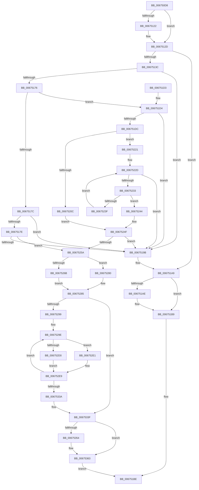

# MiAddPartitionHugeRange

- RVA: `0x006750D8`–`0x0067536A` (길이 `658` bytes)
- VA: `0x00000001406750D8`
- 실행 섹션: `.text`
- PDB 이름 있음: `예`; PDB Function 태그: `아니요`
- unwind 정보 RVA: `0x000D7C2C`
- 디코드: `180`개 명령, `658/658` bytes 표시
- 미해석 바이트: `0` (있으면 어셈블리에 `.byte`로 보존)

> 이 문서는 커널 이미지의 기계어와 PDB 기호를 분석해 생성했습니다. 4번과 5번은 함수 원형과 자료형을 바이너리 사용 방식에서 추정한 C 해석이며 원본 소스 복구 결과는 아닙니다.

## 1. Dependencies

- 직접 호출 지점: **11**; 고유 호출 대상: **9**
- 직접 호출자로 확인된 함수: **2**
- RIP 상대 이미지 참조: **6**

### Outgoing calls
- `0x00675128` → [MiLockDynamicMemoryShared](../3B/MiLockDynamicMemoryShared_function_003B8AA8.md) (function, `0x003B8AA8`)
- `0x00675133` → [MiMemoryRangeAlreadyExists](MiMemoryRangeAlreadyExists_function_00673354.md) (function, `0x00673354`)
- `0x00675159` → [ExAcquireSpinLockExclusive](../24/ExAcquireSpinLockExclusive_function_00248690.md) (function, `0x00248690`)
- `0x006751A4` → [MiReleaseSpinLockExclusive](../24/MiReleaseSpinLockExclusive_function_002482C0.md) (function, `0x002482C0`)
- `0x006751B4` → [MiUnlockDynamicMemoryShared](../3B/MiUnlockDynamicMemoryShared_function_003B8A48.md) (function, `0x003B8A48`)
- `0x006752A1` → [MiLockHugePfnInternal](../3F/MiLockHugePfnInternal_function_003FBC80.md) (function, `0x003FBC80`)
- `0x006752BC` → [RtlSetBitsEx](../3B/RtlSetBitsEx_function_003B6570.md) (function, `0x003B6570`)
- `0x006752DA` → [MiUpdateHugePageCounts](MiUpdateHugePageCounts_function_00677530.md) (function, `0x00677530`)
- `0x006752E4` → [MiInsertHugeRangeInList](../43/MiInsertHugeRangeInList_function_004371E8.md) (function, `0x004371E8`)
- `0x0067534A` → [MiReleaseSpinLockExclusive](../24/MiReleaseSpinLockExclusive_function_002482C0.md) (function, `0x002482C0`)
- `0x0067535E` → [MiUnlockDynamicMemoryShared](../3B/MiUnlockDynamicMemoryShared_function_003B8A48.md) (function, `0x003B8A48`)

### Direct callers
- [MiHotAddHugeRange](../../page/7F/MiHotAddHugeRange_function_007FBF6C.md) at `0x007FBFF2`
- [MiCreateHugeIoRanges](../../init/C6/MiCreateHugeIoRanges_function_00C6437C.md) at `0x00C6440D`

### Static image references
- `0x006750F5` → RVA `0x00E38D00` (`.data`; read)
- `0x00675140` → RVA `0x00E30100` (`.data`; read)
- `0x0067515E` → RVA `0x00E300B0` (`.data`; read)
- `0x0067517E` → RVA `0x00E300B8` (`.data`; read)
- `0x0067525A` → RVA `0x00E300C0` (`.data`; read)
- `0x0067530C` → RVA `0x00E300C8` (`.data`; read)

## 2. Other-region calls and transfers

- 다른 실행 섹션으로 향하는 call: **0**
- 별도 외부 분기/꼬리 이동을 확인하지 못했습니다.

## 3. Assembly (complete function range)

```asm
006750D8  48 89 5C 24 18                  mov qword ptr [rsp + 0x18], rbx
006750DD  48 89 4C 24 08                  mov qword ptr [rsp + 8], rcx
006750E2  55                              push rbp
006750E3  56                              push rsi
006750E4  57                              push rdi
006750E5  41 54                           push r12
006750E7  41 55                           push r13
006750E9  41 56                           push r14
006750EB  41 57                           push r15
006750ED  48 83 EC 20                     sub rsp, 0x20
006750F1  48 8B 5A 20                     mov rbx, qword ptr [rdx + 0x20]
006750F5  4C 8D 3D 04 3C 7C 00            lea r15, [rip + 0x7c3c04]
006750FC  48 8B 7A 28                     mov rdi, qword ptr [rdx + 0x28]
00675100  45 8B F1                        mov r14d, r9d
00675103  65 48 8B 2C 25 88 01 00 00      mov rbp, qword ptr gs:[0x188]
0067510C  48 03 FB                        add rdi, rbx
0067510F  48 89 6C 24 68                  mov qword ptr [rsp + 0x68], rbp
00675114  45 8B E8                        mov r13d, r8d
00675117  48 8B F2                        mov rsi, rdx
0067511A  4C 8B E1                        mov r12, rcx
0067511D  45 85 C9                        test r9d, r9d
00675120  75 0B                           jne 0x14067512d
00675122  48 8B D5                        mov rdx, rbp
00675125  49 8B CF                        mov rcx, r15
00675128  E8 7B 39 D4 FF                  call 0x1403b8aa8
0067512D  48 8B D7                        mov rdx, rdi
00675130  48 8B CB                        mov rcx, rbx
00675133  E8 1C E2 FF FF                  call 0x140673354
00675138  85 C0                           test eax, eax
0067513A  75 6D                           jne 0x1406751a9
0067513C  48 8B 7E 20                     mov rdi, qword ptr [rsi + 0x20]
00675140  48 8D 0D B9 AF 7B 00            lea rcx, [rip + 0x7bafb9]
00675147  48 8B 76 28                     mov rsi, qword ptr [rsi + 0x28]
0067514B  48 C1 EF 12                     shr rdi, 0x12
0067514F  81 E7 FF FF 3F 00               and edi, 0x3fffff
00675155  48 C1 EE 12                     shr rsi, 0x12
00675159  E8 32 35 BD FF                  call 0x140248690
0067515E  48 8B 0D 4B AF 7B 00            mov rcx, qword ptr [rip + 0x7baf4b]
00675165  81 E6 FF FF 3F 00               and esi, 0x3fffff
0067516B  88 44 24 78                     mov byte ptr [rsp + 0x78], al
0067516F  8A D8                           mov bl, al
00675171  48 3B F9                        cmp rdi, rcx
00675174  73 25                           jae 0x14067519b
00675176  48 83 FE 01                     cmp rsi, 1
0067517A  77 58                           ja 0x1406751d4
0067517C  75 1D                           jne 0x14067519b
0067517E  48 8B 05 33 AF 7B 00            mov rax, qword ptr [rip + 0x7baf33]
00675185  8B D7                           mov edx, edi
00675187  8B CF                           mov ecx, edi
00675189  83 E2 3F                        and edx, 0x3f
0067518C  48 C1 E9 06                     shr rcx, 6
00675190  48 0F A3 14 C8                  bt qword ptr [rax + rcx*8], rdx
00675195  0F 83 BF 00 00 00               jae 0x14067525a
0067519B  8A D3                           mov dl, bl
0067519D  48 8D 0D 5C AF 7B 00            lea rcx, [rip + 0x7baf5c]
006751A4  E8 17 31 BD FF                  call 0x1402482c0
006751A9  45 85 F6                        test r14d, r14d
006751AC  75 0B                           jne 0x1406751b9
006751AE  48 8B D5                        mov rdx, rbp
006751B1  49 8B CF                        mov rcx, r15
006751B4  E8 8F 38 D4 FF                  call 0x1403b8a48
006751B9  B8 18 00 00 C0                  mov eax, 0xc0000018
006751BE  48 8B 5C 24 70                  mov rbx, qword ptr [rsp + 0x70]
006751C3  48 83 C4 20                     add rsp, 0x20
006751C7  41 5F                           pop r15
006751C9  41 5E                           pop r14
006751CB  41 5D                           pop r13
006751CD  41 5C                           pop r12
006751CF  5F                              pop rdi
006751D0  5E                              pop rsi
006751D1  5D                              pop rbp
006751D2  C3                              ret
006751D3  CC                              int3
006751D4  48 2B CF                        sub rcx, rdi
006751D7  48 3B CE                        cmp rcx, rsi
006751DA  72 BF                           jb 0x14067519b
006751DC  48 8B 0D D5 AE 7B 00            mov rcx, qword ptr [rip + 0x7baed5]
006751E3  4C 8D 5E FF                     lea r11, [rsi - 1]
006751E7  4C 03 DF                        add r11, rdi
006751EA  48 8B C7                        mov rax, rdi
006751ED  48 C1 E8 06                     shr rax, 6
006751F1  49 83 C8 FF                     or r8, 0xffffffffffffffff
006751F5  48 8D 14 C1                     lea rdx, [rcx + rax*8]
006751F9  49 8B C3                        mov rax, r11
006751FC  4C 8B 0A                        mov r9, qword ptr [rdx]
006751FF  48 C1 E8 06                     shr rax, 6
00675203  4C 8D 14 C1                     lea r10, [rcx + rax*8]
00675207  49 3B D2                        cmp rdx, r10
0067520A  75 15                           jne 0x140675221
0067520C  41 8D 48 41                     lea ecx, [r8 + 0x41]
00675210  40 2A CE                        sub cl, sil
00675213  49 D3 E8                        shr r8, cl
00675216  48 8B CF                        mov rcx, rdi
00675219  49 D3 E0                        shl r8, cl
0067521C  4D 85 C8                        test r8, r9
0067521F  EB 2E                           jmp 0x14067524f
00675221  48 8B CF                        mov rcx, rdi
00675224  49 8B C0                        mov rax, r8
00675227  48 D3 E0                        shl rax, cl
0067522A  4C 85 C8                        test rax, r9
0067522D  0F 85 68 FF FF FF               jne 0x14067519b
00675233  48 83 C2 08                     add rdx, 8
00675237  48 8B 02                        mov rax, qword ptr [rdx]
0067523A  49 3B D2                        cmp rdx, r10
0067523D  74 05                           je 0x140675244
0067523F  48 85 C0                        test rax, rax
00675242  EB E9                           jmp 0x14067522d
00675244  41 8A CB                        mov cl, r11b
00675247  F6 D1                           not cl
00675249  49 D3 E8                        shr r8, cl
0067524C  49 85 C0                        test r8, rax
0067524F  0F 94 C0                        sete al
00675252  84 C0                           test al, al
00675254  0F 84 41 FF FF FF               je 0x14067519b
0067525A  48 8B 05 5F AE 7B 00            mov rax, qword ptr [rip + 0x7bae5f]
00675261  4C 8D 3C F8                     lea r15, [rax + rdi*8]
00675265  41 83 FD 03                     cmp r13d, 3
00675269  75 15                           jne 0x140675280
0067526B  41 0F B7 1C 24                  movzx ebx, word ptr [r12]
00675270  81 E3 FF 07 00 00               and ebx, 0x7ff
00675276  48 C1 E3 04                     shl rbx, 4
0067527A  48 83 CB 03                     or rbx, 3
0067527E  EB 05                           jmp 0x140675285
00675280  BB 13 40 00 00                  mov ebx, 0x4013
00675285  45 33 E4                        xor r12d, r12d
00675288  41 83 FD 01                     cmp r13d, 1
0067528C  41 0F 94 C4                     sete r12b
00675290  48 85 F6                        test rsi, rsi
00675293  0F 84 A6 00 00 00               je 0x14067533f
00675299  48 8B 6C 24 60                  mov rbp, qword ptr [rsp + 0x60]
0067529E  49 8B CF                        mov rcx, r15
006752A1  E8 DA 69 D8 FF                  call 0x1403fbc80
006752A6  48 8B D7                        mov rdx, rdi
006752A9  48 8D 0D 00 AE 7B 00            lea rcx, [rip + 0x7bae00]
006752B0  81 E2 FF FF 3F 00               and edx, 0x3fffff
006752B6  41 B8 01 00 00 00               mov r8d, 1
006752BC  E8 AF 12 D4 FF                  call 0x1403b6570
006752C1  49 89 1F                        mov qword ptr [r15], rbx
006752C4  48 8B D7                        mov rdx, rdi
006752C7  48 8B CD                        mov rcx, rbp
006752CA  41 83 FD 03                     cmp r13d, 3
006752CE  75 11                           jne 0x1406752e1
006752D0  41 8D 45 FE                     lea eax, [r13 - 2]
006752D4  44 8B C8                        mov r9d, eax
006752D7  44 8B C0                        mov r8d, eax
006752DA  E8 51 22 00 00                  call 0x140677530
006752DF  EB 08                           jmp 0x1406752e9
006752E1  45 8B C4                        mov r8d, r12d
006752E4  E8 FF 1E DC FF                  call 0x1404371e8
006752E9  49 8B C7                        mov rax, r15
006752EC  BA 01 00 00 00                  mov edx, 1
006752F1  48 2B 05 C8 AD 7B 00            sub rax, qword ptr [rip + 0x7badc8]
006752F8  48 C1 F8 03                     sar rax, 3
006752FC  25 FF FF 3F 00                  and eax, 0x3fffff
00675301  8B C8                           mov ecx, eax
00675303  83 E1 1F                        and ecx, 0x1f
00675306  D3 E2                           shl edx, cl
00675308  8B C8                           mov ecx, eax
0067530A  F7 D2                           not edx
0067530C  48 8B 05 B5 AD 7B 00            mov rax, qword ptr [rip + 0x7badb5]
00675313  48 C1 E9 05                     shr rcx, 5
00675317  F0 21 14 88                     lock and dword ptr [rax + rcx*4], edx
0067531B  48 8D 57 01                     lea rdx, [rdi + 1]
0067531F  49 83 C7 08                     add r15, 8
00675323  48 33 FA                        xor rdi, rdx
00675326  48 81 E7 00 00 C0 FF            and rdi, 0xffffffffffc00000
0067532D  48 33 FA                        xor rdi, rdx
00675330  48 83 EE 01                     sub rsi, 1
00675334  0F 85 64 FF FF FF               jne 0x14067529e
0067533A  48 8B 6C 24 68                  mov rbp, qword ptr [rsp + 0x68]
0067533F  8A 54 24 78                     mov dl, byte ptr [rsp + 0x78]
00675343  48 8D 0D B6 AD 7B 00            lea rcx, [rip + 0x7badb6]
0067534A  E8 71 2F BD FF                  call 0x1402482c0
0067534F  45 85 F6                        test r14d, r14d
00675352  75 0F                           jne 0x140675363
00675354  48 8B D5                        mov rdx, rbp
00675357  48 8D 0D A2 39 7C 00            lea rcx, [rip + 0x7c39a2]
0067535E  E8 E5 36 D4 FF                  call 0x1403b8a48
00675363  33 C0                           xor eax, eax
00675365  E9 54 FE FF FF                  jmp 0x1406751be
```

## 4. C-style interpretation (structured pseudocode)

```c
__int64 __fastcall MiAddPartitionHugeRange(__int64 a1, __int64 a2, __int64 a3, int a4)
{
    __int64 result;
    __int64 v_r11;
    __int64 v_r12;
    __int64 v_r15;
    __int64 v_rbx;
    __int64 v_rdi;
    __int64 v_rsi;
    __int64 v_rsp;
    unsigned __int64 v_stack_p10;
    unsigned __int64 v_stack_p18;
    unsigned __int8 v_stack_p20;
    unsigned __int64 v_stack_p60;
    unsigned __int64 v_stack_p68;
    unsigned __int8 v_stack_p78;
    unsigned __int64 v_stack_p8;

    v_stack_p18 = v_rbx;
    v_stack_p8 = a1;
    v_rsp = (v_rsp) - (32);
    v_rdi = (*(unsigned __int64 *)(a2 + 40)) + (*(unsigned __int64 *)(a2 + 32));
    v_stack_p10 = *(unsigned __int64 *)(gs_base + (0 + 392));
    if (a4 == 0) {
        a2 = *(unsigned __int64 *)(gs_base + (0 + 392));
        a1 = v_rip + 8141828;
        result = MiLockDynamicMemoryShared(a1, a2, a3, a4);
    }
    result = MiMemoryRangeAlreadyExists(*(unsigned __int64 *)(a2 + 32), v_rdi, a3, a4);
    if ((unsigned int)(result) != 0) goto loc_006751A9;
    v_rdi = (*(unsigned __int64 *)(a2 + 32)) >> (18);
    v_rdi = (unsigned int)((v_rdi) & (0x3FFFFFULL));
    v_rsi = (*(unsigned __int64 *)(a2 + 40)) >> (18);
    result = ExAcquireSpinLockExclusive(v_rip + 8105913, v_rdi, a3, a4);
    v_rsi = (unsigned int)((v_rsi) & (0x3FFFFFULL));
    v_stack_p20 = (unsigned __int8)(result);
    if (v_rdi >= (*(unsigned __int64 *)(v_rip + 8105803))) goto loc_0067519B;
    if (v_rsi > 1) goto loc_006751D4;
    if (v_rsi != 1) goto loc_0067519B;
    a2 = (unsigned int)(((unsigned int)((unsigned int)(v_rdi))) & (63));
    a1 = ((unsigned int)((unsigned int)(v_rdi))) >> (6);
    if (condition_is_above_or_equal) goto loc_0067525A;
loc_0067519B:
    result = MiReleaseSpinLockExclusive(v_rip + 8105820, (unsigned __int8)((unsigned __int8)(result)), a3, a4);
loc_006751A9:
    if ((unsigned int)((unsigned int)(a4)) == 0) {
        a2 = *(unsigned __int64 *)(gs_base + (0 + 392));
        a1 = v_rip + 8141828;
        result = MiUnlockDynamicMemoryShared(a1, a2, a3, a4);
    }
loc_006751BE:
    v_rsp = (v_rsp) + (32);
    return (unsigned int)(0xC0000018ULL);
loc_006751D4:
    a1 = (a1) - (v_rdi);
    if (a1 < v_rsi) goto loc_0067519B;
    v_r11 = (v_rsi - 1) + (v_rdi);
    result = (v_rdi) >> (6);
    a3 = (a3) | (-1);
    result = (v_r11) >> (6);
    if ((*(unsigned __int64 *)(v_rip + 8105685) + result * 8) != (*(unsigned __int64 *)(v_rip + 8105685) + result * 8)) goto loc_00675221;
    a1 = (unsigned __int8)((a3 + 65) - ((unsigned __int8)(v_rsi)));
    a3 = (a3) >> ((unsigned __int8)(a1));
    a3 = (a3) << ((unsigned __int8)(v_rdi));
    goto loc_0067524F;
loc_00675221:
    result = (a3) << ((unsigned __int8)(v_rdi));
loc_0067522D:
    if (((result) & (*(unsigned __int64 *)(*(unsigned __int64 *)(v_rip + 8105685) + result * 8))) != 0) goto loc_0067519B;
    a2 = (*(unsigned __int64 *)(v_rip + 8105685) + result * 8) + (8);
    if (a2 == (*(unsigned __int64 *)(v_rip + 8105685) + result * 8)) goto loc_00675244;
    goto loc_0067522D;
loc_00675244:
    a1 = (unsigned __int8)(~((unsigned __int8)(v_r11)));
    a3 = (a3) >> ((unsigned __int8)(a1));
loc_0067524F:
    result = (((a3) & (*(unsigned __int64 *)(a2))) == 0) ? 1 : 0;
    if ((unsigned __int8)(result) == 0) goto loc_0067519B;
loc_0067525A:
    if (((unsigned int)((unsigned int)((unsigned int)(a3)))) != 3) goto loc_00675280;
    v_rbx = (unsigned int)((*(unsigned __int16 *)(a1)) & (0x7FFULL));
    v_rbx = (v_rbx) << (4);
    v_rbx = (v_rbx) | (3);
    goto loc_00675285;
loc_00675280:
loc_00675285:
    v_r12 = 0;
    v_r12 = (((unsigned int)((unsigned int)((unsigned int)(a3)))) == 1) ? 1 : 0;
    if (v_rsi == 0) goto loc_0067533F;
loc_0067529E:
    result = MiLockHugePfnInternal(*(unsigned __int64 *)(v_rip + 8105567) + v_rdi * 8, a2, a3, *(unsigned __int64 *)(*(unsigned __int64 *)(v_rip + 8105685) + result * 8));
    a2 = (unsigned int)((v_rdi) & (0x3FFFFFULL));
    result = RtlSetBitsEx(v_rip + 8105472, a2, 1, *(unsigned __int64 *)(*(unsigned __int64 *)(v_rip + 8105685) + result * 8));
    *(unsigned __int64 *)(*(unsigned __int64 *)(v_rip + 8105567) + v_rdi * 8) = (unsigned int)(0x4013ULL);
    if (((unsigned int)((unsigned int)((unsigned int)(a3)))) != 3) goto loc_006752E1;
    result = MiUpdateHugePageCounts(v_stack_p60, v_rdi, (unsigned int)((unsigned int)((unsigned int)((unsigned int)(a3)) - 2)), (unsigned int)((unsigned int)((unsigned int)((unsigned int)(a3)) - 2)));
    goto loc_006752E9;
loc_006752E1:
    result = MiInsertHugeRangeInList(v_stack_p60, v_rdi, (unsigned int)((unsigned int)(v_r12)), (unsigned int)((unsigned int)((unsigned int)((unsigned int)(a3)) - 2)));
loc_006752E9:
    result = (*(unsigned __int64 *)(v_rip + 8105567) + v_rdi * 8) - (*(unsigned __int64 *)(v_rip + 8105416));
    result = (result) >> (3);
    result = (unsigned int)((result) & (0x3FFFFFULL));
    a1 = (unsigned int)(((unsigned int)((unsigned int)(result))) & (31));
    a2 = (unsigned int)((1) << ((unsigned __int8)(a1)));
    a2 = (unsigned int)(~(a2));
    a1 = ((unsigned int)((unsigned int)(result))) >> (5);
    v_r15 = (*(unsigned __int64 *)(v_rip + 8105567) + v_rdi * 8) + (8);
    v_rdi = (v_rdi) ^ (v_rdi + 1);
    v_rdi = (v_rdi) & (0xFFFFFFFFFFC00000ULL);
    v_rdi = (v_rdi) ^ (v_rdi + 1);
    v_rsi = (v_rsi) - (1);
    if (condition_is_not_equal) goto loc_0067529E;
loc_0067533F:
    result = MiReleaseSpinLockExclusive(v_rip + 8105398, v_stack_p78, (unsigned int)((unsigned int)(v_r12)), (unsigned int)((unsigned int)((unsigned int)((unsigned int)(a3)) - 2)));
    if ((unsigned int)((unsigned int)(a4)) == 0) {
        a2 = v_stack_p68;
        a1 = v_rip + 8141218;
        result = MiUnlockDynamicMemoryShared(a1, a2, (unsigned int)((unsigned int)(v_r12)), (unsigned int)((unsigned int)((unsigned int)((unsigned int)(a3)) - 2)));
    }
    result = 0;
    goto loc_006751BE;
}
```

## 5. (Beta) C Style

```c
int64_t MiAddPartitionHugeRange(void *Arg1, void *Arg2, int64_t Arg3, int32_t Arg4)
{
    uint8_t *arg1 = (uint8_t *)Arg1;
    uint8_t *arg2 = (uint8_t *)Arg2;

    int64_t result;
    int64_t local_r11;
    int64_t local_r12;
    int64_t local_r15;
    int64_t local_rbx;
    int64_t local_rdi;
    int64_t local_rsi;
    int64_t local_rsp;
    uint64_t v_stack_p10;
    uint64_t v_stack_p18;
    uint8_t v_stack_p20;
    uint64_t v_stack_p60;
    uint64_t v_stack_p68;
    uint8_t v_stack_p78;
    uint64_t v_stack_p8;

    v_stack_p18 = local_rbx;
    v_stack_p8 = Arg1;
    local_rsp = (local_rsp) - (32);
    local_rdi = (*(uint64_t *)(arg2 + 0x28)) + (*(uint64_t *)(arg2 + 0x20));
    v_stack_p10 = *(uint64_t *)(gs_base + (0 + 0x188));
    if (Arg4 == 0) {
        Arg2 = *(uint64_t *)(gs_base + (0 + 0x188));
        Arg1 = v_rip + 8141828;
        result = MiLockDynamicMemoryShared(Arg1, Arg2, Arg3, Arg4);
    }
    result = MiMemoryRangeAlreadyExists(*(uint64_t *)(arg2 + 0x20), local_rdi, Arg3, Arg4);
    if ((uint32_t)(result) != 0) goto loc_006751A9;
    local_rdi = (*(uint64_t *)(arg2 + 0x20)) >> (18);
    local_rdi = (uint32_t)((local_rdi) & (0x3FFFFFULL));
    local_rsi = (*(uint64_t *)(arg2 + 0x28)) >> (18);
    result = ExAcquireSpinLockExclusive(v_rip + 8105913, local_rdi, Arg3, Arg4);
    local_rsi = (uint32_t)((local_rsi) & (0x3FFFFFULL));
    v_stack_p20 = (uint8_t)(result);
    if (local_rdi >= (*(uint64_t *)(v_rip + 0x7BAF4B))) goto loc_0067519B;
    if (local_rsi > 1) goto loc_006751D4;
    if (local_rsi != 1) goto loc_0067519B;
    Arg2 = (uint32_t)(((uint32_t)((uint32_t)(local_rdi))) & (63));
    Arg1 = ((uint32_t)((uint32_t)(local_rdi))) >> (6);
    if (condition_is_above_or_equal) goto loc_0067525A;
loc_0067519B:
    result = MiReleaseSpinLockExclusive(v_rip + 8105820, (uint8_t)((uint8_t)(result)), Arg3, Arg4);
loc_006751A9:
    if ((uint32_t)((uint32_t)(Arg4)) == 0) {
        Arg2 = *(uint64_t *)(gs_base + (0 + 0x188));
        Arg1 = v_rip + 8141828;
        result = MiUnlockDynamicMemoryShared(Arg1, Arg2, Arg3, Arg4);
    }
loc_006751BE:
    local_rsp = (local_rsp) + (32);
    return (uint32_t)(0xC0000018ULL);
loc_006751D4:
    Arg1 = (Arg1) - (local_rdi);
    if (Arg1 < local_rsi) goto loc_0067519B;
    local_r11 = (local_rsi - 1) + (local_rdi);
    result = (local_rdi) >> (6);
    Arg3 = (Arg3) | (-1);
    result = (local_r11) >> (6);
    if ((*(uint64_t *)(v_rip + 0x7BAED5) + result * 8) != (*(uint64_t *)(v_rip + 0x7BAED5) + result * 8)) goto loc_00675221;
    Arg1 = (uint8_t)((Arg3 + 65) - ((uint8_t)(local_rsi)));
    Arg3 = (Arg3) >> ((uint8_t)(Arg1));
    Arg3 = (Arg3) << ((uint8_t)(local_rdi));
    goto loc_0067524F;
loc_00675221:
    result = (Arg3) << ((uint8_t)(local_rdi));
loc_0067522D:
    if (((result) & (*(uint64_t *)(*(uint64_t *)(v_rip + 0x7BAED5) + result * 8))) != 0) goto loc_0067519B;
    Arg2 = (*(uint64_t *)(v_rip + 0x7BAED5) + result * 8) + (8);
    if (Arg2 == (*(uint64_t *)(v_rip + 0x7BAED5) + result * 8)) goto loc_00675244;
    goto loc_0067522D;
loc_00675244:
    Arg1 = (uint8_t)(~((uint8_t)(local_r11)));
    Arg3 = (Arg3) >> ((uint8_t)(Arg1));
loc_0067524F:
    result = (((Arg3) & (*(uint64_t *)(arg2))) == 0) ? 1 : 0;
    if ((uint8_t)(result) == 0) goto loc_0067519B;
loc_0067525A:
    if (((uint32_t)((uint32_t)((uint32_t)(Arg3)))) != 3) goto loc_00675280;
    local_rbx = (uint32_t)((*(uint16_t *)(arg1)) & (0x7FFULL));
    local_rbx = (local_rbx) << (4);
    local_rbx = (local_rbx) | (3);
    goto loc_00675285;
loc_00675280:
loc_00675285:
    local_r12 = 0;
    local_r12 = (((uint32_t)((uint32_t)((uint32_t)(Arg3)))) == 1) ? 1 : 0;
    if (local_rsi == 0) goto loc_0067533F;
loc_0067529E:
    result = MiLockHugePfnInternal(*(uint64_t *)(v_rip + 0x7BAE5F) + local_rdi * 8, Arg2, Arg3, *(uint64_t *)(*(uint64_t *)(v_rip + 0x7BAED5) + result * 8));
    Arg2 = (uint32_t)((local_rdi) & (0x3FFFFFULL));
    result = RtlSetBitsEx(v_rip + 8105472, Arg2, 1, *(uint64_t *)(*(uint64_t *)(v_rip + 0x7BAED5) + result * 8));
    *(uint64_t *)(*(uint64_t *)(v_rip + 0x7BAE5F) + local_rdi * 8) = (uint32_t)(0x4013ULL);
    if (((uint32_t)((uint32_t)((uint32_t)(Arg3)))) != 3) goto loc_006752E1;
    result = MiUpdateHugePageCounts(v_stack_p60, local_rdi, (uint32_t)((uint32_t)((uint32_t)((uint32_t)(Arg3)) - 2)), (uint32_t)((uint32_t)((uint32_t)((uint32_t)(Arg3)) - 2)));
    goto loc_006752E9;
loc_006752E1:
    result = MiInsertHugeRangeInList(v_stack_p60, local_rdi, (uint32_t)((uint32_t)(local_r12)), (uint32_t)((uint32_t)((uint32_t)((uint32_t)(Arg3)) - 2)));
loc_006752E9:
    result = (*(uint64_t *)(v_rip + 0x7BAE5F) + local_rdi * 8) - (*(uint64_t *)(v_rip + 0x7BADC8));
    result = (result) >> (3);
    result = (uint32_t)((result) & (0x3FFFFFULL));
    Arg1 = (uint32_t)(((uint32_t)((uint32_t)(result))) & (31));
    Arg2 = (uint32_t)((1) << ((uint8_t)(Arg1)));
    Arg2 = (uint32_t)(~(Arg2));
    Arg1 = ((uint32_t)((uint32_t)(result))) >> (5);
    local_r15 = (*(uint64_t *)(v_rip + 0x7BAE5F) + local_rdi * 8) + (8);
    local_rdi = (local_rdi) ^ (local_rdi + 1);
    local_rdi = (local_rdi) & (0xFFFFFFFFFFC00000ULL);
    local_rdi = (local_rdi) ^ (local_rdi + 1);
    local_rsi = (local_rsi) - (1);
    if (condition_is_not_equal) goto loc_0067529E;
loc_0067533F:
    result = MiReleaseSpinLockExclusive(v_rip + 8105398, v_stack_p78, (uint32_t)((uint32_t)(local_r12)), (uint32_t)((uint32_t)((uint32_t)((uint32_t)(Arg3)) - 2)));
    if ((uint32_t)((uint32_t)(Arg4)) == 0) {
        Arg2 = v_stack_p68;
        Arg1 = v_rip + 8141218;
        result = MiUnlockDynamicMemoryShared(Arg1, Arg2, (uint32_t)((uint32_t)(local_r12)), (uint32_t)((uint32_t)((uint32_t)((uint32_t)(Arg3)) - 2)));
    }
    result = 0;
    goto loc_006751BE;
}
```

### 관측된 메모리 오프셋

구조체 형식이 확인되지 않은 접근은 인자 기준의 오프셋으로만 기록했습니다.

| 기준 인자 | 오프셋 표현 | 폭 (bit) | 접근 |
|---|---:|---:|---|
| `Arg1` | `+ 0x0` | `16` | `R` |
| `Arg2` | `+ 0x20` | `64` | `R` |
| `Arg2` | `+ 0x28` | `64` | `R` |

## 6. Execution-region graph

[열기: 2D/3D 그래프와 함수 탐색 컨트롤 패널](../../../control-panel.html?section=text&rva=0x006750D8&view=graph)

- 2D 그래프는 위에서 아래로 흐르고, 3D 그래프는 빈 공간을 드래그해 회전합니다. Shift+드래그는 이동, 휠은 확대·축소, 함수 노드 선택은 대상 보고서 이동입니다.

### Static fallback


