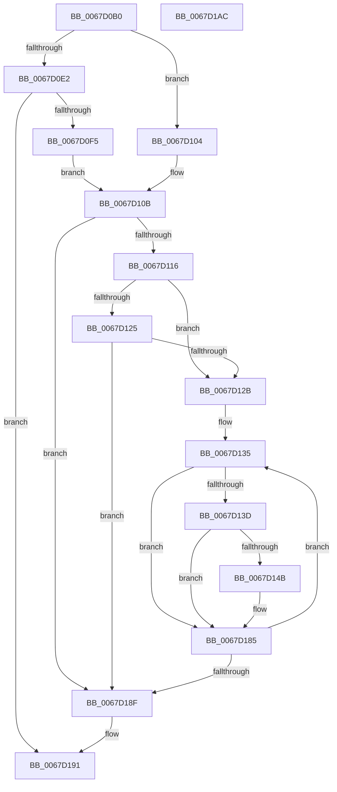

# MiAddPartitionToCrashDump

- RVA: `0x0067D0B0`–`0x0067D1AD` (길이 `253` bytes)
- VA: `0x000000014067D0B0`
- 실행 섹션: `.text`
- PDB 이름 있음: `예`; PDB Function 태그: `아니요`
- unwind 정보 RVA: `0x0005D7BC`
- 디코드: `68`개 명령, `253/253` bytes 표시
- 미해석 바이트: `0` (있으면 어셈블리에 `.byte`로 보존)

> 이 문서는 커널 이미지의 기계어와 PDB 기호를 분석해 생성했습니다. 4번과 5번은 함수 원형과 자료형을 바이너리 사용 방식에서 추정한 C 해석이며 원본 소스 복구 결과는 아닙니다.

## 1. Dependencies

- 직접 호출 지점: **6**; 고유 호출 대상: **3**
- 직접 호출자로 확인된 함수: **1**
- RIP 상대 이미지 참조: **3**

### Outgoing calls
- `0x0067D0E8` → [MmAddRangeToCrashDump](MmAddRangeToCrashDump_function_0067D8B0.md) (function, `0x0067D8B0`)
- `0x0067D10B` → [MmAddRangeToCrashDump](MmAddRangeToCrashDump_function_0067D8B0.md) (function, `0x0067D8B0`)
- `0x0067D142` → [MmIsAddressValidEx](../27/MmIsAddressValidEx_function_0027FDD0.md) (function, `0x0027FDD0`)
- `0x0067D157` → [MmAddRangeToCrashDump](MmAddRangeToCrashDump_function_0067D8B0.md) (function, `0x0067D8B0`)
- `0x0067D169` → [MmAddRangeToCrashDump](MmAddRangeToCrashDump_function_0067D8B0.md) (function, `0x0067D8B0`)
- `0x0067D180` → [MiAddUnicodeStringToCrashDump](MiAddUnicodeStringToCrashDump_function_0067D378.md) (function, `0x0067D378`)

### Direct callers
- [MiAddPartitionDataToCrashDump](MiAddPartitionDataToCrashDump_function_0067CEA8.md) at `0x0067D022`

### Static image references
- `0x0067D0C9` → RVA `0x00E300A0` (`.data`; read)
- `0x0067D0D0` → RVA `0x00E38D00` (`.data`; read)
- `0x0067D0F5` → RVA `0x00E30098` (`.data`; read)

## 2. Other-region calls and transfers

- 다른 실행 섹션으로 향하는 call: **0**
- 별도 외부 분기/꼬리 이동을 확인하지 못했습니다.

## 3. Assembly (complete function range)

```asm
0067D0B0  48 8B C4                        mov rax, rsp
0067D0B3  48 89 58 08                     mov qword ptr [rax + 8], rbx
0067D0B7  48 89 68 10                     mov qword ptr [rax + 0x10], rbp
0067D0BB  48 89 70 18                     mov qword ptr [rax + 0x18], rsi
0067D0BF  48 89 78 20                     mov qword ptr [rax + 0x20], rdi
0067D0C3  41 56                           push r14
0067D0C5  48 83 EC 30                     sub rsp, 0x30
0067D0C9  48 8B 3D D0 2F 7B 00            mov rdi, qword ptr [rip + 0x7b2fd0]
0067D0D0  48 8D 05 29 BC 7B 00            lea rax, [rip + 0x7bbc29]
0067D0D7  48 8B DA                        mov rbx, rdx
0067D0DA  48 8B F1                        mov rsi, rcx
0067D0DD  48 3B D0                        cmp rdx, rax
0067D0E0  75 22                           jne 0x14067d104
0067D0E2  41 B8 40 5D 00 00               mov r8d, 0x5d40
0067D0E8  E8 C3 07 00 00                  call 0x14067d8b0
0067D0ED  85 C0                           test eax, eax
0067D0EF  0F 88 9C 00 00 00               js 0x14067d191
0067D0F5  48 8B 15 9C 2F 7B 00            mov rdx, qword ptr [rip + 0x7b2f9c]
0067D0FC  4C 8B C7                        mov r8, rdi
0067D0FF  48 8B CE                        mov rcx, rsi
0067D102  EB 07                           jmp 0x14067d10b
0067D104  4C 8D 87 40 5D 00 00            lea r8, [rdi + 0x5d40]
0067D10B  E8 A0 07 00 00                  call 0x14067d8b0
0067D110  8B E8                           mov ebp, eax
0067D112  85 C0                           test eax, eax
0067D114  78 79                           js 0x14067d18f
0067D116  8B 83 58 48 00 00               mov eax, dword ptr [rbx + 0x4858]
0067D11C  B9 10 00 00 00                  mov ecx, 0x10
0067D121  3B C1                           cmp eax, ecx
0067D123  77 06                           ja 0x14067d12b
0067D125  8B C8                           mov ecx, eax
0067D127  85 C0                           test eax, eax
0067D129  74 64                           je 0x14067d18f
0067D12B  48 81 C3 60 48 00 00            add rbx, 0x4860
0067D132  44 8B F1                        mov r14d, ecx
0067D135  48 8B 3B                        mov rdi, qword ptr [rbx]
0067D138  48 85 FF                        test rdi, rdi
0067D13B  74 48                           je 0x14067d185
0067D13D  33 D2                           xor edx, edx
0067D13F  48 8B CF                        mov rcx, rdi
0067D142  E8 89 2C C0 FF                  call 0x14027fdd0
0067D147  84 C0                           test al, al
0067D149  74 3A                           je 0x14067d185
0067D14B  41 B8 00 01 00 00               mov r8d, 0x100
0067D151  48 8B D7                        mov rdx, rdi
0067D154  48 8B CE                        mov rcx, rsi
0067D157  E8 54 07 00 00                  call 0x14067d8b0
0067D15C  48 8B 57 18                     mov rdx, qword ptr [rdi + 0x18]
0067D160  41 B8 D8 00 00 00               mov r8d, 0xd8
0067D166  48 8B CE                        mov rcx, rsi
0067D169  E8 42 07 00 00                  call 0x14067d8b0
0067D16E  0F 10 47 40                     movups xmm0, xmmword ptr [rdi + 0x40]
0067D172  48 8D 54 24 20                  lea rdx, [rsp + 0x20]
0067D177  48 8B CE                        mov rcx, rsi
0067D17A  F3 0F 7F 44 24 20               movdqu xmmword ptr [rsp + 0x20], xmm0
0067D180  E8 F3 01 00 00                  call 0x14067d378
0067D185  48 83 C3 08                     add rbx, 8
0067D189  49 83 EE 01                     sub r14, 1
0067D18D  75 A6                           jne 0x14067d135
0067D18F  8B C5                           mov eax, ebp
0067D191  48 8B 5C 24 40                  mov rbx, qword ptr [rsp + 0x40]
0067D196  48 8B 6C 24 48                  mov rbp, qword ptr [rsp + 0x48]
0067D19B  48 8B 74 24 50                  mov rsi, qword ptr [rsp + 0x50]
0067D1A0  48 8B 7C 24 58                  mov rdi, qword ptr [rsp + 0x58]
0067D1A5  48 83 C4 30                     add rsp, 0x30
0067D1A9  41 5E                           pop r14
0067D1AB  C3                              ret
0067D1AC  CC                              int3
```

## 4. C-style interpretation (structured pseudocode)

```c
__int64 __fastcall MiAddPartitionToCrashDump(__int64 a1, __int64 a2)
{
    __int64 result;
    __int64 v_r14;
    __int64 v_rbx;
    __int64 v_rsp;
    unsigned __int64 v_stack_m18;
    unsigned __int64 v_stack_p10;
    unsigned __int64 v_stack_p18;
    unsigned __int64 v_stack_p20;
    unsigned __int64 v_stack_p8;

    *(unsigned __int64 *)(v_rsp + 8) = v_rbx;
    *(unsigned __int64 *)(v_rsp + 16) = v_rbp;
    *(unsigned __int64 *)(v_rsp + 24) = v_rsi;
    *(unsigned __int64 *)(v_rsp + 32) = v_rdi;
    v_rsp = (v_rsp) - (48);
    if (a2 != (v_rip + 8109097)) goto loc_0067D104;
    result = MmAddRangeToCrashDump(a1, a2, (unsigned int)(0x5D40ULL), a4);
    if (sign_flag) goto loc_0067D191;
    goto loc_0067D10B;
loc_0067D104:
loc_0067D10B:
    result = MmAddRangeToCrashDump(a1, *(unsigned __int64 *)(v_rip + 8073116), *(unsigned __int64 *)(v_rip + 8073168) + 23872, a4);
    if (sign_flag) goto loc_0067D18F;
    if (((unsigned int)((unsigned int)(*(unsigned int *)(a2 + 18520)))) > 16) goto loc_0067D12B;
    if ((unsigned int)((unsigned int)(*(unsigned int *)(a2 + 18520))) == 0) goto loc_0067D18F;
loc_0067D12B:
    v_rbx = (a2) + (0x4860ULL);
loc_0067D135:
    if (*(unsigned __int64 *)(v_rbx) == 0) goto loc_0067D185;
    a2 = 0;
    result = MmIsAddressValidEx(*(unsigned __int64 *)(v_rbx), a2, *(unsigned __int64 *)(v_rip + 8073168) + 23872, a4);
    if ((unsigned __int8)(result) != 0) {
        a3 = 256;
        a2 = *(unsigned __int64 *)(v_rbx);
        a1 = a1;
        result = MmAddRangeToCrashDump(a1, a2, a3, a4);
        a2 = *(unsigned __int64 *)(*(unsigned __int64 *)(v_rbx) + 24);
        a3 = 216;
        a1 = a1;
        result = MmAddRangeToCrashDump(a1, a2, a3, a4);
        a2 = v_stack_m18;
        a1 = a1;
        v_stack_m18 = v_xmm0;
        result = MiAddUnicodeStringToCrashDump(a1, a2, a3, a4);
    }
    v_rbx = (v_rbx) + (8);
    v_r14 = ((unsigned int)((unsigned int)((unsigned int)((unsigned int)((unsigned int)(*(unsigned int *)(a2 + 18520))))))) - (1);
    if (condition_is_not_equal) goto loc_0067D135;
loc_0067D18F:
loc_0067D191:
    v_rsp = (v_rsp) + (48);
    return (unsigned int)((unsigned int)((unsigned int)((unsigned int)(result))));
}
```

## 5. (Beta) C Style

```c
int64_t MiAddPartitionToCrashDump(int64_t Arg1, void *Arg2)
{
    uint8_t *arg2 = (uint8_t *)Arg2;

    int64_t result;
    int64_t local_r14;
    int64_t local_rbx;
    int64_t local_rsp;
    uint64_t v_stack_m18;
    uint64_t v_stack_p10;
    uint64_t v_stack_p18;
    uint64_t v_stack_p20;
    uint64_t v_stack_p8;

    *(uint64_t *)(local_rsp + 0x8) = local_rbx;
    *(uint64_t *)(local_rsp + 0x10) = local_rbp;
    *(uint64_t *)(local_rsp + 0x18) = local_rsi;
    *(uint64_t *)(local_rsp + 0x20) = local_rdi;
    local_rsp = (local_rsp) - (48);
    if (Arg2 != (v_rip + 8109097)) goto loc_0067D104;
    result = MmAddRangeToCrashDump(Arg1, Arg2, (uint32_t)(0x5D40ULL), a4);
    if (sign_flag) goto loc_0067D191;
    goto loc_0067D10B;
loc_0067D104:
loc_0067D10B:
    result = MmAddRangeToCrashDump(Arg1, *(uint64_t *)(v_rip + 0x7B2F9C), *(uint64_t *)(v_rip + 0x7B2FD0) + 23872, a4);
    if (sign_flag) goto loc_0067D18F;
    if (((uint32_t)((uint32_t)(*(uint32_t *)(arg2 + 0x4858)))) > 16) goto loc_0067D12B;
    if ((uint32_t)((uint32_t)(*(uint32_t *)(arg2 + 0x4858))) == 0) goto loc_0067D18F;
loc_0067D12B:
    local_rbx = (Arg2) + (0x4860ULL);
loc_0067D135:
    if (*(uint64_t *)(local_rbx) == 0) goto loc_0067D185;
    Arg2 = 0;
    result = MmIsAddressValidEx(*(uint64_t *)(local_rbx), Arg2, *(uint64_t *)(v_rip + 0x7B2FD0) + 23872, a4);
    if ((uint8_t)(result) != 0) {
        a3 = 256;
        Arg2 = *(uint64_t *)(local_rbx);
        Arg1 = Arg1;
        result = MmAddRangeToCrashDump(Arg1, Arg2, a3, a4);
        Arg2 = *(uint64_t *)(*(uint64_t *)(local_rbx) + 0x18);
        a3 = 216;
        Arg1 = Arg1;
        result = MmAddRangeToCrashDump(Arg1, Arg2, a3, a4);
        Arg2 = v_stack_m18;
        Arg1 = Arg1;
        v_stack_m18 = v_xmm0;
        result = MiAddUnicodeStringToCrashDump(Arg1, Arg2, a3, a4);
    }
    local_rbx = (local_rbx) + (8);
    local_r14 = ((uint32_t)((uint32_t)((uint32_t)((uint32_t)((uint32_t)(*(uint32_t *)(arg2 + 0x4858))))))) - (1);
    if (condition_is_not_equal) goto loc_0067D135;
loc_0067D18F:
loc_0067D191:
    local_rsp = (local_rsp) + (48);
    return (uint32_t)((uint32_t)((uint32_t)((uint32_t)(result))));
}
```

### 관측된 메모리 오프셋

구조체 형식이 확인되지 않은 접근은 인자 기준의 오프셋으로만 기록했습니다.

| 기준 인자 | 오프셋 표현 | 폭 (bit) | 접근 |
|---|---:|---:|---|
| `Arg2` | `+ 0x0` | `64` | `R` |
| `Arg2` | `+ 0x4858` | `32` | `R` |

## 6. Execution-region graph

[열기: 2D/3D 그래프와 함수 탐색 컨트롤 패널](../../../control-panel.html?section=text&rva=0x0067D0B0&view=graph)

- 2D 그래프는 위에서 아래로 흐르고, 3D 그래프는 빈 공간을 드래그해 회전합니다. Shift+드래그는 이동, 휠은 확대·축소, 함수 노드 선택은 대상 보고서 이동입니다.

### Static fallback


