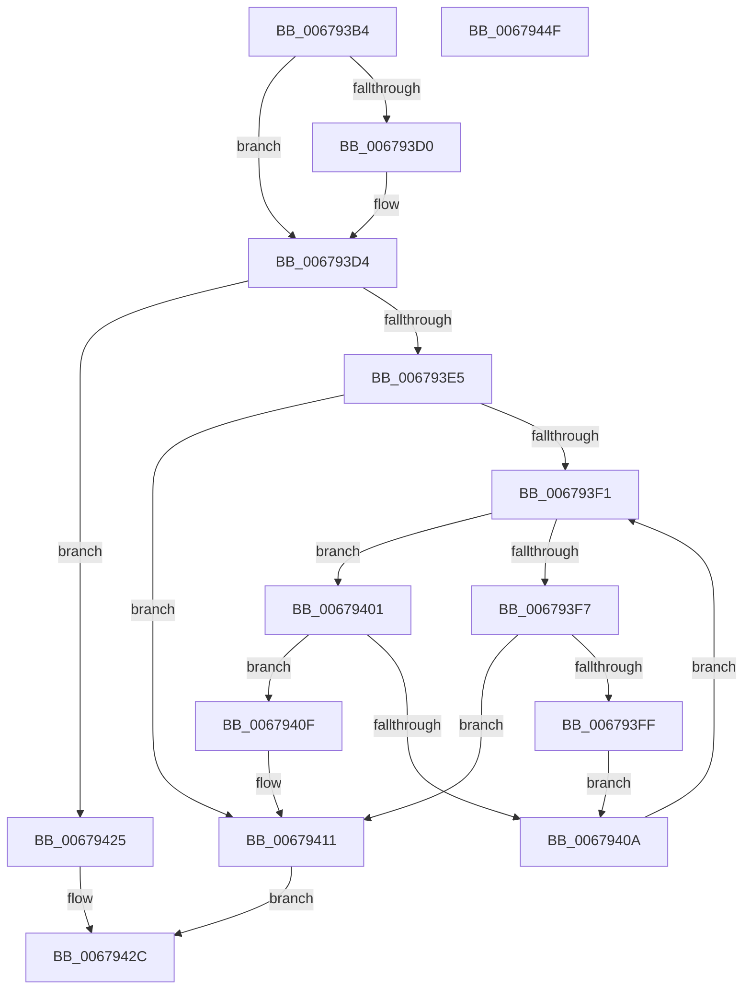

# MiAddPendingBadPageNode

- RVA: `0x006793B4`–`0x00679450` (길이 `156` bytes)
- VA: `0x00000001406793B4`
- 실행 섹션: `.text`
- PDB 이름 있음: `예`; PDB Function 태그: `아니요`
- unwind 정보 RVA: `0x00060BC4`
- 디코드: `44`개 명령, `156/156` bytes 표시
- 미해석 바이트: `0` (있으면 어셈블리에 `.byte`로 보존)

> 이 문서는 커널 이미지의 기계어와 PDB 기호를 분석해 생성했습니다. 4번과 5번은 함수 원형과 자료형을 바이너리 사용 방식에서 추정한 C 해석이며 원본 소스 복구 결과는 아닙니다.

## 1. Dependencies

- 직접 호출 지점: **3**; 고유 호출 대상: **3**
- 직접 호출자로 확인된 함수: **1**
- RIP 상대 이미지 참조: **4**

### Outgoing calls
- `0x006793DB` → [ExAcquireSpinLockExclusiveAtDpcLevel](../24/ExAcquireSpinLockExclusiveAtDpcLevel_function_00248E80.md) (function, `0x00248E80`)
- `0x0067941E` → [RtlAvlInsertNodeEx](../26/RtlAvlInsertNodeEx_function_00265790.md) (function, `0x00265790`)
- `0x0067943A` → [ExReleaseSpinLockExclusiveFromDpcLevel](../24/ExReleaseSpinLockExclusiveFromDpcLevel_function_002497E0.md) (function, `0x002497E0`)

### Direct callers
- [MiSetPfnRemovalRequested](MiSetPfnRemovalRequested_function_0067A4D0.md) at `0x0067A66D`

### Static image references
- `0x006793D4` → RVA `0x00E2FFD0` (`.data`; read)
- `0x006793E5` → RVA `0x00E2FFC0` (`.data`; read)
- `0x00679425` → RVA `0x00E2FFD8` (`.data`; read/write)
- `0x0067942C` → RVA `0x00E2FFC8` (`.data`; read/write)

## 2. Other-region calls and transfers

- 다른 실행 섹션으로 향하는 call: **0**
- 별도 외부 분기/꼬리 이동을 확인하지 못했습니다.

## 3. Assembly (complete function range)

```asm
006793B4  48 89 5C 24 08                  mov qword ptr [rsp + 8], rbx
006793B9  48 89 74 24 10                  mov qword ptr [rsp + 0x10], rsi
006793BE  57                              push rdi
006793BF  48 83 EC 20                     sub rsp, 0x20
006793C3  33 DB                           xor ebx, ebx
006793C5  48 8B FA                        mov rdi, rdx
006793C8  48 8B F1                        mov rsi, rcx
006793CB  48 85 D2                        test rdx, rdx
006793CE  74 04                           je 0x1406793d4
006793D0  48 89 4A 18                     mov qword ptr [rdx + 0x18], rcx
006793D4  48 8D 0D F5 6B 7B 00            lea rcx, [rip + 0x7b6bf5]
006793DB  E8 A0 FA BC FF                  call 0x140248e80
006793E0  48 85 FF                        test rdi, rdi
006793E3  74 40                           je 0x140679425
006793E5  48 8B 15 D4 6B 7B 00            mov rdx, qword ptr [rip + 0x7b6bd4]
006793EC  48 85 D2                        test rdx, rdx
006793EF  74 20                           je 0x140679411
006793F1  48 3B 72 18                     cmp rsi, qword ptr [rdx + 0x18]
006793F5  73 0A                           jae 0x140679401
006793F7  48 8B 02                        mov rax, qword ptr [rdx]
006793FA  48 85 C0                        test rax, rax
006793FD  74 12                           je 0x140679411
006793FF  EB 09                           jmp 0x14067940a
00679401  48 8B 42 08                     mov rax, qword ptr [rdx + 8]
00679405  48 85 C0                        test rax, rax
00679408  74 05                           je 0x14067940f
0067940A  48 8B D0                        mov rdx, rax
0067940D  EB E2                           jmp 0x1406793f1
0067940F  B3 01                           mov bl, 1
00679411  4C 8B CF                        mov r9, rdi
00679414  48 8D 0D A5 6B 7B 00            lea rcx, [rip + 0x7b6ba5]
0067941B  44 8A C3                        mov r8b, bl
0067941E  E8 6D C3 BE FF                  call 0x140265790
00679423  EB 07                           jmp 0x14067942c
00679425  48 FF 05 AC 6B 7B 00            inc qword ptr [rip + 0x7b6bac]
0067942C  48 FF 05 95 6B 7B 00            inc qword ptr [rip + 0x7b6b95]
00679433  48 8D 0D 96 6B 7B 00            lea rcx, [rip + 0x7b6b96]
0067943A  E8 A1 03 BD FF                  call 0x1402497e0
0067943F  48 8B 5C 24 30                  mov rbx, qword ptr [rsp + 0x30]
00679444  48 8B 74 24 38                  mov rsi, qword ptr [rsp + 0x38]
00679449  48 83 C4 20                     add rsp, 0x20
0067944D  5F                              pop rdi
0067944E  C3                              ret
0067944F  CC                              int3
```

## 4. C-style interpretation (structured pseudocode)

```c
__int64 __fastcall MiAddPendingBadPageNode(__int64 a1, __int64 a2)
{
    __int64 result;
    __int64 v_rbx;
    __int64 v_rsp;
    unsigned __int64 v_stack_p10;
    unsigned __int64 v_stack_p8;

    v_stack_p8 = v_rbx;
    v_stack_p10 = v_rsi;
    v_rsp = (v_rsp) - (32);
    v_rbx = 0;
    if (a2 != 0) {
        *(unsigned __int64 *)(a2 + 24) = a1;
    }
    result = ExAcquireSpinLockExclusiveAtDpcLevel(v_rip + 8088565, a2, a3, a4);
    if (a2 == 0) goto loc_00679425;
    if (*(unsigned __int64 *)(v_rip + 8088532) == 0) goto loc_00679411;
loc_006793F1:
    if (a1 >= (*(unsigned __int64 *)(*(unsigned __int64 *)(v_rip + 8088532) + 24))) goto loc_00679401;
    if (*(unsigned __int64 *)(*(unsigned __int64 *)(v_rip + 8088532)) == 0) goto loc_00679411;
    goto loc_0067940A;
loc_00679401:
    if (*(unsigned __int64 *)(*(unsigned __int64 *)(v_rip + 8088532) + 8) == 0) goto loc_0067940F;
loc_0067940A:
    goto loc_006793F1;
loc_0067940F:
loc_00679411:
    result = RtlAvlInsertNodeEx(v_rip + 8088485, *(unsigned __int64 *)(*(unsigned __int64 *)(v_rip + 8088532) + 8), 1, a2);
    goto loc_0067942C;
loc_00679425:
loc_0067942C:
    result = ExReleaseSpinLockExclusiveFromDpcLevel(v_rip + 8088470, *(unsigned __int64 *)(*(unsigned __int64 *)(v_rip + 8088532) + 8), 1, a2);
    v_rsp = (v_rsp) + (32);
    return result;
}
```

## 5. (Beta) C Style

```c
int64_t MiAddPendingBadPageNode(int64_t Arg1, int64_t Arg2)
{
    int64_t result;
    int64_t local_rbx;
    int64_t local_rsp;
    uint64_t v_stack_p10;
    uint64_t v_stack_p8;

    v_stack_p8 = local_rbx;
    v_stack_p10 = local_rsi;
    local_rsp = (local_rsp) - (32);
    local_rbx = 0;
    if (Arg2 != 0) {
        *(uint64_t *)(Arg2 + 0x18) = Arg1;
    }
    result = ExAcquireSpinLockExclusiveAtDpcLevel(v_rip + 8088565, Arg2, a3, a4);
    if (Arg2 == 0) goto loc_00679425;
    if (*(uint64_t *)(v_rip + 0x7B6BD4) == 0) goto loc_00679411;
loc_006793F1:
    if (Arg1 >= (*(uint64_t *)(*(uint64_t *)(v_rip + 0x7B6BD4) + 0x18))) goto loc_00679401;
    if (*(uint64_t *)(*(uint64_t *)(v_rip + 0x7B6BD4)) == 0) goto loc_00679411;
    goto loc_0067940A;
loc_00679401:
    if (*(uint64_t *)(*(uint64_t *)(v_rip + 0x7B6BD4) + 0x8) == 0) goto loc_0067940F;
loc_0067940A:
    goto loc_006793F1;
loc_0067940F:
loc_00679411:
    result = RtlAvlInsertNodeEx(v_rip + 8088485, *(uint64_t *)(*(uint64_t *)(v_rip + 0x7B6BD4) + 0x8), 1, Arg2);
    goto loc_0067942C;
loc_00679425:
loc_0067942C:
    result = ExReleaseSpinLockExclusiveFromDpcLevel(v_rip + 8088470, *(uint64_t *)(*(uint64_t *)(v_rip + 0x7B6BD4) + 0x8), 1, Arg2);
    local_rsp = (local_rsp) + (32);
    return result;
}
```

## 6. Execution-region graph

[열기: 2D/3D 그래프와 함수 탐색 컨트롤 패널](../../../control-panel.html?section=text&rva=0x006793B4&view=graph)

- 2D 그래프는 위에서 아래로 흐르고, 3D 그래프는 빈 공간을 드래그해 회전합니다. Shift+드래그는 이동, 휠은 확대·축소, 함수 노드 선택은 대상 보고서 이동입니다.

### Static fallback


