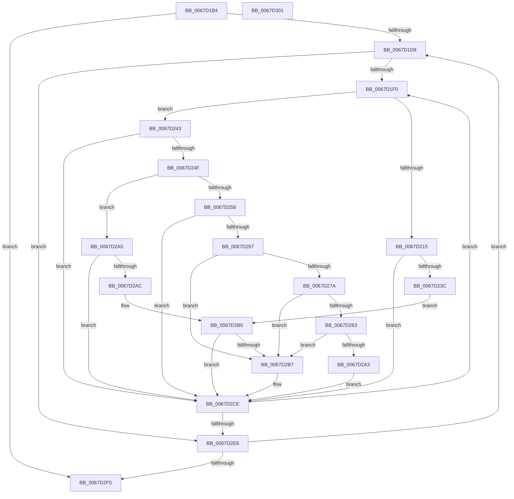

# MiAddPhysicalPagesToCrashDump

- RVA: `0x0067D1B4`–`0x0067D302` (길이 `334` bytes)
- VA: `0x000000014067D1B4`
- 실행 섹션: `.text`
- PDB 이름 있음: `예`; PDB Function 태그: `아니요`
- unwind 정보 RVA: `0x000BCB98`
- 디코드: `94`개 명령, `334/334` bytes 표시
- 미해석 바이트: `0` (있으면 어셈블리에 `.byte`로 보존)

> 이 문서는 커널 이미지의 기계어와 PDB 기호를 분석해 생성했습니다. 4번과 5번은 함수 원형과 자료형을 바이너리 사용 방식에서 추정한 C 해석이며 원본 소스 복구 결과는 아닙니다.

## 1. Dependencies

- 직접 호출 지점: **2**; 고유 호출 대상: **2**
- 직접 호출자로 확인된 함수: **1**
- RIP 상대 이미지 참조: **1**

### Outgoing calls
- `0x0067D229` → [MiGetPagesRemainingInResidentPage](../68/MiGetPagesRemainingInResidentPage_function_0068AC14.md) (function, `0x0068AC14`)
- `0x0067D2C9` → [guard_dispatch_icall](../6B/guard_dispatch_icall_function_006BAAD0.md) (function, `0x006BAAD0`)

### Direct callers
- [MmGetDumpRange](MmGetDumpRange_function_0067DA68.md) at `0x0067DB41`

### Static image references
- `0x0067D1C4` → RVA `0x00FC6B88` (`ALMOSTRO`; read)

## 2. Other-region calls and transfers

- 다른 실행 섹션으로 향하는 call: **0**
- 별도 외부 분기/꼬리 이동을 확인하지 못했습니다.

## 3. Assembly (complete function range)

```asm
0067D1B4  48 89 5C 24 08                  mov qword ptr [rsp + 8], rbx
0067D1B9  55                              push rbp
0067D1BA  56                              push rsi
0067D1BB  57                              push rdi
0067D1BC  41 56                           push r14
0067D1BE  41 57                           push r15
0067D1C0  48 83 EC 30                     sub rsp, 0x30
0067D1C4  48 8B 05 BD 99 94 00            mov rax, qword ptr [rip + 0x9499bd]
0067D1CB  33 DB                           xor ebx, ebx
0067D1CD  4C 8B F9                        mov r15, rcx
0067D1D0  39 18                           cmp dword ptr [rax], ebx
0067D1D2  0F 86 18 01 00 00               jbe 0x14067d2f0
0067D1D8  8B FB                           mov edi, ebx
0067D1DA  45 33 F6                        xor r14d, r14d
0067D1DD  48 03 FF                        add rdi, rdi
0067D1E0  48 8B 74 F8 10                  mov rsi, qword ptr [rax + rdi*8 + 0x10]
0067D1E5  4C 39 74 F8 18                  cmp qword ptr [rax + rdi*8 + 0x18], r14
0067D1EA  0F 86 F6 00 00 00               jbe 0x14067d2e6
0067D1F0  48 8D 0C 76                     lea rcx, [rsi + rsi*2]
0067D1F4  48 C1 E1 04                     shl rcx, 4
0067D1F8  48 B8 00 00 00 00 00 DE FF FF   movabs rax, 0xffffde0000000000
0067D202  48 03 C8                        add rcx, rax
0067D205  BD 01 00 00 00                  mov ebp, 1
0067D20A  48 8B 41 28                     mov rax, qword ptr [rcx + 0x28]
0067D20E  48 0F BA E0 28                  bt rax, 0x28
0067D213  73 2E                           jae 0x14067d243
0067D215  83 64 24 68 00                  and dword ptr [rsp + 0x68], 0
0067D21A  4C 8D 44 24 70                  lea r8, [rsp + 0x70]
0067D21F  83 64 24 70 00                  and dword ptr [rsp + 0x70], 0
0067D224  48 8D 54 24 68                  lea rdx, [rsp + 0x68]
0067D229  E8 E6 D9 00 00                  call 0x14068ac14
0067D22E  83 7C 24 68 06                  cmp dword ptr [rsp + 0x68], 6
0067D233  48 8B E8                        mov rbp, rax
0067D236  0F 85 92 00 00 00               jne 0x14067d2ce
0067D23C  83 7C 24 70 01                  cmp dword ptr [rsp + 0x70], 1
0067D241  EB 72                           jmp 0x14067d2b5
0067D243  8B 41 20                        mov eax, dword ptr [rcx + 0x20]
0067D246  C1 E8 10                        shr eax, 0x10
0067D249  24 C0                           and al, 0xc0
0067D24B  3C 40                           cmp al, 0x40
0067D24D  75 7F                           jne 0x14067d2ce
0067D24F  8A 41 22                        mov al, byte ptr [rcx + 0x22]
0067D252  24 07                           and al, 7
0067D254  3C 06                           cmp al, 6
0067D256  75 4D                           jne 0x14067d2a5
0067D258  48 8B 41 28                     mov rax, qword ptr [rcx + 0x28]
0067D25C  48 C1 E8 3C                     shr rax, 0x3c
0067D260  24 07                           and al, 7
0067D262  40 3A C5                        cmp al, bpl
0067D265  74 67                           je 0x14067d2ce
0067D267  48 8B 41 18                     mov rax, qword ptr [rcx + 0x18]
0067D26B  48 BA FF FF FF FF FF FF FF 3F   movabs rdx, 0x3fffffffffffffff
0067D275  48 85 C2                        test rdx, rax
0067D278  74 3D                           je 0x14067d2b7
0067D27A  8A 41 22                        mov al, byte ptr [rcx + 0x22]
0067D27D  24 07                           and al, 7
0067D27F  3C 06                           cmp al, 6
0067D281  75 34                           jne 0x14067d2b7
0067D283  48 8B 41 28                     mov rax, qword ptr [rcx + 0x28]
0067D287  48 B9 FF FF FF FF FF 00 00 00   movabs rcx, 0xffffffffff
0067D291  48 23 C1                        and rax, rcx
0067D294  48 B9 FE FF FF FF 3F 00 00 00   movabs rcx, 0x3ffffffffe
0067D29E  48 3B C1                        cmp rax, rcx
0067D2A1  75 14                           jne 0x14067d2b7
0067D2A3  EB 29                           jmp 0x14067d2ce
0067D2A5  2C 02                           sub al, 2
0067D2A7  40 3A C5                        cmp al, bpl
0067D2AA  77 22                           ja 0x14067d2ce
0067D2AC  8B 41 10                        mov eax, dword ptr [rcx + 0x10]
0067D2AF  48 A9 00 04 00 00               test rax, 0x400
0067D2B5  75 17                           jne 0x14067d2ce
0067D2B7  49 8B 07                        mov rax, qword ptr [r15]
0067D2BA  41 B9 02 00 00 00               mov r9d, 2
0067D2C0  4C 8B C5                        mov r8, rbp
0067D2C3  48 8B D6                        mov rdx, rsi
0067D2C6  49 8B CF                        mov rcx, r15
0067D2C9  E8 02 D8 03 00                  call 0x1406baad0
0067D2CE  48 8B 05 B3 98 94 00            mov rax, qword ptr [rip + 0x9498b3]
0067D2D5  4C 03 F5                        add r14, rbp
0067D2D8  48 03 F5                        add rsi, rbp
0067D2DB  4C 3B 74 F8 18                  cmp r14, qword ptr [rax + rdi*8 + 0x18]
0067D2E0  0F 82 0A FF FF FF               jb 0x14067d1f0
0067D2E6  FF C3                           inc ebx
0067D2E8  3B 18                           cmp ebx, dword ptr [rax]
0067D2EA  0F 82 E8 FE FF FF               jb 0x14067d1d8
0067D2F0  48 8B 5C 24 60                  mov rbx, qword ptr [rsp + 0x60]
0067D2F5  48 83 C4 30                     add rsp, 0x30
0067D2F9  41 5F                           pop r15
0067D2FB  41 5E                           pop r14
0067D2FD  5F                              pop rdi
0067D2FE  5E                              pop rsi
0067D2FF  5D                              pop rbp
0067D300  C3                              ret
0067D301  CC                              int3
```

## 4. C-style interpretation (structured pseudocode)

```c
__int64 __fastcall MiAddPhysicalPagesToCrashDump(__int64 a1)
{
    __int64 result;
    __int64 v_r14;
    __int64 v_rbx;
    __int64 v_rdi;
    __int64 v_rsi;
    __int64 v_rsp;
    unsigned int v_stack_p10;
    unsigned __int64 v_stack_p18;
    unsigned __int64 v_stack_p8;

    v_stack_p8 = v_rbx;
    v_rsp = (v_rsp) - (48);
    v_rbx = 0;
    if ((*(unsigned int *)(*(unsigned __int64 *)(v_rip + 9738685))) <= 0) goto loc_0067D2F0;
loc_0067D1D8:
    v_r14 = 0;
    v_rdi = (0) + (0);
    if ((*(unsigned __int64 *)(*(unsigned __int64 *)(v_rip + 9738685) + v_rdi * 8 + 24)) <= 0) goto loc_0067D2E6;
loc_0067D1F0:
    a1 = (*(unsigned __int64 *)(*(unsigned __int64 *)(v_rip + 9738685) + v_rdi * 8 + 16) + *(unsigned __int64 *)(*(unsigned __int64 *)(v_rip + 9738685) + v_rdi * 8 + 16) * 2) << (4);
    a1 = (a1) + (*(unsigned __int64 *)(v_rip + 9738685));
    if (condition_is_above_or_equal) goto loc_0067D243;
    result = MiGetPagesRemainingInResidentPage(a1, v_stack_p10, v_stack_p18, a4);
    if (v_stack_p10 != 6) goto loc_0067D2CE;
    goto loc_0067D2B5;
loc_0067D243:
    result = (unsigned int)(((unsigned int)(*(unsigned int *)(a1 + 32))) >> (16));
    result = (unsigned __int8)((result) & (192));
    if (((unsigned __int8)(result)) != 64) goto loc_0067D2CE;
    result = (unsigned __int8)((*(unsigned __int8 *)(a1 + 34)) & (7));
    if (((unsigned __int8)(result)) != 6) goto loc_0067D2A5;
    result = (*(unsigned __int64 *)(a1 + 40)) >> (60);
    result = (unsigned __int8)((result) & (7));
    if (((unsigned __int8)(result)) == ((unsigned __int8)(result))) goto loc_0067D2CE;
    if (((v_stack_p10) & (*(unsigned __int64 *)(a1 + 24))) == 0) goto loc_0067D2B7;
    result = (unsigned __int8)((*(unsigned __int8 *)(a1 + 34)) & (7));
    if (((unsigned __int8)(result)) != 6) goto loc_0067D2B7;
    result = (*(unsigned __int64 *)(a1 + 40)) & (a1);
    if (result != a1) goto loc_0067D2B7;
    goto loc_0067D2CE;
loc_0067D2A5:
    result = (unsigned __int8)((result) - (2));
    if (((unsigned __int8)(result)) > ((unsigned __int8)(result))) goto loc_0067D2CE;
loc_0067D2B5:
    result = (unsigned int)(*(unsigned int *)(a1 + 16));
    if ((((unsigned int)(*(unsigned int *)(a1 + 16))) & (0x400ULL)) == 0) {
        result = *(unsigned __int64 *)(a1);
        a4 = 2;
        a3 = result;
        a2 = *(unsigned __int64 *)(*(unsigned __int64 *)(v_rip + 9738685) + v_rdi * 8 + 16);
        a1 = a1;
        result = guard_dispatch_icall(a1, a2, a3, a4);
    }
    v_r14 = (v_r14) + (result);
    v_rsi = (*(unsigned __int64 *)(*(unsigned __int64 *)(v_rip + 9738685) + v_rdi * 8 + 16)) + (result);
    if (v_r14 < (*(unsigned __int64 *)(*(unsigned __int64 *)(v_rip + 9738419) + v_rdi * 8 + 24))) goto loc_0067D1F0;
loc_0067D2E6:
    v_rbx = (unsigned int)((v_rbx) + 1);
    if (((unsigned int)(v_rbx)) < (*(unsigned int *)(*(unsigned __int64 *)(v_rip + 9738419)))) goto loc_0067D1D8;
loc_0067D2F0:
    v_rsp = (v_rsp) + (48);
    return *(unsigned __int64 *)(v_rip + 9738419);
}
```

## 5. (Beta) C Style

```c
int64_t MiAddPhysicalPagesToCrashDump(void *Arg1)
{
    uint8_t *arg1 = (uint8_t *)Arg1;

    int64_t result;
    int64_t local_r14;
    int64_t local_rbx;
    int64_t local_rdi;
    int64_t local_rsi;
    int64_t local_rsp;
    uint32_t v_stack_p10;
    uint64_t v_stack_p18;
    uint64_t v_stack_p8;

    v_stack_p8 = local_rbx;
    local_rsp = (local_rsp) - (48);
    local_rbx = 0;
    if ((*(uint32_t *)(*(uint64_t *)(v_rip + 0x9499BD))) <= 0) goto loc_0067D2F0;
loc_0067D1D8:
    local_r14 = 0;
    local_rdi = (0) + (0);
    if ((*(uint64_t *)(*(uint64_t *)(v_rip + 0x9499BD) + local_rdi * 8 + 0x18)) <= 0) goto loc_0067D2E6;
loc_0067D1F0:
    Arg1 = (*(uint64_t *)(*(uint64_t *)(v_rip + 0x9499BD) + local_rdi * 8 + 0x10) + *(uint64_t *)(*(uint64_t *)(v_rip + 0x9499BD) + local_rdi * 8 + 0x10) * 2) << (4);
    Arg1 = (Arg1) + (*(uint64_t *)(v_rip + 0x9499BD));
    if (condition_is_above_or_equal) goto loc_0067D243;
    result = MiGetPagesRemainingInResidentPage(Arg1, v_stack_p10, v_stack_p18, a4);
    if (v_stack_p10 != 6) goto loc_0067D2CE;
    goto loc_0067D2B5;
loc_0067D243:
    result = (uint32_t)(((uint32_t)(*(uint32_t *)(arg1 + 0x20))) >> (16));
    result = (uint8_t)((result) & (192));
    if (((uint8_t)(result)) != 64) goto loc_0067D2CE;
    result = (uint8_t)((*(uint8_t *)(arg1 + 0x22)) & (7));
    if (((uint8_t)(result)) != 6) goto loc_0067D2A5;
    result = (*(uint64_t *)(arg1 + 0x28)) >> (60);
    result = (uint8_t)((result) & (7));
    if (((uint8_t)(result)) == ((uint8_t)(result))) goto loc_0067D2CE;
    if (((v_stack_p10) & (*(uint64_t *)(arg1 + 0x18))) == 0) goto loc_0067D2B7;
    result = (uint8_t)((*(uint8_t *)(arg1 + 0x22)) & (7));
    if (((uint8_t)(result)) != 6) goto loc_0067D2B7;
    result = (*(uint64_t *)(arg1 + 0x28)) & (Arg1);
    if (result != Arg1) goto loc_0067D2B7;
    goto loc_0067D2CE;
loc_0067D2A5:
    result = (uint8_t)((result) - (2));
    if (((uint8_t)(result)) > ((uint8_t)(result))) goto loc_0067D2CE;
loc_0067D2B5:
    result = (uint32_t)(*(uint32_t *)(arg1 + 0x10));
    if ((((uint32_t)(*(uint32_t *)(arg1 + 0x10))) & (0x400ULL)) == 0) {
        result = *(uint64_t *)(arg1);
        a4 = 2;
        a3 = result;
        a2 = *(uint64_t *)(*(uint64_t *)(v_rip + 0x9499BD) + local_rdi * 8 + 0x10);
        Arg1 = Arg1;
        result = guard_dispatch_icall(Arg1, a2, a3, a4);
    }
    local_r14 = (local_r14) + (result);
    local_rsi = (*(uint64_t *)(*(uint64_t *)(v_rip + 0x9499BD) + local_rdi * 8 + 0x10)) + (result);
    if (local_r14 < (*(uint64_t *)(*(uint64_t *)(v_rip + 0x9498B3) + local_rdi * 8 + 0x18))) goto loc_0067D1F0;
loc_0067D2E6:
    local_rbx = (uint32_t)((local_rbx) + 1);
    if (((uint32_t)(local_rbx)) < (*(uint32_t *)(*(uint64_t *)(v_rip + 0x9498B3)))) goto loc_0067D1D8;
loc_0067D2F0:
    local_rsp = (local_rsp) + (48);
    return *(uint64_t *)(v_rip + 0x9498B3);
}
```

### 관측된 메모리 오프셋

구조체 형식이 확인되지 않은 접근은 인자 기준의 오프셋으로만 기록했습니다.

| 기준 인자 | 오프셋 표현 | 폭 (bit) | 접근 |
|---|---:|---:|---|
| `Arg1` | `+ 0x0` | `64` | `R` |

## 6. Execution-region graph

[열기: 2D/3D 그래프와 함수 탐색 컨트롤 패널](../../../control-panel.html?section=text&rva=0x0067D1B4&view=graph)

- 2D 그래프는 위에서 아래로 흐르고, 3D 그래프는 빈 공간을 드래그해 회전합니다. Shift+드래그는 이동, 휠은 확대·축소, 함수 노드 선택은 대상 보고서 이동입니다.

### Static fallback


