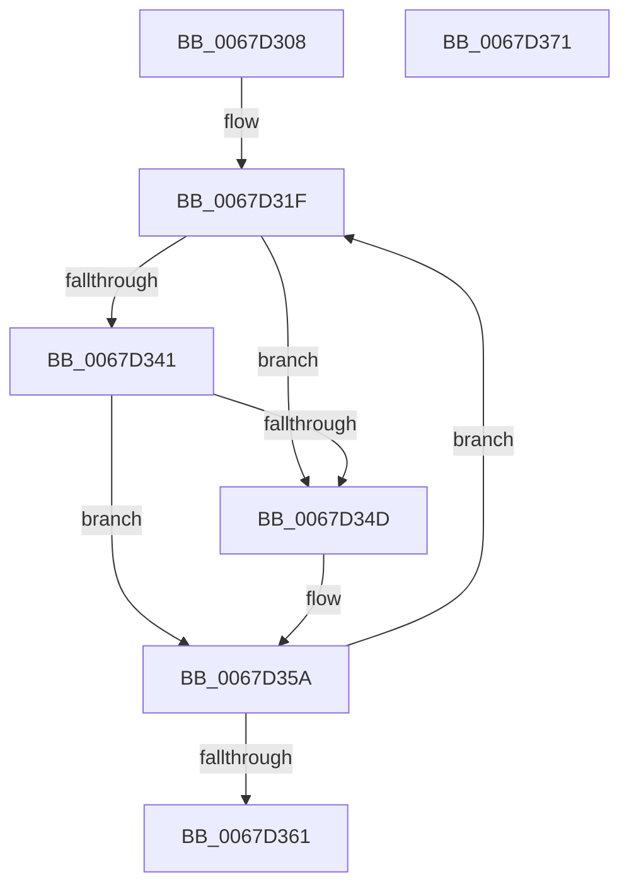

# MiAddTriageDumpPtes

- RVA: `0x0067D308`–`0x0067D372` (길이 `106` bytes)
- VA: `0x000000014067D308`
- 실행 섹션: `.text`
- PDB 이름 있음: `예`; PDB Function 태그: `아니요`
- unwind 정보 RVA: `0x00060BC4`
- 디코드: `30`개 명령, `106/106` bytes 표시
- 미해석 바이트: `0` (있으면 어셈블리에 `.byte`로 보존)

> 이 문서는 커널 이미지의 기계어와 PDB 기호를 분석해 생성했습니다. 4번과 5번은 함수 원형과 자료형을 바이너리 사용 방식에서 추정한 C 해석이며 원본 소스 복구 결과는 아닙니다.

## 1. Dependencies

- 직접 호출 지점: **2**; 고유 호출 대상: **2**
- 직접 호출자로 확인된 함수: **1**
- RIP 상대 이미지 참조: **0**

### Outgoing calls
- `0x0067D344` → [MI_IS_PHYSICAL_ADDRESS](../23/MI_IS_PHYSICAL_ADDRESS_function_0023B3A0.md) (function, `0x0023B3A0`)
- `0x0067D355` → [IoAddTriageDumpDataBlock](../42/IoAddTriageDumpDataBlock_function_00428374.md) (function, `0x00428374`)

### Direct callers
- [MmSnapTriageDumpInformation](MmSnapTriageDumpInformation_function_0067DE28.md) at `0x0067DF14`
- [MmSnapTriageDumpInformation](MmSnapTriageDumpInformation_function_0067DE28.md) at `0x0067DF36`

### Static image references
- 디코드된 RIP-relative 메모리 참조가 없습니다.

## 2. Other-region calls and transfers

- 다른 실행 섹션으로 향하는 call: **0**
- 별도 외부 분기/꼬리 이동을 확인하지 못했습니다.

## 3. Assembly (complete function range)

```asm
0067D308  48 89 5C 24 08                  mov qword ptr [rsp + 8], rbx
0067D30D  48 89 74 24 10                  mov qword ptr [rsp + 0x10], rsi
0067D312  57                              push rdi
0067D313  48 83 EC 20                     sub rsp, 0x20
0067D317  48 8B F1                        mov rsi, rcx
0067D31A  48 8B D9                        mov rbx, rcx
0067D31D  33 FF                           xor edi, edi
0067D31F  48 C1 EB 09                     shr rbx, 9
0067D323  48 B8 F8 FF FF FF 7F 00 00 00   movabs rax, 0x7ffffffff8
0067D32D  48 23 D8                        and rbx, rax
0067D330  48 B8 00 00 00 00 80 F6 FF FF   movabs rax, 0xfffff68000000000
0067D33A  48 03 D8                        add rbx, rax
0067D33D  85 FF                           test edi, edi
0067D33F  75 0C                           jne 0x14067d34d
0067D341  48 8B CE                        mov rcx, rsi
0067D344  E8 57 E0 BB FF                  call 0x14023b3a0
0067D349  85 C0                           test eax, eax
0067D34B  75 0D                           jne 0x14067d35a
0067D34D  BA 08 00 00 00                  mov edx, 8
0067D352  48 8B CB                        mov rcx, rbx
0067D355  E8 1A B0 DA FF                  call 0x140428374
0067D35A  FF C7                           inc edi
0067D35C  83 FF 04                        cmp edi, 4
0067D35F  72 BE                           jb 0x14067d31f
0067D361  48 8B 5C 24 30                  mov rbx, qword ptr [rsp + 0x30]
0067D366  48 8B 74 24 38                  mov rsi, qword ptr [rsp + 0x38]
0067D36B  48 83 C4 20                     add rsp, 0x20
0067D36F  5F                              pop rdi
0067D370  C3                              ret
0067D371  CC                              int3
```

## 4. C-style interpretation (structured pseudocode)

```c
__int64 __fastcall MiAddTriageDumpPtes(__int64 a1)
{
    __int64 result;
    __int64 v_rbx;
    __int64 v_rdi;
    __int64 v_rsp;
    unsigned __int64 v_stack_p10;
    unsigned __int64 v_stack_p8;

    v_stack_p8 = v_rbx;
    v_stack_p10 = v_rsi;
    v_rsp = (v_rsp) - (32);
    v_rdi = 0;
loc_0067D31F:
    v_rbx = (a1) >> (9);
    v_rbx = (v_rbx) & (result);
    v_rbx = (v_rbx) + (result);
    if (0 != 0) goto loc_0067D34D;
    result = MI_IS_PHYSICAL_ADDRESS(a1, a2, a3, a4);
    if ((unsigned int)(result) == 0) {
        a2 = 8;
        a1 = v_rbx;
        result = IoAddTriageDumpDataBlock(a1, a2, a3, a4);
    }
    v_rdi = (unsigned int)((v_rdi) + 1);
    if (((unsigned int)(v_rdi)) < 4) goto loc_0067D31F;
    v_rsp = (v_rsp) + (32);
    return result;
}
```

## 5. (Beta) C Style

```c
int64_t MiAddTriageDumpPtes(int64_t Arg1)
{
    int64_t result;
    int64_t local_rbx;
    int64_t local_rdi;
    int64_t local_rsp;
    uint64_t v_stack_p10;
    uint64_t v_stack_p8;

    v_stack_p8 = local_rbx;
    v_stack_p10 = local_rsi;
    local_rsp = (local_rsp) - (32);
    local_rdi = 0;
loc_0067D31F:
    local_rbx = (Arg1) >> (9);
    local_rbx = (local_rbx) & (result);
    local_rbx = (local_rbx) + (result);
    if (0 != 0) goto loc_0067D34D;
    result = MI_IS_PHYSICAL_ADDRESS(Arg1, a2, a3, a4);
    if ((uint32_t)(result) == 0) {
        a2 = 8;
        Arg1 = local_rbx;
        result = IoAddTriageDumpDataBlock(Arg1, a2, a3, a4);
    }
    local_rdi = (uint32_t)((local_rdi) + 1);
    if (((uint32_t)(local_rdi)) < 4) goto loc_0067D31F;
    local_rsp = (local_rsp) + (32);
    return result;
}
```

## 6. Execution-region graph

[열기: 2D/3D 그래프와 함수 탐색 컨트롤 패널](../../../control-panel.html?section=text&rva=0x0067D308&view=graph)

- 2D 그래프는 위에서 아래로 흐르고, 3D 그래프는 빈 공간을 드래그해 회전합니다. Shift+드래그는 이동, 휠은 확대·축소, 함수 노드 선택은 대상 보고서 이동입니다.

### Static fallback


