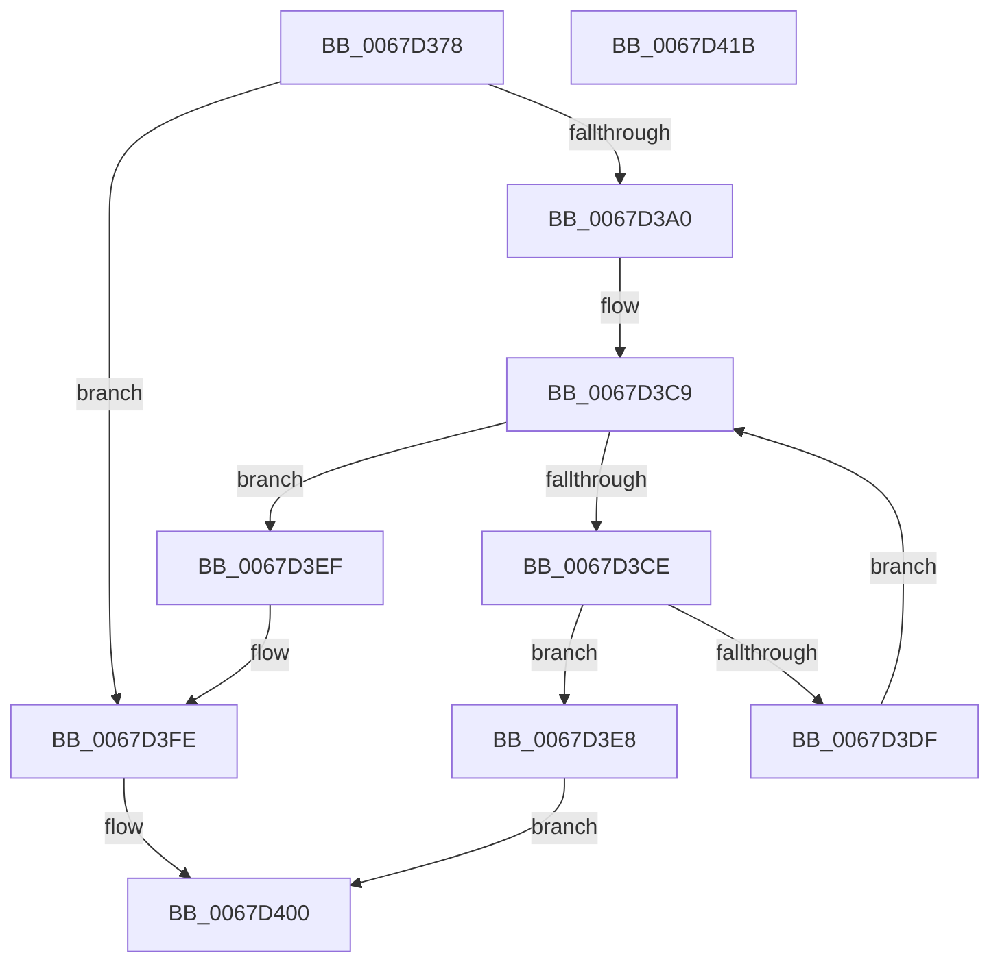

# MiAddUnicodeStringToCrashDump

- RVA: `0x0067D378`–`0x0067D41C` (길이 `164` bytes)
- VA: `0x000000014067D378`
- 실행 섹션: `.text`
- PDB 이름 있음: `예`; PDB Function 태그: `아니요`
- unwind 정보 RVA: `0x0005E6B4`
- 디코드: `46`개 명령, `164/164` bytes 표시
- 미해석 바이트: `0` (있으면 어셈블리에 `.byte`로 보존)

> 이 문서는 커널 이미지의 기계어와 PDB 기호를 분석해 생성했습니다. 4번과 5번은 함수 원형과 자료형을 바이너리 사용 방식에서 추정한 C 해석이며 원본 소스 복구 결과는 아닙니다.

## 1. Dependencies

- 직접 호출 지점: **2**; 고유 호출 대상: **2**
- 직접 호출자로 확인된 함수: **1**
- RIP 상대 이미지 참조: **0**

### Outgoing calls
- `0x0067D3D6` → [MmIsAddressValidEx](../27/MmIsAddressValidEx_function_0027FDD0.md) (function, `0x0027FDD0`)
- `0x0067D3F9` → [MmAddRangeToCrashDump](MmAddRangeToCrashDump_function_0067D8B0.md) (function, `0x0067D8B0`)

### Direct callers
- [MiAddPartitionToCrashDump](MiAddPartitionToCrashDump_function_0067D0B0.md) at `0x0067D180`

### Static image references
- 디코드된 RIP-relative 메모리 참조가 없습니다.

## 2. Other-region calls and transfers

- 다른 실행 섹션으로 향하는 call: **0**
- 별도 외부 분기/꼬리 이동을 확인하지 못했습니다.

## 3. Assembly (complete function range)

```asm
0067D378  48 8B C4                        mov rax, rsp
0067D37B  48 89 58 08                     mov qword ptr [rax + 8], rbx
0067D37F  48 89 68 10                     mov qword ptr [rax + 0x10], rbp
0067D383  48 89 70 18                     mov qword ptr [rax + 0x18], rsi
0067D387  48 89 78 20                     mov qword ptr [rax + 0x20], rdi
0067D38B  41 56                           push r14
0067D38D  48 83 EC 20                     sub rsp, 0x20
0067D391  48 8B FA                        mov rdi, rdx
0067D394  48 8B E9                        mov rbp, rcx
0067D397  0F B7 52 02                     movzx edx, word ptr [rdx + 2]
0067D39B  66 85 D2                        test dx, dx
0067D39E  74 5E                           je 0x14067d3fe
0067D3A0  48 8B 47 08                     mov rax, qword ptr [rdi + 8]
0067D3A4  48 8D B2 FF 0F 00 00            lea rsi, [rdx + 0xfff]
0067D3AB  48 8B D8                        mov rbx, rax
0067D3AE  48 C7 C1 00 F0 FF FF            mov rcx, 0xfffffffffffff000
0067D3B5  25 FF 0F 00 00                  and eax, 0xfff
0067D3BA  48 23 D9                        and rbx, rcx
0067D3BD  48 03 F0                        add rsi, rax
0067D3C0  44 8B F2                        mov r14d, edx
0067D3C3  48 23 F1                        and rsi, rcx
0067D3C6  48 03 F3                        add rsi, rbx
0067D3C9  48 3B DE                        cmp rbx, rsi
0067D3CC  73 21                           jae 0x14067d3ef
0067D3CE  BA 01 00 00 00                  mov edx, 1
0067D3D3  48 8B CB                        mov rcx, rbx
0067D3D6  E8 F5 29 C0 FF                  call 0x14027fdd0
0067D3DB  84 C0                           test al, al
0067D3DD  74 09                           je 0x14067d3e8
0067D3DF  48 81 C3 00 10 00 00            add rbx, 0x1000
0067D3E6  EB E1                           jmp 0x14067d3c9
0067D3E8  B8 01 00 00 C0                  mov eax, 0xc0000001
0067D3ED  EB 11                           jmp 0x14067d400
0067D3EF  48 8B 57 08                     mov rdx, qword ptr [rdi + 8]
0067D3F3  4D 8B C6                        mov r8, r14
0067D3F6  48 8B CD                        mov rcx, rbp
0067D3F9  E8 B2 04 00 00                  call 0x14067d8b0
0067D3FE  33 C0                           xor eax, eax
0067D400  48 8B 5C 24 30                  mov rbx, qword ptr [rsp + 0x30]
0067D405  48 8B 6C 24 38                  mov rbp, qword ptr [rsp + 0x38]
0067D40A  48 8B 74 24 40                  mov rsi, qword ptr [rsp + 0x40]
0067D40F  48 8B 7C 24 48                  mov rdi, qword ptr [rsp + 0x48]
0067D414  48 83 C4 20                     add rsp, 0x20
0067D418  41 5E                           pop r14
0067D41A  C3                              ret
0067D41B  CC                              int3
```

## 4. C-style interpretation (structured pseudocode)

```c
__int64 __fastcall MiAddUnicodeStringToCrashDump(__int64 a1, __int64 a2)
{
    __int64 result;
    __int64 v_rbx;
    __int64 v_rsi;
    __int64 v_rsp;
    unsigned __int64 v_stack_p10;
    unsigned __int64 v_stack_p18;
    unsigned __int64 v_stack_p20;
    unsigned __int64 v_stack_p8;

    *(unsigned __int64 *)(v_rsp + 8) = v_rbx;
    *(unsigned __int64 *)(v_rsp + 16) = v_rbp;
    *(unsigned __int64 *)(v_rsp + 24) = v_rsi;
    *(unsigned __int64 *)(v_rsp + 32) = v_rdi;
    v_rsp = (v_rsp) - (32);
    if ((unsigned __int16)(*(unsigned __int16 *)(a2 + 2)) == 0) goto loc_0067D3FE;
    result = (unsigned int)((*(unsigned __int64 *)(a2 + 8)) & (0xFFFULL));
    v_rbx = (*(unsigned __int64 *)(a2 + 8)) & (0xFFFFFFFFFFFFF000ULL);
    v_rsi = (*(unsigned __int16 *)(a2 + 2) + 4095) + (result);
    v_rsi = (v_rsi) & (0xFFFFFFFFFFFFF000ULL);
    v_rsi = (v_rsi) + (v_rbx);
loc_0067D3C9:
    if (v_rbx >= v_rsi) goto loc_0067D3EF;
    result = MmIsAddressValidEx(v_rbx, 1, a3, a4);
    if ((unsigned __int8)(result) == 0) goto loc_0067D3E8;
    v_rbx = (v_rbx) + (0x1000ULL);
    goto loc_0067D3C9;
loc_0067D3E8:
    goto loc_0067D400;
loc_0067D3EF:
    result = MmAddRangeToCrashDump(a1, *(unsigned __int64 *)(a2 + 8), (unsigned int)((unsigned int)(*(unsigned __int16 *)(a2 + 2))), a4);
loc_0067D3FE:
    result = 0;
loc_0067D400:
    v_rsp = (v_rsp) + (32);
    return result;
}
```

## 5. (Beta) C Style

```c
int64_t MiAddUnicodeStringToCrashDump(int64_t Arg1, void *Arg2)
{
    uint8_t *arg2 = (uint8_t *)Arg2;

    int64_t result;
    int64_t local_rbx;
    int64_t local_rsi;
    int64_t local_rsp;
    uint64_t v_stack_p10;
    uint64_t v_stack_p18;
    uint64_t v_stack_p20;
    uint64_t v_stack_p8;

    *(uint64_t *)(local_rsp + 0x8) = local_rbx;
    *(uint64_t *)(local_rsp + 0x10) = local_rbp;
    *(uint64_t *)(local_rsp + 0x18) = local_rsi;
    *(uint64_t *)(local_rsp + 0x20) = local_rdi;
    local_rsp = (local_rsp) - (32);
    if ((uint16_t)(*(uint16_t *)(arg2 + 0x2)) == 0) goto loc_0067D3FE;
    result = (uint32_t)((*(uint64_t *)(arg2 + 0x8)) & (0xFFFULL));
    local_rbx = (*(uint64_t *)(arg2 + 0x8)) & (0xFFFFFFFFFFFFF000ULL);
    local_rsi = (*(uint16_t *)(arg2 + 0x2) + 4095) + (result);
    local_rsi = (local_rsi) & (0xFFFFFFFFFFFFF000ULL);
    local_rsi = (local_rsi) + (local_rbx);
loc_0067D3C9:
    if (local_rbx >= local_rsi) goto loc_0067D3EF;
    result = MmIsAddressValidEx(local_rbx, 1, a3, a4);
    if ((uint8_t)(result) == 0) goto loc_0067D3E8;
    local_rbx = (local_rbx) + (0x1000ULL);
    goto loc_0067D3C9;
loc_0067D3E8:
    goto loc_0067D400;
loc_0067D3EF:
    result = MmAddRangeToCrashDump(Arg1, *(uint64_t *)(arg2 + 0x8), (uint32_t)((uint32_t)(*(uint16_t *)(arg2 + 0x2))), a4);
loc_0067D3FE:
    result = 0;
loc_0067D400:
    local_rsp = (local_rsp) + (32);
    return result;
}
```

### 관측된 메모리 오프셋

구조체 형식이 확인되지 않은 접근은 인자 기준의 오프셋으로만 기록했습니다.

| 기준 인자 | 오프셋 표현 | 폭 (bit) | 접근 |
|---|---:|---:|---|
| `Arg2` | `+ 0x2` | `16` | `R` |
| `Arg2` | `+ 0x8` | `64` | `R` |

## 6. Execution-region graph

[열기: 2D/3D 그래프와 함수 탐색 컨트롤 패널](../../../control-panel.html?section=text&rva=0x0067D378&view=graph)

- 2D 그래프는 위에서 아래로 흐르고, 3D 그래프는 빈 공간을 드래그해 회전합니다. Shift+드래그는 이동, 휠은 확대·축소, 함수 노드 선택은 대상 보고서 이동입니다.

### Static fallback


