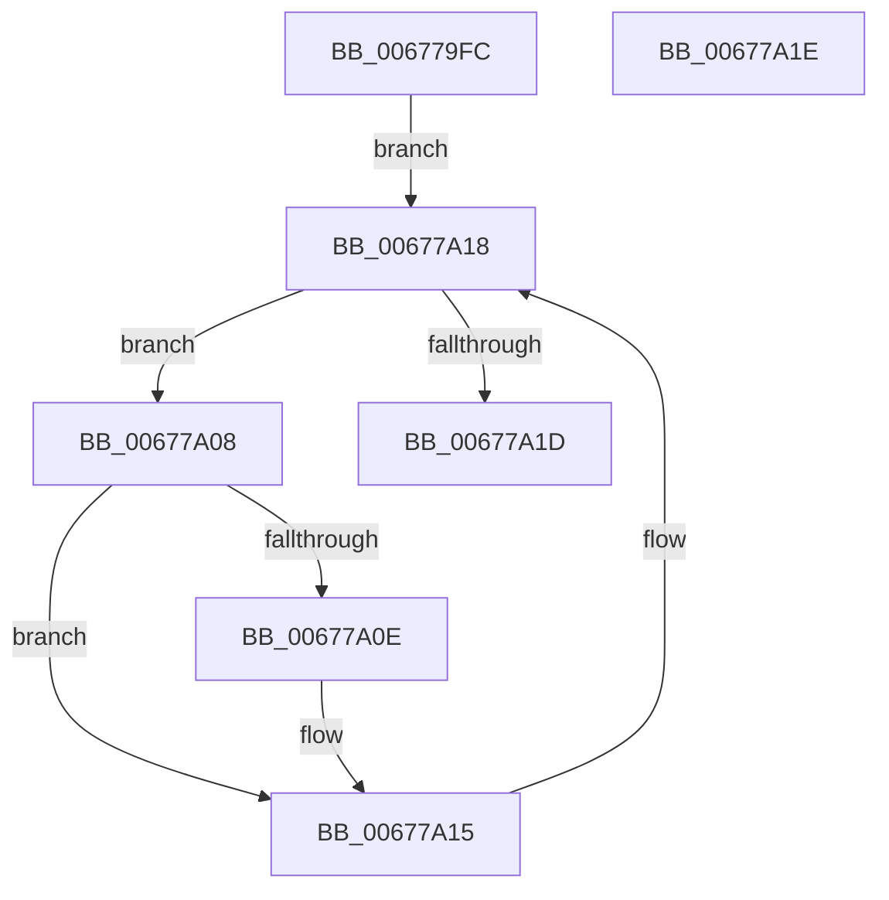

# MiAdjustUnusedSegmentWalkers

- RVA: `0x006779FC`–`0x00677A1F` (길이 `35` bytes)
- VA: `0x00000001406779FC`
- 실행 섹션: `.text`
- PDB 이름 있음: `예`; PDB Function 태그: `아니요`
- unwind 정보 RVA: `0x000DB714`
- 디코드: `12`개 명령, `35/35` bytes 표시
- 미해석 바이트: `0` (있으면 어셈블리에 `.byte`로 보존)

> 이 문서는 커널 이미지의 기계어와 PDB 기호를 분석해 생성했습니다. 4번과 5번은 함수 원형과 자료형을 바이너리 사용 방식에서 추정한 C 해석이며 원본 소스 복구 결과는 아닙니다.

## 1. Dependencies

- 직접 호출 지점: **0**; 고유 호출 대상: **0**
- 직접 호출자로 확인된 함수: **3**
- RIP 상대 이미지 참조: **0**

### Outgoing calls
- 직접 디코드된 call 명령이 없습니다.

### Direct callers
- [MiUnlinkUnusedSubsection](../24/MiUnlinkUnusedSubsection_function_002496F4.md) at `0x0024971B`
- [MiUnlinkUnusedControlArea](../4E/MiUnlinkUnusedControlArea_function_004ED9F8.md) at `0x004EDA60`
- [MiMoveUnusedSubsectionsToDeleteOnClose](MiMoveUnusedSubsectionsToDeleteOnClose_function_006781E0.md) at `0x0067821C`

### Static image references
- 디코드된 RIP-relative 메모리 참조가 없습니다.

## 2. Other-region calls and transfers

- 다른 실행 섹션으로 향하는 call: **0**
- 별도 외부 분기/꼬리 이동을 확인하지 못했습니다.

## 3. Assembly (complete function range)

```asm
006779FC  4C 8D 81 B8 07 00 00            lea r8, [rcx + 0x7b8]
00677A03  49 8B 08                        mov rcx, qword ptr [r8]
00677A06  EB 10                           jmp 0x140677a18
00677A08  48 39 51 10                     cmp qword ptr [rcx + 0x10], rdx
00677A0C  75 07                           jne 0x140677a15
00677A0E  48 8B 02                        mov rax, qword ptr [rdx]
00677A11  48 89 41 10                     mov qword ptr [rcx + 0x10], rax
00677A15  48 8B 09                        mov rcx, qword ptr [rcx]
00677A18  49 3B C8                        cmp rcx, r8
00677A1B  75 EB                           jne 0x140677a08
00677A1D  C3                              ret
00677A1E  CC                              int3
```

## 4. C-style interpretation (structured pseudocode)

```c
__int64 __fastcall MiAdjustUnusedSegmentWalkers(__int64 a1, __int64 a2)
{
    __int64 result;

    goto loc_00677A18;
loc_00677A08:
    if ((*(unsigned __int64 *)(*(unsigned __int64 *)(a1 + 1976) + 16)) == a2) {
        result = *(unsigned __int64 *)(a2);
        *(unsigned __int64 *)(*(unsigned __int64 *)(a1 + 1976) + 16) = result;
    }
loc_00677A18:
    if ((*(unsigned __int64 *)(*(unsigned __int64 *)(a1 + 1976))) != (a1 + 1976)) goto loc_00677A08;
    return result;
}
```

## 5. (Beta) C Style

```c
int64_t MiAdjustUnusedSegmentWalkers(void *Arg1, void *Arg2)
{
    uint8_t *arg1 = (uint8_t *)Arg1;
    uint8_t *arg2 = (uint8_t *)Arg2;

    int64_t result;

    goto loc_00677A18;
loc_00677A08:
    if ((*(uint64_t *)(*(uint64_t *)(arg1 + 0x7B8) + 0x10)) == Arg2) {
        result = *(uint64_t *)(arg2);
        *(uint64_t *)(*(uint64_t *)(arg1 + 0x7B8) + 0x10) = result;
    }
loc_00677A18:
    if ((*(uint64_t *)(*(uint64_t *)(arg1 + 0x7B8))) != (Arg1 + 1976)) goto loc_00677A08;
    return result;
}
```

### 관측된 메모리 오프셋

구조체 형식이 확인되지 않은 접근은 인자 기준의 오프셋으로만 기록했습니다.

| 기준 인자 | 오프셋 표현 | 폭 (bit) | 접근 |
|---|---:|---:|---|
| `Arg1` | `+ 0x0` | `64` | `R` |
| `Arg1` | `+ 0x7B8` | `64` | `R` |
| `Arg2` | `+ 0x0` | `64` | `R` |

## 6. Execution-region graph

[열기: 2D/3D 그래프와 함수 탐색 컨트롤 패널](../../../control-panel.html?section=text&rva=0x006779FC&view=graph)

- 2D 그래프는 위에서 아래로 흐르고, 3D 그래프는 빈 공간을 드래그해 회전합니다. Shift+드래그는 이동, 휠은 확대·축소, 함수 노드 선택은 대상 보고서 이동입니다.

### Static fallback


