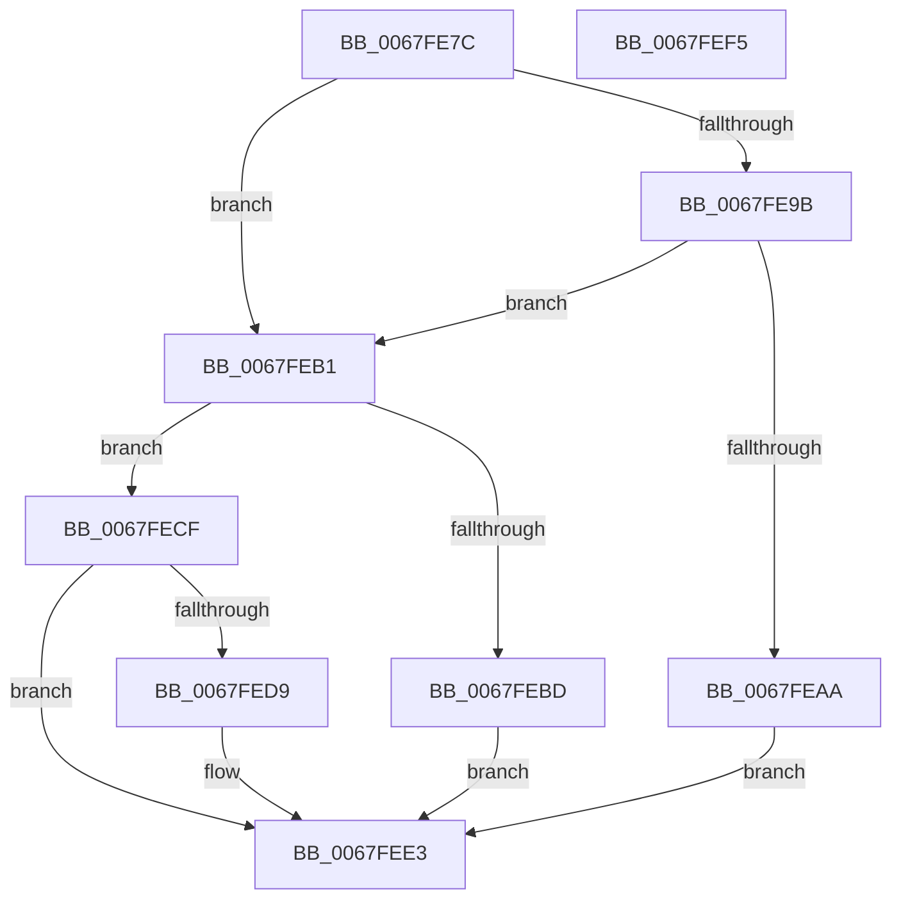

# MiAttemptChangePagingFileMaximum

- RVA: `0x0067FE7C`–`0x0067FEF6` (길이 `122` bytes)
- VA: `0x000000014067FE7C`
- 실행 섹션: `.text`
- PDB 이름 있음: `예`; PDB Function 태그: `아니요`
- unwind 정보 RVA: `0x00060BC4`
- 디코드: `39`개 명령, `122/122` bytes 표시
- 미해석 바이트: `0` (있으면 어셈블리에 `.byte`로 보존)

> 이 문서는 커널 이미지의 기계어와 PDB 기호를 분석해 생성했습니다. 4번과 5번은 함수 원형과 자료형을 바이너리 사용 방식에서 추정한 C 해석이며 원본 소스 복구 결과는 아닙니다.

## 1. Dependencies

- 직접 호출 지점: **4**; 고유 호출 대상: **4**
- 직접 호출자로 확인된 함수: **3**
- RIP 상대 이미지 참조: **0**

### Outgoing calls
- `0x0067FE9D` → [MiReservePageHash](../69/MiReservePageHash_function_00697B80.md) (function, `0x00697B80`)
- `0x0067FEB3` → [MiCreatePageFileSpaceBitmaps](../../page/7F/MiCreatePageFileSpaceBitmaps_function_007FEBBC.md) (function, `0x007FEBBC`)
- `0x0067FEC6` → [MiChangePagingFileMaximum](MiChangePagingFileMaximum_function_0067FEFC.md) (function, `0x0067FEFC`)
- `0x0067FEDE` → [MiReleasePageHash](../69/MiReleasePageHash_function_00697B20.md) (function, `0x00697B20`)

### Direct callers
- [MiStoreExtendVirtualPagefile](../4F/MiStoreExtendVirtualPagefile_function_004F73AC.md) at `0x004F7440`
- [sub_006E65B0](../6E/Unknown_function_006E65B0.md) at `0x006E6608`
- [MiCreatePagingFile](../../page/7F/MiCreatePagingFile_function_007FEFF4.md) at `0x007FFAC3`

### Static image references
- 디코드된 RIP-relative 메모리 참조가 없습니다.

## 2. Other-region calls and transfers

- 다른 실행 섹션으로 향하는 call: **1**
  - `0x0067FEB3` → [MiCreatePageFileSpaceBitmaps](../../page/7F/MiCreatePageFileSpaceBitmaps_function_007FEBBC.md) (`.text` → `PAGE`)
- 별도 외부 분기/꼬리 이동을 확인하지 못했습니다.

## 3. Assembly (complete function range)

```asm
0067FE7C  48 89 5C 24 08                  mov qword ptr [rsp + 8], rbx
0067FE81  48 89 74 24 10                  mov qword ptr [rsp + 0x10], rsi
0067FE86  57                              push rdi
0067FE87  48 83 EC 20                     sub rsp, 0x20
0067FE8B  33 FF                           xor edi, edi
0067FE8D  8B F2                           mov esi, edx
0067FE8F  48 8B D9                        mov rbx, rcx
0067FE92  48 39 B9 B8 00 00 00            cmp qword ptr [rcx + 0xb8], rdi
0067FE99  74 16                           je 0x14067feb1
0067FE9B  8B CA                           mov ecx, edx
0067FE9D  E8 DE 7C 01 00                  call 0x140697b80
0067FEA2  48 8B F8                        mov rdi, rax
0067FEA5  48 85 C0                        test rax, rax
0067FEA8  75 07                           jne 0x14067feb1
0067FEAA  BB 9A 00 00 C0                  mov ebx, 0xc000009a
0067FEAF  EB 32                           jmp 0x14067fee3
0067FEB1  8B CE                           mov ecx, esi
0067FEB3  E8 04 ED 17 00                  call 0x1407febbc
0067FEB8  48 85 C0                        test rax, rax
0067FEBB  74 12                           je 0x14067fecf
0067FEBD  4C 8B C7                        mov r8, rdi
0067FEC0  48 8B D0                        mov rdx, rax
0067FEC3  48 8B CB                        mov rcx, rbx
0067FEC6  E8 31 00 00 00                  call 0x14067fefc
0067FECB  33 DB                           xor ebx, ebx
0067FECD  EB 14                           jmp 0x14067fee3
0067FECF  BB 9A 00 00 C0                  mov ebx, 0xc000009a
0067FED4  48 85 FF                        test rdi, rdi
0067FED7  74 0A                           je 0x14067fee3
0067FED9  8B D6                           mov edx, esi
0067FEDB  48 8B CF                        mov rcx, rdi
0067FEDE  E8 3D 7C 01 00                  call 0x140697b20
0067FEE3  48 8B 74 24 38                  mov rsi, qword ptr [rsp + 0x38]
0067FEE8  8B C3                           mov eax, ebx
0067FEEA  48 8B 5C 24 30                  mov rbx, qword ptr [rsp + 0x30]
0067FEEF  48 83 C4 20                     add rsp, 0x20
0067FEF3  5F                              pop rdi
0067FEF4  C3                              ret
0067FEF5  CC                              int3
```

## 4. C-style interpretation (structured pseudocode)

```c
__int64 __fastcall MiAttemptChangePagingFileMaximum(__int64 a1, int a2)
{
    __int64 result;
    __int64 v_rbx;
    __int64 v_rdi;
    __int64 v_rsp;
    unsigned __int64 v_stack_p10;
    unsigned __int64 v_stack_p8;

    v_stack_p8 = v_rbx;
    v_stack_p10 = v_rsi;
    v_rsp = (v_rsp) - (32);
    v_rdi = 0;
    if ((*(unsigned __int64 *)(a1 + 184)) == 0) goto loc_0067FEB1;
    result = MiReservePageHash((unsigned int)(a2), a2, a3, a4);
    if (result != 0) goto loc_0067FEB1;
    goto loc_0067FEE3;
loc_0067FEB1:
    result = MiCreatePageFileSpaceBitmaps((unsigned int)((unsigned int)((unsigned int)(a2))), a2, a3, a4);
    if (result == 0) goto loc_0067FECF;
    result = MiChangePagingFileMaximum((unsigned int)(0xC000009AULL), result, result, a4);
    v_rbx = 0;
    goto loc_0067FEE3;
loc_0067FECF:
    if (result != 0) {
        a2 = (unsigned int)((unsigned int)(a2));
        a1 = result;
        result = MiReleasePageHash(a1, a2, result, a4);
    }
    v_rsp = (v_rsp) + (32);
    return (unsigned int)((unsigned int)((unsigned int)(0xC000009AULL)));
}
```

## 5. (Beta) C Style

```c
int64_t MiAttemptChangePagingFileMaximum(void *Arg1, int32_t Arg2)
{
    uint8_t *arg1 = (uint8_t *)Arg1;

    int64_t result;
    int64_t local_rbx;
    int64_t local_rdi;
    int64_t local_rsp;
    uint64_t v_stack_p10;
    uint64_t v_stack_p8;

    v_stack_p8 = local_rbx;
    v_stack_p10 = local_rsi;
    local_rsp = (local_rsp) - (32);
    local_rdi = 0;
    if ((*(uint64_t *)(arg1 + 0xB8)) == 0) goto loc_0067FEB1;
    result = MiReservePageHash((uint32_t)(Arg2), Arg2, a3, a4);
    if (result != 0) goto loc_0067FEB1;
    goto loc_0067FEE3;
loc_0067FEB1:
    result = MiCreatePageFileSpaceBitmaps((uint32_t)((uint32_t)((uint32_t)(Arg2))), Arg2, a3, a4);
    if (result == 0) goto loc_0067FECF;
    result = MiChangePagingFileMaximum((uint32_t)(0xC000009AULL), result, result, a4);
    local_rbx = 0;
    goto loc_0067FEE3;
loc_0067FECF:
    if (result != 0) {
        Arg2 = (uint32_t)((uint32_t)(Arg2));
        Arg1 = result;
        result = MiReleasePageHash(Arg1, Arg2, result, a4);
    }
    local_rsp = (local_rsp) + (32);
    return (uint32_t)((uint32_t)((uint32_t)(0xC000009AULL)));
}
```

### 관측된 메모리 오프셋

구조체 형식이 확인되지 않은 접근은 인자 기준의 오프셋으로만 기록했습니다.

| 기준 인자 | 오프셋 표현 | 폭 (bit) | 접근 |
|---|---:|---:|---|
| `Arg1` | `+ 0xB8` | `64` | `R` |

## 6. Execution-region graph

[열기: 2D/3D 그래프와 함수 탐색 컨트롤 패널](../../../control-panel.html?section=text&rva=0x0067FE7C&view=graph)

- 2D 그래프는 위에서 아래로 흐르고, 3D 그래프는 빈 공간을 드래그해 회전합니다. Shift+드래그는 이동, 휠은 확대·축소, 함수 노드 선택은 대상 보고서 이동입니다.

### Static fallback


