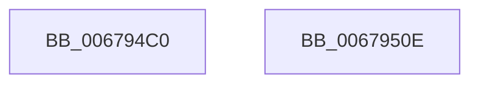

# MiBadPageSignaler

- RVA: `0x006794C0`–`0x0067950F` (길이 `79` bytes)
- VA: `0x00000001406794C0`
- 실행 섹션: `.text`
- PDB 이름 있음: `예`; PDB Function 태그: `아니요`
- unwind 정보 RVA: `0x00063458`
- 디코드: `18`개 명령, `79/79` bytes 표시
- 미해석 바이트: `0` (있으면 어셈블리에 `.byte`로 보존)

> 이 문서는 커널 이미지의 기계어와 PDB 기호를 분석해 생성했습니다. 4번과 5번은 함수 원형과 자료형을 바이너리 사용 방식에서 추정한 C 해석이며 원본 소스 복구 결과는 아닙니다.

## 1. Dependencies

- 직접 호출 지점: **3**; 고유 호출 대상: **3**
- 직접 호출자로 확인된 함수: **0**
- RIP 상대 이미지 참조: **3**

### Outgoing calls
- `0x006794CB` → [ExAcquireSpinLockExclusive](../24/ExAcquireSpinLockExclusive_function_00248690.md) (function, `0x00248690`)
- `0x006794E0` → [MiReleaseSpinLockExclusive](../24/MiReleaseSpinLockExclusive_function_002482C0.md) (function, `0x002482C0`)
- `0x00679504` → [ZwUpdateWnfStateData](../6B/ZwUpdateWnfStateData_function_006B0D10.md) (function, `0x006B0D10`)

### Direct callers
- 이 함수 시작 RVA로 연결되는 직접 call은 확인되지 않았습니다. 간접 호출은 완전히 역산할 수 없습니다.

### Static image references
- `0x006794C4` → RVA `0x00E3A8A0` (`.data`; read)
- `0x006794D2` → RVA `0x00E30252` (`.data`; write)
- `0x006794EA` → RVA `0x00020BC8` (`.rdata`; read)

## 2. Other-region calls and transfers

- 다른 실행 섹션으로 향하는 call: **0**
- 별도 외부 분기/꼬리 이동을 확인하지 못했습니다.

## 3. Assembly (complete function range)

```asm
006794C0  48 83 EC 48                     sub rsp, 0x48
006794C4  48 8D 0D D5 13 7C 00            lea rcx, [rip + 0x7c13d5]
006794CB  E8 C0 F1 BC FF                  call 0x140248690
006794D0  8A D0                           mov dl, al
006794D2  C6 05 79 6D 7B 00 00            mov byte ptr [rip + 0x7b6d79], 0
006794D9  48 8D 0D C0 13 7C 00            lea rcx, [rip + 0x7c13c0]
006794E0  E8 DB ED BC FF                  call 0x1402482c0
006794E5  83 64 24 30 00                  and dword ptr [rsp + 0x30], 0
006794EA  48 8D 0D D7 76 9A FF            lea rcx, [rip - 0x658929]
006794F1  83 64 24 28 00                  and dword ptr [rsp + 0x28], 0
006794F6  45 33 C9                        xor r9d, r9d
006794F9  48 83 64 24 20 00               and qword ptr [rsp + 0x20], 0
006794FF  45 33 C0                        xor r8d, r8d
00679502  33 D2                           xor edx, edx
00679504  E8 07 78 03 00                  call 0x1406b0d10
00679509  48 83 C4 48                     add rsp, 0x48
0067950D  C3                              ret
0067950E  CC                              int3
```

## 4. C-style interpretation (structured pseudocode)

```c
__int64 __fastcall MiBadPageSignaler(__int64 a1, __int64 a2, int a3, int a4)
{
    __int64 result;
    __int64 v_rsp;
    unsigned int v_stack_m18;
    unsigned int v_stack_m20;
    unsigned __int64 v_stack_m28;

    v_rsp = (v_rsp) - (72);
    result = ExAcquireSpinLockExclusive(v_rip + 8131541, a2, a3, a4);
    *(unsigned __int8 *)(v_rip + 8088953) = 0;
    result = MiReleaseSpinLockExclusive(v_rip + 8131520, (unsigned __int8)(result), a3, a4);
    a4 = 0;
    a3 = 0;
    a2 = 0;
    result = ZwUpdateWnfStateData(v_rip - 6654249, a2, a3, a4);
    v_rsp = (v_rsp) + (72);
    return result;
}
```

## 5. (Beta) C Style

```c
int64_t MiBadPageSignaler(int64_t Arg1, int64_t Arg2, int32_t Arg3, int32_t Arg4)
{
    int64_t result;
    int64_t local_rsp;
    uint32_t v_stack_m18;
    uint32_t v_stack_m20;
    uint64_t v_stack_m28;

    local_rsp = (local_rsp) - (72);
    result = ExAcquireSpinLockExclusive(v_rip + 8131541, Arg2, Arg3, Arg4);
    *(uint8_t *)(v_rip + 0x7B6D79) = 0;
    result = MiReleaseSpinLockExclusive(v_rip + 8131520, (uint8_t)(result), Arg3, Arg4);
    Arg4 = 0;
    Arg3 = 0;
    Arg2 = 0;
    result = ZwUpdateWnfStateData(v_rip - 6654249, Arg2, Arg3, Arg4);
    local_rsp = (local_rsp) + (72);
    return result;
}
```

## 6. Execution-region graph

[열기: 2D/3D 그래프와 함수 탐색 컨트롤 패널](../../../control-panel.html?section=text&rva=0x006794C0&view=graph)

- 2D 그래프는 위에서 아래로 흐르고, 3D 그래프는 빈 공간을 드래그해 회전합니다. Shift+드래그는 이동, 휠은 확대·축소, 함수 노드 선택은 대상 보고서 이동입니다.

### Static fallback


