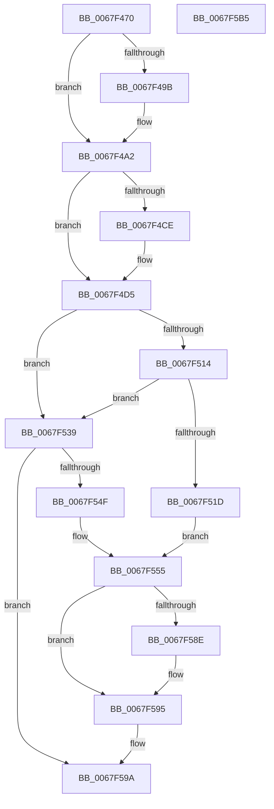

# MiBuildDynamicRegion

- RVA: `0x0067F470`–`0x0067F5B6` (길이 `326` bytes)
- VA: `0x000000014067F470`
- 실행 섹션: `.text`
- PDB 이름 있음: `예`; PDB Function 태그: `아니요`
- unwind 정보 RVA: `0x000D80B0`
- 디코드: `84`개 명령, `326/326` bytes 표시
- 미해석 바이트: `0` (있으면 어셈블리에 `.byte`로 보존)

> 이 문서는 커널 이미지의 기계어와 PDB 기호를 분석해 생성했습니다. 4번과 5번은 함수 원형과 자료형을 바이너리 사용 방식에서 추정한 C 해석이며 원본 소스 복구 결과는 아닙니다.

## 1. Dependencies

- 직접 호출 지점: **4**; 고유 호출 대상: **3**
- 직접 호출자로 확인된 함수: **2**
- RIP 상대 이미지 참조: **4**

### Outgoing calls
- `0x0067F4AF` → [ExGenRandom](../41/ExGenRandom_function_0041B010.md) (function, `0x0041B010`)
- `0x0067F542` → [MiReservePtes](../31/MiReservePtes_function_00318D20.md) (function, `0x00318D20`)
- `0x0067F56D` → [MiInitializeDynamicBitmap](MiInitializeDynamicBitmap_function_0067F5BC.md) (function, `0x0067F5BC`)
- `0x0067F57B` → [ExGenRandom](../41/ExGenRandom_function_0041B010.md) (function, `0x0041B010`)

### Direct callers
- [MiInitializeNonPagedPool](../../init/C6/MiInitializeNonPagedPool_function_00C64A24.md) at `0x00C64B54`
- [MiInitializeDynamicRegion](../../init/C6/MiInitializeDynamicRegion_function_00C65C2C.md) at `0x00C65C38`

### Static image references
- `0x0067F489` → RVA `0x00E2F080` (`.data`; read)
- `0x0067F49B` → RVA `0x00E2EEC8` (`.data`; write)
- `0x0067F4B9` → RVA `0x00E2EF60` (`.data`; read)
- `0x0067F53B` → RVA `0x00E37668` (`.data`; read)

## 2. Other-region calls and transfers

- 다른 실행 섹션으로 향하는 call: **0**
- 별도 외부 분기/꼬리 이동을 확인하지 못했습니다.

## 3. Assembly (complete function range)

```asm
0067F470  48 8B C4                        mov rax, rsp
0067F473  48 89 58 08                     mov qword ptr [rax + 8], rbx
0067F477  48 89 68 10                     mov qword ptr [rax + 0x10], rbp
0067F47B  48 89 78 18                     mov qword ptr [rax + 0x18], rdi
0067F47F  4C 89 60 20                     mov qword ptr [rax + 0x20], r12
0067F483  41 56                           push r14
0067F485  48 83 EC 20                     sub rsp, 0x20
0067F489  48 8D 05 F0 FB 7A 00            lea rax, [rip + 0x7afbf0]
0067F490  49 8B F8                        mov rdi, r8
0067F493  48 8B D9                        mov rbx, rcx
0067F496  48 3B C8                        cmp rcx, rax
0067F499  75 07                           jne 0x14067f4a2
0067F49B  4C 89 05 26 FA 7A 00            mov qword ptr [rip + 0x7afa26], r8
0067F4A2  48 89 51 20                     mov qword ptr [rcx + 0x20], rdx
0067F4A6  B9 01 00 00 00                  mov ecx, 1
0067F4AB  48 C1 EF 15                     shr rdi, 0x15
0067F4AF  E8 5C BB D9 FF                  call 0x14041b010
0067F4B4  25 FF 7F 00 00                  and eax, 0x7fff
0067F4B9  4C 8D 35 A0 FA 7A 00            lea r14, [rip + 0x7afaa0]
0067F4C0  48 89 43 18                     mov qword ptr [rbx + 0x18], rax
0067F4C4  BD FF 0F 00 00                  mov ebp, 0xfff
0067F4C9  49 3B DE                        cmp rbx, r14
0067F4CC  75 07                           jne 0x14067f4d5
0067F4CE  48 23 C5                        and rax, rbp
0067F4D1  48 89 43 18                     mov qword ptr [rbx + 0x18], rax
0067F4D5  40 F6 C7 3F                     test dil, 0x3f
0067F4D9  48 89 7B 10                     mov qword ptr [rbx + 0x10], rdi
0067F4DD  B9 00 00 00 00                  mov ecx, 0
0067F4E2  49 BC 00 00 00 00 80 F6 FF FF   movabs r12, 0xfffff68000000000
0067F4EC  0F 95 C1                        setne cl
0067F4EF  48 8B C7                        mov rax, rdi
0067F4F2  48 C1 E8 06                     shr rax, 6
0067F4F6  48 03 C8                        add rcx, rax
0067F4F9  B8 00 00 00 00                  mov eax, 0
0067F4FE  48 C1 E1 03                     shl rcx, 3
0067F502  48 85 CD                        test rbp, rcx
0067F505  0F 95 C0                        setne al
0067F508  48 C1 E9 0C                     shr rcx, 0xc
0067F50C  48 03 C1                        add rax, rcx
0067F50F  49 3B DE                        cmp rbx, r14
0067F512  75 25                           jne 0x14067f539
0067F514  48 8B 53 08                     mov rdx, qword ptr [rbx + 8]
0067F518  48 85 D2                        test rdx, rdx
0067F51B  74 1C                           je 0x14067f539
0067F51D  48 C1 EA 09                     shr rdx, 9
0067F521  48 B8 F8 FF FF FF 7F 00 00 00   movabs rax, 0x7ffffffff8
0067F52B  48 23 D0                        and rdx, rax
0067F52E  45 33 C9                        xor r9d, r9d
0067F531  49 8B C4                        mov rax, r12
0067F534  48 03 D0                        add rdx, rax
0067F537  EB 1C                           jmp 0x14067f555
0067F539  8B D0                           mov edx, eax
0067F53B  48 8D 0D 26 81 7B 00            lea rcx, [rip + 0x7b8126]
0067F542  E8 D9 97 C9 FF                  call 0x140318d20
0067F547  48 8B D0                        mov rdx, rax
0067F54A  48 85 C0                        test rax, rax
0067F54D  74 4B                           je 0x14067f59a
0067F54F  41 B9 01 00 00 00               mov r9d, 1
0067F555  48 C1 E2 19                     shl rdx, 0x19
0067F559  49 8B C4                        mov rax, r12
0067F55C  48 C1 E0 19                     shl rax, 0x19
0067F560  4C 8B C7                        mov r8, rdi
0067F563  48 2B D0                        sub rdx, rax
0067F566  48 8B CB                        mov rcx, rbx
0067F569  48 C1 FA 10                     sar rdx, 0x10
0067F56D  E8 4A 00 00 00                  call 0x14067f5bc
0067F572  48 83 23 00                     and qword ptr [rbx], 0
0067F576  B9 01 00 00 00                  mov ecx, 1
0067F57B  E8 90 BA D9 FF                  call 0x14041b010
0067F580  25 FF 7F 00 00                  and eax, 0x7fff
0067F585  48 89 43 18                     mov qword ptr [rbx + 0x18], rax
0067F589  49 3B DE                        cmp rbx, r14
0067F58C  75 07                           jne 0x14067f595
0067F58E  48 23 C5                        and rax, rbp
0067F591  48 89 43 18                     mov qword ptr [rbx + 0x18], rax
0067F595  B8 01 00 00 00                  mov eax, 1
0067F59A  48 8B 5C 24 30                  mov rbx, qword ptr [rsp + 0x30]
0067F59F  48 8B 6C 24 38                  mov rbp, qword ptr [rsp + 0x38]
0067F5A4  48 8B 7C 24 40                  mov rdi, qword ptr [rsp + 0x40]
0067F5A9  4C 8B 64 24 48                  mov r12, qword ptr [rsp + 0x48]
0067F5AE  48 83 C4 20                     add rsp, 0x20
0067F5B2  41 5E                           pop r14
0067F5B4  C3                              ret
0067F5B5  CC                              int3
```

## 4. C-style interpretation (structured pseudocode)

```c
__int64 __fastcall MiBuildDynamicRegion(__int64 a1, __int64 a2, __int64 a3, int a4)
{
    __int64 result;
    __int64 v_rdi;
    __int64 v_rsp;
    unsigned __int64 v_stack_p10;
    unsigned __int64 v_stack_p18;
    unsigned __int64 v_stack_p20;
    unsigned __int64 v_stack_p8;

    *(unsigned __int64 *)(v_rsp + 8) = v_rbx;
    *(unsigned __int64 *)(v_rsp + 16) = v_rbp;
    *(unsigned __int64 *)(v_rsp + 24) = v_rdi;
    *(unsigned __int64 *)(v_rsp + 32) = v_r12;
    v_rsp = (v_rsp) - (32);
    if (a1 == (v_rip + 8059888)) {
        *(unsigned __int64 *)(v_rip + 8059430) = a3;
    }
    *(unsigned __int64 *)(a1 + 32) = a2;
    v_rdi = (a3) >> (21);
    result = ExGenRandom(1, a2, a3, a4);
    result = (unsigned int)((result) & (0x7FFFULL));
    *(unsigned __int64 *)(a1 + 24) = result;
    if (a1 == (v_rip + 8059552)) {
        result = (result) & ((unsigned int)(0xFFFULL));
        *(unsigned __int64 *)(a1 + 24) = result;
    }
    *(unsigned __int64 *)(a1 + 16) = v_rdi;
    a1 = ((((unsigned __int8)(v_rdi)) & (63)) != 0) ? 1 : 0;
    result = (v_rdi) >> (6);
    a1 = (a1) + (result);
    a1 = (a1) << (3);
    result = ((((unsigned int)(0xFFFULL)) & (a1)) != 0) ? 1 : 0;
    a1 = (a1) >> (12);
    result = (result) + (a1);
    if (a1 != (v_rip + 8059552)) goto loc_0067F539;
    if (*(unsigned __int64 *)(a1 + 8) == 0) goto loc_0067F539;
    a2 = (*(unsigned __int64 *)(a1 + 8)) >> (9);
    a2 = (a2) & (result);
    a4 = 0;
    a2 = (a2) + (v_r12);
    goto loc_0067F555;
loc_0067F539:
    result = MiReservePtes(v_rip + 8093990, (unsigned int)((unsigned int)(v_r12)), a3, a4);
    if (result == 0) goto loc_0067F59A;
loc_0067F555:
    a2 = (result) << (25);
    result = (v_r12) << (25);
    a2 = (a2) - (result);
    a2 = (a2) >> (16);
    result = MiInitializeDynamicBitmap(a1, a2, v_rdi, 1);
    result = ExGenRandom(1, a2, v_rdi, 1);
    result = (unsigned int)((result) & (0x7FFFULL));
    *(unsigned __int64 *)(a1 + 24) = result;
    if (a1 == (v_rip + 8059552)) {
        result = (result) & ((unsigned int)(0xFFFULL));
        *(unsigned __int64 *)(a1 + 24) = result;
    }
loc_0067F59A:
    v_rsp = (v_rsp) + (32);
    return 1;
}
```

## 5. (Beta) C Style

```c
int64_t MiBuildDynamicRegion(void *Arg1, int64_t Arg2, int64_t Arg3, int32_t Arg4)
{
    uint8_t *arg1 = (uint8_t *)Arg1;

    int64_t result;
    int64_t local_rdi;
    int64_t local_rsp;
    uint64_t v_stack_p10;
    uint64_t v_stack_p18;
    uint64_t v_stack_p20;
    uint64_t v_stack_p8;

    *(uint64_t *)(local_rsp + 0x8) = local_rbx;
    *(uint64_t *)(local_rsp + 0x10) = local_rbp;
    *(uint64_t *)(local_rsp + 0x18) = local_rdi;
    *(uint64_t *)(local_rsp + 0x20) = local_r12;
    local_rsp = (local_rsp) - (32);
    if (Arg1 == (v_rip + 8059888)) {
        *(uint64_t *)(v_rip + 0x7AFA26) = Arg3;
    }
    *(uint64_t *)(arg1 + 0x20) = Arg2;
    local_rdi = (Arg3) >> (21);
    result = ExGenRandom(1, Arg2, Arg3, Arg4);
    result = (uint32_t)((result) & (0x7FFFULL));
    *(uint64_t *)(arg1 + 0x18) = result;
    if (Arg1 == (v_rip + 8059552)) {
        result = (result) & ((uint32_t)(0xFFFULL));
        *(uint64_t *)(arg1 + 0x18) = result;
    }
    *(uint64_t *)(arg1 + 0x10) = local_rdi;
    Arg1 = ((((uint8_t)(local_rdi)) & (63)) != 0) ? 1 : 0;
    result = (local_rdi) >> (6);
    Arg1 = (Arg1) + (result);
    Arg1 = (Arg1) << (3);
    result = ((((uint32_t)(0xFFFULL)) & (Arg1)) != 0) ? 1 : 0;
    Arg1 = (Arg1) >> (12);
    result = (result) + (Arg1);
    if (Arg1 != (v_rip + 8059552)) goto loc_0067F539;
    if (*(uint64_t *)(arg1 + 0x8) == 0) goto loc_0067F539;
    Arg2 = (*(uint64_t *)(arg1 + 0x8)) >> (9);
    Arg2 = (Arg2) & (result);
    Arg4 = 0;
    Arg2 = (Arg2) + (local_r12);
    goto loc_0067F555;
loc_0067F539:
    result = MiReservePtes(v_rip + 8093990, (uint32_t)((uint32_t)(local_r12)), Arg3, Arg4);
    if (result == 0) goto loc_0067F59A;
loc_0067F555:
    Arg2 = (result) << (25);
    result = (local_r12) << (25);
    Arg2 = (Arg2) - (result);
    Arg2 = (Arg2) >> (16);
    result = MiInitializeDynamicBitmap(Arg1, Arg2, local_rdi, 1);
    result = ExGenRandom(1, Arg2, local_rdi, 1);
    result = (uint32_t)((result) & (0x7FFFULL));
    *(uint64_t *)(arg1 + 0x18) = result;
    if (Arg1 == (v_rip + 8059552)) {
        result = (result) & ((uint32_t)(0xFFFULL));
        *(uint64_t *)(arg1 + 0x18) = result;
    }
loc_0067F59A:
    local_rsp = (local_rsp) + (32);
    return 1;
}
```

### 관측된 메모리 오프셋

구조체 형식이 확인되지 않은 접근은 인자 기준의 오프셋으로만 기록했습니다.

| 기준 인자 | 오프셋 표현 | 폭 (bit) | 접근 |
|---|---:|---:|---|
| `Arg1` | `+ 0x18` | `64` | `W` |

## 6. Execution-region graph

[열기: 2D/3D 그래프와 함수 탐색 컨트롤 패널](../../../control-panel.html?section=text&rva=0x0067F470&view=graph)

- 2D 그래프는 위에서 아래로 흐르고, 3D 그래프는 빈 공간을 드래그해 회전합니다. Shift+드래그는 이동, 휠은 확대·축소, 함수 노드 선택은 대상 보고서 이동입니다.

### Static fallback


