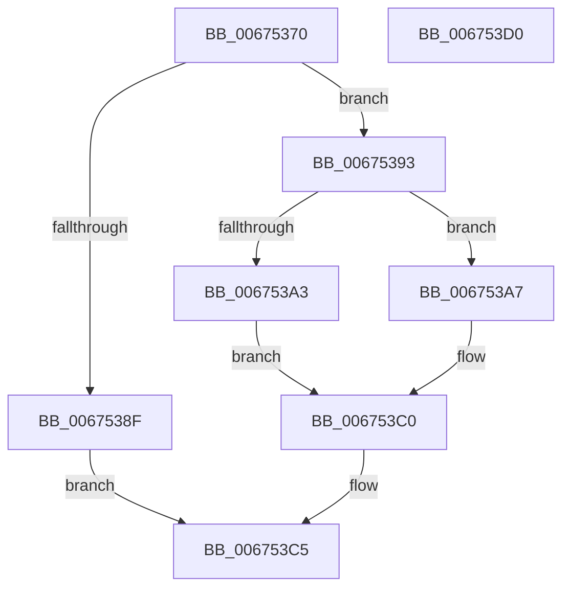

# MiCanBeginHugeIoPageAccessor

- RVA: `0x00675370`–`0x006753D1` (길이 `97` bytes)
- VA: `0x0000000140675370`
- 실행 섹션: `.text`
- PDB 이름 있음: `예`; PDB Function 태그: `아니요`
- unwind 정보 RVA: `0x0005CAAC`
- 디코드: `29`개 명령, `97/97` bytes 표시
- 미해석 바이트: `0` (있으면 어셈블리에 `.byte`로 보존)

> 이 문서는 커널 이미지의 기계어와 PDB 기호를 분석해 생성했습니다. 4번과 5번은 함수 원형과 자료형을 바이너리 사용 방식에서 추정한 C 해석이며 원본 소스 복구 결과는 아닙니다.

## 1. Dependencies

- 직접 호출 지점: **1**; 고유 호출 대상: **1**
- 직접 호출자로 확인된 함수: **1**
- RIP 상대 이미지 참조: **1**

### Outgoing calls
- `0x00675393` → [MiLockHugeRangeColorHeadAtDpc](../4F/MiLockHugeRangeColorHeadAtDpc_function_004FAD14.md) (function, `0x004FAD14`)

### Direct callers
- [MiBeginPageAccessor](../43/MiBeginPageAccessor_function_0043BBE0.md) at `0x0043BD33`

### Static image references
- `0x006753AA` → RVA `0x00E300C0` (`.data`; read)

## 2. Other-region calls and transfers

- 다른 실행 섹션으로 향하는 call: **0**
- 별도 외부 분기/꼬리 이동을 확인하지 못했습니다.

## 3. Assembly (complete function range)

```asm
00675370  48 89 5C 24 08                  mov qword ptr [rsp + 8], rbx
00675375  57                              push rdi
00675376  48 83 EC 20                     sub rsp, 0x20
0067537A  48 8B 01                        mov rax, qword ptr [rcx]
0067537D  48 BF 00 00 00 00 00 00 00 08   movabs rdi, 0x800000000000000
00675387  48 8B D9                        mov rbx, rcx
0067538A  48 85 C7                        test rdi, rax
0067538D  74 04                           je 0x140675393
0067538F  33 C0                           xor eax, eax
00675391  EB 32                           jmp 0x1406753c5
00675393  E8 7C 59 E8 FF                  call 0x1404fad14
00675398  48 8B 0B                        mov rcx, qword ptr [rbx]
0067539B  48 8B D0                        mov rdx, rax
0067539E  48 85 CF                        test rdi, rcx
006753A1  74 04                           je 0x1406753a7
006753A3  33 C0                           xor eax, eax
006753A5  EB 19                           jmp 0x1406753c0
006753A7  48 8B C3                        mov rax, rbx
006753AA  48 2B 05 0F AD 7B 00            sub rax, qword ptr [rip + 0x7bad0f]
006753B1  48 C1 F8 03                     sar rax, 3
006753B5  25 FF FF 3F 00                  and eax, 0x3fffff
006753BA  48 0B CF                        or rcx, rdi
006753BD  48 89 0B                        mov qword ptr [rbx], rcx
006753C0  F0 48 83 22 F7                  lock and qword ptr [rdx], 0xfffffffffffffff7
006753C5  48 8B 5C 24 30                  mov rbx, qword ptr [rsp + 0x30]
006753CA  48 83 C4 20                     add rsp, 0x20
006753CE  5F                              pop rdi
006753CF  C3                              ret
006753D0  CC                              int3
```

## 4. C-style interpretation (structured pseudocode)

```c
__int64 __fastcall MiCanBeginHugeIoPageAccessor(__int64 a1)
{
    __int64 result;
    __int64 v_rsp;
    unsigned __int64 v_stack_p8;

    v_stack_p8 = v_rbx;
    v_rsp = (v_rsp) - (32);
    if (((v_rdi) & (*(unsigned __int64 *)(a1))) == 0) goto loc_00675393;
    result = 0;
    goto loc_006753C5;
loc_00675393:
    result = MiLockHugeRangeColorHeadAtDpc(a1, a2, a3, a4);
    if (((v_rdi) & (*(unsigned __int64 *)(a1))) == 0) goto loc_006753A7;
    result = 0;
    goto loc_006753C0;
loc_006753A7:
    result = (a1) - (*(unsigned __int64 *)(v_rip + 8105231));
    result = (result) >> (3);
    result = (unsigned int)((result) & (0x3FFFFFULL));
    a1 = (*(unsigned __int64 *)(a1)) | (v_rdi);
    *(unsigned __int64 *)(a1) = a1;
loc_006753C0:
loc_006753C5:
    v_rsp = (v_rsp) + (32);
    return result;
}
```

## 5. (Beta) C Style

```c
int64_t MiCanBeginHugeIoPageAccessor(void *Arg1)
{
    uint8_t *arg1 = (uint8_t *)Arg1;

    int64_t result;
    int64_t local_rsp;
    uint64_t v_stack_p8;

    v_stack_p8 = local_rbx;
    local_rsp = (local_rsp) - (32);
    if (((local_rdi) & (*(uint64_t *)(arg1))) == 0) goto loc_00675393;
    result = 0;
    goto loc_006753C5;
loc_00675393:
    result = MiLockHugeRangeColorHeadAtDpc(Arg1, a2, a3, a4);
    if (((local_rdi) & (*(uint64_t *)(arg1))) == 0) goto loc_006753A7;
    result = 0;
    goto loc_006753C0;
loc_006753A7:
    result = (Arg1) - (*(uint64_t *)(v_rip + 0x7BAD0F));
    result = (result) >> (3);
    result = (uint32_t)((result) & (0x3FFFFFULL));
    Arg1 = (*(uint64_t *)(arg1)) | (local_rdi);
    *(void **)(arg1) = Arg1;
loc_006753C0:
loc_006753C5:
    local_rsp = (local_rsp) + (32);
    return result;
}
```

### 관측된 메모리 오프셋

구조체 형식이 확인되지 않은 접근은 인자 기준의 오프셋으로만 기록했습니다.

| 기준 인자 | 오프셋 표현 | 폭 (bit) | 접근 |
|---|---:|---:|---|
| `Arg1` | `+ 0x0` | `64` | `R` |
| `Arg1` | `+ 0x0` | `64` | `W` |

## 6. Execution-region graph

[열기: 2D/3D 그래프와 함수 탐색 컨트롤 패널](../../../control-panel.html?section=text&rva=0x00675370&view=graph)

- 2D 그래프는 위에서 아래로 흐르고, 3D 그래프는 빈 공간을 드래그해 회전합니다. Shift+드래그는 이동, 휠은 확대·축소, 함수 노드 선택은 대상 보고서 이동입니다.

### Static fallback


