# MiChangePagingFileMaximum

- RVA: `0x0067FEFC`–`0x006802CB` (길이 `975` bytes)
- VA: `0x000000014067FEFC`
- 실행 섹션: `.text`
- PDB 이름 있음: `예`; PDB Function 태그: `아니요`
- unwind 정보 RVA: `0x000D8128`
- 디코드: `241`개 명령, `975/975` bytes 표시
- 미해석 바이트: `0` (있으면 어셈블리에 `.byte`로 보존)

> 이 문서는 커널 이미지의 기계어와 PDB 기호를 분석해 생성했습니다. 4번과 5번은 함수 원형과 자료형을 바이너리 사용 방식에서 추정한 C 해석이며 원본 소스 복구 결과는 아닙니다.

## 1. Dependencies

- 직접 호출 지점: **15**; 고유 호출 대상: **13**
- 직접 호출자로 확인된 함수: **1**
- RIP 상대 이미지 참조: **4**

### Outgoing calls
- `0x0067FF3E` → [RtlSetAllBits](../36/RtlSetAllBits_function_00362490.md) (function, `0x00362490`)
- `0x0067FF4F` → [RtlSetAllBits](../36/RtlSetAllBits_function_00362490.md) (function, `0x00362490`)
- `0x0067FF63` → [ExAcquireSpinLockExclusive](../24/ExAcquireSpinLockExclusive_function_00248690.md) (function, `0x00248690`)
- `0x0068006D` → [MiCheckLinearProtectedPteAccessedBit](../29/MiCheckLinearProtectedPteAccessedBit_function_00292D80.md) (function, `0x00292D80`)
- `0x006800E6` → [RtlCopyBitMap](../3E/RtlCopyBitMap_function_003E2210.md) (function, `0x003E2210`)
- `0x006800F7` → [RtlCopyBitMap](../3E/RtlCopyBitMap_function_003E2210.md) (function, `0x003E2210`)
- `0x0068013A` → [MiDerefPageFileSpaceBitmaps](../47/MiDerefPageFileSpaceBitmaps_function_0047B478.md) (function, `0x0047B478`)
- `0x00680164` → [MiReleaseSpinLockExclusive](../24/MiReleaseSpinLockExclusive_function_002482C0.md) (function, `0x002482C0`)
- `0x00680173` → [ExFreePoolWithTag](../../poolcode/B8/ExFreePoolWithTag_function_00B82870.md) (function, `0x00B82870`)
- `0x006801EF` → [MiLockPageInline](../31/MiLockPageInline_function_0031A340.md) (function, `0x0031A340`)
- `0x006801FA` → [ExAcquireSpinLockExclusiveAtDpcLevel](../24/ExAcquireSpinLockExclusiveAtDpcLevel_function_00248E80.md) (function, `0x00248E80`)
- `0x0068025C` → [MiSetPfnContainingFrame](../36/MiSetPfnContainingFrame_function_00363FC0.md) (function, `0x00363FC0`)
- `0x00680268` → [ExReleaseSpinLockExclusiveFromDpcLevel](../24/ExReleaseSpinLockExclusiveFromDpcLevel_function_002497E0.md) (function, `0x002497E0`)
- `0x00680273` → [MiUnlockPage](../31/MiUnlockPage_function_0031A3E0.md) (function, `0x0031A3E0`)
- `0x006802B1` → [MiReleasePtes](../24/MiReleasePtes_function_00247240.md) (function, `0x00247240`)

### Direct callers
- [MiAttemptChangePagingFileMaximum](MiAttemptChangePagingFileMaximum_function_0067FE7C.md) at `0x0067FEC6`

### Static image references
- `0x0067FFCA` → RVA `0x00E3738C` (`.data`; read)
- `0x0068003C` → RVA `0x00FC6A88` (`ALMOSTRO`; read)
- `0x006800AC` → RVA `0x00010880` (`.rdata`; read)
- `0x006802A7` → RVA `0x00E37668` (`.data`; read)

## 2. Other-region calls and transfers

- 다른 실행 섹션으로 향하는 call: **1**
  - `0x00680173` → [ExFreePoolWithTag](../../poolcode/B8/ExFreePoolWithTag_function_00B82870.md) (`.text` → `POOLCODE`)
- 별도 외부 분기/꼬리 이동을 확인하지 못했습니다.

## 3. Assembly (complete function range)

```asm
0067FEFC  48 8B C4                        mov rax, rsp
0067FEFF  4C 89 40 18                     mov qword ptr [rax + 0x18], r8
0067FF03  48 89 50 10                     mov qword ptr [rax + 0x10], rdx
0067FF07  48 89 48 08                     mov qword ptr [rax + 8], rcx
0067FF0B  53                              push rbx
0067FF0C  55                              push rbp
0067FF0D  56                              push rsi
0067FF0E  57                              push rdi
0067FF0F  41 54                           push r12
0067FF11  41 55                           push r13
0067FF13  41 56                           push r14
0067FF15  41 57                           push r15
0067FF17  48 81 EC 88 00 00 00            sub rsp, 0x88
0067FF1E  48 8D 72 08                     lea rsi, [rdx + 8]
0067FF22  4C 8B F1                        mov r14, rcx
0067FF25  0F 57 C0                        xorps xmm0, xmm0
0067FF28  0F 57 C9                        xorps xmm1, xmm1
0067FF2B  48 8B CE                        mov rcx, rsi
0067FF2E  49 8B F8                        mov rdi, r8
0067FF31  48 8B DA                        mov rbx, rdx
0067FF34  F3 0F 7F 40 98                  movdqu xmmword ptr [rax - 0x68], xmm0
0067FF39  F3 0F 7F 48 A8                  movdqu xmmword ptr [rax - 0x58], xmm1
0067FF3E  E8 4D 25 CE FF                  call 0x140362490
0067FF43  48 8D 43 18                     lea rax, [rbx + 0x18]
0067FF47  48 8B C8                        mov rcx, rax
0067FF4A  48 89 44 24 50                  mov qword ptr [rsp + 0x50], rax
0067FF4F  E8 3C 25 CE FF                  call 0x140362490
0067FF54  4D 8D AE C8 00 00 00            lea r13, [r14 + 0xc8]
0067FF5B  49 8B CD                        mov rcx, r13
0067FF5E  4C 89 6C 24 40                  mov qword ptr [rsp + 0x40], r13
0067FF63  E8 28 87 BC FF                  call 0x140248690
0067FF68  49 8B 5E 50                     mov rbx, qword ptr [r14 + 0x50]
0067FF6C  4D 8D A6 B8 00 00 00            lea r12, [r14 + 0xb8]
0067FF73  88 84 24 E8 00 00 00            mov byte ptr [rsp + 0xe8], al
0067FF7A  48 B9 F8 FF FF FF 7F 00 00 00   movabs rcx, 0x7ffffffff8
0067FF84  48 89 5C 24 38                  mov qword ptr [rsp + 0x38], rbx
0067FF89  4C 89 64 24 30                  mov qword ptr [rsp + 0x30], r12
0067FF8E  49 BB 00 00 00 00 80 F6 FF FF   movabs r11, 0xfffff68000000000
0067FF98  4C 8D 4B 08                     lea r9, [rbx + 8]
0067FF9C  4C 89 4C 24 48                  mov qword ptr [rsp + 0x48], r9
0067FFA1  48 85 FF                        test rdi, rdi
0067FFA4  0F 84 17 01 00 00               je 0x1406800c1
0067FFAA  4D 8B 3C 24                     mov r15, qword ptr [r12]
0067FFAE  49 C1 EF 09                     shr r15, 9
0067FFB2  4C 23 F9                        and r15, rcx
0067FFB5  49 8B C3                        mov rax, r11
0067FFB8  4C 03 F8                        add r15, rax
0067FFBB  48 C1 EF 09                     shr rdi, 9
0067FFBF  4C 89 7C 24 20                  mov qword ptr [rsp + 0x20], r15
0067FFC4  48 23 F9                        and rdi, rcx
0067FFC7  49 8B C3                        mov rax, r11
0067FFCA  8B 0D BC 73 7B 00               mov ecx, dword ptr [rip + 0x7b73bc]
0067FFD0  48 03 F8                        add rdi, rax
0067FFD3  41 8B 11                        mov edx, dword ptr [r9]
0067FFD6  41 BA FF 0F 00 00               mov r10d, 0xfff
0067FFDC  BD 00 00 00 00                  mov ebp, 0
0067FFE1  8B C2                           mov eax, edx
0067FFE3  48 0F AF C1                     imul rax, rcx
0067FFE7  49 85 C2                        test r10, rax
0067FFEA  40 0F 95 C5                     setne bpl
0067FFEE  48 C1 E8 0C                     shr rax, 0xc
0067FFF2  48 03 E8                        add rbp, rax
0067FFF5  8B 06                           mov eax, dword ptr [rsi]
0067FFF7  44 8B C0                        mov r8d, eax
0067FFFA  48 89 6C 24 28                  mov qword ptr [rsp + 0x28], rbp
0067FFFF  4C 0F AF C1                     imul r8, rcx
00680003  49 8B C8                        mov rcx, r8
00680006  49 23 CA                        and rcx, r10
00680009  3B D0                           cmp edx, eax
0068000B  73 05                           jae 0x140680012
0068000D  48 8B F5                        mov rsi, rbp
00680010  EB 10                           jmp 0x140680022
00680012  33 F6                           xor esi, esi
00680014  48 85 C9                        test rcx, rcx
00680017  40 0F 95 C6                     setne sil
0068001B  49 C1 E8 0C                     shr r8, 0xc
0068001F  49 03 F0                        add rsi, r8
00680022  48 85 F6                        test rsi, rsi
00680025  74 7E                           je 0x1406800a5
00680027  4D 8B E7                        mov r12, r15
0068002A  4C 8B F7                        mov r14, rdi
0068002D  4C 2B E7                        sub r12, rdi
00680030  4C 8B EE                        mov r13, rsi
00680033  4B 8B 1C 34                     mov rbx, qword ptr [r12 + r14]
00680037  F6 C3 01                        test bl, 1
0068003A  74 40                           je 0x14068007c
0068003C  48 0F BA 25 43 6A 94 00 24      bt qword ptr [rip + 0x946a43], 0x24
00680045  73 35                           jae 0x14068007c
00680047  F6 C3 20                        test bl, 0x20
0068004A  75 30                           jne 0x14068007c
0068004C  49 8B C3                        mov rax, r11
0068004F  48 B9 00 00 00 00 40 00 00 00   movabs rcx, 0x4000000000
00680059  48 03 C1                        add rax, rcx
0068005C  4C 3B F0                        cmp r14, rax
0068005F  72 1B                           jb 0x14068007c
00680061  41 B8 80 00 00 00               mov r8d, 0x80
00680067  48 8B D3                        mov rdx, rbx
0068006A  49 8B CE                        mov rcx, r14
0068006D  E8 0E 2D C1 FF                  call 0x140292d80
00680072  49 BB 00 00 00 00 80 F6 FF FF   movabs r11, 0xfffff68000000000
0068007C  49 89 1E                        mov qword ptr [r14], rbx
0068007F  49 83 C6 08                     add r14, 8
00680083  49 83 ED 01                     sub r13, 1
00680087  75 AA                           jne 0x140680033
00680089  4C 8B B4 24 D0 00 00 00         mov r14, qword ptr [rsp + 0xd0]
00680091  4C 8B 64 24 30                  mov r12, qword ptr [rsp + 0x30]
00680096  48 8B 5C 24 38                  mov rbx, qword ptr [rsp + 0x38]
0068009B  4C 8B 6C 24 40                  mov r13, qword ptr [rsp + 0x40]
006800A0  4C 8B 4C 24 48                  mov r9, qword ptr [rsp + 0x48]
006800A5  33 C9                           xor ecx, ecx
006800A7  48 85 ED                        test rbp, rbp
006800AA  74 28                           je 0x1406800d4
006800AC  48 8B 05 CD 07 99 FF            mov rax, qword ptr [rip - 0x66f833]
006800B3  49 89 04 CF                     mov qword ptr [r15 + rcx*8], rax
006800B7  48 FF C1                        inc rcx
006800BA  48 3B CD                        cmp rcx, rbp
006800BD  72 F4                           jb 0x1406800b3
006800BF  EB 13                           jmp 0x1406800d4
006800C1  45 33 FF                        xor r15d, r15d
006800C4  33 ED                           xor ebp, ebp
006800C6  33 FF                           xor edi, edi
006800C8  4C 89 7C 24 20                  mov qword ptr [rsp + 0x20], r15
006800CD  48 89 6C 24 28                  mov qword ptr [rsp + 0x28], rbp
006800D2  33 F6                           xor esi, esi
006800D4  48 8B 94 24 D8 00 00 00         mov rdx, qword ptr [rsp + 0xd8]
006800DC  45 33 C0                        xor r8d, r8d
006800DF  48 83 C2 08                     add rdx, 8
006800E3  49 8B C9                        mov rcx, r9
006800E6  E8 25 21 D6 FF                  call 0x1403e2210
006800EB  48 8B 54 24 50                  mov rdx, qword ptr [rsp + 0x50]
006800F0  48 8D 4B 18                     lea rcx, [rbx + 0x18]
006800F4  45 33 C0                        xor r8d, r8d
006800F7  E8 14 21 D6 FF                  call 0x1403e2210
006800FC  48 8B 8C 24 D8 00 00 00         mov rcx, qword ptr [rsp + 0xd8]
00680104  48 8D 54 24 58                  lea rdx, [rsp + 0x58]
00680109  41 B8 01 00 00 00               mov r8d, 1
0068010F  8B 41 08                        mov eax, dword ptr [rcx + 8]
00680112  49 8B CE                        mov rcx, r14
00680115  41 89 46 04                     mov dword ptr [r14 + 4], eax
00680119  0F 10 03                        movups xmm0, xmmword ptr [rbx]
0068011C  0F 10 4B 10                     movups xmm1, xmmword ptr [rbx + 0x10]
00680120  0F 11 44 24 58                  movups xmmword ptr [rsp + 0x58], xmm0
00680125  48 89 5C 24 58                  mov qword ptr [rsp + 0x58], rbx
0068012A  F2 0F 10 43 20                  movsd xmm0, qword ptr [rbx + 0x20]
0068012F  F2 0F 11 44 24 78               movsd qword ptr [rsp + 0x78], xmm0
00680135  0F 11 4C 24 68                  movups xmmword ptr [rsp + 0x68], xmm1
0068013A  E8 39 B3 DF FF                  call 0x14047b478
0068013F  8A 94 24 E8 00 00 00            mov dl, byte ptr [rsp + 0xe8]
00680146  48 8B D8                        mov rbx, rax
00680149  48 8B 84 24 D8 00 00 00         mov rax, qword ptr [rsp + 0xd8]
00680151  49 8B CD                        mov rcx, r13
00680154  49 89 46 50                     mov qword ptr [r14 + 0x50], rax
00680158  48 8B 84 24 E0 00 00 00         mov rax, qword ptr [rsp + 0xe0]
00680160  49 89 04 24                     mov qword ptr [r12], rax
00680164  E8 57 81 BC FF                  call 0x1402482c0
00680169  48 85 DB                        test rbx, rbx
0068016C  74 0A                           je 0x140680178
0068016E  33 D2                           xor edx, edx
00680170  48 8B CB                        mov rcx, rbx
00680173  E8 F8 26 50 00                  call 0x140b82870
00680178  4D 85 FF                        test r15, r15
0068017B  0F 84 35 01 00 00               je 0x1406802b6
00680181  48 85 F6                        test rsi, rsi
00680184  0F 84 1A 01 00 00               je 0x1406802a4
0068018A  49 BC FF FF FF FF FF 00 00 00   movabs r12, 0xffffffffff
00680194  48 BA 00 00 00 00 00 DE FF FF   movabs rdx, 0xffffde0000000000
0068019E  48 B9 00 00 00 00 00 00 00 80   movabs rcx, 0x8000000000000000
006801A8  48 BD 00 00 00 00 80 F6 FF FF   movabs rbp, 0xfffff68000000000
006801B2  49 BF F8 FF FF FF 7F 00 00 00   movabs r15, 0x7ffffffff8
006801BC  48 8B 07                        mov rax, qword ptr [rdi]
006801BF  A8 01                           test al, 1
006801C1  0F 84 C5 00 00 00               je 0x14068028c
006801C7  48 C1 E8 0C                     shr rax, 0xc
006801CB  49 23 C4                        and rax, r12
006801CE  48 8D 1C 40                     lea rbx, [rax + rax*2]
006801D2  48 C1 E3 04                     shl rbx, 4
006801D6  48 8B C2                        mov rax, rdx
006801D9  48 03 D8                        add rbx, rax
006801DC  48 8B 43 08                     mov rax, qword ptr [rbx + 8]
006801E0  48 0B C1                        or rax, rcx
006801E3  48 3B C7                        cmp rax, rdi
006801E6  0F 84 A0 00 00 00               je 0x14068028c
006801EC  48 8B CB                        mov rcx, rbx
006801EF  E8 4C A1 C9 FF                  call 0x14031a340
006801F4  49 8B CD                        mov rcx, r13
006801F7  44 8A F0                        mov r14b, al
006801FA  E8 81 8C BC FF                  call 0x140248e80
006801FF  48 8B 0F                        mov rcx, qword ptr [rdi]
00680202  F6 C1 01                        test cl, 1
00680205  74 5E                           je 0x140680265
00680207  48 C1 E9 0C                     shr rcx, 0xc
0068020B  49 23 CC                        and rcx, r12
0068020E  48 B8 00 00 00 00 00 DE FF FF   movabs rax, 0xffffde0000000000
00680218  48 8D 14 49                     lea rdx, [rcx + rcx*2]
0068021C  48 C1 E2 04                     shl rdx, 4
00680220  48 8B C0                        mov rax, rax
00680223  48 03 D0                        add rdx, rax
00680226  48 3B DA                        cmp rbx, rdx
00680229  75 3A                           jne 0x140680265
0068022B  48 8B 43 08                     mov rax, qword ptr [rbx + 8]
0068022F  48 B9 00 00 00 00 00 00 00 80   movabs rcx, 0x8000000000000000
00680239  48 0B C1                        or rax, rcx
0068023C  48 3B C7                        cmp rax, rdi
0068023F  74 24                           je 0x140680265
00680241  48 8B D7                        mov rdx, rdi
00680244  48 C1 EA 09                     shr rdx, 9
00680248  49 23 D7                        and rdx, r15
0068024B  48 8B C5                        mov rax, rbp
0068024E  48 8B 14 02                     mov rdx, qword ptr [rdx + rax]
00680252  48 8B CB                        mov rcx, rbx
00680255  48 C1 EA 0C                     shr rdx, 0xc
00680259  49 23 D4                        and rdx, r12
0068025C  E8 5F 3D CE FF                  call 0x140363fc0
00680261  48 89 7B 08                     mov qword ptr [rbx + 8], rdi
00680265  49 8B CD                        mov rcx, r13
00680268  E8 73 95 BC FF                  call 0x1402497e0
0068026D  41 8A D6                        mov dl, r14b
00680270  48 8B CB                        mov rcx, rbx
00680273  E8 68 A1 C9 FF                  call 0x14031a3e0
00680278  48 B9 00 00 00 00 00 00 00 80   movabs rcx, 0x8000000000000000
00680282  48 BA 00 00 00 00 00 DE FF FF   movabs rdx, 0xffffde0000000000
0068028C  48 83 C7 08                     add rdi, 8
00680290  48 83 EE 01                     sub rsi, 1
00680294  0F 85 22 FF FF FF               jne 0x1406801bc
0068029A  4C 8B 7C 24 20                  mov r15, qword ptr [rsp + 0x20]
0068029F  48 8B 6C 24 28                  mov rbp, qword ptr [rsp + 0x28]
006802A4  44 8B C5                        mov r8d, ebp
006802A7  48 8D 0D BA 73 7B 00            lea rcx, [rip + 0x7b73ba]
006802AE  49 8B D7                        mov rdx, r15
006802B1  E8 8A 6F BC FF                  call 0x140247240
006802B6  48 81 C4 88 00 00 00            add rsp, 0x88
006802BD  41 5F                           pop r15
006802BF  41 5E                           pop r14
006802C1  41 5D                           pop r13
006802C3  41 5C                           pop r12
006802C5  5F                              pop rdi
006802C6  5E                              pop rsi
006802C7  5D                              pop rbp
006802C8  5B                              pop rbx
006802C9  C3                              ret
006802CA  CC                              int3
```

## 4. C-style interpretation (structured pseudocode)

```c
__int64 __fastcall MiChangePagingFileMaximum(__int64 a1, __int64 a2, __int64 a3)
{
    __int64 result;
    __int64 v_r12;
    __int64 v_r13;
    __int64 v_r14;
    __int64 v_r15;
    __int64 v_rbp;
    __int64 v_rbx;
    __int64 v_rdi;
    __int64 v_rsi;
    __int64 v_rsp;
    unsigned __int64 v_stack_m50;
    unsigned __int64 v_stack_m60;
    unsigned __int64 v_stack_m70;
    unsigned __int64 v_stack_m78;
    unsigned __int64 v_stack_m80;
    unsigned __int64 v_stack_m88;
    unsigned __int64 v_stack_m90;
    unsigned __int64 v_stack_m98;
    unsigned __int64 v_stack_mA0;
    unsigned __int64 v_stack_mA8;
    unsigned __int64 v_stack_p10;
    unsigned __int64 v_stack_p18;
    unsigned __int8 v_stack_p20;
    unsigned __int64 v_stack_p8;

    *(unsigned __int64 *)(v_rsp + 24) = a3;
    *(unsigned __int64 *)(v_rsp + 16) = a2;
    *(unsigned __int64 *)(v_rsp + 8) = a1;
    v_rsp = (v_rsp) - (136);
    *(unsigned __int64 *)(v_rsp - 104) = v_xmm0;
    *(unsigned __int64 *)(v_rsp - 88) = v_xmm1;
    result = RtlSetAllBits(a2 + 8, a2, a3, a4);
    v_stack_m78 = a2 + 24;
    result = RtlSetAllBits(a2 + 24, a2, a3, a4);
    v_stack_m88 = a1 + 200;
    result = ExAcquireSpinLockExclusive(a1 + 200, a2, a3, a4);
    v_stack_p20 = (unsigned __int8)(result);
    v_stack_m90 = *(unsigned __int64 *)(a1 + 80);
    v_stack_m98 = a1 + 184;
    v_stack_m80 = *(unsigned __int64 *)(a1 + 80) + 8;
    if (a3 == 0) goto loc_006800C1;
    v_r15 = (*(unsigned __int64 *)(a1 + 184)) >> (9);
    v_r15 = (v_r15) & (a1 + 200);
    v_r15 = (v_r15) + (v_r11);
    v_rdi = (a3) >> (9);
    v_stack_mA8 = v_r15;
    v_rdi = (v_rdi) & (a1 + 200);
    v_rdi = (v_rdi) + (v_r11);
    result = ((unsigned int)((unsigned int)((unsigned int)(*(unsigned int *)(*(unsigned __int64 *)(a1 + 80) + 8))))) * ((unsigned int)(*(unsigned int *)(v_rip + 8090556)));
    v_rbp = ((((unsigned int)(0xFFFULL)) & (result)) != 0) ? 1 : 0;
    result = (result) >> (12);
    v_rbp = (v_rbp) + (result);
    v_stack_mA0 = v_rbp;
    a3 = ((unsigned int)((unsigned int)((unsigned int)(*(unsigned int *)(a2 + 8))))) * ((unsigned int)(*(unsigned int *)(v_rip + 8090556)));
    a1 = (a3) & ((unsigned int)(0xFFFULL));
    if (((unsigned int)((unsigned int)(*(unsigned int *)(*(unsigned __int64 *)(a1 + 80) + 8)))) >= ((unsigned int)((unsigned int)(*(unsigned int *)(a2 + 8))))) goto loc_00680012;
    goto loc_00680022;
loc_00680012:
    v_rsi = 0;
    v_rsi = (a1 != 0) ? 1 : 0;
    a3 = (a3) >> (12);
    v_rsi = (v_rsi) + (a3);
loc_00680022:
    if (v_rsi == 0) goto loc_006800A5;
    v_r12 = (v_r15) - (v_rdi);
loc_00680033:
    if ((((unsigned __int8)(*(unsigned __int64 *)(v_r12 + v_rdi * 1))) & (1)) == 0) goto loc_0068007C;
    if (condition_is_above_or_equal) goto loc_0068007C;
    if ((((unsigned __int8)(*(unsigned __int64 *)(v_r12 + v_rdi * 1))) & (32)) != 0) goto loc_0068007C;
    result = (v_r11) + (a1);
    if (v_rdi >= result) {
        a3 = 128;
        a2 = *(unsigned __int64 *)(v_r12 + v_rdi * 1);
        a1 = v_rdi;
        result = MiCheckLinearProtectedPteAccessedBit(a1, a2, a3, *(unsigned __int64 *)(a1 + 80) + 8);
    }
    *(unsigned __int64 *)(v_rdi) = *(unsigned __int64 *)(v_r12 + v_rdi * 1);
    v_r14 = (v_rdi) + (8);
    v_r13 = (v_rsi) - (1);
    if (condition_is_not_equal) goto loc_00680033;
loc_006800A5:
    a1 = 0;
    if (v_rbp == 0) goto loc_006800D4;
loc_006800B3:
    *(unsigned __int64 *)(v_r15 + a1 * 8) = *(unsigned __int64 *)(v_rip - 6748211);
    a1 = (a1) + 1;
    if (a1 < v_rbp) goto loc_006800B3;
    goto loc_006800D4;
loc_006800C1:
    v_r15 = 0;
    v_rbp = 0;
    v_rdi = 0;
    v_stack_mA8 = 0;
    v_stack_mA0 = 0;
    v_rsi = 0;
loc_006800D4:
    a3 = 0;
    a2 = (v_stack_p10) + (8);
    result = RtlCopyBitMap(v_stack_m80, a2, a3, v_stack_m80);
    a3 = 0;
    result = RtlCopyBitMap(v_stack_m90 + 24, v_stack_m78, a3, v_stack_m80);
    *(unsigned int *)(v_stack_p8 + 4) = (unsigned int)((unsigned int)(*(unsigned int *)(v_stack_p10 + 8)));
    v_stack_m70 = v_xmm0;
    v_stack_m70 = v_stack_m90;
    v_stack_m50 = v_xmm0;
    v_stack_m60 = v_xmm1;
    result = MiDerefPageFileSpaceBitmaps(v_stack_p8, v_stack_m70, 1, v_stack_m80);
    *(unsigned __int64 *)(v_stack_p8 + 80) = v_stack_p10;
    *(unsigned __int64 *)(v_stack_m98) = v_stack_p18;
    result = MiReleaseSpinLockExclusive(v_stack_m88, v_stack_p20, 1, v_stack_m80);
    if (result != 0) {
        a2 = 0;
        a1 = result;
        result = ExFreePoolWithTag(a1, a2, 1, v_stack_m80);
    }
    if (0 == 0) goto loc_006802B6;
    if (0 == 0) goto loc_006802A4;
loc_006801BC:
    if ((((unsigned __int8)(*(unsigned __int64 *)(v_rdi))) & (1)) == 0) goto loc_0068028C;
    result = (*(unsigned __int64 *)(v_rdi)) >> (12);
    result = (result) & (v_stack_m98);
    v_rbx = (result + result * 2) << (4);
    v_rbx = (v_rbx) + (0);
    result = (*(unsigned __int64 *)(v_rbx + 8)) | (a1);
    if (result == 0) goto loc_0068028C;
    result = MiLockPageInline(v_rbx, a2, 1, v_stack_m80);
    result = ExAcquireSpinLockExclusiveAtDpcLevel(v_stack_m88, a2, 1, v_stack_m80);
    if ((((unsigned __int8)(*(unsigned __int64 *)(v_rdi))) & (1)) == 0) goto loc_00680265;
    a1 = (*(unsigned __int64 *)(v_rdi)) >> (12);
    a1 = (a1) & (v_stack_m98);
    a2 = (a1 + a1 * 2) << (4);
    a2 = (a2) + (result);
    if (v_rbx != a2) goto loc_00680265;
    result = (*(unsigned __int64 *)(v_rbx + 8)) | (a1);
    if (result != 0) {
        a2 = 0;
        a2 = (a2) >> (9);
        a2 = (a2) & (0);
        result = 0;
        a2 = *(unsigned __int64 *)(a2 + result * 1);
        a1 = v_rbx;
        a2 = (a2) >> (12);
        a2 = (a2) & (v_stack_m98);
        result = MiSetPfnContainingFrame(a1, a2, 1, v_stack_m80);
        *(unsigned __int64 *)(v_rbx + 8) = 0;
    }
    result = ExReleaseSpinLockExclusiveFromDpcLevel(v_stack_m88, a2, 1, v_stack_m80);
    result = MiUnlockPage(v_rbx, (unsigned __int8)((unsigned __int8)(result)), 1, v_stack_m80);
loc_0068028C:
    v_rdi = (v_rdi) + (8);
    v_rsi = (v_rsi) - (1);
    if (condition_is_not_equal) goto loc_006801BC;
loc_006802A4:
    result = MiReleasePtes(v_rip + 8090554, v_stack_mA8, (unsigned int)((unsigned int)(v_stack_mA0)), v_stack_m80);
loc_006802B6:
    v_rsp = (v_rsp) + (136);
    return result;
}
```

## 5. (Beta) C Style

```c
int64_t MiChangePagingFileMaximum(void *Arg1, void *Arg2, int64_t Arg3)
{
    uint8_t *arg1 = (uint8_t *)Arg1;
    uint8_t *arg2 = (uint8_t *)Arg2;

    int64_t result;
    int64_t local_r12;
    int64_t local_r13;
    int64_t local_r14;
    int64_t local_r15;
    int64_t local_rbp;
    int64_t local_rbx;
    int64_t local_rdi;
    int64_t local_rsi;
    int64_t local_rsp;
    uint64_t v_stack_m50;
    uint64_t v_stack_m60;
    uint64_t v_stack_m70;
    uint64_t v_stack_m78;
    uint64_t v_stack_m80;
    uint64_t v_stack_m88;
    uint64_t v_stack_m90;
    uint64_t v_stack_m98;
    uint64_t v_stack_mA0;
    uint64_t v_stack_mA8;
    uint64_t v_stack_p10;
    uint64_t v_stack_p18;
    uint8_t v_stack_p20;
    uint64_t v_stack_p8;

    *(uint64_t *)(local_rsp + 0x18) = Arg3;
    *(void **)(local_rsp + 0x10) = Arg2;
    *(void **)(local_rsp + 0x8) = Arg1;
    local_rsp = (local_rsp) - (136);
    *(uint64_t *)(local_rsp - 0x68) = v_xmm0;
    *(uint64_t *)(local_rsp - 0x58) = v_xmm1;
    result = RtlSetAllBits(Arg2 + 8, Arg2, Arg3, a4);
    v_stack_m78 = Arg2 + 24;
    result = RtlSetAllBits(Arg2 + 24, Arg2, Arg3, a4);
    v_stack_m88 = Arg1 + 200;
    result = ExAcquireSpinLockExclusive(Arg1 + 200, Arg2, Arg3, a4);
    v_stack_p20 = (uint8_t)(result);
    v_stack_m90 = *(uint64_t *)(arg1 + 0x50);
    v_stack_m98 = Arg1 + 184;
    v_stack_m80 = *(uint64_t *)(arg1 + 0x50) + 8;
    if (Arg3 == 0) goto loc_006800C1;
    local_r15 = (*(uint64_t *)(arg1 + 0xB8)) >> (9);
    local_r15 = (local_r15) & (Arg1 + 200);
    local_r15 = (local_r15) + (local_r11);
    local_rdi = (Arg3) >> (9);
    v_stack_mA8 = local_r15;
    local_rdi = (local_rdi) & (Arg1 + 200);
    local_rdi = (local_rdi) + (local_r11);
    result = ((uint32_t)((uint32_t)((uint32_t)(*(uint32_t *)(*(uint64_t *)(arg1 + 0x50) + 0x8))))) * ((uint32_t)(*(uint32_t *)(v_rip + 0x7B73BC)));
    local_rbp = ((((uint32_t)(0xFFFULL)) & (result)) != 0) ? 1 : 0;
    result = (result) >> (12);
    local_rbp = (local_rbp) + (result);
    v_stack_mA0 = local_rbp;
    Arg3 = ((uint32_t)((uint32_t)((uint32_t)(*(uint32_t *)(arg2 + 0x8))))) * ((uint32_t)(*(uint32_t *)(v_rip + 0x7B73BC)));
    Arg1 = (Arg3) & ((uint32_t)(0xFFFULL));
    if (((uint32_t)((uint32_t)(*(uint32_t *)(*(uint64_t *)(arg1 + 0x50) + 0x8)))) >= ((uint32_t)((uint32_t)(*(uint32_t *)(arg2 + 0x8))))) goto loc_00680012;
    goto loc_00680022;
loc_00680012:
    local_rsi = 0;
    local_rsi = (Arg1 != NULL) ? 1 : 0;
    Arg3 = (Arg3) >> (12);
    local_rsi = (local_rsi) + (Arg3);
loc_00680022:
    if (local_rsi == 0) goto loc_006800A5;
    local_r12 = (local_r15) - (local_rdi);
loc_00680033:
    if ((((uint8_t)(*(uint64_t *)(local_r12 + local_rdi * 1))) & (1)) == 0) goto loc_0068007C;
    if (condition_is_above_or_equal) goto loc_0068007C;
    if ((((uint8_t)(*(uint64_t *)(local_r12 + local_rdi * 1))) & (32)) != 0) goto loc_0068007C;
    result = (local_r11) + (Arg1);
    if (local_rdi >= result) {
        Arg3 = 128;
        Arg2 = *(uint64_t *)(local_r12 + local_rdi * 1);
        Arg1 = local_rdi;
        result = MiCheckLinearProtectedPteAccessedBit(Arg1, Arg2, Arg3, *(uint64_t *)(arg1 + 0x50) + 8);
    }
    *(uint64_t *)(local_rdi) = *(uint64_t *)(local_r12 + local_rdi * 1);
    local_r14 = (local_rdi) + (8);
    local_r13 = (local_rsi) - (1);
    if (condition_is_not_equal) goto loc_00680033;
loc_006800A5:
    Arg1 = 0;
    if (local_rbp == 0) goto loc_006800D4;
loc_006800B3:
    *(uint64_t *)(local_r15 + arg1 * 8) = *(uint64_t *)(v_rip - 0x66F833);
    Arg1 = (Arg1) + 1;
    if (Arg1 < local_rbp) goto loc_006800B3;
    goto loc_006800D4;
loc_006800C1:
    local_r15 = 0;
    local_rbp = 0;
    local_rdi = 0;
    v_stack_mA8 = 0;
    v_stack_mA0 = 0;
    local_rsi = 0;
loc_006800D4:
    Arg3 = 0;
    Arg2 = (v_stack_p10) + (8);
    result = RtlCopyBitMap(v_stack_m80, Arg2, Arg3, v_stack_m80);
    Arg3 = 0;
    result = RtlCopyBitMap(v_stack_m90 + 24, v_stack_m78, Arg3, v_stack_m80);
    *(uint32_t *)(v_stack_p8 + 0x4) = (uint32_t)((uint32_t)(*(uint32_t *)(v_stack_p10 + 0x8)));
    v_stack_m70 = v_xmm0;
    v_stack_m70 = v_stack_m90;
    v_stack_m50 = v_xmm0;
    v_stack_m60 = v_xmm1;
    result = MiDerefPageFileSpaceBitmaps(v_stack_p8, v_stack_m70, 1, v_stack_m80);
    *(uint64_t *)(v_stack_p8 + 0x50) = v_stack_p10;
    *(uint64_t *)(v_stack_m98) = v_stack_p18;
    result = MiReleaseSpinLockExclusive(v_stack_m88, v_stack_p20, 1, v_stack_m80);
    if (result != 0) {
        Arg2 = 0;
        Arg1 = result;
        result = ExFreePoolWithTag(Arg1, Arg2, 1, v_stack_m80);
    }
    if (0 == 0) goto loc_006802B6;
    if (0 == 0) goto loc_006802A4;
loc_006801BC:
    if ((((uint8_t)(*(uint64_t *)(local_rdi))) & (1)) == 0) goto loc_0068028C;
    result = (*(uint64_t *)(local_rdi)) >> (12);
    result = (result) & (v_stack_m98);
    local_rbx = (result + result * 2) << (4);
    local_rbx = (local_rbx) + (0);
    result = (*(uint64_t *)(local_rbx + 0x8)) | (Arg1);
    if (result == 0) goto loc_0068028C;
    result = MiLockPageInline(local_rbx, Arg2, 1, v_stack_m80);
    result = ExAcquireSpinLockExclusiveAtDpcLevel(v_stack_m88, Arg2, 1, v_stack_m80);
    if ((((uint8_t)(*(uint64_t *)(local_rdi))) & (1)) == 0) goto loc_00680265;
    Arg1 = (*(uint64_t *)(local_rdi)) >> (12);
    Arg1 = (Arg1) & (v_stack_m98);
    Arg2 = (Arg1 + Arg1 * 2) << (4);
    Arg2 = (Arg2) + (result);
    if (local_rbx != Arg2) goto loc_00680265;
    result = (*(uint64_t *)(local_rbx + 0x8)) | (Arg1);
    if (result != 0) {
        Arg2 = 0;
        Arg2 = (Arg2) >> (9);
        Arg2 = (Arg2) & (0);
        result = 0;
        Arg2 = *(uint64_t *)(arg2 + result * 1);
        Arg1 = local_rbx;
        Arg2 = (Arg2) >> (12);
        Arg2 = (Arg2) & (v_stack_m98);
        result = MiSetPfnContainingFrame(Arg1, Arg2, 1, v_stack_m80);
        *(uint64_t *)(local_rbx + 0x8) = 0;
    }
    result = ExReleaseSpinLockExclusiveFromDpcLevel(v_stack_m88, Arg2, 1, v_stack_m80);
    result = MiUnlockPage(local_rbx, (uint8_t)((uint8_t)(result)), 1, v_stack_m80);
loc_0068028C:
    local_rdi = (local_rdi) + (8);
    local_rsi = (local_rsi) - (1);
    if (condition_is_not_equal) goto loc_006801BC;
loc_006802A4:
    result = MiReleasePtes(v_rip + 8090554, v_stack_mA8, (uint32_t)((uint32_t)(v_stack_mA0)), v_stack_m80);
loc_006802B6:
    local_rsp = (local_rsp) + (136);
    return result;
}
```

### 관측된 메모리 오프셋

구조체 형식이 확인되지 않은 접근은 인자 기준의 오프셋으로만 기록했습니다.

| 기준 인자 | 오프셋 표현 | 폭 (bit) | 접근 |
|---|---:|---:|---|
| `Arg1` | `+ 0x0` | `64` | `R` |
| `Arg1` | `+ 0x50` | `64` | `R` |
| `Arg1` | `+ 0xB8` | `64` | `R` |
| `Arg1` | `+ 0xC8` | `64` | `R` |
| `Arg2` | `+ 0x0` | `32` | `R` |
| `Arg2` | `+ 0x8` | `64` | `R` |
| `Arg2` | `+ 0x18` | `64` | `R` |

## 6. Execution-region graph

[열기: 2D/3D 그래프와 함수 탐색 컨트롤 패널](../../../control-panel.html?section=text&rva=0x0067FEFC&view=graph)

- 2D 그래프는 위에서 아래로 흐르고, 3D 그래프는 빈 공간을 드래그해 회전합니다. Shift+드래그는 이동, 휠은 확대·축소, 함수 노드 선택은 대상 보고서 이동입니다.

### Static fallback

```mermaid
flowchart TD
  bb_0067FEFC[BB_0067FEFC]
  bb_0067FFAA[BB_0067FFAA]
  bb_0068000D[BB_0068000D]
  bb_00680012[BB_00680012]
  bb_00680022[BB_00680022]
  bb_00680027[BB_00680027]
  bb_00680033[BB_00680033]
  bb_0068003C[BB_0068003C]
  bb_00680047[BB_00680047]
  bb_0068004C[BB_0068004C]
  bb_00680061[BB_00680061]
  bb_0068007C[BB_0068007C]
  bb_00680089[BB_00680089]
  bb_006800A5[BB_006800A5]
  bb_006800AC[BB_006800AC]
  bb_006800B3[BB_006800B3]
  bb_006800BF[BB_006800BF]
  bb_006800C1[BB_006800C1]
  bb_006800D4[BB_006800D4]
  bb_0068016E[BB_0068016E]
  bb_00680178[BB_00680178]
  bb_00680181[BB_00680181]
  bb_0068018A[BB_0068018A]
  bb_006801BC[BB_006801BC]
  bb_006801C7[BB_006801C7]
  bb_006801EC[BB_006801EC]
  bb_00680207[BB_00680207]
  bb_0068022B[BB_0068022B]
  bb_00680241[BB_00680241]
  bb_00680265[BB_00680265]
  bb_0068028C[BB_0068028C]
  bb_0068029A[BB_0068029A]
  bb_006802A4[BB_006802A4]
  bb_006802B6[BB_006802B6]
  bb_006802CA[BB_006802CA]
  bb_0067FEFC -->|branch| bb_006800C1
  bb_0067FEFC -->|fallthrough| bb_0067FFAA
  bb_0067FFAA -->|branch| bb_00680012
  bb_0067FFAA -->|fallthrough| bb_0068000D
  bb_0068000D -->|branch| bb_00680022
  bb_00680012 -->|flow| bb_00680022
  bb_00680022 -->|branch| bb_006800A5
  bb_00680022 -->|fallthrough| bb_00680027
  bb_00680027 -->|flow| bb_00680033
  bb_00680033 -->|branch| bb_0068007C
  bb_00680033 -->|fallthrough| bb_0068003C
  bb_0068003C -->|branch| bb_0068007C
  bb_0068003C -->|fallthrough| bb_00680047
  bb_00680047 -->|branch| bb_0068007C
  bb_00680047 -->|fallthrough| bb_0068004C
  bb_0068004C -->|branch| bb_0068007C
  bb_0068004C -->|fallthrough| bb_00680061
  bb_00680061 -->|flow| bb_0068007C
  bb_0068007C -->|branch| bb_00680033
  bb_0068007C -->|fallthrough| bb_00680089
  bb_00680089 -->|flow| bb_006800A5
  bb_006800A5 -->|branch| bb_006800D4
  bb_006800A5 -->|fallthrough| bb_006800AC
  bb_006800AC -->|flow| bb_006800B3
  bb_006800B3 -->|branch| bb_006800B3
  bb_006800B3 -->|fallthrough| bb_006800BF
  bb_006800BF -->|branch| bb_006800D4
  bb_006800C1 -->|flow| bb_006800D4
  bb_006800D4 -->|branch| bb_00680178
  bb_006800D4 -->|fallthrough| bb_0068016E
  bb_0068016E -->|flow| bb_00680178
  bb_00680178 -->|branch| bb_006802B6
  bb_00680178 -->|fallthrough| bb_00680181
  bb_00680181 -->|branch| bb_006802A4
  bb_00680181 -->|fallthrough| bb_0068018A
  bb_0068018A -->|flow| bb_006801BC
  bb_006801BC -->|branch| bb_0068028C
  bb_006801BC -->|fallthrough| bb_006801C7
  bb_006801C7 -->|branch| bb_0068028C
  bb_006801C7 -->|fallthrough| bb_006801EC
  bb_006801EC -->|branch| bb_00680265
  bb_006801EC -->|fallthrough| bb_00680207
  bb_00680207 -->|branch| bb_00680265
  bb_00680207 -->|fallthrough| bb_0068022B
  bb_0068022B -->|branch| bb_00680265
  bb_0068022B -->|fallthrough| bb_00680241
  bb_00680241 -->|flow| bb_00680265
  bb_00680265 -->|flow| bb_0068028C
  bb_0068028C -->|branch| bb_006801BC
  bb_0068028C -->|fallthrough| bb_0068029A
  bb_0068029A -->|flow| bb_006802A4
  bb_006802A4 -->|flow| bb_006802B6
```


