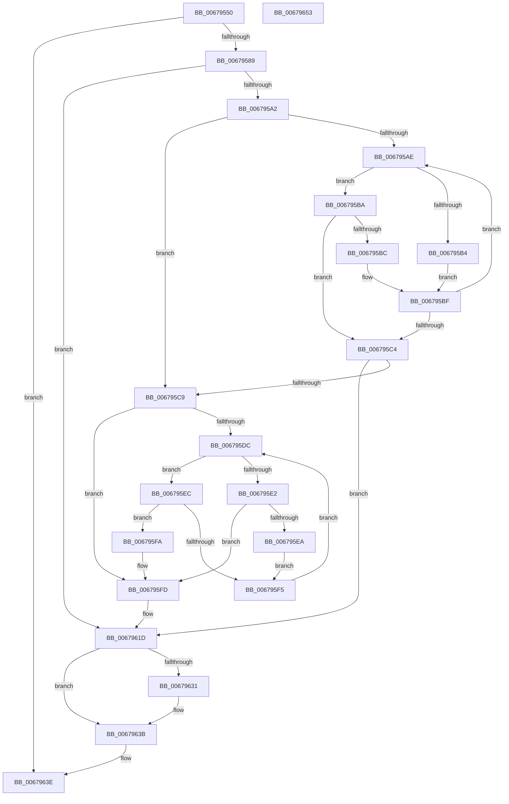

# MiCheckLostBadPageNode

- RVA: `0x00679550`–`0x00679654` (길이 `260` bytes)
- VA: `0x0000000140679550`
- 실행 섹션: `.text`
- PDB 이름 있음: `예`; PDB Function 태그: `아니요`
- unwind 정보 RVA: `0x0005C954`
- 디코드: `73`개 명령, `260/260` bytes 표시
- 미해석 바이트: `0` (있으면 어셈블리에 `.byte`로 보존)

> 이 문서는 커널 이미지의 기계어와 PDB 기호를 분석해 생성했습니다. 4번과 5번은 함수 원형과 자료형을 바이너리 사용 방식에서 추정한 C 해석이며 원본 소스 복구 결과는 아닙니다.

## 1. Dependencies

- 직접 호출 지점: **5**; 고유 호출 대상: **5**
- 직접 호출자로 확인된 함수: **1**
- RIP 상대 이미지 참조: **3**

### Outgoing calls
- `0x00679578` → [MiAllocatePool](../35/MiAllocatePool_function_0035B540.md) (function, `0x0035B540`)
- `0x00679590` → [ExAcquireSpinLockExclusive](../24/ExAcquireSpinLockExclusive_function_00248690.md) (function, `0x00248690`)
- `0x00679607` → [RtlAvlInsertNodeEx](../26/RtlAvlInsertNodeEx_function_00265790.md) (function, `0x00265790`)
- `0x00679627` → [MiReleaseSpinLockExclusive](../24/MiReleaseSpinLockExclusive_function_002482C0.md) (function, `0x002482C0`)
- `0x00679636` → [ExFreePoolWithTag](../../poolcode/B8/ExFreePoolWithTag_function_00B82870.md) (function, `0x00B82870`)

### Direct callers
- [MiGetListOfPendingBadPages](MiGetListOfPendingBadPages_function_006799D0.md) at `0x00679B70`

### Static image references
- `0x00679589` → RVA `0x00E2FFD0` (`.data`; read)
- `0x006795A2` → RVA `0x00E2FFC0` (`.data`; read)
- `0x0067960C` → RVA `0x00E2FFD8` (`.data`; read/write)

## 2. Other-region calls and transfers

- 다른 실행 섹션으로 향하는 call: **1**
  - `0x00679636` → [ExFreePoolWithTag](../../poolcode/B8/ExFreePoolWithTag_function_00B82870.md) (`.text` → `POOLCODE`)
- 별도 외부 분기/꼬리 이동을 확인하지 못했습니다.

## 3. Assembly (complete function range)

```asm
00679550  48 89 5C 24 08                  mov qword ptr [rsp + 8], rbx
00679555  48 89 6C 24 10                  mov qword ptr [rsp + 0x10], rbp
0067955A  48 89 74 24 18                  mov qword ptr [rsp + 0x18], rsi
0067955F  57                              push rdi
00679560  48 83 EC 20                     sub rsp, 0x20
00679564  BA 20 00 00 00                  mov edx, 0x20
00679569  48 8B D9                        mov rbx, rcx
0067956C  41 B8 4D 69 42 6C               mov r8d, 0x6c42694d
00679572  40 32 F6                        xor sil, sil
00679575  8D 4A 20                        lea ecx, [rdx + 0x20]
00679578  E8 C3 1F CE FF                  call 0x14035b540
0067957D  48 8B F8                        mov rdi, rax
00679580  48 85 C0                        test rax, rax
00679583  0F 84 B5 00 00 00               je 0x14067963e
00679589  48 8D 0D 40 6A 7B 00            lea rcx, [rip + 0x7b6a40]
00679590  E8 FB F0 BC FF                  call 0x140248690
00679595  40 8A E8                        mov bpl, al
00679598  8B 43 20                        mov eax, dword ptr [rbx + 0x20]
0067959B  C1 E8 18                        shr eax, 0x18
0067959E  A8 40                           test al, 0x40
006795A0  74 7B                           je 0x14067961d
006795A2  48 8B 05 17 6A 7B 00            mov rax, qword ptr [rip + 0x7b6a17]
006795A9  48 85 C0                        test rax, rax
006795AC  74 1B                           je 0x1406795c9
006795AE  48 3B 58 18                     cmp rbx, qword ptr [rax + 0x18]
006795B2  76 06                           jbe 0x1406795ba
006795B4  48 8B 40 08                     mov rax, qword ptr [rax + 8]
006795B8  EB 05                           jmp 0x1406795bf
006795BA  73 08                           jae 0x1406795c4
006795BC  48 8B 00                        mov rax, qword ptr [rax]
006795BF  48 85 C0                        test rax, rax
006795C2  75 EA                           jne 0x1406795ae
006795C4  48 85 C0                        test rax, rax
006795C7  75 54                           jne 0x14067961d
006795C9  48 89 5F 18                     mov qword ptr [rdi + 0x18], rbx
006795CD  45 32 C0                        xor r8b, r8b
006795D0  48 8B 15 E9 69 7B 00            mov rdx, qword ptr [rip + 0x7b69e9]
006795D7  48 85 D2                        test rdx, rdx
006795DA  74 21                           je 0x1406795fd
006795DC  48 3B 5A 18                     cmp rbx, qword ptr [rdx + 0x18]
006795E0  73 0A                           jae 0x1406795ec
006795E2  48 8B 02                        mov rax, qword ptr [rdx]
006795E5  48 85 C0                        test rax, rax
006795E8  74 13                           je 0x1406795fd
006795EA  EB 09                           jmp 0x1406795f5
006795EC  48 8B 42 08                     mov rax, qword ptr [rdx + 8]
006795F0  48 85 C0                        test rax, rax
006795F3  74 05                           je 0x1406795fa
006795F5  48 8B D0                        mov rdx, rax
006795F8  EB E2                           jmp 0x1406795dc
006795FA  41 B0 01                        mov r8b, 1
006795FD  4C 8B CF                        mov r9, rdi
00679600  48 8D 0D B9 69 7B 00            lea rcx, [rip + 0x7b69b9]
00679607  E8 84 C1 BE FF                  call 0x140265790
0067960C  48 83 2D C4 69 7B 00 01         sub qword ptr [rip + 0x7b69c4], 1
00679614  BF 00 00 00 00                  mov edi, 0
00679619  40 0F 94 C6                     sete sil
0067961D  40 8A D5                        mov dl, bpl
00679620  48 8D 0D A9 69 7B 00            lea rcx, [rip + 0x7b69a9]
00679627  E8 94 EC BC FF                  call 0x1402482c0
0067962C  48 85 FF                        test rdi, rdi
0067962F  74 0A                           je 0x14067963b
00679631  33 D2                           xor edx, edx
00679633  48 8B CF                        mov rcx, rdi
00679636  E8 35 92 50 00                  call 0x140b82870
0067963B  40 8A C6                        mov al, sil
0067963E  48 8B 5C 24 30                  mov rbx, qword ptr [rsp + 0x30]
00679643  48 8B 6C 24 38                  mov rbp, qword ptr [rsp + 0x38]
00679648  48 8B 74 24 40                  mov rsi, qword ptr [rsp + 0x40]
0067964D  48 83 C4 20                     add rsp, 0x20
00679651  5F                              pop rdi
00679652  C3                              ret
00679653  CC                              int3
```

## 4. C-style interpretation (structured pseudocode)

```c
__int64 __fastcall MiCheckLostBadPageNode(__int64 a1)
{
    __int64 result;
    __int64 v_rsi;
    __int64 v_rsp;
    unsigned __int64 v_stack_p10;
    unsigned __int64 v_stack_p18;
    unsigned __int64 v_stack_p8;

    v_stack_p8 = v_rbx;
    v_stack_p10 = v_rbp;
    v_stack_p18 = v_rsi;
    v_rsp = (v_rsp) - (32);
    v_rsi = 0;
    result = MiAllocatePool(32 + 32, 32, (unsigned int)(0x6C42694DULL), a4);
    if (result == 0) goto loc_0067963E;
    result = ExAcquireSpinLockExclusive(v_rip + 8088128, 32, (unsigned int)(0x6C42694DULL), a4);
    result = (unsigned int)(((unsigned int)(*(unsigned int *)(a1 + 32))) >> (24));
    if ((((unsigned __int8)(result)) & (64)) == 0) goto loc_0067961D;
    if (*(unsigned __int64 *)(v_rip + 8088087) == 0) goto loc_006795C9;
loc_006795AE:
    if (a1 <= (*(unsigned __int64 *)(*(unsigned __int64 *)(v_rip + 8088087) + 24))) goto loc_006795BA;
    goto loc_006795BF;
loc_006795BA:
    if (a1 >= (*(unsigned __int64 *)(*(unsigned __int64 *)(v_rip + 8088087) + 24))) goto loc_006795C4;
loc_006795BF:
    if (*(unsigned __int64 *)(*(unsigned __int64 *)(*(unsigned __int64 *)(v_rip + 8088087) + 8)) != 0) goto loc_006795AE;
loc_006795C4:
    if (*(unsigned __int64 *)(*(unsigned __int64 *)(*(unsigned __int64 *)(v_rip + 8088087) + 8)) != 0) goto loc_0067961D;
loc_006795C9:
    *(unsigned __int64 *)(result + 24) = a1;
    a3 = 0;
    if (*(unsigned __int64 *)(v_rip + 8088041) == 0) goto loc_006795FD;
loc_006795DC:
    if (a1 >= (*(unsigned __int64 *)(*(unsigned __int64 *)(v_rip + 8088041) + 24))) goto loc_006795EC;
    if (*(unsigned __int64 *)(*(unsigned __int64 *)(v_rip + 8088041)) == 0) goto loc_006795FD;
    goto loc_006795F5;
loc_006795EC:
    if (*(unsigned __int64 *)(*(unsigned __int64 *)(v_rip + 8088041) + 8) == 0) goto loc_006795FA;
loc_006795F5:
    goto loc_006795DC;
loc_006795FA:
loc_006795FD:
    result = RtlAvlInsertNodeEx(v_rip + 8087993, *(unsigned __int64 *)(*(unsigned __int64 *)(v_rip + 8088041) + 8), 1, result);
    v_rsi = (*(unsigned __int64 *)(*(unsigned __int64 *)(v_rip + 8088041) + 8) == 0) ? 1 : 0;
loc_0067961D:
    result = MiReleaseSpinLockExclusive(v_rip + 8087977, (unsigned __int8)((unsigned __int8)(result)), 1, result);
    if (0 != 0) {
        a2 = 0;
        a1 = 0;
        result = ExFreePoolWithTag(a1, a2, 1, result);
    }
loc_0067963E:
    v_rsp = (v_rsp) + (32);
    return (unsigned __int8)(v_rsi);
}
```

## 5. (Beta) C Style

```c
int64_t MiCheckLostBadPageNode(void *Arg1)
{
    uint8_t *arg1 = (uint8_t *)Arg1;

    int64_t result;
    int64_t local_rsi;
    int64_t local_rsp;
    uint64_t v_stack_p10;
    uint64_t v_stack_p18;
    uint64_t v_stack_p8;

    v_stack_p8 = local_rbx;
    v_stack_p10 = local_rbp;
    v_stack_p18 = local_rsi;
    local_rsp = (local_rsp) - (32);
    local_rsi = 0;
    result = MiAllocatePool(32 + 32, 32, (uint32_t)(0x6C42694DULL), a4);
    if (result == 0) goto loc_0067963E;
    result = ExAcquireSpinLockExclusive(v_rip + 8088128, 32, (uint32_t)(0x6C42694DULL), a4);
    result = (uint32_t)(((uint32_t)(*(uint32_t *)(arg1 + 0x20))) >> (24));
    if ((((uint8_t)(result)) & (64)) == 0) goto loc_0067961D;
    if (*(uint64_t *)(v_rip + 0x7B6A17) == 0) goto loc_006795C9;
loc_006795AE:
    if (Arg1 <= (*(uint64_t *)(*(uint64_t *)(v_rip + 0x7B6A17) + 0x18))) goto loc_006795BA;
    goto loc_006795BF;
loc_006795BA:
    if (Arg1 >= (*(uint64_t *)(*(uint64_t *)(v_rip + 0x7B6A17) + 0x18))) goto loc_006795C4;
loc_006795BF:
    if (*(uint64_t *)(*(uint64_t *)(*(uint64_t *)(v_rip + 0x7B6A17) + 0x8)) != 0) goto loc_006795AE;
loc_006795C4:
    if (*(uint64_t *)(*(uint64_t *)(*(uint64_t *)(v_rip + 0x7B6A17) + 0x8)) != 0) goto loc_0067961D;
loc_006795C9:
    *(void **)(result + 0x18) = Arg1;
    a3 = 0;
    if (*(uint64_t *)(v_rip + 0x7B69E9) == 0) goto loc_006795FD;
loc_006795DC:
    if (Arg1 >= (*(uint64_t *)(*(uint64_t *)(v_rip + 0x7B69E9) + 0x18))) goto loc_006795EC;
    if (*(uint64_t *)(*(uint64_t *)(v_rip + 0x7B69E9)) == 0) goto loc_006795FD;
    goto loc_006795F5;
loc_006795EC:
    if (*(uint64_t *)(*(uint64_t *)(v_rip + 0x7B69E9) + 0x8) == 0) goto loc_006795FA;
loc_006795F5:
    goto loc_006795DC;
loc_006795FA:
loc_006795FD:
    result = RtlAvlInsertNodeEx(v_rip + 8087993, *(uint64_t *)(*(uint64_t *)(v_rip + 0x7B69E9) + 0x8), 1, result);
    local_rsi = (*(uint64_t *)(*(uint64_t *)(v_rip + 0x7B69E9) + 0x8) == 0) ? 1 : 0;
loc_0067961D:
    result = MiReleaseSpinLockExclusive(v_rip + 8087977, (uint8_t)((uint8_t)(result)), 1, result);
    if (0 != 0) {
        a2 = 0;
        Arg1 = 0;
        result = ExFreePoolWithTag(Arg1, a2, 1, result);
    }
loc_0067963E:
    local_rsp = (local_rsp) + (32);
    return (uint8_t)(local_rsi);
}
```

### 관측된 메모리 오프셋

구조체 형식이 확인되지 않은 접근은 인자 기준의 오프셋으로만 기록했습니다.

| 기준 인자 | 오프셋 표현 | 폭 (bit) | 접근 |
|---|---:|---:|---|
| `Arg1` | `+ 0x20` | `32` | `R` |

## 6. Execution-region graph

[열기: 2D/3D 그래프와 함수 탐색 컨트롤 패널](../../../control-panel.html?section=text&rva=0x00679550&view=graph)

- 2D 그래프는 위에서 아래로 흐르고, 3D 그래프는 빈 공간을 드래그해 회전합니다. Shift+드래그는 이동, 휠은 확대·축소, 함수 노드 선택은 대상 보고서 이동입니다.

### Static fallback


