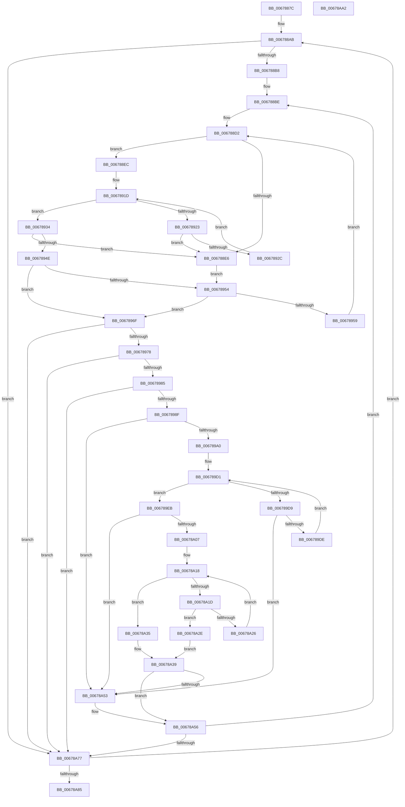

# MiClearMirrorBitmaps

- RVA: `0x0067887C`–`0x00678AA3` (길이 `551` bytes)
- VA: `0x000000014067887C`
- 실행 섹션: `.text`
- PDB 이름 있음: `예`; PDB Function 태그: `아니요`
- unwind 정보 RVA: `0x000BCF54`
- 디코드: `162`개 명령, `551/551` bytes 표시
- 미해석 바이트: `0` (있으면 어셈블리에 `.byte`로 보존)

> 이 문서는 커널 이미지의 기계어와 PDB 기호를 분석해 생성했습니다. 4번과 5번은 함수 원형과 자료형을 바이너리 사용 방식에서 추정한 C 해석이며 원본 소스 복구 결과는 아닙니다.

## 1. Dependencies

- 직접 호출 지점: **1**; 고유 호출 대상: **1**
- 직접 호출자로 확인된 함수: **1**
- RIP 상대 이미지 참조: **2**

### Outgoing calls
- `0x00678A66` → [RtlClearBitsEx](../29/RtlClearBitsEx_function_00297740.md) (function, `0x00297740`)

### Direct callers
- [MiRemovePhysicalMemory](../../page/7F/MiRemovePhysicalMemory_function_007FAD3C.md) at `0x007FAF86`

### Static image references
- `0x0067889B` → RVA `0x00E30190` (`.data`; read)
- `0x006788AB` → RVA `0x00E301B0` (`.data`; read)

## 2. Other-region calls and transfers

- 다른 실행 섹션으로 향하는 call: **0**
- 별도 외부 분기/꼬리 이동을 확인하지 못했습니다.

## 3. Assembly (complete function range)

```asm
0067887C  48 89 5C 24 08                  mov qword ptr [rsp + 8], rbx
00678881  48 89 6C 24 10                  mov qword ptr [rsp + 0x10], rbp
00678886  48 89 74 24 20                  mov qword ptr [rsp + 0x20], rsi
0067888B  57                              push rdi
0067888C  41 54                           push r12
0067888E  41 55                           push r13
00678890  41 56                           push r14
00678892  41 57                           push r15
00678894  48 83 EC 20                     sub rsp, 0x20
00678898  4C 8B E2                        mov r12, rdx
0067889B  48 8D 35 EE 78 7B 00            lea rsi, [rip + 0x7b78ee]
006788A2  4C 8B E9                        mov r13, rcx
006788A5  41 BF 02 00 00 00               mov r15d, 2
006788AB  83 3D FE 78 7B 00 00            cmp dword ptr [rip + 0x7b78fe], 0
006788B2  0F 84 BF 01 00 00               je 0x140678a77
006788B8  49 8B FD                        mov rdi, r13
006788BB  49 8B EC                        mov rbp, r12
006788BE  4C 8B 1E                        mov r11, qword ptr [rsi]
006788C1  4C 8B 76 08                     mov r14, qword ptr [rsi + 8]
006788C5  49 3B FB                        cmp rdi, r11
006788C8  4D 1B D2                        sbb r10, r10
006788CB  4C 23 D7                        and r10, rdi
006788CE  4D 8D 43 FF                     lea r8, [r11 - 1]
006788D2  83 64 24 60 00                  and dword ptr [rsp + 0x60], 0
006788D7  49 8B C0                        mov rax, r8
006788DA  49 2B C2                        sub rax, r10
006788DD  48 FF C0                        inc rax
006788E0  48 83 F8 01                     cmp rax, 1
006788E4  73 06                           jae 0x1406788ec
006788E6  48 83 CA FF                     or rdx, 0xffffffffffffffff
006788EA  EB 68                           jmp 0x140678954
006788EC  49 8B C0                        mov rax, r8
006788EF  41 8A CA                        mov cl, r10b
006788F2  48 C1 E8 06                     shr rax, 6
006788F6  80 E1 3F                        and cl, 0x3f
006788F9  41 B9 01 00 00 00               mov r9d, 1
006788FF  49 D3 E1                        shl r9, cl
00678902  49 FF C9                        dec r9
00678905  49 8D 1C C6                     lea rbx, [r14 + rax*8]
00678909  49 8B C2                        mov rax, r10
0067890C  48 C1 E8 06                     shr rax, 6
00678910  49 8D 14 C6                     lea rdx, [r14 + rax*8]
00678914  48 8B 02                        mov rax, qword ptr [rdx]
00678917  48 F7 D0                        not rax
0067891A  4C 0B C8                        or r9, rax
0067891D  49 83 F9 FF                     cmp r9, -1
00678921  75 11                           jne 0x140678934
00678923  48 83 C2 08                     add rdx, 8
00678927  48 3B D3                        cmp rdx, rbx
0067892A  77 BA                           ja 0x1406788e6
0067892C  4C 8B 0A                        mov r9, qword ptr [rdx]
0067892F  49 F7 D1                        not r9
00678932  EB E9                           jmp 0x14067891d
00678934  49 2B D6                        sub rdx, r14
00678937  49 F7 D1                        not r9
0067893A  48 C1 FA 03                     sar rdx, 3
0067893E  49 0F BC C1                     bsf rax, r9
00678942  48 C1 E2 06                     shl rdx, 6
00678946  48 03 D0                        add rdx, rax
00678949  49 3B D0                        cmp rdx, r8
0067894C  77 98                           ja 0x1406788e6
0067894E  48 83 FA FF                     cmp rdx, -1
00678952  75 1B                           jne 0x14067896f
00678954  4D 85 D2                        test r10, r10
00678957  74 16                           je 0x14067896f
00678959  4C 8D 47 01                     lea r8, [rdi + 1]
0067895D  4D 3B C3                        cmp r8, r11
00678960  4D 0F 47 C3                     cmova r8, r11
00678964  49 FF C8                        dec r8
00678967  45 33 D2                        xor r10d, r10d
0067896A  E9 63 FF FF FF                  jmp 0x1406788d2
0067896F  48 3B D7                        cmp rdx, rdi
00678972  0F 82 FF 00 00 00               jb 0x140678a77
00678978  4A 8D 04 27                     lea rax, [rdi + r12]
0067897C  48 3B D0                        cmp rdx, rax
0067897F  0F 83 F2 00 00 00               jae 0x140678a77
00678985  48 83 FA FF                     cmp rdx, -1
00678989  0F 84 E8 00 00 00               je 0x140678a77
0067898F  83 64 24 60 00                  and dword ptr [rsp + 0x60], 0
00678994  4C 8B 16                        mov r10, qword ptr [rsi]
00678997  4C 3B D2                        cmp r10, rdx
0067899A  0F 86 B3 00 00 00               jbe 0x140678a53
006789A0  49 8D 42 FF                     lea rax, [r10 - 1]
006789A4  8A CA                           mov cl, dl
006789A6  48 C1 E8 06                     shr rax, 6
006789AA  80 E1 3F                        and cl, 0x3f
006789AD  4D 8D 1C C6                     lea r11, [r14 + rax*8]
006789B1  48 8B C2                        mov rax, rdx
006789B4  48 C1 E8 06                     shr rax, 6
006789B8  4D 8D 04 C6                     lea r8, [r14 + rax*8]
006789BC  B8 01 00 00 00                  mov eax, 1
006789C1  4D 8B 08                        mov r9, qword ptr [r8]
006789C4  48 D3 E0                        shl rax, cl
006789C7  48 FF C8                        dec rax
006789CA  4C 0B C8                        or r9, rax
006789CD  49 8D 40 08                     lea rax, [r8 + 8]
006789D1  49 F7 D1                        not r9
006789D4  4D 85 C9                        test r9, r9
006789D7  75 12                           jne 0x1406789eb
006789D9  49 3B C3                        cmp rax, r11
006789DC  77 75                           ja 0x140678a53
006789DE  49 83 C0 08                     add r8, 8
006789E2  48 83 C0 08                     add rax, 8
006789E6  4D 8B 08                        mov r9, qword ptr [r8]
006789E9  EB E6                           jmp 0x1406789d1
006789EB  49 0F BC C9                     bsf rcx, r9
006789EF  49 8B D8                        mov rbx, r8
006789F2  49 2B DE                        sub rbx, r14
006789F5  8B C1                           mov eax, ecx
006789F7  48 C1 FB 03                     sar rbx, 3
006789FB  48 C1 E3 06                     shl rbx, 6
006789FF  48 03 D8                        add rbx, rax
00678A02  49 3B DA                        cmp rbx, r10
00678A05  77 4C                           ja 0x140678a53
00678A07  B8 01 00 00 00                  mov eax, 1
00678A0C  48 D3 E0                        shl rax, cl
00678A0F  48 FF C8                        dec rax
00678A12  49 0B C1                        or rax, r9
00678A15  48 F7 D0                        not rax
00678A18  48 85 C0                        test rax, rax
00678A1B  75 18                           jne 0x140678a35
00678A1D  49 8D 40 08                     lea rax, [r8 + 8]
00678A21  49 3B C3                        cmp rax, r11
00678A24  77 08                           ja 0x140678a2e
00678A26  4C 8B C0                        mov r8, rax
00678A29  48 8B 00                        mov rax, qword ptr [rax]
00678A2C  EB EA                           jmp 0x140678a18
00678A2E  B8 40 00 00 00                  mov eax, 0x40
00678A33  EB 04                           jmp 0x140678a39
00678A35  48 0F BC C0                     bsf rax, rax
00678A39  4D 2B C6                        sub r8, r14
00678A3C  49 C1 F8 03                     sar r8, 3
00678A40  49 C1 E0 06                     shl r8, 6
00678A44  4C 03 C0                        add r8, rax
00678A47  4D 3B C2                        cmp r8, r10
00678A4A  4D 0F 47 C2                     cmova r8, r10
00678A4E  4C 3B C3                        cmp r8, rbx
00678A51  75 03                           jne 0x140678a56
00678A53  49 8B DA                        mov rbx, r10
00678A56  48 2B DA                        sub rbx, rdx
00678A59  48 8B CE                        mov rcx, rsi
00678A5C  48 3B DD                        cmp rbx, rbp
00678A5F  48 0F 47 DD                     cmova rbx, rbp
00678A63  4C 8B C3                        mov r8, rbx
00678A66  E8 D5 EC C1 FF                  call 0x140297740
00678A6B  48 03 FB                        add rdi, rbx
00678A6E  48 2B EB                        sub rbp, rbx
00678A71  0F 85 47 FE FF FF               jne 0x1406788be
00678A77  48 83 C6 10                     add rsi, 0x10
00678A7B  49 83 EF 01                     sub r15, 1
00678A7F  0F 85 26 FE FF FF               jne 0x1406788ab
00678A85  48 8B 5C 24 50                  mov rbx, qword ptr [rsp + 0x50]
00678A8A  48 8B 6C 24 58                  mov rbp, qword ptr [rsp + 0x58]
00678A8F  48 8B 74 24 68                  mov rsi, qword ptr [rsp + 0x68]
00678A94  48 83 C4 20                     add rsp, 0x20
00678A98  41 5F                           pop r15
00678A9A  41 5E                           pop r14
00678A9C  41 5D                           pop r13
00678A9E  41 5C                           pop r12
00678AA0  5F                              pop rdi
00678AA1  C3                              ret
00678AA2  CC                              int3
```

## 4. C-style interpretation (structured pseudocode)

```c
__int64 __fastcall MiClearMirrorBitmaps(__int64 a1, __int64 a2)
{
    __int64 result;
    __int64 v_r10;
    __int64 v_r15;
    __int64 v_rbp;
    __int64 v_rbx;
    __int64 v_rdi;
    __int64 v_rsi;
    __int64 v_rsp;
    unsigned __int64 v_stack_p10;
    unsigned int v_stack_p18;
    unsigned __int64 v_stack_p20;
    unsigned __int64 v_stack_p8;

    v_stack_p8 = v_rbx;
    v_stack_p10 = v_rbp;
    v_stack_p20 = v_rsi;
    v_rsp = (v_rsp) - (32);
loc_006788AB:
    if ((*(unsigned int *)(v_rip + 8091902)) == 0) goto loc_00678A77;
loc_006788BE:
    v_r10 = (v_r10) & (a1);
loc_006788D2:
    result = (*(unsigned __int64 *)(v_rip + 8091886) - 1) - (v_r10);
    result = (result) + 1;
    if (result >= 1) goto loc_006788EC;
loc_006788E6:
    a2 = (a2) | (-1);
    goto loc_00678954;
loc_006788EC:
    result = (*(unsigned __int64 *)(v_rip + 8091886) - 1) >> (6);
    a1 = (unsigned __int8)(((unsigned __int8)(v_r10)) & (63));
    a4 = (1) << ((unsigned __int8)(a1));
    a4 = (a4) - 1;
    result = (v_r10) >> (6);
    result = ~(*(unsigned __int64 *)(*(unsigned __int64 *)(v_rip + 8091886 + 8) + result * 8));
    a4 = (a4) | (result);
loc_0067891D:
    if (a4 != -1) goto loc_00678934;
    a2 = (*(unsigned __int64 *)(v_rip + 8091886 + 8) + result * 8) + (8);
    if (a2 > (*(unsigned __int64 *)(v_rip + 8091886 + 8) + result * 8)) goto loc_006788E6;
    a4 = ~(*(unsigned __int64 *)(a2));
    goto loc_0067891D;
loc_00678934:
    a2 = (a2) - (*(unsigned __int64 *)(v_rip + 8091886 + 8));
    a4 = ~(a4);
    a2 = (a2) >> (3);
    a2 = (a2) << (6);
    a2 = (a2) + (result);
    if (a2 > (*(unsigned __int64 *)(v_rip + 8091886) - 1)) goto loc_006788E6;
    if (a2 != -1) goto loc_0067896F;
loc_00678954:
    if (v_r10 == 0) goto loc_0067896F;
    a3 = a1 + 1;
    if ((a1 + 1) > (*(unsigned __int64 *)(v_rip + 8091886))) { a3 = *(unsigned __int64 *)(v_rip + 8091886); }
    a3 = (a3) - 1;
    v_r10 = 0;
    goto loc_006788D2;
loc_0067896F:
    if (a2 < a1) goto loc_00678A77;
    if (a2 >= (a1 + a2 * 1)) goto loc_00678A77;
    if (a2 == -1) goto loc_00678A77;
    if ((*(unsigned __int64 *)(v_rip + 8091886)) <= a2) goto loc_00678A53;
    result = (*(unsigned __int64 *)(v_rip + 8091886) - 1) >> (6);
    a1 = (unsigned __int8)(((unsigned __int8)(a2)) & (63));
    result = (a2) >> (6);
    result = (1) << ((unsigned __int8)(a1));
    result = (result) - 1;
    a4 = (*(unsigned __int64 *)(*(unsigned __int64 *)(v_rip + 8091886 + 8) + result * 8)) | (result);
loc_006789D1:
    a4 = ~(a4);
    if (a4 != 0) goto loc_006789EB;
    if ((*(unsigned __int64 *)(v_rip + 8091886 + 8) + result * 8 + 8) > (*(unsigned __int64 *)(v_rip + 8091886 + 8) + result * 8)) goto loc_00678A53;
    a3 = (*(unsigned __int64 *)(v_rip + 8091886 + 8) + result * 8) + (8);
    result = (*(unsigned __int64 *)(v_rip + 8091886 + 8) + result * 8 + 8) + (8);
    goto loc_006789D1;
loc_006789EB:
    v_rbx = (a3) - (*(unsigned __int64 *)(v_rip + 8091886 + 8));
    v_rbx = (v_rbx) >> (3);
    v_rbx = (v_rbx) << (6);
    v_rbx = (v_rbx) + ((unsigned int)((unsigned int)(a1)));
    if (v_rbx > (*(unsigned __int64 *)(v_rip + 8091886))) goto loc_00678A53;
    result = (1) << ((unsigned __int8)(a1));
    result = (result) - 1;
    result = (result) | (*(unsigned __int64 *)(a3));
    result = ~(result);
loc_00678A18:
    if (result != 0) goto loc_00678A35;
    if ((a3 + 8) > (*(unsigned __int64 *)(v_rip + 8091886 + 8) + result * 8)) goto loc_00678A2E;
    goto loc_00678A18;
loc_00678A2E:
    goto loc_00678A39;
loc_00678A35:
loc_00678A39:
    a3 = (a3 + 8) - (*(unsigned __int64 *)(v_rip + 8091886 + 8));
    a3 = (a3) >> (3);
    a3 = (a3) << (6);
    a3 = (a3) + (64);
    if (a3 > (*(unsigned __int64 *)(v_rip + 8091886))) { a3 = *(unsigned __int64 *)(v_rip + 8091886); }
    if (a3 == v_rbx) {
        v_rbx = *(unsigned __int64 *)(v_rip + 8091886);
    }
    v_rbx = (v_rbx) - (a2);
    if (v_rbx > a2) { v_rbx = a2; }
    result = RtlClearBitsEx(v_rip + 8091886, a2, v_rbx, *(unsigned __int64 *)(a3));
    v_rdi = (a1) + (v_rbx);
    v_rbp = (a2) - (v_rbx);
    if (condition_is_not_equal) goto loc_006788BE;
loc_00678A77:
    v_rsi = (v_rip + 8091886) + (16);
    v_r15 = (2) - (1);
    if (condition_is_not_equal) goto loc_006788AB;
    v_rsp = (v_rsp) + (32);
    return result;
}
```

## 5. (Beta) C Style

```c
int64_t MiClearMirrorBitmaps(int64_t Arg1, int64_t Arg2)
{
    int64_t result;
    int64_t local_r10;
    int64_t local_r15;
    int64_t local_rbp;
    int64_t local_rbx;
    int64_t local_rdi;
    int64_t local_rsi;
    int64_t local_rsp;
    uint64_t v_stack_p10;
    uint32_t v_stack_p18;
    uint64_t v_stack_p20;
    uint64_t v_stack_p8;

    v_stack_p8 = local_rbx;
    v_stack_p10 = local_rbp;
    v_stack_p20 = local_rsi;
    local_rsp = (local_rsp) - (32);
loc_006788AB:
    if ((*(uint32_t *)(v_rip + 0x7B78FE)) == 0) goto loc_00678A77;
loc_006788BE:
    local_r10 = (local_r10) & (Arg1);
loc_006788D2:
    result = (*(uint64_t *)(v_rip + 0x7B78EE) - 1) - (local_r10);
    result = (result) + 1;
    if (result >= 1) goto loc_006788EC;
loc_006788E6:
    Arg2 = (Arg2) | (-1);
    goto loc_00678954;
loc_006788EC:
    result = (*(uint64_t *)(v_rip + 0x7B78EE) - 1) >> (6);
    Arg1 = (uint8_t)(((uint8_t)(local_r10)) & (63));
    a4 = (1) << ((uint8_t)(Arg1));
    a4 = (a4) - 1;
    result = (local_r10) >> (6);
    result = ~(*(uint64_t *)(*(uint64_t *)(v_rip + 0x7B78EE + 0x8) + result * 8));
    a4 = (a4) | (result);
loc_0067891D:
    if (a4 != -1) goto loc_00678934;
    Arg2 = (*(uint64_t *)(v_rip + 0x7B78EE + 0x8) + result * 8) + (8);
    if (Arg2 > (*(uint64_t *)(v_rip + 0x7B78EE + 0x8) + result * 8)) goto loc_006788E6;
    a4 = ~(*(uint64_t *)(Arg2));
    goto loc_0067891D;
loc_00678934:
    Arg2 = (Arg2) - (*(uint64_t *)(v_rip + 0x7B78EE + 0x8));
    a4 = ~(a4);
    Arg2 = (Arg2) >> (3);
    Arg2 = (Arg2) << (6);
    Arg2 = (Arg2) + (result);
    if (Arg2 > (*(uint64_t *)(v_rip + 0x7B78EE) - 1)) goto loc_006788E6;
    if (Arg2 != -1) goto loc_0067896F;
loc_00678954:
    if (local_r10 == 0) goto loc_0067896F;
    a3 = Arg1 + 1;
    if ((Arg1 + 1) > (*(uint64_t *)(v_rip + 0x7B78EE))) { a3 = *(uint64_t *)(v_rip + 0x7B78EE); }
    a3 = (a3) - 1;
    local_r10 = 0;
    goto loc_006788D2;
loc_0067896F:
    if (Arg2 < Arg1) goto loc_00678A77;
    if (Arg2 >= (Arg1 + Arg2 * 1)) goto loc_00678A77;
    if (Arg2 == -1) goto loc_00678A77;
    if ((*(uint64_t *)(v_rip + 0x7B78EE)) <= Arg2) goto loc_00678A53;
    result = (*(uint64_t *)(v_rip + 0x7B78EE) - 1) >> (6);
    Arg1 = (uint8_t)(((uint8_t)(Arg2)) & (63));
    result = (Arg2) >> (6);
    result = (1) << ((uint8_t)(Arg1));
    result = (result) - 1;
    a4 = (*(uint64_t *)(*(uint64_t *)(v_rip + 0x7B78EE + 0x8) + result * 8)) | (result);
loc_006789D1:
    a4 = ~(a4);
    if (a4 != 0) goto loc_006789EB;
    if ((*(uint64_t *)(v_rip + 0x7B78EE + 0x8) + result * 8 + 8) > (*(uint64_t *)(v_rip + 0x7B78EE + 0x8) + result * 8)) goto loc_00678A53;
    a3 = (*(uint64_t *)(v_rip + 0x7B78EE + 0x8) + result * 8) + (8);
    result = (*(uint64_t *)(v_rip + 0x7B78EE + 0x8) + result * 8 + 8) + (8);
    goto loc_006789D1;
loc_006789EB:
    local_rbx = (a3) - (*(uint64_t *)(v_rip + 0x7B78EE + 0x8));
    local_rbx = (local_rbx) >> (3);
    local_rbx = (local_rbx) << (6);
    local_rbx = (local_rbx) + ((uint32_t)((uint32_t)(Arg1)));
    if (local_rbx > (*(uint64_t *)(v_rip + 0x7B78EE))) goto loc_00678A53;
    result = (1) << ((uint8_t)(Arg1));
    result = (result) - 1;
    result = (result) | (*(uint64_t *)(a3));
    result = ~(result);
loc_00678A18:
    if (result != 0) goto loc_00678A35;
    if ((a3 + 8) > (*(uint64_t *)(v_rip + 0x7B78EE + 0x8) + result * 8)) goto loc_00678A2E;
    goto loc_00678A18;
loc_00678A2E:
    goto loc_00678A39;
loc_00678A35:
loc_00678A39:
    a3 = (a3 + 8) - (*(uint64_t *)(v_rip + 0x7B78EE + 0x8));
    a3 = (a3) >> (3);
    a3 = (a3) << (6);
    a3 = (a3) + (64);
    if (a3 > (*(uint64_t *)(v_rip + 0x7B78EE))) { a3 = *(uint64_t *)(v_rip + 0x7B78EE); }
    if (a3 == local_rbx) {
        local_rbx = *(uint64_t *)(v_rip + 0x7B78EE);
    }
    local_rbx = (local_rbx) - (Arg2);
    if (local_rbx > Arg2) { local_rbx = Arg2; }
    result = RtlClearBitsEx(v_rip + 8091886, Arg2, local_rbx, *(uint64_t *)(a3));
    local_rdi = (Arg1) + (local_rbx);
    local_rbp = (Arg2) - (local_rbx);
    if (condition_is_not_equal) goto loc_006788BE;
loc_00678A77:
    local_rsi = (v_rip + 8091886) + (16);
    local_r15 = (2) - (1);
    if (condition_is_not_equal) goto loc_006788AB;
    local_rsp = (local_rsp) + (32);
    return result;
}
```

## 6. Execution-region graph

[열기: 2D/3D 그래프와 함수 탐색 컨트롤 패널](../../../control-panel.html?section=text&rva=0x0067887C&view=graph)

- 2D 그래프는 위에서 아래로 흐르고, 3D 그래프는 빈 공간을 드래그해 회전합니다. Shift+드래그는 이동, 휠은 확대·축소, 함수 노드 선택은 대상 보고서 이동입니다.

### Static fallback


