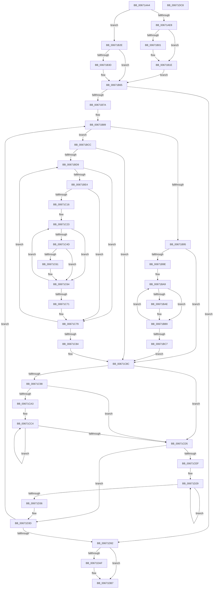

# MiComputeNodeMemory

- RVA: `0x00671AA4`–`0x00671DC9` (길이 `805` bytes)
- VA: `0x0000000140671AA4`
- 실행 섹션: `.text`
- PDB 이름 있음: `예`; PDB Function 태그: `아니요`
- unwind 정보 RVA: `0x000D7AEC`
- 디코드: `201`개 명령, `805/805` bytes 표시
- 미해석 바이트: `0` (있으면 어셈블리에 `.byte`로 보존)

> 이 문서는 커널 이미지의 기계어와 PDB 기호를 분석해 생성했습니다. 4번과 5번은 함수 원형과 자료형을 바이너리 사용 방식에서 추정한 C 해석이며 원본 소스 복구 결과는 아닙니다.

## 1. Dependencies

- 직접 호출 지점: **5**; 고유 호출 대상: **5**
- 직접 호출자로 확인된 함수: **4**
- RIP 상대 이미지 참조: **4**

### Outgoing calls
- `0x00671B45` → [MiReferencePageRuns](../37/MiReferencePageRuns_function_00379540.md) (function, `0x00379540`)
- `0x00671CD8` → [ExAcquireSpinLockExclusive](../24/ExAcquireSpinLockExclusive_function_00248690.md) (function, `0x00248690`)
- `0x00671D1F` → [memcpy](../6C/memcpy_function_006C6840.md) (function, `0x006C6840`)
- `0x00671D4E` → [MiReleaseSpinLockExclusive](../24/MiReleaseSpinLockExclusive_function_002482C0.md) (function, `0x002482C0`)
- `0x00671DB2` → [MiDereferencePageRuns](../3B/MiDereferencePageRuns_function_003BD388.md) (function, `0x003BD388`)

### Direct callers
- [MiPerformMemoryChange](MiPerformMemoryChange_function_006733A8.md) at `0x0067358E`
- [MiUpdatePartitionMemory](../69/MiUpdatePartitionMemory_function_00692294.md) at `0x006922EB`
- [MiCompleteMemoryAddition](../../page/7F/MiCompleteMemoryAddition_function_007F9FAC.md) at `0x007F9FD1`
- [MiInitializePhysicalMemoryBlocks](../../init/C6/MiInitializePhysicalMemoryBlocks_function_00C60920.md) at `0x00C609D8`

### Static image references
- `0x00671ACE` → RVA `0x00E38D00` (`.data`; read)
- `0x00671B65` → RVA `0x00FC5000` (`ALMOSTRO`; read)
- `0x00671C98` → RVA `0x00FC5002` (`ALMOSTRO`; read)
- `0x00671CB7` → RVA `0x00E37900` (`.data`; read)

## 2. Other-region calls and transfers

- 다른 실행 섹션으로 향하는 call: **0**
- 별도 외부 분기/꼬리 이동을 확인하지 못했습니다.

## 3. Assembly (complete function range)

```asm
00671AA4  89 54 24 10                     mov dword ptr [rsp + 0x10], edx
00671AA8  53                              push rbx
00671AA9  55                              push rbp
00671AAA  56                              push rsi
00671AAB  57                              push rdi
00671AAC  41 54                           push r12
00671AAE  41 55                           push r13
00671AB0  41 56                           push r14
00671AB2  41 57                           push r15
00671AB4  48 83 EC 58                     sub rsp, 0x58
00671AB8  0F B7 01                        movzx eax, word ptr [rcx]
00671ABB  45 33 E4                        xor r12d, r12d
00671ABE  4C 8B 69 20                     mov r13, qword ptr [rcx + 0x20]
00671AC2  49 83 CE FF                     or r14, 0xffffffffffffffff
00671AC6  66 89 84 24 B0 00 00 00         mov word ptr [rsp + 0xb0], ax
00671ACE  48 8D 05 2B 72 7C 00            lea rax, [rip + 0x7c722b]
00671AD5  4C 89 64 24 20                  mov qword ptr [rsp + 0x20], r12
00671ADA  48 8B F1                        mov rsi, rcx
00671ADD  41 8B EC                        mov ebp, r12d
00671AE0  45 8B FC                        mov r15d, r12d
00671AE3  4D 85 ED                        test r13, r13
00671AE6  74 46                           je 0x140671b2e
00671AE8  45 8B 4D 00                     mov r9d, dword ptr [r13]
00671AEC  4C 89 4C 24 28                  mov qword ptr [rsp + 0x28], r9
00671AF1  49 8D 79 01                     lea rdi, [r9 + 1]
00671AF5  48 C1 E7 04                     shl rdi, 4
00671AF9  49 03 FD                        add rdi, r13
00671AFC  45 85 C9                        test r9d, r9d
00671AFF  74 1D                           je 0x140671b1e
00671B01  4D 8B 75 10                     mov r14, qword ptr [r13 + 0x10]
00671B05  41 8D 41 FF                     lea eax, [r9 - 1]
00671B09  48 03 C0                        add rax, rax
00671B0C  4D 8B 7C C5 10                  mov r15, qword ptr [r13 + rax*8 + 0x10]
00671B11  49 FF CF                        dec r15
00671B14  4D 03 7C C5 18                  add r15, qword ptr [r13 + rax*8 + 0x18]
00671B19  4C 89 7C 24 20                  mov qword ptr [rsp + 0x20], r15
00671B1E  4C 89 B1 40 48 00 00            mov qword ptr [rcx + 0x4840], r14
00671B25  4C 89 B9 48 48 00 00            mov qword ptr [rcx + 0x4848], r15
00671B2C  EB 37                           jmp 0x140671b65
00671B2E  45 8B CC                        mov r9d, r12d
00671B31  49 8B FC                        mov rdi, r12
00671B34  4C 89 4C 24 28                  mov qword ptr [rsp + 0x28], r9
00671B39  85 D2                           test edx, edx
00671B3B  75 28                           jne 0x140671b65
00671B3D  BA 01 00 00 00                  mov edx, 1
00671B42  48 8B C8                        mov rcx, rax
00671B45  E8 F6 79 D0 FF                  call 0x140379540
00671B4A  4C 8B 4C 24 28                  mov r9, qword ptr [rsp + 0x28]
00671B4F  48 8B E8                        mov rbp, rax
00671B52  8B 94 24 A8 00 00 00            mov edx, dword ptr [rsp + 0xa8]
00671B59  8B 38                           mov edi, dword ptr [rax]
00671B5B  48 FF C7                        inc rdi
00671B5E  48 C1 E7 04                     shl rdi, 4
00671B62  48 03 F8                        add rdi, rax
00671B65  66 44 3B 25 93 34 95 00         cmp r12w, word ptr [rip + 0x953493]
00671B6D  41 8B DC                        mov ebx, r12d
00671B70  48 8B 46 10                     mov rax, qword ptr [rsi + 0x10]
00671B74  0F 83 18 02 00 00               jae 0x140671d92
00671B7A  4C 8D 90 74 3B 00 00            lea r10, [rax + 0x3b74]
00671B81  4C 89 94 24 B8 00 00 00         mov qword ptr [rsp + 0xb8], r10
00671B89  0F 57 C0                        xorps xmm0, xmm0
00671B8C  0F 11 44 24 38                  movups xmmword ptr [rsp + 0x38], xmm0
00671B91  85 D2                           test edx, edx
00671B93  74 37                           je 0x140671bcc
00671B95  45 85 C9                        test r9d, r9d
00671B98  0F 84 EE 00 00 00               je 0x140671c8c
00671B9E  48 8D 57 04                     lea rdx, [rdi + 4]
00671BA2  45 8B C9                        mov r9d, r9d
00671BA5  4D 8D 45 18                     lea r8, [r13 + 0x18]
00671BA9  39 5A FC                        cmp dword ptr [rdx - 4], ebx
00671BAC  75 0B                           jne 0x140671bb9
00671BAE  0F B6 0A                        movzx ecx, byte ptr [rdx]
00671BB1  49 8B 00                        mov rax, qword ptr [r8]
00671BB4  48 01 44 CC 38                  add qword ptr [rsp + rcx*8 + 0x38], rax
00671BB9  49 83 C0 10                     add r8, 0x10
00671BBD  48 83 C2 08                     add rdx, 8
00671BC1  49 83 E9 01                     sub r9, 1
00671BC5  75 E2                           jne 0x140671ba9
00671BC7  E9 C0 00 00 00                  jmp 0x140671c8c
00671BCC  41 8B D4                        mov edx, r12d
00671BCF  44 39 65 00                     cmp dword ptr [rbp], r12d
00671BD3  0F 86 B3 00 00 00               jbe 0x140671c8c
00671BD9  8B C2                           mov eax, edx
00671BDB  39 1C C7                        cmp dword ptr [rdi + rax*8], ebx
00671BDE  0F 85 95 00 00 00               jne 0x140671c79
00671BE4  8A 4C C7 04                     mov cl, byte ptr [rdi + rax*8 + 4]
00671BE8  48 03 C0                        add rax, rax
00671BEB  88 8C 24 A0 00 00 00            mov byte ptr [rsp + 0xa0], cl
00671BF2  48 8B 4C C5 10                  mov rcx, qword ptr [rbp + rax*8 + 0x10]
00671BF7  4C 8D 04 49                     lea r8, [rcx + rcx*2]
00671BFB  49 C1 E0 04                     shl r8, 4
00671BFF  49 B9 00 00 00 00 00 DE FF FF   movabs r9, 0xffffde0000000000
00671C09  4D 03 C1                        add r8, r9
00671C0C  4C 8B 4C C5 18                  mov r9, qword ptr [rbp + rax*8 + 0x18]
00671C11  4D 85 C9                        test r9, r9
00671C14  74 63                           je 0x140671c79
00671C16  44 0F B6 94 24 A0 00 00 00      movzx r10d, byte ptr [rsp + 0xa0]
00671C1F  49 83 C0 28                     add r8, 0x28
00671C23  49 8B 00                        mov rax, qword ptr [r8]
00671C26  4D 8B E6                        mov r12, r14
00671C29  48 C1 E8 2B                     shr rax, 0x2b
00671C2D  4D 8B DE                        mov r11, r14
00671C30  C7 84 24 A0 00 00 00 FF 03 00 00  mov dword ptr [rsp + 0xa0], 0x3ff
00671C3B  66 23 84 24 A0 00 00 00         and ax, word ptr [rsp + 0xa0]
00671C43  66 3B 84 24 B0 00 00 00         cmp ax, word ptr [rsp + 0xb0]
00671C4B  75 17                           jne 0x140671c64
00671C4D  4A FF 44 D4 38                  inc qword ptr [rsp + r10*8 + 0x38]
00671C52  4C 8B F1                        mov r14, rcx
00671C55  4C 3B D9                        cmp r11, rcx
00671C58  4D 0F 46 F3                     cmovbe r14, r11
00671C5C  4C 3B F9                        cmp r15, rcx
00671C5F  73 03                           jae 0x140671c64
00671C61  4C 8B F9                        mov r15, rcx
00671C64  48 FF C1                        inc rcx
00671C67  49 83 C0 30                     add r8, 0x30
00671C6B  49 83 E9 01                     sub r9, 1
00671C6F  75 B2                           jne 0x140671c23
00671C71  4C 89 7C 24 20                  mov qword ptr [rsp + 0x20], r15
00671C76  45 33 E4                        xor r12d, r12d
00671C79  FF C2                           inc edx
00671C7B  3B 55 00                        cmp edx, dword ptr [rbp]
00671C7E  0F 82 55 FF FF FF               jb 0x140671bd9
00671C84  4C 8B 94 24 B8 00 00 00         mov r10, qword ptr [rsp + 0xb8]
00671C8C  48 8D 05 6D 70 7C 00            lea rax, [rip + 0x7c706d]
00671C93  48 3B F0                        cmp rsi, rax
00671C96  75 3D                           jne 0x140671cd5
00671C98  0F B6 15 63 33 95 00            movzx edx, byte ptr [rip + 0x953363]
00671C9F  84 D2                           test dl, dl
00671CA1  74 32                           je 0x140671cd5
00671CA3  4C 8D 44 24 38                  lea r8, [rsp + 0x38]
00671CA8  44 8B CB                        mov r9d, ebx
00671CAB  49 C1 E1 04                     shl r9, 4
00671CAF  48 8D 4C 24 38                  lea rcx, [rsp + 0x38]
00671CB4  4D 2B C8                        sub r9, r8
00671CB7  4C 8D 05 42 5C 7C 00            lea r8, [rip + 0x7c5c42]
00671CBE  4D 03 C8                        add r9, r8
00671CC1  44 8B C2                        mov r8d, edx
00671CC4  49 8B 04 09                     mov rax, qword ptr [r9 + rcx]
00671CC8  48 29 01                        sub qword ptr [rcx], rax
00671CCB  48 8D 49 08                     lea rcx, [rcx + 8]
00671CCF  49 83 E8 01                     sub r8, 1
00671CD3  75 EF                           jne 0x140671cc4
00671CD5  49 8B CA                        mov rcx, r10
00671CD8  E8 B3 69 BD FF                  call 0x140248690
00671CDD  0F B6 0D 1E 33 95 00            movzx ecx, byte ptr [rip + 0x95331e]
00671CE4  88 84 24 A0 00 00 00            mov byte ptr [rsp + 0xa0], al
00671CEB  84 C9                           test cl, cl
00671CED  74 4E                           je 0x140671d3d
00671CEF  44 8B C1                        mov r8d, ecx
00671CF2  48 89 4C 24 30                  mov qword ptr [rsp + 0x30], rcx
00671CF7  4C 8D 7C 24 38                  lea r15, [rsp + 0x38]
00671CFC  49 C1 E0 03                     shl r8, 3
00671D00  48 8D 44 24 48                  lea rax, [rsp + 0x48]
00671D05  49 8B CF                        mov rcx, r15
00671D08  48 2B C8                        sub rcx, rax
00671D0B  49 8B D7                        mov rdx, r15
00671D0E  48 8B 84 24 B8 00 00 00         mov rax, qword ptr [rsp + 0xb8]
00671D16  48 05 0C FF FF FF               add rax, -0xf4
00671D1C  48 03 C8                        add rcx, rax
00671D1F  E8 1C 4B 05 00                  call 0x1406c6840
00671D24  48 8B 44 24 30                  mov rax, qword ptr [rsp + 0x30]
00671D29  4D 03 27                        add r12, qword ptr [r15]
00671D2C  4D 8D 7F 08                     lea r15, [r15 + 8]
00671D30  48 83 E8 01                     sub rax, 1
00671D34  75 F3                           jne 0x140671d29
00671D36  8A 84 24 A0 00 00 00            mov al, byte ptr [rsp + 0xa0]
00671D3D  48 8B 8C 24 B8 00 00 00         mov rcx, qword ptr [rsp + 0xb8]
00671D45  8A D0                           mov dl, al
00671D47  4C 89 A1 0C FF FF FF            mov qword ptr [rcx - 0xf4], r12
00671D4E  E8 6D 65 BD FF                  call 0x1402482c0
00671D53  4C 8B 94 24 B8 00 00 00         mov r10, qword ptr [rsp + 0xb8]
00671D5B  FF C3                           inc ebx
00671D5D  0F B7 05 9C 32 95 00            movzx eax, word ptr [rip + 0x95329c]
00671D64  49 81 C2 80 DF 00 00            add r10, 0xdf80
00671D6B  4C 8B 7C 24 20                  mov r15, qword ptr [rsp + 0x20]
00671D70  41 BC 00 00 00 00               mov r12d, 0
00671D76  4C 8B 4C 24 28                  mov r9, qword ptr [rsp + 0x28]
00671D7B  8B 94 24 A8 00 00 00            mov edx, dword ptr [rsp + 0xa8]
00671D82  4C 89 94 24 B8 00 00 00         mov qword ptr [rsp + 0xb8], r10
00671D8A  3B D8                           cmp ebx, eax
00671D8C  0F 82 F7 FD FF FF               jb 0x140671b89
00671D92  4D 3B F7                        cmp r14, r15
00671D95  4C 89 BE 48 48 00 00            mov qword ptr [rsi + 0x4848], r15
00671D9C  49 8B C4                        mov rax, r12
00671D9F  49 0F 46 C6                     cmovbe rax, r14
00671DA3  48 89 86 40 48 00 00            mov qword ptr [rsi + 0x4840], rax
00671DAA  48 85 ED                        test rbp, rbp
00671DAD  74 08                           je 0x140671db7
00671DAF  48 8B CD                        mov rcx, rbp
00671DB2  E8 D1 B5 D4 FF                  call 0x1403bd388
00671DB7  48 83 C4 58                     add rsp, 0x58
00671DBB  41 5F                           pop r15
00671DBD  41 5E                           pop r14
00671DBF  41 5D                           pop r13
00671DC1  41 5C                           pop r12
00671DC3  5F                              pop rdi
00671DC4  5E                              pop rsi
00671DC5  5D                              pop rbp
00671DC6  5B                              pop rbx
00671DC7  C3                              ret
00671DC8  CC                              int3
```

## 4. C-style interpretation (structured pseudocode)

```c
__int64 __fastcall MiComputeNodeMemory(__int64 a1, int a2)
{
    __int64 result;
    __int64 v_r10;
    __int64 v_r12;
    __int64 v_r14;
    __int64 v_r15;
    __int64 v_rbp;
    __int64 v_rbx;
    __int64 v_rdi;
    __int64 v_rsp;
    unsigned __int64 v_stack_m50;
    unsigned __int64 v_stack_m60;
    unsigned __int64 v_stack_m68;
    unsigned __int64 v_stack_m70;
    unsigned __int64 v_stack_m78;
    unsigned int v_stack_p10;
    unsigned __int16 v_stack_p18;
    unsigned __int64 v_stack_p20;
    unsigned __int8 v_stack_p8;

    v_stack_p10 = a2;
    v_rsp = (v_rsp) - (88);
    v_r12 = 0;
    v_r14 = (v_r14) | (-1);
    v_stack_p18 = (unsigned __int16)(*(unsigned __int16 *)(a1));
    v_stack_m78 = 0;
    if (*(unsigned __int64 *)(a1 + 32) == 0) goto loc_00671B2E;
    v_stack_m70 = (unsigned int)(*(unsigned int *)(*(unsigned __int64 *)(a1 + 32)));
    v_rdi = ((unsigned int)(*(unsigned int *)(*(unsigned __int64 *)(a1 + 32))) + 1) << (4);
    v_rdi = (v_rdi) + (*(unsigned __int64 *)(a1 + 32));
    result = v_rip + 8155691;
    v_r15 = 0;
    if ((unsigned int)((unsigned int)(*(unsigned int *)(*(unsigned __int64 *)(a1 + 32)))) != 0) {
        v_r14 = *(unsigned __int64 *)(*(unsigned __int64 *)(a1 + 32) + 16);
        result = (unsigned int)(*(unsigned int *)(*(unsigned __int64 *)(a1 + 32))) - 1;
        result = (result) + (result);
        v_r15 = *(unsigned __int64 *)(*(unsigned __int64 *)(a1 + 32) + result * 8 + 16);
        v_r15 = (v_r15) - 1;
        v_r15 = (v_r15) + (*(unsigned __int64 *)(*(unsigned __int64 *)(a1 + 32) + result * 8 + 24));
        v_stack_m78 = v_r15;
    }
    *(unsigned __int64 *)(a1 + 18496) = v_r14;
    *(unsigned __int64 *)(a1 + 18504) = v_r15;
    goto loc_00671B65;
loc_00671B2E:
    v_stack_m70 = 0;
    v_rdi = 0;
    v_rbp = 0;
    if (a2 == 0) {
        a2 = 1;
        a1 = result;
        result = MiReferencePageRuns(a1, a2, a3, 0);
        a4 = v_stack_m70;
        v_rbp = result;
        a2 = v_stack_p10;
        v_rdi = *(unsigned int *)(result);
        v_rdi = (v_rdi) + 1;
        v_rdi = (v_rdi) << (4);
        v_rdi = (v_rdi) + (result);
    }
    if (0 >= (*(unsigned __int16 *)(v_rip + 9778323))) goto loc_00671D92;
    v_stack_p20 = *(unsigned __int64 *)(a1 + 16) + 15220;
loc_00671B89:
    v_stack_m60 = v_xmm0;
    if (a2 == 0) goto loc_00671BCC;
    if ((unsigned int)(a4) == 0) goto loc_00671C8C;
loc_00671BA9:
    result = *(unsigned __int64 *)(a1 + 16);
    if ((*(unsigned int *)(v_rdi + 4 - 4)) == 0) {
        a1 = *(unsigned __int8 *)(v_rdi + 4);
        result = *(unsigned __int64 *)(*(unsigned __int64 *)(a1 + 32) + 24);
    }
    a3 = (*(unsigned __int64 *)(a1 + 32) + 24) + (16);
    a2 = (v_rdi + 4) + (8);
    a4 = ((unsigned int)((unsigned int)(a4))) - (1);
    if (condition_is_not_equal) goto loc_00671BA9;
    goto loc_00671C8C;
loc_00671BCC:
    if ((*(unsigned int *)(v_rbp)) <= 0) goto loc_00671C8C;
loc_00671BD9:
    if ((*(unsigned int *)(v_rdi + 0 * 8)) != 0) goto loc_00671C79;
    result = (0) + (0);
    v_stack_p8 = (unsigned __int8)(*(unsigned __int8 *)(v_rdi + 0 * 8 + 4));
    a3 = (*(unsigned __int64 *)(v_rbp + result * 8 + 16) + *(unsigned __int64 *)(v_rbp + result * 8 + 16) * 2) << (4);
    a3 = (a3) + (a4);
    if (*(unsigned __int64 *)(v_rbp + result * 8 + 24) == 0) goto loc_00671C79;
    a3 = (a3) + (40);
loc_00671C23:
    result = (*(unsigned __int64 *)(a3)) >> (43);
    v_stack_p8 = 0x3FFULL;
    result = (unsigned __int16)((result) & (v_stack_p8));
    if (((unsigned __int16)(result)) != v_stack_p18) goto loc_00671C64;
    v_r14 = *(unsigned __int64 *)(v_rbp + result * 8 + 16);
    if (v_r14 <= (*(unsigned __int64 *)(v_rbp + result * 8 + 16))) { v_r14 = v_r14; }
    if (v_r15 < (*(unsigned __int64 *)(v_rbp + result * 8 + 16))) {
        v_r15 = *(unsigned __int64 *)(v_rbp + result * 8 + 16);
    }
    a1 = (*(unsigned __int64 *)(v_rbp + result * 8 + 16)) + 1;
    a3 = (a3) + (48);
    a4 = (*(unsigned __int64 *)(v_rbp + result * 8 + 24)) - (1);
    if (condition_is_not_equal) goto loc_00671C23;
    v_stack_m78 = v_r15;
    v_r12 = 0;
loc_00671C79:
    a2 = (unsigned int)((0) + 1);
    if (a2 < (*(unsigned int *)(v_rbp))) goto loc_00671BD9;
loc_00671C8C:
    if (a1 != (v_rip + 8155245)) goto loc_00671CD5;
    if ((unsigned __int8)(*(unsigned __int8 *)(v_rip + 9778019)) == 0) goto loc_00671CD5;
    a4 = (0) << (4);
    a4 = (a4) - (v_stack_m60);
    a4 = (a4) + (v_rip + 8150082);
loc_00671CC4:
    a3 = ((unsigned int)((unsigned int)(*(unsigned __int8 *)(v_rip + 9778019)))) - (1);
    if (condition_is_not_equal) goto loc_00671CC4;
loc_00671CD5:
    result = ExAcquireSpinLockExclusive(v_stack_p20, *(unsigned __int8 *)(v_rip + 9778019), a3, a4);
    v_stack_p8 = (unsigned __int8)(result);
    if ((unsigned __int8)(*(unsigned __int8 *)(v_rip + 9777950)) == 0) goto loc_00671D3D;
    v_stack_m68 = *(unsigned __int8 *)(v_rip + 9777950);
    a3 = ((unsigned int)((unsigned int)(*(unsigned __int8 *)(v_rip + 9777950)))) << (3);
    a1 = (v_stack_m60) - (v_stack_m50);
    result = (v_stack_p20) + (-244);
    a1 = (a1) + (result);
    result = memcpy(a1, v_stack_m60, a3, a4);
loc_00671D29:
    v_r12 = (v_r12) + (*(unsigned __int64 *)(v_stack_m60));
    result = (v_stack_m68) - (1);
    if (condition_is_not_equal) goto loc_00671D29;
loc_00671D3D:
    *(unsigned __int64 *)(v_stack_p20 - 244) = v_r12;
    result = MiReleaseSpinLockExclusive(v_stack_p20, (unsigned __int8)(v_stack_p8), a3, a4);
    v_rbx = (unsigned int)((0) + 1);
    v_r10 = (v_stack_p20) + (0xDF80ULL);
    v_stack_p20 = v_r10;
    if (((unsigned int)(v_rbx)) < ((unsigned int)(*(unsigned __int16 *)(v_rip + 9777820)))) goto loc_00671B89;
loc_00671D92:
    *(unsigned __int64 *)(a1 + 18504) = v_stack_m78;
    result = 0;
    if (v_r14 <= v_stack_m78) { result = v_r14; }
    *(unsigned __int64 *)(a1 + 18496) = result;
    if (v_rbp != 0) {
        a1 = v_rbp;
        result = MiDereferencePageRuns(a1, (unsigned int)(v_stack_p10), a3, v_stack_m70);
    }
    v_rsp = (v_rsp) + (88);
    return result;
}
```

## 5. (Beta) C Style

```c
int64_t MiComputeNodeMemory(void *Arg1, int32_t Arg2)
{
    uint8_t *arg1 = (uint8_t *)Arg1;

    int64_t result;
    int64_t local_r10;
    int64_t local_r12;
    int64_t local_r14;
    int64_t local_r15;
    int64_t local_rbp;
    int64_t local_rbx;
    int64_t local_rdi;
    int64_t local_rsp;
    uint64_t v_stack_m50;
    uint64_t v_stack_m60;
    uint64_t v_stack_m68;
    uint64_t v_stack_m70;
    uint64_t v_stack_m78;
    uint32_t v_stack_p10;
    uint16_t v_stack_p18;
    uint64_t v_stack_p20;
    uint8_t v_stack_p8;

    v_stack_p10 = Arg2;
    local_rsp = (local_rsp) - (88);
    local_r12 = 0;
    local_r14 = (local_r14) | (-1);
    v_stack_p18 = (uint16_t)(*(uint16_t *)(arg1));
    v_stack_m78 = 0;
    if (*(uint64_t *)(arg1 + 0x20) == 0) goto loc_00671B2E;
    v_stack_m70 = (uint32_t)(*(uint32_t *)(*(uint64_t *)(arg1 + 0x20)));
    local_rdi = ((uint32_t)(*(uint32_t *)(*(uint64_t *)(arg1 + 0x20))) + 1) << (4);
    local_rdi = (local_rdi) + (*(uint64_t *)(arg1 + 0x20));
    result = v_rip + 8155691;
    local_r15 = 0;
    if ((uint32_t)((uint32_t)(*(uint32_t *)(*(uint64_t *)(arg1 + 0x20)))) != 0) {
        local_r14 = *(uint64_t *)(*(uint64_t *)(arg1 + 0x20) + 0x10);
        result = (uint32_t)(*(uint32_t *)(*(uint64_t *)(arg1 + 0x20))) - 1;
        result = (result) + (result);
        local_r15 = *(uint64_t *)(*(uint64_t *)(arg1 + 0x20) + result * 8 + 0x10);
        local_r15 = (local_r15) - 1;
        local_r15 = (local_r15) + (*(uint64_t *)(*(uint64_t *)(arg1 + 0x20) + result * 8 + 0x18));
        v_stack_m78 = local_r15;
    }
    *(uint64_t *)(arg1 + 0x4840) = local_r14;
    *(uint64_t *)(arg1 + 0x4848) = local_r15;
    goto loc_00671B65;
loc_00671B2E:
    v_stack_m70 = 0;
    local_rdi = 0;
    local_rbp = 0;
    if (Arg2 == 0) {
        Arg2 = 1;
        Arg1 = result;
        result = MiReferencePageRuns(Arg1, Arg2, a3, 0);
        a4 = v_stack_m70;
        local_rbp = result;
        Arg2 = v_stack_p10;
        local_rdi = *(uint32_t *)(result);
        local_rdi = (local_rdi) + 1;
        local_rdi = (local_rdi) << (4);
        local_rdi = (local_rdi) + (result);
    }
    if (0 >= (*(uint16_t *)(v_rip + 0x953493))) goto loc_00671D92;
    v_stack_p20 = *(uint64_t *)(arg1 + 0x10) + 15220;
loc_00671B89:
    v_stack_m60 = v_xmm0;
    if (Arg2 == 0) goto loc_00671BCC;
    if ((uint32_t)(a4) == 0) goto loc_00671C8C;
loc_00671BA9:
    result = *(uint64_t *)(arg1 + 0x10);
    if ((*(uint32_t *)(local_rdi + 0x4 - 0x4)) == 0) {
        Arg1 = *(uint8_t *)(local_rdi + 0x4);
        result = *(uint64_t *)(*(uint64_t *)(arg1 + 0x20) + 0x18);
    }
    a3 = (*(uint64_t *)(arg1 + 0x20) + 24) + (16);
    Arg2 = (local_rdi + 4) + (8);
    a4 = ((uint32_t)((uint32_t)(a4))) - (1);
    if (condition_is_not_equal) goto loc_00671BA9;
    goto loc_00671C8C;
loc_00671BCC:
    if ((*(uint32_t *)(local_rbp)) <= 0) goto loc_00671C8C;
loc_00671BD9:
    if ((*(uint32_t *)(local_rdi + 0x0 * 8)) != 0) goto loc_00671C79;
    result = (0) + (0);
    v_stack_p8 = (uint8_t)(*(uint8_t *)(local_rdi + 0x0 * 8 + 0x4));
    a3 = (*(uint64_t *)(local_rbp + result * 8 + 0x10) + *(uint64_t *)(local_rbp + result * 8 + 0x10) * 2) << (4);
    a3 = (a3) + (a4);
    if (*(uint64_t *)(local_rbp + result * 8 + 0x18) == 0) goto loc_00671C79;
    a3 = (a3) + (40);
loc_00671C23:
    result = (*(uint64_t *)(a3)) >> (43);
    v_stack_p8 = 0x3FFULL;
    result = (uint16_t)((result) & (v_stack_p8));
    if (((uint16_t)(result)) != v_stack_p18) goto loc_00671C64;
    local_r14 = *(uint64_t *)(local_rbp + result * 8 + 0x10);
    if (local_r14 <= (*(uint64_t *)(local_rbp + result * 8 + 0x10))) { local_r14 = local_r14; }
    if (local_r15 < (*(uint64_t *)(local_rbp + result * 8 + 0x10))) {
        local_r15 = *(uint64_t *)(local_rbp + result * 8 + 0x10);
    }
    Arg1 = (*(uint64_t *)(local_rbp + result * 8 + 0x10)) + 1;
    a3 = (a3) + (48);
    a4 = (*(uint64_t *)(local_rbp + result * 8 + 0x18)) - (1);
    if (condition_is_not_equal) goto loc_00671C23;
    v_stack_m78 = local_r15;
    local_r12 = 0;
loc_00671C79:
    Arg2 = (uint32_t)((0) + 1);
    if (Arg2 < (*(uint32_t *)(local_rbp))) goto loc_00671BD9;
loc_00671C8C:
    if (Arg1 != (v_rip + 8155245)) goto loc_00671CD5;
    if ((uint8_t)(*(uint8_t *)(v_rip + 0x953363)) == 0) goto loc_00671CD5;
    a4 = (0) << (4);
    a4 = (a4) - (v_stack_m60);
    a4 = (a4) + (v_rip + 8150082);
loc_00671CC4:
    a3 = ((uint32_t)((uint32_t)(*(uint8_t *)(v_rip + 0x953363)))) - (1);
    if (condition_is_not_equal) goto loc_00671CC4;
loc_00671CD5:
    result = ExAcquireSpinLockExclusive(v_stack_p20, *(uint8_t *)(v_rip + 0x953363), a3, a4);
    v_stack_p8 = (uint8_t)(result);
    if ((uint8_t)(*(uint8_t *)(v_rip + 0x95331E)) == 0) goto loc_00671D3D;
    v_stack_m68 = *(uint8_t *)(v_rip + 0x95331E);
    a3 = ((uint32_t)((uint32_t)(*(uint8_t *)(v_rip + 0x95331E)))) << (3);
    Arg1 = (v_stack_m60) - (v_stack_m50);
    result = (v_stack_p20) + (-244);
    Arg1 = (Arg1) + (result);
    result = memcpy(Arg1, v_stack_m60, a3, a4);
loc_00671D29:
    local_r12 = (local_r12) + (*(uint64_t *)(v_stack_m60));
    result = (v_stack_m68) - (1);
    if (condition_is_not_equal) goto loc_00671D29;
loc_00671D3D:
    *(uint64_t *)(v_stack_p20 - 0xF4) = local_r12;
    result = MiReleaseSpinLockExclusive(v_stack_p20, (uint8_t)(v_stack_p8), a3, a4);
    local_rbx = (uint32_t)((0) + 1);
    local_r10 = (v_stack_p20) + (0xDF80ULL);
    v_stack_p20 = local_r10;
    if (((uint32_t)(local_rbx)) < ((uint32_t)(*(uint16_t *)(v_rip + 0x95329C)))) goto loc_00671B89;
loc_00671D92:
    *(uint64_t *)(arg1 + 0x4848) = v_stack_m78;
    result = 0;
    if (local_r14 <= v_stack_m78) { result = local_r14; }
    *(uint64_t *)(arg1 + 0x4840) = result;
    if (local_rbp != 0) {
        Arg1 = local_rbp;
        result = MiDereferencePageRuns(Arg1, (uint32_t)(v_stack_p10), a3, v_stack_m70);
    }
    local_rsp = (local_rsp) + (88);
    return result;
}
```

### 관측된 메모리 오프셋

구조체 형식이 확인되지 않은 접근은 인자 기준의 오프셋으로만 기록했습니다.

| 기준 인자 | 오프셋 표현 | 폭 (bit) | 접근 |
|---|---:|---:|---|
| `Arg1` | `+ 0x0` | `16` | `R` |
| `Arg1` | `+ 0x10` | `64` | `R` |
| `Arg1` | `+ 0x20` | `64` | `R` |
| `Arg1` | `+ 0x4840` | `64` | `W` |
| `Arg1` | `+ 0x4848` | `64` | `W` |

## 6. Execution-region graph

[열기: 2D/3D 그래프와 함수 탐색 컨트롤 패널](../../../control-panel.html?section=text&rva=0x00671AA4&view=graph)

- 2D 그래프는 위에서 아래로 흐르고, 3D 그래프는 빈 공간을 드래그해 회전합니다. Shift+드래그는 이동, 휠은 확대·축소, 함수 노드 선택은 대상 보고서 이동입니다.

### Static fallback


