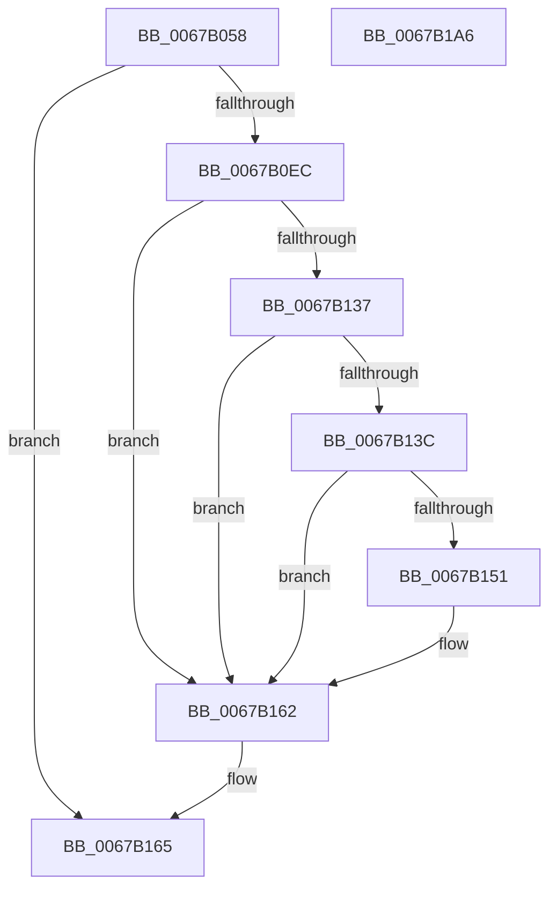

# MiCopyKstack

- RVA: `0x0067B058`–`0x0067B1A7` (길이 `335` bytes)
- VA: `0x000000014067B058`
- 실행 섹션: `.text`
- PDB 이름 있음: `예`; PDB Function 태그: `아니요`
- unwind 정보 RVA: `0x00083688`
- 디코드: `86`개 명령, `335/335` bytes 표시
- 미해석 바이트: `0` (있으면 어셈블리에 `.byte`로 보존)

> 이 문서는 커널 이미지의 기계어와 PDB 기호를 분석해 생성했습니다. 4번과 5번은 함수 원형과 자료형을 바이너리 사용 방식에서 추정한 C 해석이며 원본 소스 복구 결과는 아닙니다.

## 1. Dependencies

- 직접 호출 지점: **4**; 고유 호출 대상: **4**
- 직접 호출자로 확인된 함수: **2**
- RIP 상대 이미지 참조: **2**

### Outgoing calls
- `0x0067B0E0` → [KeCopyPage](../6B/KeCopyPage_function_006BA0F0.md) (function, `0x006BA0F0`)
- `0x0067B102` → [MiFlushSingleTbEntry](../28/MiFlushSingleTbEntry_function_0028E730.md) (function, `0x0028E730`)
- `0x0067B15D` → [MiCheckLinearProtectedPteAccessedBit](../29/MiCheckLinearProtectedPteAccessedBit_function_00292D80.md) (function, `0x00292D80`)
- `0x0067B187` → [MiSetPfnIdentity](../2A/MiSetPfnIdentity_function_002A2350.md) (function, `0x002A2350`)

### Direct callers
- [MiStackCopyHighLevel](MiStackCopyHighLevel_function_0067B204.md) at `0x0067B248`
- [sub_006DAAE6](../6D/Unknown_function_006DAAE6.md) at `0x006DAB56`

### Static image references
- `0x0067B0EC` → RVA `0x00010880` (`.rdata`; read)
- `0x0067B12C` → RVA `0x00FC6A88` (`ALMOSTRO`; read)

## 2. Other-region calls and transfers

- 다른 실행 섹션으로 향하는 call: **0**
- 별도 외부 분기/꼬리 이동을 확인하지 못했습니다.

## 3. Assembly (complete function range)

```asm
0067B058  48 89 5C 24 10                  mov qword ptr [rsp + 0x10], rbx
0067B05D  48 89 6C 24 18                  mov qword ptr [rsp + 0x18], rbp
0067B062  56                              push rsi
0067B063  57                              push rdi
0067B064  41 54                           push r12
0067B066  41 56                           push r14
0067B068  41 57                           push r15
0067B06A  48 83 EC 20                     sub rsp, 0x20
0067B06E  41 8B F9                        mov edi, r9d
0067B071  4D 8B D0                        mov r10, r8
0067B074  4C 8B F2                        mov r14, rdx
0067B077  48 8B E9                        mov rbp, rcx
0067B07A  48 B8 00 00 00 00 00 DE FF FF   movabs rax, 0xffffde0000000000
0067B084  48 8B 72 08                     mov rsi, qword ptr [rdx + 8]
0067B088  48 2B E8                        sub rbp, rax
0067B08B  48 B8 AB AA AA AA AA AA AA AA   movabs rax, 0xaaaaaaaaaaaaaaab
0067B095  48 C1 FD 04                     sar rbp, 4
0067B099  48 0F AF E8                     imul rbp, rax
0067B09D  48 B8 00 00 00 00 00 00 00 80   movabs rax, 0x8000000000000000
0067B0A7  49 BC 00 00 00 00 80 F6 FF FF   movabs r12, 0xfffff68000000000
0067B0B1  48 0B F0                        or rsi, rax
0067B0B4  49 8B C4                        mov rax, r12
0067B0B7  48 C1 E0 19                     shl rax, 0x19
0067B0BB  4C 8B FE                        mov r15, rsi
0067B0BE  49 C1 E2 19                     shl r10, 0x19
0067B0C2  41 B8 01 00 00 00               mov r8d, 1
0067B0C8  49 C1 E7 19                     shl r15, 0x19
0067B0CC  4C 2B D0                        sub r10, rax
0067B0CF  4C 2B F8                        sub r15, rax
0067B0D2  49 C1 FA 10                     sar r10, 0x10
0067B0D6  49 C1 FF 10                     sar r15, 0x10
0067B0DA  49 8B CA                        mov rcx, r10
0067B0DD  49 8B D7                        mov rdx, r15
0067B0E0  E8 0B F0 03 00                  call 0x1406ba0f0
0067B0E5  48 8B 1E                        mov rbx, qword ptr [rsi]
0067B0E8  85 FF                           test edi, edi
0067B0EA  74 79                           je 0x14067b165
0067B0EC  48 8B 05 8D 57 99 FF            mov rax, qword ptr [rip - 0x66a873]
0067B0F3  BA 02 00 00 00                  mov edx, 2
0067B0F8  49 8B CF                        mov rcx, r15
0067B0FB  48 89 06                        mov qword ptr [rsi], rax
0067B0FE  44 8D 42 FF                     lea r8d, [rdx - 1]
0067B102  E8 29 36 C1 FF                  call 0x14028e730
0067B107  48 B8 FF 0F 00 00 00 00 F0 FF   movabs rax, 0xfff0000000000fff
0067B111  48 C1 E5 0C                     shl rbp, 0xc
0067B115  48 23 D8                        and rbx, rax
0067B118  48 B8 00 F0 FF FF FF FF 0F 00   movabs rax, 0xffffffffff000
0067B122  48 23 E8                        and rbp, rax
0067B125  48 83 CB 20                     or rbx, 0x20
0067B129  48 33 DD                        xor rbx, rbp
0067B12C  48 0F BA 25 53 B9 94 00 24      bt qword ptr [rip + 0x94b953], 0x24
0067B135  73 2B                           jae 0x14067b162
0067B137  F6 C3 20                        test bl, 0x20
0067B13A  75 26                           jne 0x14067b162
0067B13C  49 8B C4                        mov rax, r12
0067B13F  48 B9 00 00 00 00 40 00 00 00   movabs rcx, 0x4000000000
0067B149  48 03 C1                        add rax, rcx
0067B14C  48 3B F0                        cmp rsi, rax
0067B14F  72 11                           jb 0x14067b162
0067B151  41 B8 80 00 00 00               mov r8d, 0x80
0067B157  48 8B D3                        mov rdx, rbx
0067B15A  48 8B CE                        mov rcx, rsi
0067B15D  E8 1E 7C C1 FF                  call 0x140292d80
0067B162  48 89 1E                        mov qword ptr [rsi], rbx
0067B165  41 8B 4E 20                     mov ecx, dword ptr [r14 + 0x20]
0067B169  33 D2                           xor edx, edx
0067B16B  89 4C 24 68                     mov dword ptr [rsp + 0x68], ecx
0067B16F  C1 E9 10                        shr ecx, 0x10
0067B172  80 E1 FD                        and cl, 0xfd
0067B175  80 C9 05                        or cl, 5
0067B178  88 4C 24 6A                     mov byte ptr [rsp + 0x6a], cl
0067B17C  8B 4C 24 68                     mov ecx, dword ptr [rsp + 0x68]
0067B180  41 89 4E 20                     mov dword ptr [r14 + 0x20], ecx
0067B184  49 8B CE                        mov rcx, r14
0067B187  E8 C4 71 C2 FF                  call 0x1402a2350
0067B18C  48 8B 5C 24 58                  mov rbx, qword ptr [rsp + 0x58]
0067B191  49 8B C7                        mov rax, r15
0067B194  48 8B 6C 24 60                  mov rbp, qword ptr [rsp + 0x60]
0067B199  48 83 C4 20                     add rsp, 0x20
0067B19D  41 5F                           pop r15
0067B19F  41 5E                           pop r14
0067B1A1  41 5C                           pop r12
0067B1A3  5F                              pop rdi
0067B1A4  5E                              pop rsi
0067B1A5  C3                              ret
0067B1A6  CC                              int3
```

## 4. C-style interpretation (structured pseudocode)

```c
__int64 __fastcall MiCopyKstack(__int64 a1, __int64 a2, __int64 a3, int a4)
{
    __int64 result;
    __int64 v_r10;
    __int64 v_r15;
    __int64 v_rbp;
    __int64 v_rbx;
    __int64 v_rsi;
    __int64 v_rsp;
    unsigned __int64 v_stack_p10;
    unsigned __int64 v_stack_p18;
    unsigned int v_stack_p20;
    unsigned __int8 v_stack_p22;

    v_stack_p10 = v_rbx;
    v_stack_p18 = v_rbp;
    v_rsp = (v_rsp) - (32);
    v_rbp = (a1) - (result);
    v_rbp = (v_rbp) >> (4);
    v_rbp = (v_rbp) * (result);
    v_rsi = (*(unsigned __int64 *)(a2 + 8)) | (result);
    result = (v_r12) << (25);
    v_r10 = (a3) << (25);
    v_r15 = (v_rsi) << (25);
    v_r10 = (v_r10) - (result);
    v_r15 = (v_r15) - (result);
    v_r10 = (v_r10) >> (16);
    v_r15 = (v_r15) >> (16);
    result = KeCopyPage(v_r10, v_r15, 1, a4);
    if ((unsigned int)((unsigned int)(a4)) == 0) goto loc_0067B165;
    *(unsigned __int64 *)(v_rsi) = *(unsigned __int64 *)(v_rip - 6727795);
    result = MiFlushSingleTbEntry(v_r15, 2, 2 - 1, a4);
    v_rbp = (v_rbp) << (12);
    v_rbx = (*(unsigned __int64 *)(v_rsi)) & (result);
    v_rbp = (v_rbp) & (result);
    v_rbx = (v_rbx) | (32);
    v_rbx = (v_rbx) ^ (v_rbp);
    if (condition_is_above_or_equal) goto loc_0067B162;
    if ((((unsigned __int8)(v_rbx)) & (32)) != 0) goto loc_0067B162;
    result = (v_r12) + (v_r15);
    if (v_rsi >= result) {
        a3 = 128;
        a2 = v_rbx;
        a1 = v_rsi;
        result = MiCheckLinearProtectedPteAccessedBit(a1, a2, a3, a4);
    }
    *(unsigned __int64 *)(v_rsi) = v_rbx;
loc_0067B165:
    a2 = 0;
    v_stack_p20 = (unsigned int)((unsigned int)(*(unsigned int *)(a2 + 32)));
    a1 = (unsigned int)(((unsigned int)(*(unsigned int *)(a2 + 32))) >> (16));
    a1 = (unsigned __int8)((a1) & (253));
    a1 = (unsigned __int8)((a1) | (5));
    v_stack_p22 = (unsigned __int8)(a1);
    *(unsigned int *)(a2 + 32) = (unsigned int)((unsigned int)(v_stack_p20));
    result = MiSetPfnIdentity(0, a2, a3, a4);
    v_rsp = (v_rsp) + (32);
    return v_r15;
}
```

## 5. (Beta) C Style

```c
int64_t MiCopyKstack(int64_t Arg1, void *Arg2, int64_t Arg3, int32_t Arg4)
{
    uint8_t *arg2 = (uint8_t *)Arg2;

    int64_t result;
    int64_t local_r10;
    int64_t local_r15;
    int64_t local_rbp;
    int64_t local_rbx;
    int64_t local_rsi;
    int64_t local_rsp;
    uint64_t v_stack_p10;
    uint64_t v_stack_p18;
    uint32_t v_stack_p20;
    uint8_t v_stack_p22;

    v_stack_p10 = local_rbx;
    v_stack_p18 = local_rbp;
    local_rsp = (local_rsp) - (32);
    local_rbp = (Arg1) - (result);
    local_rbp = (local_rbp) >> (4);
    local_rbp = (local_rbp) * (result);
    local_rsi = (*(uint64_t *)(arg2 + 0x8)) | (result);
    result = (local_r12) << (25);
    local_r10 = (Arg3) << (25);
    local_r15 = (local_rsi) << (25);
    local_r10 = (local_r10) - (result);
    local_r15 = (local_r15) - (result);
    local_r10 = (local_r10) >> (16);
    local_r15 = (local_r15) >> (16);
    result = KeCopyPage(local_r10, local_r15, 1, Arg4);
    if ((uint32_t)((uint32_t)(Arg4)) == 0) goto loc_0067B165;
    *(uint64_t *)(local_rsi) = *(uint64_t *)(v_rip - 0x66A873);
    result = MiFlushSingleTbEntry(local_r15, 2, 2 - 1, Arg4);
    local_rbp = (local_rbp) << (12);
    local_rbx = (*(uint64_t *)(local_rsi)) & (result);
    local_rbp = (local_rbp) & (result);
    local_rbx = (local_rbx) | (32);
    local_rbx = (local_rbx) ^ (local_rbp);
    if (condition_is_above_or_equal) goto loc_0067B162;
    if ((((uint8_t)(local_rbx)) & (32)) != 0) goto loc_0067B162;
    result = (local_r12) + (local_r15);
    if (local_rsi >= result) {
        Arg3 = 128;
        Arg2 = local_rbx;
        Arg1 = local_rsi;
        result = MiCheckLinearProtectedPteAccessedBit(Arg1, Arg2, Arg3, Arg4);
    }
    *(uint64_t *)(local_rsi) = local_rbx;
loc_0067B165:
    Arg2 = 0;
    v_stack_p20 = (uint32_t)((uint32_t)(*(uint32_t *)(arg2 + 0x20)));
    Arg1 = (uint32_t)(((uint32_t)(*(uint32_t *)(arg2 + 0x20))) >> (16));
    Arg1 = (uint8_t)((Arg1) & (253));
    Arg1 = (uint8_t)((Arg1) | (5));
    v_stack_p22 = (uint8_t)(Arg1);
    *(uint32_t *)(arg2 + 0x20) = (uint32_t)((uint32_t)(v_stack_p20));
    result = MiSetPfnIdentity(0, Arg2, Arg3, Arg4);
    local_rsp = (local_rsp) + (32);
    return local_r15;
}
```

### 관측된 메모리 오프셋

구조체 형식이 확인되지 않은 접근은 인자 기준의 오프셋으로만 기록했습니다.

| 기준 인자 | 오프셋 표현 | 폭 (bit) | 접근 |
|---|---:|---:|---|
| `Arg2` | `+ 0x8` | `64` | `R` |
| `Arg2` | `+ 0x20` | `32` | `R` |
| `Arg2` | `+ 0x20` | `32` | `W` |

## 6. Execution-region graph

[열기: 2D/3D 그래프와 함수 탐색 컨트롤 패널](../../../control-panel.html?section=text&rva=0x0067B058&view=graph)

- 2D 그래프는 위에서 아래로 흐르고, 3D 그래프는 빈 공간을 드래그해 회전합니다. Shift+드래그는 이동, 휠은 확대·축소, 함수 노드 선택은 대상 보고서 이동입니다.

### Static fallback


